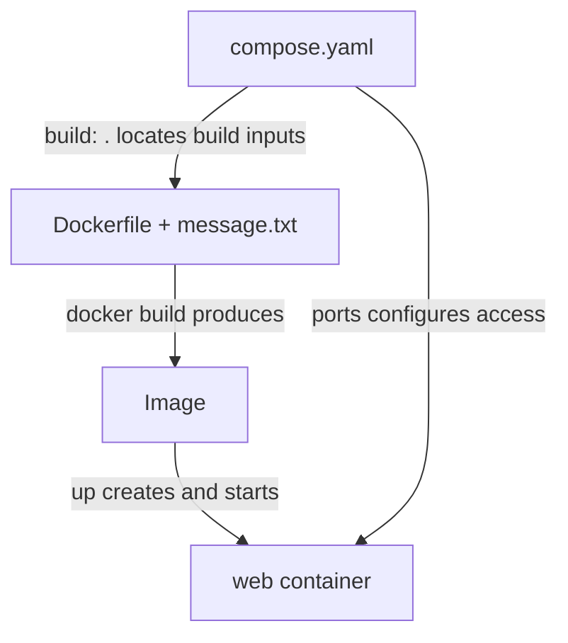

# Dockerfile and Docker Compose

[Русский](../../../ru/tools/docker/README.md)

Build a small HTTP server and request a file from its container. The first run needs Docker with Compose and curl 7.71 or later. The image supplies Python.

| What do you want to do? | Technique | Go to |
| --- | --- | --- |
| Start an existing project for the first time | `up --build -d` → HTTP request → `down` | [First run](#first-run) |
| Write a Dockerfile for your app | Choose a base, copy the files, set the startup command | [Write a Dockerfile](dockerfile.md) |
| Use a Dockerfile from Compose | Point a service at the build directory and publish a port | [Write a compose.yaml](compose-file.md) |
| Find a command for a running project | Read logs, run a command, apply a change | [Compose commands](commands.md) |
| Connect an app to PostgreSQL | Locate the database by service name, wait for readiness, persist data | [Connect a database](compose-file.md#connect-a-database) |

An **image** packages files and a default command. A **container** is an instance of an image with its own state. In Compose, a **service** describes the containers your application needs. A **project** groups services and their resources under a common name.

The diagram shows how the two files take part in starting one service.



## First run

Start Docker Desktop or a Docker Engine with the Compose plugin. Run these commands in Bash or Zsh from the repository root. The first image download needs access to Docker Hub. The example uses local port `18081` by default. Python's HTTP server is for local practice. [Install Compose](https://docs.docker.com/compose/install/) · [Python http.server](https://docs.python.org/3.14/library/http.server.html).

```bash
cd examples/tools/docker-basics
docker version
docker compose version
docker compose config -q
docker compose up --build -d
docker compose ps
curl --retry 5 --retry-all-errors -fsS http://127.0.0.1:18081/message.txt
```

Look for a `Server` section in `docker version`. A successful `config -q` exits silently. The `up` command builds the image from the [Dockerfile](../../../../examples/tools/docker-basics/Dockerfile) and starts the `web` service defined in [compose.yaml](../../../../examples/tools/docker-basics/compose.yaml). The `-d` flag returns control to your terminal.

In the `ps` output, look for `web` and the mapping `127.0.0.1:18081->8000/tcp`. While the server starts, curl may report a connection error and retry the request. A successful request prints the contents of [message.txt](../../../../examples/tools/docker-basics/message.txt).

```text
Hello from Docker!
```

Read the request in the log. Then remove the practice container and project network. The built image stays on your machine.

```bash
docker compose logs --tail 5 web
docker compose down
```

If the port is occupied or the response differs, look up the [symptom](commands.md#diagnose-a-failure). After your first run, try [changing a file and applying the change](commands.md#apply-a-change).

[An app with PostgreSQL and a GitHub Actions test](../compose-and-github-actions.md) · [Development tools](../README.md)
