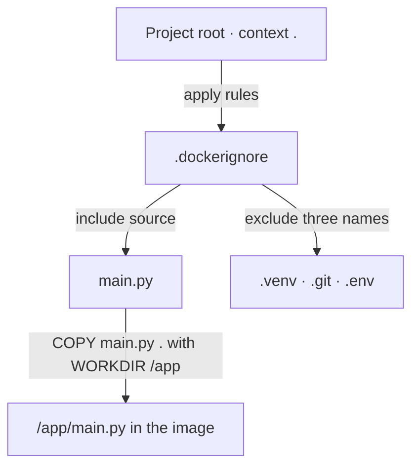
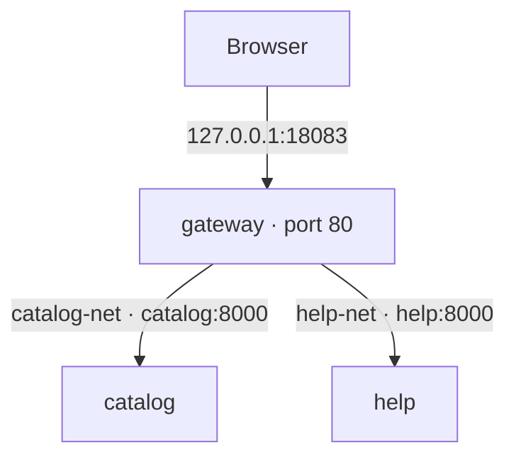

# How Dockerfile and Compose work together

[Русский](../../../ru/tools/docker/guide.md)

Imagine a site with two sections. A reader opens the catalog or the help page through a single address. Behind it are three services. The `gateway` service accepts requests, and `catalog` and `help` serve their respective text files. [Complete site files](lab.md).

## What each file controls

**The Dockerfile determines what the image contains.** `FROM` supplies Python, `COPY` adds the page files, and `CMD` sets the server command. Building produces an **image** from which Docker can create containers.

**compose.yaml determines how the containers run.** The `services` section describes the application's roles. Both `catalog` and `help` use the same Dockerfile. Each starts the server in its own working directory and gets its own volume. The `gateway` service uses the published Nginx image. All three belong to one Compose project.

## Where COPY finds a file

In `docker build -f dockers/Dockerfile .`, the final dot selects the source directory for the build. Run it from the project root and Docker looks there for `.dockerignore`. Then `COPY main.py .` reads the included file from that root. The dot on the right selects the working directory in the image. With `WORKDIR /app`, the file lands at `/app/main.py`.

The arrows trace one source file into the image.

What changes if the last argument is `dockers/`? That subdirectory becomes the context. The root-level `main.py` falls outside it, so the build fails. [Project tree and complete files](build-context.md)

## How a request reaches its service

Each arrow shows the destination of one hop.

Follow a request for `/catalog/message.txt`.

1. The browser contacts port `18083` on the host. The `ports` entry forwards the request to port `80` on the gateway.
2. Nginx selects the `/catalog/` route. It resolves the service name `catalog` on the shared `catalog-net` network and requests `/message.txt` on port `8000`.
3. The server reads `/site/catalog/message.txt`. The response travels back through the gateway to the browser.

For `/help/message.txt`, the gateway uses `help-net` and the name `help`. Both internal services can listen on port `8000` because each has its own network address. The gateway joins both networks. The catalog and help services share no network. Inside a container, `127.0.0.1` points back to that container. [Compose networking](https://docs.docker.com/compose/how-tos/networking/).

## What survives container recreation

A **volume** stores files separately from the container. The entry `catalog-pages:/site/catalog` makes the contents of the `catalog-pages` volume available at `/site/catalog`. On the first mount of an empty volume, Docker copies in the files that the image supplies at that path. This is where the initial catalog message comes from.

Once the volume contains files, a new container sees those files. Rebuilding the image alone therefore does not update the page in an existing volume. The same mechanism preserves the request log when the gateway is recreated. [How Docker populates an empty volume](https://docs.docker.com/engine/storage/volumes/#mounting-a-volume-over-existing-data).

The `gateway.conf` entry works differently. The mapping `./gateway.conf:/etc/nginx/conf.d/default.conf:ro` gives the gateway read-only access to a specific file on the host. This is a **bind mount**. Use the [lab](lab.md) to trace a request and check data persistence.

[All Docker materials](README.md)
