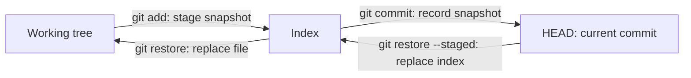

# Git

[Русский](../../../ru/tools/git/README.md)

Open this reference to prepare a commit, undo a change, or update a branch.
Choose a situation in the table.
The link leads to a short card with an example and consequences.
[GitHub Pull Requests](../github-pull-requests/README.md) are covered separately.

## Quick lookup

| Situation | Command choice | Card and example |
| --- | --- | --- |
| Inspect changes and prepare a commit | `status` → `diff` → `add` → `diff --staged` | [Check and commit](workflow.md#inspect-changes-and-prepare-a-commit) |
| Temporarily switch tasks | `stash push -u` → `apply` | [Set work aside](workflow.md#temporarily-set-work-aside) |
| Exclude a file from the next commit while keeping edits | `restore --staged` | [Unstage a file](history.md#unstage-a-file) |
| Discard uncommitted file edits | `restore` with a chosen source | [Undo edits](history.md#discard-uncommitted-changes) |
| Remove the last local commit while keeping changes | `reset --soft` or `--mixed` | [Undo a commit](history.md#undo-a-commit-while-preserving-changes) |
| Undo a published change | `revert` | [Add a reversing commit](history.md#undo-a-published-change) |
| Recover a lost commit | `reflog` → `show` → `branch rescue` | [Recover a commit](history.md#recover-a-lost-commit) |
| Update a branch and resolve a conflict | `fetch` → choose merge/rebase | [Choose integration](remotes.md#fetch-changes-and-choose-integration) |
| Update a remote branch | Ordinary push, explicit lease after an agreed rebase | [Choose a push method](remotes.md#choose-how-to-update-a-remote-branch) |
| Delete a branch after verification | Check main/PR → `branch -d` | [Verify the result](remotes.md#delete-a-branch-after-verifying-the-result) |

| Parameter | Value |
| --- | --- |
| API | Git CLI. `switch` and `restore` appeared in Git 2.23 |
| Prerequisites | Terminal, installed Git, and understanding the current directory |

## Navigation

- [HEAD, index, and working tree](#distinguish-head-the-index-and-the-working-tree).
- [Choose by work state](#choose-by-work-state).
- [Local and remote branches](#distinguish-local-and-remote-branches).
- [Common mistakes](#common-mistakes).
- [Sources](#sources).
- Detailed pages cover [workflow](workflow.md), [undo and recovery](history.md), and [remote branches](remotes.md).

## Distinguish HEAD, the index, and the working tree

| Object | Contents | Inspection |
| --- | --- | --- |
| `HEAD` | Current commit, usually through the current local branch | `git log -1 --oneline` |
| Index | Staged snapshot for the next commit | `git diff --staged` relative to HEAD |
| Working tree | Files on disk, including unstaged edits | `git diff` relative to the index, `git status --short` for new files |

The diagram shows snapshot transfers between states.
`restore` replaces the selected destination's contents and can discard edits.

In `git status --short`, the first column shows the index relative to HEAD.
The second column shows the working tree relative to the index.
`??` indicates an untracked file.
`MM` means the file changed again after `add`.
The commit receives the index version.
The [commit preparation card](workflow.md#inspect-changes-and-prepare-a-commit) shows the checks in order.

`git init -b main` creates a repository.
`git clone URL` obtains an existing repository.
Replace `URL` with the project's address.
The URL and access permissions depend on the project.
[Configure the author](workflow.md#configure-the-author-and-interface) before the first commit.

## Choose by work state

| Preserve | Situation | Destination |
| --- | --- | --- |
| Uncommitted files | Temporarily switch tasks | [Stash with verification before drop](workflow.md#temporarily-set-work-aside) |
| File text | Remove a file only from the index | [Restore staged](history.md#unstage-a-file) |
| Last commit's changes | Commit is still unpublished | [Soft or mixed reset](history.md#undo-a-commit-while-preserving-changes) |
| Shared history | Change is already published | [Revert](history.md#undo-a-published-change) |
| Existing branch commits | Obtain main-branch changes | [Merge and conflict resolution](remotes.md#update-a-branch-and-resolve-a-conflict) |

## Distinguish local and remote branches

| Name | Location | Update time |
| --- | --- | --- |
| `feature/profile` | Local branch | Local commit, merge, rebase, or reset |
| `origin/feature/profile` | Local reference to the known remote state | Usually on fetch. It can lag behind the server |
| `refs/heads/feature/profile` on `origin` | Branch in the remote repository | Push accepted by the server or another server-side change |

`fetch` obtains objects and updates references according to remote settings.
An ordinary fetch does not integrate changes into the current branch.
`pull` combines fetching and integration.
`push` changes remote references.

- [Amend your last commit](history.md#amend-your-last-commit) if it is still unpublished.
- [Rebase your branch](history.md#rebase-your-branch) if project rules permit new commit identifiers.
- [Create a rescue branch](history.md#recover-a-lost-commit) before moving the current branch for recovery.
- [Check an explicit lease](remotes.md#rewrite-your-branch-with-a-lease-check) before an agreed remote-branch rewrite.

Complete scenarios cover [commit and stash](workflow.md#verifiable-workflow),
[restore/reset/revert/reflog](history.md#test-reset-modes-and-revert),
[merge/rebase conflicts](history.md#test-merge-and-rebase-conflicts),
and [lease and branch deletion](remotes.md#test-rebase-leases-and-branch-deletion).
All scenarios use separate temporary repositories.

## Common mistakes

| Symptom | Cause | Action |
| --- | --- | --- |
| Push rejected | New server commits or branch protection | Fetch. Inspect divergence and project rules |
| Text disappeared after `--hard` | Index and tracked files were replaced | Look for a saved commit or external copy. Reflog does not store every uncommitted text version |
| `.gitignore` does not hide a file | The file is already tracked | [Stop tracking](history.md#unstage-a-file) if that is the team's task |
| `branch -d` refuses after squash | Original commits did not become main's ancestors | [Check the PR and contents](remotes.md#delete-a-branch-after-verifying-the-result) |
| Unexpected changes appear | Wrong branch or folder is open | Check `pwd`, `git branch --show-current`, and `git status` |

## Sources

- [Git v2.55.0 manuals](https://github.com/git/git/tree/v2.55.0/Documentation), [2.55.0 release notes](https://raw.githubusercontent.com/git/git/v2.55.0/Documentation/RelNotes/2.55.0.adoc).
- [Status](https://git-scm.com/docs/git-status/2.55.0), [restore](https://git-scm.com/docs/git-restore/2.55.0), [push](https://git-scm.com/docs/git-push/2.55.0).
- [Conventional Commits 1.0.0](https://www.conventionalcommits.org/en/v1.0.0/).

[Development tools](../README.md) · [Task index](../../tasks/README.md#git-and-github)
