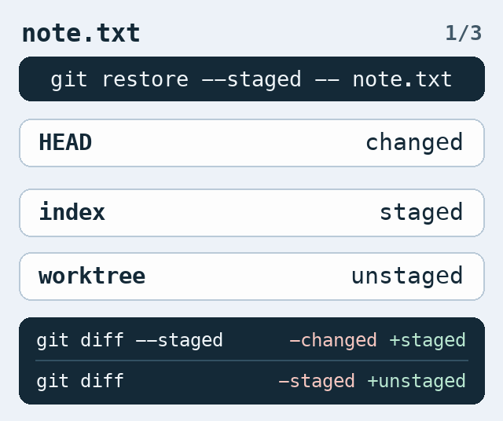

<a id="отмена-изменений-восстановление-и-rebase"></a>
# Undo changes, recover commits, and rebase

[Русский](../../../ru/tools/git/history.md)

Choose an operation based on where the change lives and what text must be preserved.
The cards distinguish unstaging, discarding edits, and changing history.
[Git reference](README.md).

<a id="выбрать-операцию"></a>
## Choose an operation

| Situation | Command | Example and consequences |
| --- | --- | --- |
| A file was staged by mistake | `restore --staged` | [Preserve text](#unstage-a-file) |
| A file edit is no longer needed | `restore` | [Choose a source and discard edits](#discard-uncommitted-changes) |
| The last commit is local | `reset --soft` / `--mixed` | [Preserve changes](#undo-a-commit-while-preserving-changes) |
| A change is published | `revert` | [Add a reversing commit](#undo-a-published-change) |
| A commit disappeared from the branch | `reflog` → `branch rescue` | [Recover the reference](#recover-a-lost-commit) |
| Your commit needs another edit | `commit --amend` | [Create a new identifier](#amend-your-last-commit) |
| Your branch needs a new base | `rebase` | [Resolve a conflict or abort](#rebase-your-branch) |

Undo is intermediate. Recovery and rebase are advanced.
Prerequisites include understanding [HEAD, the index, and the working tree](README.md#distinguish-head-the-index-and-the-working-tree).
Complete scenarios require Bash and Git 2.32+ for configuration isolation.

<a id="убрать-файл-из-индекса"></a>
## Unstage a file

`app.py` is in the index, but its edits need to stay on disk.
If HEAD already exists, unstage the file.

```bash
git restore --staged -- app.py
git diff --staged -- app.py
git diff -- app.py
```

The index receives the file version from HEAD.
The staged diff for the file becomes empty.
The working tree stays intact.
A newly added file becomes untracked and appears in `git status --short`.

<details>
<summary>Show step by step</summary>



In this example, `note.txt` starts as `changed` in HEAD, `staged` in the index, and `unstaged` in the working tree. The command copies `changed` from HEAD to the index. Afterward, `git diff --staged` is empty, and `git diff` shows the change from `changed` to `unstaged`.

[Open the GIF to replay it](../../../assets/git-restore-staged.gif?raw=true)

</details>

The command does not stop tracking a file already in HEAD.
HEAD is absent before the first commit. For a newly added file, use `git rm --cached -- app.py`.

To stop tracking a previously committed file, use this operation.

```bash
git rm --cached -- local.env
```

The file stays on disk and the index stages its removal from the repository.
Add the path to `.gitignore` if the file should remain local.
Check the staged diff before committing the removal.
Other copies may remove the file from their working trees when they receive the commit.
Earlier versions remain in history. The command does not remove a published secret from history.
If `rm --cached` refuses because the file versions differ, save the required versions first.

[Learning example for restore](#test-reset-modes-and-revert)

<a id="отменить-незакоммиченные-изменения"></a>
## Discard uncommitted changes

The edits to tracked `app.py` are no longer needed.
First inspect `git diff -- app.py` and `git diff --staged -- app.py`.
Save any needed text in a separate copy or through [stash](workflow.md#temporarily-set-work-aside).

The commands in the table are alternatives.
Each command discards edits at the selected destination.

| Discard or replace | Individual command snippet | Result and loss |
| --- | --- | --- |
| Only edits since the last `add` | `git restore -- app.py` | The file gets the index version. Staged edits remain |
| Only replace the working copy with the HEAD version | `git restore --source=HEAD --worktree -- app.py` | The index stays intact. Working text is replaced by the commit version |
| Both staged and unstaged edits for the file | `git restore --source=HEAD --staged --worktree -- app.py` | The index and file get the HEAD version. Both uncommitted versions are lost |

**Example snippet for discarding only an unstaged edit**

```bash
git restore -- app.py
git diff -- app.py
git diff --staged -- app.py
```

The first diff is empty. The second shows preserved staged edits, if any existed.
`restore` does not remove arbitrary untracked files.
If the selected tracked path is absent from the source, Git removes it to match the source.
Reflog does not store every uncommitted text version.

[Learning example for discarded edits](#test-reset-modes-and-revert)

<a id="отменить-коммит-с-сохранением-изменений"></a>
## Undo a commit while preserving changes

The last commit is unpublished and has a parent.
The correct local branch is current, and the working tree and index are clean.
If others already use the commit, [choose revert](#undo-a-published-change) or an agreed process.

| After undoing, you need to | Choose one command | Index | Working tree |
| --- | --- | --- | --- |
| Rebuild the commit immediately | `git reset --soft HEAD~1` | Preserves staged snapshot | Preserves files |
| Select changes again | `git reset --mixed HEAD~1` | Receives parent version | Preserves files |

**Example snippet for preserving staged changes**

```bash
git status --short
git log -2 --oneline
git branch backup-before-reset
git reset --soft HEAD~1
git diff --staged
git status --short
```

The current branch and HEAD move to the first parent.
Changes from the undone commit remain staged.
The `backup-before-reset` branch preserves the previous commit. Choose an unused name.
If uncommitted edits already exist, the result mixes with them.
For a merge commit, `HEAD~1` means the first parent.

**Keep the selected reset mode.** Replacing `--soft` or `--mixed` with `--hard` can discard uncommitted work.
`--hard` replaces the index and tracked files with the target snapshot.
It can also delete untracked paths that obstruct writing tracked files.
The previous commit object is not immediately removed, but recovery of uncommitted text is not guaranteed.

[Compare soft/mixed/hard in a learning repository](#test-reset-modes-and-revert)

<a id="отменить-опубликованное-изменение"></a>
## Undo a published change

The commit has already entered shared history.
Save uncommitted work before proceeding.
Find the required ordinary commit with `git log --oneline`.

In this **snippet template**, replace `COMMIT` with the verified identifier.

```text
git show COMMIT
git revert COMMIT
git show --stat HEAD
```

Git adds a new commit with the reverse change.
The original commit remains in history.
Then run project checks and send the reverting commit through the normal PR/push process.

Later changes can cause a conflict.
On conflict, fix the file, run `git add -- file`, and then run `git revert --continue`.
To abort an unfinished operation, run `git revert --abort`.
Reverting a merge requires choosing a mainline parent with `-m` and affects subsequent merges.
This short recipe is for an ordinary single-parent commit.
Revert does not remove the original secret from history.

[Complete learning revert](#test-reset-modes-and-revert)

<a id="восстановить-потерянный-коммит"></a>
## Recover a lost commit

After a reset, rebase, or branch deletion, the required commit no longer appears in the ordinary log.
Inspect local HEAD movements.

```bash
git reflog --date=iso
```

In this **snippet template**, replace `COMMIT` with the recovered commit identifier.
Choose an unused rescue branch name.

```text
git show COMMIT
git branch rescue COMMIT
git log -1 --oneline rescue
git show rescue:app.py
```

The new local branch retains the recovered commit.
The current branch, index, and files stay intact.
Replace `app.py` with a path that exists in that commit.
After saving current work, you can switch to `rescue` and inspect the files.

The reflog belongs to this local copy and has a retention period.
The required object may have been pruned.
Reflog is not a durable backup and does not guarantee recovery of uncommitted text.

[Learning recovery through reflog](#test-reset-modes-and-revert)

<a id="исправить-свой-последний-коммит"></a>
## Amend your last commit

Your last commit is unpublished and needs another edit.
Use this snippet after inspecting the entire staged diff.

```bash
git add -- app.py
git diff --staged
git commit --amend --no-edit
```

Amend creates a new commit with a different identifier.
To change the message, omit `--no-edit`.
The entire staged index becomes part of the new snapshot.
Amending a published branch requires an [agreed remote rewrite](remotes.md#rewrite-your-branch-with-a-lease-check).

<a id="перебазировать-свою-ветку"></a>
## Rebase your branch

You need to move your branch to a new base.
The example assumes current `feature/profile`, clean files and index, remote `origin`, and a server-side `main` branch.
For a published shared branch, agree on the rewrite first.

```bash
git fetch origin
git branch backup-before-rebase
git rebase origin/main
```

Without a conflict, Git reapplies the commits on top of `origin/main`.
Recreated commits receive new identifiers.
Choose an unused backup branch name.

On conflict, inspect `git status` and `git diff`.
Fix the file while preserving required changes from both sides.
The continuation snippet assumes a conflict in `app.py`.

```bash
git add -- app.py
git diff --cached
git rebase --continue
```

If the next commit also conflicts, repeat the resolution.
To abort an unfinished rebase, run `git rebase --abort`.
Under the clean starting conditions above, the branch returns to its pre-rebase state.
Conflict-resolution edits are discarded.
`--skip` skips the current commit and can lose its change.
Avoid using `--skip` as routine conflict resolution.

Interactive `git rebase -i HEAD~3` can reorder, edit, and combine commits through `squash`/`fixup`.
First confirm that all three commits belong to your unpublished work.
After a successful rebase, compare changes and run project checks.
A linear history does not prove behavioral equivalence.

[Learning continue/abort](#test-merge-and-rebase-conflicts) · [Choose merge instead of rebase](remotes.md#update-a-branch-and-resolve-a-conflict)

<a id="проверить-режимы-reset-и-revert"></a>
## Test reset modes and revert

The complete learning Bash script uses only a synthetic temporary repository.
Save [`history.sh`](../../../../examples/tools/git/history.sh).
Run `bash history.sh`.
The script removes only the created directory on exit.
Global configuration, user branches, and remotes are outside the script's scope.

[`git/history.sh`](../../../../examples/tools/git/history.sh)

The HEAD/index/file difference checks pass.
The script restores a commit reference through reflog.
Revert adds a third commit.
The script prints `history OK`.
In a real project, first save required work with a commit or external copy.
Then create a backup branch before the risky operation.

<a id="проверить-конфликты-merge-и-rebase"></a>
## Test merge and rebase conflicts

The complete scenario creates two branches that change the same line differently.
The script checks conflicts, abort, and successful continuation for both operations.
It requires Bash and Git 2.32+.
Save [`conflicts.sh`](../../../../examples/tools/git/conflicts.sh).
Run `bash conflicts.sh`.
Deletion and resets are limited to the temporary repository created by the script.

[`git/conflicts.sh`](../../../../examples/tools/git/conflicts.sh)

Merge retains two parents.
Rebase creates a new commit on top of main.
Both branches contain the selected text `main and feature`.
The script prints `conflicts OK`.
Synthetic resolution of one line does not replace project checks.

<a id="источники"></a>
## Sources

- [Git v2.55.0 reset](https://raw.githubusercontent.com/git/git/v2.55.0/Documentation/git-reset.adoc), [restore](https://git-scm.com/docs/git-restore/2.55.0), [rm](https://raw.githubusercontent.com/git/git/v2.55.0/Documentation/git-rm.adoc).
- [Revert and reverting a merge](https://raw.githubusercontent.com/git/git/v2.55.0/Documentation/git-revert.adoc), [reflog](https://raw.githubusercontent.com/git/git/v2.55.0/Documentation/git-reflog.adoc), [rebase](https://raw.githubusercontent.com/git/git/v2.55.0/Documentation/git-rebase.adoc).
- [2.55.0 release notes](https://raw.githubusercontent.com/git/git/v2.55.0/Documentation/RelNotes/2.55.0.adoc).
