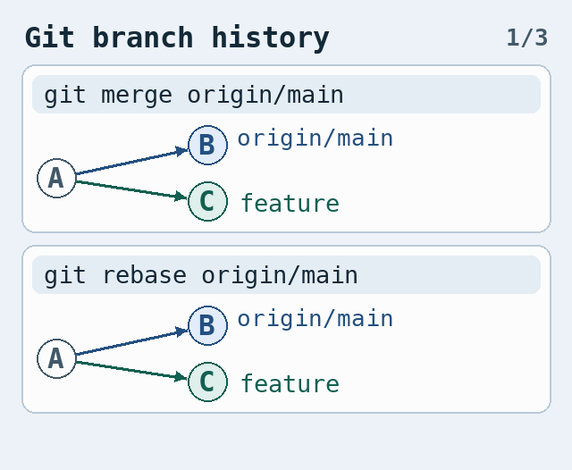

<a id="обновление-и-удаление-веток"></a>
# Update and delete branches

[Русский](../../../ru/tools/git/remotes.md)

Open this page to fetch changes, choose a push method, or check a branch before deletion.
[Git reference](README.md).

| Situation | Technique | Example |
| --- | --- | --- |
| Need to know the server state | Fetch and compare | [Choose integration](#fetch-changes-and-choose-integration) |
| A branch diverged from main | Merge or agreed rebase | [Resolve a conflict](#update-a-branch-and-resolve-a-conflict) |
| Need to push a branch | Ordinary push or explicit lease | [Choose a push method](#choose-how-to-update-a-remote-branch) |
| Published branch commits were rewritten | Verify the expected SHA | [Lease card](#rewrite-your-branch-with-a-lease-check) |
| Work is complete | Verify integration and preservation | [Deletion card](#delete-a-branch-after-verifying-the-result) |

Fetch, merge, and push are intermediate. Lease and verification after squash are advanced.
Prerequisites include understanding [branch types](README.md#distinguish-local-and-remote-branches), saved work, and a clean index.

<a id="получить-изменения-и-выбрать-интеграцию"></a>
## Fetch changes and choose integration

You need to update and first understand the divergence.
The example assumes current `feature/profile`, configured `origin`, and server-side `main`.
Before integrating, save work and check cleanliness with `git status --short`.

```bash
git branch --show-current
git fetch origin
git log --oneline --left-right HEAD...origin/main
```

Fetch obtains changes without merging them into the current branch.
In log output, `<` marks commits only in the current branch.
`>` marks commits only in `origin/main`.
The output omits shared commits.

Choose one operation after inspecting history.

| State / requirement | Command | Result / limitation |
| --- | --- | --- |
| Current branch is only behind | `git merge --ff-only origin/main` | Advances the branch without a merge commit. Refuses on divergence |
| `origin/main` is already an ancestor of the current branch | No additional integration needed | The branch already contains the known main history |
| Both sides have commits and existing commits must be preserved | `git merge origin/main` | Creates a merge commit when histories diverge. A conflict is possible |
| Rewriting your branch is permitted | `git rebase origin/main` | Recreates commits. A conflict is possible |

<details>
<summary>Show how merge and rebase change history</summary>

The arrows run from parent to child. The branches share commit `A`. Commit `B` is the tip of `origin/main`, and `C` is the tip of the feature branch.



Merge adds `M` with parents `C` and `B`. Rebase gives the feature branch a new commit `C′` with parent `B` and a different SHA. In the practice scenario, resolving the conflict the same way gives `note.txt` the same text in both cases.

[Open the GIF to replay it](../../../assets/git-merge-rebase.gif?raw=true) · [Run the conflict scenario](history.md#test-merge-and-rebase-conflicts)

</details>

To update the current branch from its configured upstream, use `git pull --ff-only`.
Check the upstream with `git branch -vv`.
`pull` performs fetch itself. `--ff-only` refuses on divergence.
The upstream of a feature branch often points to `origin/feature/profile`, whereas `origin/main` is the integration target in this example.
Avoid running pull on an unknown branch.

In these **configuration templates**, replace `URL` with the project's address.

```text
git remote add origin URL
git remote -v
```

For a fork, add the `upstream` remote using the original project's URL.
Run `git fetch upstream`.
If local `main` is only behind, run `git merge --ff-only upstream/main` on `main`.
If you have your own commits, choose the agreed merge/rebase workflow.
Remote `origin` remains your fork.
Project rules may prohibit pushing directly to main.

<a id="обновить-ветку-и-разрешить-конфликт"></a>
## Update a branch and resolve a conflict

Current `feature/profile` and `origin/main` have diverged.
Existing feature-branch commits must be preserved.
After fetching and checking that the working tree is clean, choose merge.

```bash
git merge origin/main
```

Without a conflict, Git creates a merge commit when histories diverge.
On conflict, Git stops before completing the merge.
Inspect `git status` and `git diff`.
Fix conflicting files while accounting for required changes from both sides.
The continuation below assumes a conflict in `app.py`.

```bash
git add -- app.py
git diff --cached
git diff --check --cached
git merge --continue
```

After resolution, the merge commit connects both histories.
Run project checks.
Check `git status` and `git log --oneline --graph -5`.

To abandon an unfinished merge, run `git merge --abort`.
With a clean starting state, the command restores the pre-merge state.
Conflict-resolution edits are discarded.
If the merge started with uncommitted edits, abort may not fully restore them.
For rebase, use the [separate continue/abort commands](history.md#rebase-your-branch).
Avoid running `rebase --continue` for a merge conflict.

[Complete merge/rebase conflict scenario](history.md#test-merge-and-rebase-conflicts)

<a id="выбрать-способ-обновления-удалённой-ветки"></a>
## Choose how to update a remote branch

You need to send ready local commits to the server.
Check the current branch, remote, and diff first.
The names below refer to your target feature branch.

| State | Choice | Consequences / limitation |
| --- | --- | --- |
| New branch or ordinary advancement | Ordinary `git push` with an explicit target | The server usually accepts a fast-forward. Server rules can refuse it |
| Ordinary push rejected | Fetch → inspect → merge/rebase according to project rules | Retrying push without diagnosis does not resolve the cause |
| Agreed rewrite of your published branch | `--force-with-lease=ref:expected` | Checks the exact expected state. It does not verify content correctness |
| Shared history must be preserved | Revert/merge → ordinary push | Existing commits are preserved |

**Ordinary push snippet from current `feature/profile`**

```bash
git branch --show-current
git remote -v
git push -u origin HEAD:refs/heads/feature/profile
```

Server-side `feature/profile` receives current HEAD if the push is accepted.
`-u` sets the current local branch's upstream.
An explicit target reduces dependence on `push.default`.
Ordinary push without arguments depends on configuration.
If branch protection causes rejection, use the project's PR process.
`--force` can overwrite others' progress and does not fix ordinary rejection.

[Explicit lease card](#rewrite-your-branch-with-a-lease-check)

<a id="переписать-свою-ветку-с-проверкой"></a>
## Rewrite your branch with a lease check

The rewrite of published `feature/profile` has been agreed.
The working tree and index are clean, and `feature/profile` is current.
First save the expected server SHA in the same shell.

```bash
git fetch origin
expected=$(git rev-parse --verify refs/remotes/origin/feature/profile)
git log --oneline HEAD..origin/feature/profile
```

- [ ] Inspect commits that exist only on the server.
- [ ] Preserve required server changes in the new version of the branch.
- [ ] Confirm that agreement covers this exact remote branch.

Then perform the required [amend or rebase](history.md#rebase-your-branch).
On conflict, finish or abort the operation.
After successfully changing history, compare the result and run project checks.
Only then run the push snippet.

```bash
: "${expected:?Record the expected SHA in this shell first}"
git push --force-with-lease="refs/heads/feature/profile:$expected" origin HEAD:refs/heads/feature/profile
```

The push is accepted only if the server reference still points to `$expected` and server rules allow the operation.
On mismatch, Git rejects the push.
Keep `$expected` unchanged after rejection until you inspect the new commits.
First determine which new commits appeared.

A lease checks reference state. Preservation of others' changes in the new snapshot requires a separate check.
`--force-with-lease` without an explicit SHA uses a local remote-tracking reference.
A background fetch can change that reference and weaken the check.
Explicit `$expected` preserves the chosen expectation even after another fetch.
Agreement, review, and project checks still apply.

[Complete accepted and rejected lease scenario](#test-rebase-leases-and-branch-deletion)

<a id="удалить-ветку-после-проверки-результата"></a>
## Delete a branch after verifying the result

Work on `feature/profile` is complete. Verify that the result is preserved before deletion.
Save uncommitted work first.
The snippet assumes a local `main`, remote `origin`, and existing `feature/profile`.

```bash
git fetch origin
git switch main
git merge --ff-only origin/main
git log --oneline main..feature/profile
git diff main feature/profile
git merge-base --is-ancestor feature/profile main
```

`log` shows feature commits unreachable from main.
`diff` compares final snapshots. It may include other main changes.
Exit code `0` from `merge-base --is-ancestor` confirms feature history is included in local main.
Code `1` means it is absent. Check squash/rebase results separately.
Another nonzero code indicates a check error.
If updating main fails, investigate the divergence first.

- [ ] Check that target main is up to date after fetch.
- [ ] Check the completed PR if the project uses PRs.
- [ ] Check that main contains the required behavior.
- [ ] Check successful project checks.
- [ ] Save required local commits absent from the integration result.
- [ ] Check that the remote branch contains no unfinished work by other participants.

Before deleting a server branch, verify the published result itself.
Local main may be ahead of `origin/main` even if `merge --ff-only` succeeded.
For an ordinary merge, perform a separate check.

```bash
git log --oneline origin/main..main
git merge-base --is-ancestor feature/profile origin/main
```

The first output shows local main commits absent from known server-side main.
Exit code `0` from the second command confirms feature history is included in `origin/main` after fetch.
After squash/rebase, check the published PR and the required behavior in the server-side target branch separately.
If the result exists only locally, publish it using the project's process first.
Keep the remote feature branch until then.

After verification, choose the required deletion scope.
The operations below are independent.

| Scope | Command | Consequence |
| --- | --- | --- |
| Local branch | `git branch -d feature/profile` | Deletes the local reference. Another branch must be current |
| Server branch | `git push origin --delete feature/profile` | Deletes the shared reference. Run only after verifying the published result |
| Stale local remote references | `git fetch --prune origin` | Removes stale remote-tracking references. Local branches stay intact |

`branch -d` checks inclusion in the configured upstream, or in HEAD if no upstream is configured.
Successful `-d` alone does not prove inclusion in main.
After squash, original commits may be absent from main's history even when the result is preserved.
If `-d` refuses, first check the PR, contents, and work preservation.
To preserve the original commits, you can create `git branch archive/profile feature/profile` with an unused name.
Only after these checks, make a separate decision about `git branch -D feature/profile`.
`-D` disables the history-inclusion check. The archive branch remains a local copy for as long as you keep it.
Avoid deleting all `gone` branches through a `branch -D` pipeline.

[Learning check for ordinary merge and deletion](#test-rebase-leases-and-branch-deletion)

<a id="проверить-rebase-lease-и-удаление-веток"></a>
## Test rebase, leases, and branch deletion

The complete example creates a local bare remote and two learning copies with synthetic data.
It checks rebase, an accepted lease, and two stale-lease rejections, including one after fetch.
It deletes a separate branch after checking inclusion in main.
It requires Bash and Git 2.32+.
Save [`remotes.sh`](../../../../examples/tools/git/remotes.sh).
Run `bash remotes.sh`.
The script removes only the created temporary directory on exit.
Global configuration and user remotes are outside the script's scope.

[`git/remotes.sh`](../../../../examples/tools/git/remotes.sh)

The result is `remote lease and cleanup OK`.
The `stale info` check confirms the expected rejection. Bob's server commit remains in place.
For this check, the script sets diagnostics to English with `LC_ALL=C`.
Before `cleanup-demo` is deleted, its result is included in local and published main.
Prune removes the stale reference in the second copy.
The scenario uses a local bare remote.
On GitHub, also account for permissions and branch protection.

<a id="источники"></a>
## Sources

- [Git v2.55.0 fetch](https://raw.githubusercontent.com/git/git/v2.55.0/Documentation/git-fetch.adoc), [pull](https://raw.githubusercontent.com/git/git/v2.55.0/Documentation/git-pull.adoc), [merge](https://raw.githubusercontent.com/git/git/v2.55.0/Documentation/git-merge.adoc).
- [Push and explicit leases](https://git-scm.com/docs/git-push/2.55.0), [branch and deletion](https://raw.githubusercontent.com/git/git/v2.55.0/Documentation/git-branch.adoc).
- [2.55.0 release notes](https://raw.githubusercontent.com/git/git/v2.55.0/Documentation/RelNotes/2.55.0.adoc).
