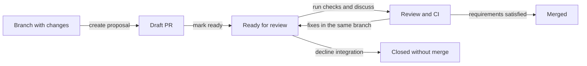

# GitHub Pull Requests

[Русский](../../../ru/tools/github-pull-requests/README.md)

A pull request proposes integrating changes from a source branch (head/compare) into a target branch (base).
Open this section to prepare or review proposed changes, or choose a merge method.
GitHub adds discussion, review, checks, and a merge decision on top of [Git](../git/README.md).

## Quick lookup

The commands below are reference snippets.
`create`, `ready`, and `merge` change GitHub state.

| Task | Command / action | Details |
| --- | --- | --- |
| Create a draft PR | `gh pr create --draft --base main` | [Description and review](review.md) |
| View a PR | `gh pr view 123` | [Review](review.md) |
| List PRs | `gh pr list` | [Review](review.md) |
| Check out a branch locally | `gh pr checkout 123` changes the working copy | [Synchronization](merging.md) |
| Check CI | `gh pr checks 123` | [Checks](review.md#before-merging) |
| Mark a PR ready for review | `gh pr ready 123` | [Lifecycle](#базовый-уровень) |
| Choose a merge method | Merge / Squash / Rebase | [Merging](merging.md) |

| Parameter | Value |
| --- | --- |
| Service | GitHub.com. Permissions, rulesets, and available merge methods depend on the repository |
| Prerequisites | Branches and push in Git. CLI examples require an installed and authenticated `gh` |

## Navigation

- [Quick lookup](#quick-lookup)
- [Open proposed changes](#open-proposed-changes)
- [Bring a PR to a decision](#bring-a-pr-to-a-decision)
- [Agree on history and branch strategy](#agree-on-history-and-branch-strategy)
- [Common mistakes](#common-mistakes)
- [Sources](#sources)
- [Description, review, and checks](review.md)
- [Synchronization, merging, and branch cleanup](merging.md)

## Open proposed changes

1. Save work in a separate branch.
   Check the diff.
   Run tests.
   Push the branch to your remote.
2. On GitHub, select **New pull request**.
3. Choose base and compare.
   For a fork, also check the repositories.
4. Fill out the [description of the task, result, checks, and limitations](review.md#prepare-a-clear-proposal) using the repository template.
5. For unfinished work, choose Draft.
   For ready work, mark it ready for review.
6. Assign appropriate reviewers.

New commits and force pushes to the same head branch appear in the PR automatically.
Editing the description does not reload history.
After a force push, explain the reason when useful.
Rechecking the diff and CI can also help.
Permissions and protections can prohibit such a push.

| State | Meaning |
| --- | --- |
| Open + Draft | Open and still in draft. Merging is unavailable |
| Open + Ready for review | Open and ready for review |
| Closed without merge | Closed without integrating through this PR |
| Merged | Changes are integrated. The PR is closed |

`Approved` is a review outcome.
It is not a separate PR state.
It does not guarantee merge readiness.

The diagram shows PR transitions from the published branch to an integration decision.

## Bring a PR to a decision

The [review page](review.md) contains a description template and author/reviewer checks.
Project rules define approval counts, required CI checks, conversation resolution, and base requirements.
A PR alone does not protect main.
Appropriate settings and adherence to the process are required.

Labels (`bug`, `enhancement`, `documentation`, and others) are repository-specific conventions.
`Closes #123` links the PR to an issue.
Automatic closure depends in part on whether the target is the default branch.

## Agree on history and branch strategy

Short-lived feature branches suit independent changes.
GitFlow adds `develop`, release, and hotfix branches.
GitFlow makes sense when the release process fits it.
Project size alone does not require GitFlow.
Long-lived integration branches require regular compatibility checks and clear ownership.
Synchronization frequency follows the changes. A fixed morning/evening schedule is optional.

The [merge method comparison](merging.md#choose-a-merge-method), an agreed rebase, and branch deletion help keep history understandable.
When a merge queue is in use, it manages integration according to repository rules.

## Common mistakes

| Symptom | Check |
| --- | --- |
| Extra commits in a PR | Check base/head, fork, merge base, and branch history. Editing the description alone does not fix the commit list |
| Approved but merging is unavailable | Check CI, protections/rulesets, conflicts, Draft, and required permissions |
| CI did not change after push | Check event settings, path/branch filters, and workflow restrictions. The PR diff updates separately |
| Local branch appears unmerged after squash | Git checks ancestry. Squash-commit equivalence requires a separate check |
| A contents link fails | Use actual GitHub heading anchors. `{#id}` does not assign an ID |

## Sources

- [PR quickstart](https://docs.github.com/en/pull-requests/get-started/pull-request-quickstart).
- [Merge methods](https://docs.github.com/en/repositories/configuring-branches-and-merges-in-your-repository/configuring-pull-request-merges/about-merge-methods-on-github).
- [GitHub CLI create](https://cli.github.com/manual/gh_pr_create), [merge](https://cli.github.com/manual/gh_pr_merge).
- [Markdown and anchors](https://docs.github.com/en/get-started/writing-on-github/getting-started-with-writing-and-formatting-on-github/basic-writing-and-formatting-syntax).

[Development tools](../README.md)
