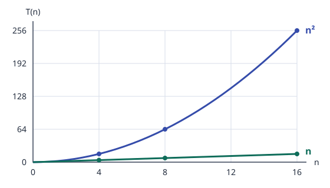

# Алгоритмы

[English](../../en/algorithms/README.md) · [Каталог материалов](../README.md)

Оцените, как растёт число операций при увеличении размера входа. Раздел вводит временную сложность на примерах с циклами Python.

## Big O

Big O задаёт верхнюю границу роста числа операций. В простом примере с обходом последовательности размер входа `n` — число её элементов.

### Посчитайте итерации

Выберите операцию для подсчёта. В этом фрагменте одно прибавление единицы соответствует одной итерации тела цикла. Переменная `items` содержит последовательность из `n` элементов, например `range(n)`.

```python
linear = 0
for item in items:
    linear += 1

quadratic = 0
for first in items:
    for second in items:
        quadratic += 1
```

Первый цикл даёт `n` итераций. Во втором случае внутренний цикл проходит все `n` элементов для каждого из `n` элементов внешнего цикла. Получается `n × n = n²` итераций внутреннего цикла.

Вложенные циклы перебирают упорядоченные пары позиций. Для списка `['A', 'B']` они считают пары `(A, A)`, `(A, B)`, `(B, A)` и `(B, B)`.

Если циклы идут друг за другом, складывайте число итераций. Например, два полных прохода дают `2n` итераций. Для вложенных циклов, которые полностью проходят две последовательности длины `n` и `m`, перемножайте длины. Внутренний цикл выполняет `n × m` итераций.

### Запустите пример

Запустите [полный пример](../../../examples/algorithms/big-o/count_operations.py) из корня репозитория с Python 3.14. Программа использует встроенный `range()` для подготовки данных.

```bash
python3.14 examples/algorithms/big-o/count_operations.py
```

```text
n linear quadratic
4 4 16
8 8 64
16 16 256
```

При удвоении `n` с 4 до 8 линейный счётчик удваивается. Квадратичный счётчик растёт в четыре раза, потому что `(2n)² = 4n²`.

По горизонтальной оси `n` отложено число элементов. По вертикальной оси `T(n)` отложено число прибавлений единицы. Точки показывают значения из вывода программы.



### Запишите оценку роста

Для всех достаточно больших `n` запись `O(g(n))` ограничивает число операций сверху величиной `c × g(n)`. Множитель `c` — положительная константа, которая одинакова для всех `n`.

Линейный счётчик имеет верхнюю границу `O(n)`. Граница `O(n²)` для него тоже верна, поскольку `n ≤ n²` при `n ≥ 1`. Обозначение `Θ(n)` задаёт точный порядок роста. Число операций ограничено сверху и снизу положительными постоянными множителями `n`. Для квадратичного счётчика точный порядок роста — `Θ(n²)`.

Для полинома точный порядок роста определяет член со старшей степенью. Например, `2n` имеет порядок роста `Θ(n)`. Для `n² + n` порядок роста равен `Θ(n²)`, поскольку `n² ≤ n² + n ≤ 2n²` при `n ≥ 1`.

Для оценки времени считайте операции, которые имеют постоянную стоимость в выбранной модели. Если число операций зависит от входных данных одного размера, укажите случай. Например, линейный поиск может найти значение на первой проверке, а при отсутствии значения проверит все `n` элементов. В худшем случае такой поиск имеет сложность `O(n)`.

| Верхняя граница | Пример операции или алгоритма |
| --- | --- |
| `O(1)` | Получить элемент массива по индексу |
| `O(log n)` | Найти элемент в отсортированном массиве двоичным поиском |
| `O(n)` | Обойти `n` элементов с постоянной работой на элемент |
| `O(n log n)` | Отсортировать `n` элементов сортировкой слиянием при постоянной стоимости сравнения |
| `O(n²)` | Перебрать все упорядоченные пары позиций с постоянной работой на пару |

## Источники

- [Big O в словаре NIST](https://www.nist.gov/dads/HTML/bigOnotation.html) · [Θ в словаре NIST](https://www.nist.gov/dads/HTML/theta.html)
- [Двоичный поиск в словаре NIST](https://www.nist.gov/dads/HTML/binarySearch.html) · [Сортировка слиянием в словаре NIST](https://www.nist.gov/dads/HTML/mergesort.html)
- [`range` в документации Python 3.14](https://docs.python.org/3.14/library/stdtypes.html#ranges)
