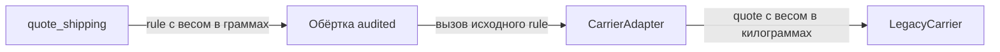
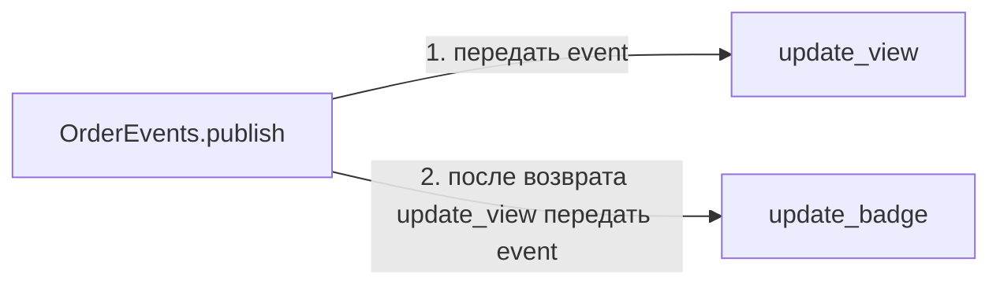
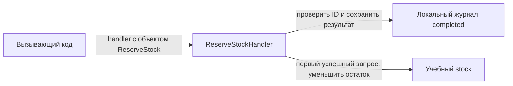

# Выполнить примеры паттернов кода

[English](../../../en/architecture/patterns/code-examples.md)

Страница содержит три локальных примера.
Тариф доставки соединяет Strategy, Adapter, Decorator и Factory.
Observer показывает подписки и ошибки.
Command показывает запрос, отдельный обработчик и повтор.
Откройте страницу, чтобы выполнить выбранный паттерн и проверить его существенные отказы.

| Ситуация | Приём | Полный пример |
| --- | --- | --- |
| Тарифы используют разные алгоритмы и единицы | Соедините Strategy, Adapter, Decorator и Factory | [Доставка](#полный-пример-strategy-adapter-и-декоратор) |
| Событие обновляет несколько локальных получателей | Сохраните подписки и задайте политику ошибок | [Observer](#observer-подписка-отписка-и-ошибка-слушателя) |
| Запрос передают отдельно от исполнения и могут повторить | Выделите данные команды и обработчик | [Command](#command-запрос-обработчик-и-локальный-повтор) |

[Краткий выбор и роли](design-patterns.md) · [К паттернам](README.md)

**Уровень:** средний.
Разбор ошибок и повтора относится к продвинутому уровню.
**Предпосылки:** Python 3.14, функции/callable, классы и исключения.
Примеры используют только стандартную библиотеку.

## Навигация

- [Полный пример: Strategy, Adapter и декоратор](#полный-пример-strategy-adapter-и-декоратор)
- [Observer: подписка, отписка и ошибка слушателя](#observer-подписка-отписка-и-ошибка-слушателя)
- [Command: запрос, обработчик и локальный повтор](#command-запрос-обработчик-и-локальный-повтор)
- [Границы примеров](#границы-примеров)

## Полный пример: Strategy, Adapter и декоратор

**Полный пример.** Пример использует только стандартную библиотеку.
Внешние зависимости не нужны.
Сохраните файл [`shipping-patterns.py`](../../../../examples/architecture/shipping-patterns.py).
Выполните `python3.14 shipping-patterns.py`.
Контракт принимает положительный целый вес в граммах.
Контракт возвращает неотрицательную целую стоимость в условных центах.
LegacyCarrier заменяет внешний SDK локальным объектом.
Объект принимает килограммы и возвращает условные денежные единицы.
Сетевой протокол здесь не моделируется.

[`architecture/shipping-patterns.py`](../../../../examples/architecture/shipping-patterns.py)

**Результат:** OK.
Пример сравнивает два тарифа и переводит граммы в килограммы.
Стоимость округляется вверх до цента.
Обёртка сохраняет результат и записывает аудит.
Три ошибочных входа приводят к отказу.
Внешний SDK может возвращать недопустимые значения или ошибки.
Задайте отдельный контракт их преобразования в адаптере.

Все стрелки ниже показывают **вызовы во время выполнения**.
Стрелки не обозначают imports:

Результат возвращается обратно по стеку вызовов.
Адаптер переводит денежные единицы в целые центы.
Обёртка пишет в список.
Если удалённый аудит откажет, потребуется выбрать политику.
Варианты: провалить операцию, сохранить событие отдельно или допустить потерю наблюдения.

## Observer: подписка, отписка и ошибка слушателя

**Задача:** уведомлять локальных слушателей по порядку подписки.
Публикация выполняется синхронно.
Первая ошибка прерывает рассылку.
Ошибка передаётся вызывающему коду.
Уже выполненные callbacks не откатываются.

**Полный пример.** Пример использует только стандартную библиотеку.
Сохраните код как `observer-pattern.py`.
Выполните `python3.14 observer-pattern.py`.
События и результаты представлены учебными строками и списками.

[`architecture/observer-pattern.py`](../../../../examples/architecture/observer-pattern.py)

**Ожидаемый результат:** `OK: observer order, unsubscribe and fail-fast delivery`.
Пример показывает порядок двух слушателей, отписку и прерывание рассылки при исключении.

**Схема вызовов при выполнении:** подписи задают порядок синхронных вызовов.
Вторая стрелка достигается только после успешного завершения первого слушателя.

**Ограничения:** `publish` использует снимок списка.
Изменение подписок во время рассылки повлияет на следующую публикацию.
Повторная подписка того же callback не добавляет дубликат.
Отписка отсутствующего callback вызывает `ValueError`.
Издатель держит сильные ссылки на слушателей.
Владелец подписки определяет время отписки.
Потокобезопасность отсутствует.
Хранение событий и повторная доставка отсутствуют.

## Command: запрос, обработчик и локальный повтор

**Задача:** отделить запрос на резервирование от исполнения.
Явно задайте семантику повтора.
Тот же ID с теми же параметрами возвращает сохранённый результат.
Тот же ID с другими параметрами отвергается.
Команда представлена данными с отдельным handler.
Метод `execute` в самой команде не обязателен.

**Полный пример.** Пример использует только стандартную библиотеку.
Сохраните код как `command-pattern.py`.
Выполните `python3.14 command-pattern.py`.
Один handler хранит остатки и журнал результатов в памяти.

[`architecture/command-pattern.py`](../../../../examples/architecture/command-pattern.py)

**Ожидаемый результат:** `OK: command validation, reserve, replay and ID conflict`.
Первый запрос резервирует остаток.
Повтор возвращает сохранённый результат.
Невалидное количество, недостаточный остаток и конфликт ID приводят к отказу.
При этих отказах остаток не меняется.
При повторе возвращается результат первого исполнения.
Это число не обещает текущий остаток после других команд.

**Схема вызовов при выполнении:** вызывающий код передаёт команду обработчику как аргумент.
Остаток меняется только при первом успешном исполнении ID.

**Ограничения:** `dataclass` создаёт методы для данных.
`dataclass` не валидирует типы аннотаций.
В примере используется явная валидация.
`frozen=True` ограничивает присваивание полей.
Этот параметр не обеспечивает бизнес-гарантии.
Локальный журнал даёт повтор только в течение жизни этого handler.
Транзакции с БД нет.
Защиты конкурентных вызовов нет.
Восстановления после рестарта и политики очистки журнала нет.
Для внешнего действия отдельно согласуйте сохранение результата и самого эффекта.
Undo может быть [бизнес-компенсацией](architecture-patterns.md#распределённые-сценарии).

## Границы примеров

Примеры выполняются в одном процессе без сети и внешнего SDK.
Потоки, восстановление после завершения процесса, надёжный аудит, доставка и хранение команд требуют отдельных механизмов.

## Источники

- [Python 3.14: Callable](https://docs.python.org/3.14/library/collections.abc.html#collections.abc.Callable).
- [Python 3.14: Decimal](https://docs.python.org/3.14/library/decimal.html).
- [Python 3.14: dataclasses](https://docs.python.org/3.14/library/dataclasses.html).
