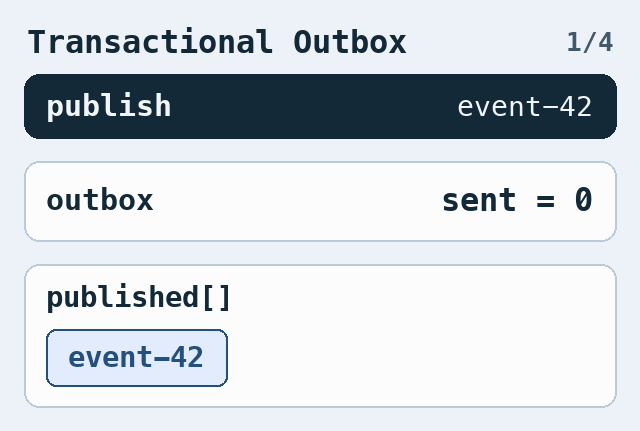

# Проверить атомарность Outbox и повтор публикации

[English](../../../en/architecture/patterns/outbox-example.md)

Используйте пример, если заказ и намерение отправить событие должны сохраняться вместе.
Отдельный отправитель может завершиться после публикации и до отметки об отправке.

| Что проверить | Приём | Результат |
| --- | --- | --- |
| Ошибка второй записи не оставляет заказ | Запишите заказ и событие в одной транзакции | Заказ `43` отсутствует после отказа `UNIQUE` |
| Повтор отправителя допускает дубликат | Смоделируйте сбой до отметки `sent` | Событие `event-42` опубликовано дважды |

[Карточка и схема Outbox](distributed-systems.md#transactional-outbox-сохранить-заказ-и-намерение-публикации) · [К паттернам](README.md)

**Предпосылки:** Python 3.14, транзакции SQLite, исключения.
Внешние зависимости и сетевые службы не нужны.

## Полный пример: Outbox и дубликат публикации

**Продвинутый уровень.** Сохраните код как `outbox.py`.
Выполните `python3.14 outbox.py`.
Пример использует sqlite3 из стандартной библиотеки.
Пример использует только БД в памяти.
Список заменяет брокер.
Проверяются атомарность локальной записи и возможный повтор внешней публикации.

[`architecture/outbox.py`](../../../../examples/architecture/outbox.py)

**Результат:** OK.
После ошибки записи события заказ 43 не сохранился.
После смоделированного сбоя событие заказа 42 опубликовано дважды.
Это ожидаемая граница Outbox.
Пример не даёт exactly-once гарантию.

Показать повтор публикации по шагам

Первая публикация добавляет `event-42` в список, который заменяет брокер. При сбое строка outbox остаётся в состоянии `sent = 0`. Следующая попытка публикует тот же идентификатор и устанавливает `sent = 1`.
Для дедупликации локального эффекта получатель может записать обработанный `event_id` и применить эффект в одной транзакции.

[Открыть GIF для повторного просмотра](../../../assets/transactional-outbox-retry.gif)

См. [схему вызовов Outbox](distributed-systems.md#transactional-outbox-сохранить-заказ-и-намерение-публикации).

Для production relay нужны блокировка или lease для workers.
Нужно подтверждение брокера.
Нужна обработка неизвестного исхода.
Нужно управление порядком, повторами и мёртвыми сообщениями.
Нужна уборка outbox.
Исключение в примере моделирует точку отказа.
БД в памяти не моделирует сохранность на диске или восстановление после завершения процесса.
Consumer здесь не реализован.

## Источники

- [Python 3.14: sqlite3](https://docs.python.org/3.14/library/sqlite3.html).
- [Microsoft: Transactional Outbox](https://learn.microsoft.com/en-us/azure/architecture/databases/guide/transactional-out-box-cosmos).
