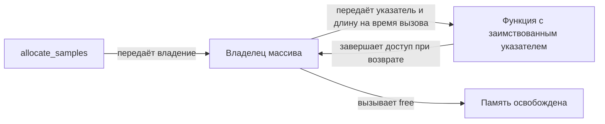

# Практические приёмы и области применения C

[Шпаргалка C](README.md) · [English](../../en/c/practice.md)

Выберите контракт владения для функции C17 или подберите инструменты для проекта. Примеры приёмов используют стандартную библиотеку. Для каждой платформы сверяйте доступные библиотеки и требования к сборке.

| Задача | Приём | Карточка |
| --- | --- | --- |
| Передать память или вернуть результат | Владелец, заимствование, выходной параметр | [Владение и ошибки](#patterns) |
| Закрыть ресурс после нескольких операций | Общая ветка очистки | [Очистка при выходе](#очистка-при-выходе) |
| Выбрать инструменты и первую задачу | Таблица платформ и библиотек | [Области применения](#application-areas) |

<a id="patterns"></a>

## Владение и ошибки

Для каждого указателя укажите владельца и срок доступности объекта. Укажите единицы длины. Если функция принимает `NULL`, опишите значение `NULL` в её контракте.

| Ситуация | Контракт | Приём |
| --- | --- | --- |
| Функция читает данные вызывающей стороны | Объект доступен до возврата из функции. | Передайте `const T *` и число элементов. |
| Функция создаёт объект для вызывающей стороны | При успехе вызывающая сторона получает владение. | Опубликуйте пару функций `create` и `destroy`. Скройте поля за неполным типом, если нужно сохранить инварианты. |
| Функция записывает результат в объект вызывающей стороны | Указатель на результат действителен для записи. Функция задаёт значение только при успехе. | Верните код состояния и передайте выходной параметр. |
| Ресурс выдала библиотека | Освободите ресурс функцией, указанной в API. | Для `fopen` вызовите `fclose`. Для `sqlite3_prepare_v2` вызовите `sqlite3_finalize`. |

### Выбрать паттерн проектирования

| Задача | Паттерн и пример | Условие |
| --- | --- | --- |
| Скрыть поля объекта за стабильным интерфейсом | Непрозрачный дескриптор. [SQLite](https://www.sqlite.org/cintro.html) отдаёт `sqlite3 *` и предоставляет функции для работы с соединением. | Опишите создание, владение и закрытие дескриптора. |
| Менять операцию без изменения обхода | Стратегия. [`visit_readings`](syntax.md#функции-структуры-и-обратные-вызовы) вызывает переданную функцию для каждого показания. | Задайте сигнатуру функции и срок жизни контекста. |
| Подключить библиотеку к интерфейсу командной строки | Адаптер. [`main.c`](../../../examples/c/port-parser/main.c) передаёт аргумент парсеру и преобразует статус в сообщение и код выхода. | Оставьте разбор данных в библиотеке. Обрабатывайте вывод и код процесса в CLI. |

### Выделить массив

Фрагмент выделения места под `count` значений `int`. Перед умножением проверьте размер в байтах. При успехе память ещё нужно инициализировать.

```c
#include <stddef.h>
#include <stdint.h>
#include <stdlib.h>

static int *allocate_samples(size_t count)
{
    if (count == 0 || count > SIZE_MAX / sizeof(int)) {
        return NULL;
    }
    return malloc(count * sizeof(int));
}
```

Если функция вернула указатель, вызывающая сторона владеет памятью и вызывает `free`. Заимствованные указатели допустимы только в пределах времени жизни объекта. На схеме показаны переходы при успешном выделении.



Чтобы изменить размер блока, передайте `realloc` проверенный ненулевой размер. Сохраните результат во временный указатель. Если `realloc` вернул `NULL`, прежний блок остаётся у владельца. При успехе обновите указатель владельца и прекратите использовать прежние заимствованные указатели.

### Возвращать код ошибки

Передайте выходной параметр, если функция должна вернуть и статус, и значение. В [парсере порта](../../../examples/c/port-parser/port.c) вызов `parse_port("8080", &port)` возвращает `PORT_OK` и записывает `8080`. При любом другом статусе переменная `port` сохраняет прежнее значение. Этот контракт позволяет проверить отказ без скрытых побочных эффектов для результата.

### Очистка при выходе

Фрагмент проверки первых четырёх байтов файла. Если `fopen` завершился успешно, обе ветки проверки приводят к одному вызову `fclose`.

```c
#include <stdio.h>
#include <string.h>

static int check_header(const char *path)
{
    const unsigned char expected[] = {0x44, 0x41, 0x54, 0x41};
    unsigned char actual[sizeof expected];
    int status = -1;

    FILE *file = fopen(path, "rb");
    if (file == NULL) {
        return status;
    }

    if (fread(actual, 1, sizeof actual, file) != sizeof actual) {
        goto cleanup;
    }
    if (memcmp(actual, expected, sizeof actual) != 0) {
        goto cleanup;
    }
    status = 0;

cleanup:
    if (fclose(file) == EOF) {
        status = -1;
    }
    return status;
}
```

Результат `0` означает, что заголовок совпал и файл закрыт. Этот фрагмент объединяет причины отказа в статус `-1`. Если вызывающей стороне нужна причина, верните именованные статусы. Для нескольких ресурсов освобождайте только полученные ресурсы в порядке, обратном получению.

<a id="application-areas"></a>

## Области применения

Подберите компилятор и библиотеки по целевой платформе. Если программа использует API ОС или устройства, проверяйте результат в этой среде.

| Область | Платформа и сборка | Библиотеки и API | Что изучить | Первая задача | Важное ограничение |
| --- | --- | --- | --- | --- | --- |
| Консольные утилиты | Linux или macOS, GCC или Clang, Make или CMake | Стандартная библиотека, POSIX при необходимости | Аргументы, потоки и коды выхода | Соберите [парсер порта](tooling-and-testing.md#tests). | POSIX API требуют поддержки на целевой платформе. |
| Прошивки | Плата STM32, кросс-компилятор ARM, отладочный адаптер | [STM32Cube HAL или LL](https://www.st.com/en/embedded-software/stm32cube-mcu-mpu-packages.html), Unity для логики на компьютере | Регистры, таймеры и прерывания | Переключайте светодиод по таймеру на учебной плате. | Учитывайте объём памяти и задержки на конкретной плате. |
| Модули ядра Linux | Linux VM, kbuild, файлы сборки целевого ядра | [API ядра](https://docs.kernel.org/kbuild/modules.html) | Контекст вызова и правила выделения памяти | Соберите минимальный модуль в учебной VM. | Используйте конфигурацию и заголовки нужного ядра. |
| Сетевые клиенты | Linux, macOS или Windows, компилятор и TLS-бэкенд | [libcurl](https://curl.se/libcurl/c/libcurl.html) | HTTP, TLS, тайм-ауты и обратные вызовы | Получите локальный тестовый HTTP-ответ. | Различайте ошибку передачи и код HTTP. |
| Локальные данные | Приложение с файловым доступом или SQLite в памяти | [SQLite 3 C API](https://www.sqlite.org/cintro.html) | Подготовленные запросы, привязка параметров и транзакции | Вставьте и прочитайте строку в БД `:memory:`. | Завершите работу с запросами перед закрытием соединения. |
| Графика и мультимедиа | Настольная ОС, компилятор и графическая сессия | [SDL3](https://wiki.libsdl.org/SDL3/FrontPage) | События, кадры и срок жизни ресурсов | Откройте окно и обработайте закрытие. | Соблюдайте ограничения потока для функций SDL. |

## Источники

- [ISO/IEC 9899:2018 (C17)](https://www.iso.org/standard/74528.html) и [открытый проект WG14 N1570](https://www.open-std.org/jtc1/sc22/wg14/www/docs/n1570.pdf), разделы 6.2.4 и 7.22.3 для времени жизни и базовых правил выделения.
- [Обсуждение WG14 по `realloc` с нулевым размером](https://www.open-std.org/jtc1/sc22/wg14/www/docs/n2438.htm).
