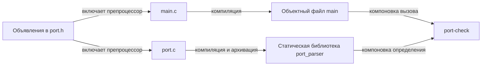

# Сборка, зависимости и тесты C

[Шпаргалка C](README.md) · [English](../../en/c/tooling-and-testing.md)

Соберите программу из нескольких файлов и запустите тесты через CTest. Учебный пример проверяет десятичный номер порта из аргумента командной строки.

| Задача | Приём | Карточка |
| --- | --- | --- |
| Найти причину ошибки сборки | Единица трансляции, объектный файл, компоновка | [Собрать и скомпоновать файлы](#собрать-и-скомпоновать-файлы) |
| Подключить внешнюю библиотеку | `FetchContent`, `target_link_libraries` | [Подключить зависимость](#packages) |
| Проверить код библиотеки | Unity и CTest | [Собрать и запустить тесты](#tests) |
| Проверить обращения к памяти | ASan и UBSan в Clang | [Запустить санитайзеры](#запустить-санитайзеры) |

## Собрать и скомпоновать файлы

Из корня репозитория соберите [командную программу](../../../examples/c/port-parser/main.c) и [парсер](../../../examples/c/port-parser/port.c) одним вызовом Clang. Нужны Clang с поддержкой C17, стандартная библиотека и Bash или Zsh.

```bash
build_dir=$(mktemp -d) &&
  clang -std=c17 -Wall -Wextra -pedantic examples/c/port-parser/main.c examples/c/port-parser/port.c \
    -o "$build_dir/port-check" &&
  "$build_dir/port-check" 8080
```

Программа выводит `Port: 8080`. Если из команды удалить `port.c`, компоновщик сообщит, что не нашёл определение `parse_port`.

Заголовок `port.h` объявляет функцию `parse_port` и тип её результата. Защитные директивы `#ifndef` и `#define` предотвращают повторное включение в одной единице трансляции. Включите заголовок в `port.c` и `main.c`, чтобы компилятор проверил соответствие определения и вызова объявлению.

Схема показывает, какие файлы участвуют в сборке `port-check`. Каждая единица трансляции получается после препроцессинга одного исходного файла.



| Признак | Что проверить |
| --- | --- |
| Компилятор не находит `port.h` | Проверьте путь к заголовку и каталог поиска. В CMake задайте каталог через `target_include_directories`. |
| Компоновщик не находит `parse_port` | Убедитесь, что `port.c` входит в библиотеку. Свяжите исполняемую цель с библиотекой через `target_link_libraries`. |
| Компоновщик сообщает о нескольких определениях | Оставьте одно определение экспортируемой функции в исходном файле. Поместите в заголовок объявление. |

Для одного исходника достаточно команды [первого запуска](README.md#первый-запуск). Флаг Clang `-c` позволяет отдельно собрать объектный файл. В проекте из нескольких целей CMake генерирует правила для Make или Ninja. Команда `cmake --build` запускает выбранный инструмент сборки.

<a id="packages"></a>

## Подключить зависимость

Выберите источник библиотеки до настройки проекта. У C несколько способов получения и подключения зависимостей.

| Условие | Инструмент | Действие |
| --- | --- | --- |
| Есть небольшой проект CMake, и нужен исходный код фиксированного выпуска | [CMake FetchContent](https://cmake.org/cmake/help/v3.31/module/FetchContent.html) | Загрузите исходники при настройке. Подключите цель библиотеки к своей цели. |
| Проект хранит зависимости в манифесте | [vcpkg в режиме манифеста](https://learn.microsoft.com/vcpkg/users/buildsystems/cmake-integration) | Укажите пакеты в `vcpkg.json`. Передайте файл toolchain при настройке CMake. Найдите пакет через `find_package` по документации порта. |
| Библиотека уже установлена системным менеджером или SDK | [CMake `find_package`](https://cmake.org/cmake/help/v3.31/command/find_package.html) или [`pkg-config`](https://cmake.org/cmake/help/v3.31/module/FindPkgConfig.html) | Найдите метаданные, пути к заголовкам и параметры компоновки. |

В [полной конфигурации парсера](../../../examples/c/port-parser/CMakeLists.txt) модуль `FetchContent` скачивает архив Unity 2.7.0. Параметр `URL_HASH` проверяет SHA-256 архива. Вызов `FetchContent_MakeAvailable(unity)` добавляет цель `unity::framework` из исходников. Строка `target_link_libraries(test_port PRIVATE port_parser unity::framework)` подключает библиотеку приложения и Unity к исполняемой цели тестов.

`FetchContent` получает исходники для текущей сборки. Менеджер пакетов вроде vcpkg дополнительно управляет установкой и зависимостями пакетов. Проверьте платформу, версию и лицензию библиотеки перед подключением. Если нужен только CLI, настройте проект с `-DBUILD_TESTING=OFF`. В этом режиме CMake пропускает загрузку Unity.

<a id="tests"></a>

## Собрать и запустить тесты

Подготовьте Clang с C17, стандартную библиотеку C, Make и CMake с CTest версии 3.24 или новее. Для первой настройки с тестами нужен доступ по HTTPS к GitHub codeload. Команды рассчитаны на Bash или Zsh.

Полный пример состоит из [интерфейса](../../../examples/c/port-parser/port.h), [парсера](../../../examples/c/port-parser/port.c), [CLI](../../../examples/c/port-parser/main.c), [тестов](../../../examples/c/port-parser/test_port.c) и [конфигурации сборки](../../../examples/c/port-parser/CMakeLists.txt). Тесты используют строки из исходника.

Из корня репозитория создайте временный каталог. Настройте и соберите проект. Запустите тесты и передайте программе аргумент `8080`.

```bash
build_dir=$(mktemp -d) &&
  cmake -S examples/c/port-parser -B "$build_dir" -G "Unix Makefiles" \
    -DCMAKE_C_COMPILER=clang -DCMAKE_BUILD_TYPE=Debug &&
  cmake --build "$build_dir" &&
  ctest --test-dir "$build_dir" --output-on-failure --no-tests=error &&
  "$build_dir/port-check" 8080
```

CTest сообщает об одном успешно запущенном тестовом процессе. Внутри процесса Unity выполняет шесть модульных тестов. Вызов `ctest --test-dir "$build_dir" -V` показывает результат каждого теста Unity. Программа печатает `Port: 8080`.

Фрагмент из `test_port.c`. Макросы `TEST_ASSERT_EQUAL_INT` и `TEST_ASSERT_EQUAL_UINT` получают ожидаемое значение первым аргументом. Тест проверяет код отказа и сохранение значения `port` при выходе за границы диапазона.

```c
static void test_out_of_range(void)
{
    unsigned int port = 80;
    TEST_ASSERT_EQUAL_INT(PORT_OUT_OF_RANGE, parse_port("0", &port));
    TEST_ASSERT_EQUAL_UINT(80, port);
    TEST_ASSERT_EQUAL_INT(PORT_OUT_OF_RANGE, parse_port("65536", &port));
    TEST_ASSERT_EQUAL_UINT(80, port);
}
```

Подключите `<unity.h>` для проверок. Добавьте `RUN_TEST(test_out_of_range)` между `UNITY_BEGIN()` и `UNITY_END()` в `main` тестового процесса. CTest использует код возврата процесса, чтобы определить результат.

Тесты проверяют десятичный разбор с начальным нулём, обе границы диапазона и ошибки аргументов, синтаксиса и диапазона. При ошибке парсер сохраняет прежнее значение выходного параметра. Парсер проверяет число из конфигурации и не открывает сетевое соединение.

Запустите `"$build_dir/port-check" 65536`, чтобы проверить отказ через CLI. Программа пишет `Expected a decimal port from 1 to 65535.` в поток ошибок и возвращает ненулевой код.

## Запустить санитайзеры

Если Clang для вашей платформы поддерживает ASan и UBSan, пересоберите тесты в новом каталоге. Флаг `-fno-sanitize-recover=undefined` завершает процесс при обнаружении неопределённого поведения, чтобы CTest отметил отказ.

```bash
sanitizer_dir=$(mktemp -d) &&
  cmake -S examples/c/port-parser -B "$sanitizer_dir" -G "Unix Makefiles" \
    -DCMAKE_C_COMPILER=clang -DCMAKE_BUILD_TYPE=Debug \
    "-DCMAKE_C_FLAGS=-fsanitize=address,undefined -fno-sanitize-recover=undefined -fno-omit-frame-pointer" &&
  cmake --build "$sanitizer_dir" &&
  ctest --test-dir "$sanitizer_dir" --output-on-failure --no-tests=error
```

ASan выявляет, например, выход за границу буфера и обращение к освобождённой памяти. UBSan выявляет, например, переполнение знакового целого. Санитайзеры проверяют выполненные пути кода.

## Источники

- [Руководство по командам Clang 21](https://releases.llvm.org/21.1.0/tools/clang/docs/CommandGuide/clang.html) и [примечания к выпуску](https://releases.llvm.org/21.1.0/tools/clang/docs/ReleaseNotes.html).
- [CMake 3.31](https://cmake.org/cmake/help/v3.31/manual/cmake.1.html), [CTest](https://cmake.org/cmake/help/v3.31/manual/ctest.1.html) и [примечания к выпуску](https://cmake.org/cmake/help/v3.31/release/3.31.html).
- [Параметры загрузки архивов в CMake 3.24](https://cmake.org/cmake/help/v3.24/module/ExternalProject.html).
- [Руководство Unity 2.7.0](https://github.com/ThrowTheSwitch/Unity/blob/v2.7.0/docs/UnityGettingStartedGuide.md) и [выпуск Unity 2.7.0](https://github.com/ThrowTheSwitch/Unity/releases/tag/v2.7.0).
- [AddressSanitizer](https://clang.llvm.org/docs/AddressSanitizer.html) и [UndefinedBehaviorSanitizer](https://clang.llvm.org/docs/UndefinedBehaviorSanitizer.html).
