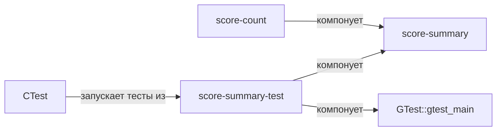

# Сборка, пакеты и тесты C++20

[Справочник C++](README.md) · [English](../../en/cpp/tooling-and-testing.md)

Соберите консольную программу, которая считает баллы на пороге и выше него. Используйте этот проект, чтобы проследить путь от манифеста зависимости до запуска тестов.

| Задача | Инструмент | Пример |
| --- | --- | --- |
| Собрать приложение и библиотеку | CMake, цели и `target_link_libraries` | [Цели сборки](#cmake-targets) |
| Выбрать способ подключения зависимости | vcpkg, Conan 2, CMake `FetchContent` | [Пакеты](#packages) |
| Повторить сборку на Apple Silicon | CMake, vcpkg, GoogleTest | [Запустить учебный проект](#run-the-lab) |
| Проверить обычный ввод и ошибки | GoogleTest, CTest | [Тесты](#tests) |
| Проверить память и неопределённое поведение | AddressSanitizer, UndefinedBehaviorSanitizer | [Диагностика](#diagnostics) |

<a id="cmake-targets"></a>

## Цели сборки

Схема показывает связи между целями из [полного `CMakeLists.txt`](../../../examples/cpp/CMakeLists.txt). Приложение и тесты используют одну реализацию подсчёта.



Фрагмент `CMakeLists.txt`. Команды используют соседние исходники и заголовок из учебного проекта.

```cmake
add_library(score-summary STATIC score-summary.cpp)
target_compile_features(score-summary PUBLIC cxx_std_20)
target_include_directories(score-summary PUBLIC "${CMAKE_CURRENT_SOURCE_DIR}")

add_executable(score-count score-count.cpp)
target_link_libraries(score-count PRIVATE score-summary)
```

Генератор Unix Makefiles создаёт правила сборки для `make`. Команда `cmake --build` запускает `make` с этими правилами. Цель `score-summary` передаёт зависимым целям требования C++20 и путь к заголовку через `PUBLIC`. У `score-count` связь `PRIVATE`, поскольку библиотека нужна для сборки самой программы.

<a id="packages"></a>

## Подключение зависимостей

| Приём | Когда использовать | Что фиксировать |
| --- | --- | --- |
| [vcpkg](https://learn.microsoft.com/en-us/vcpkg/consume/manifest-mode) | Проект использует пакеты из реестра vcpkg | Версию vcpkg, `builtin-baseline`, точечные `overrides`, triplet. |
| [Conan 2](https://docs.conan.io/2/tutorial/consuming_packages.html) | Проект использует пакеты из ConanCenter или своего реестра | Версии в рецепте, профили сборки и целевой платформы, lockfile. |
| [CMake `FetchContent`](https://cmake.org/cmake/help/v3.31/module/FetchContent.html) | Проект подключает исходники библиотеки при конфигурации | Полный хеш Git-коммита или URL архива и `URL_HASH`. |

Менеджер пакетов разрешает версии зависимостей и предоставляет сборки для выбранной платформы. `FetchContent` делает указанные исходники доступными CMake при конфигурации. Если зависимость содержит подходящий `CMakeLists.txt`, `FetchContent_MakeAvailable` может добавить её цели в сборку.

[Манифест проекта](../../../examples/cpp/vcpkg.json) фиксирует коммит встроенного реестра и порт `gtest` версии `1.17.0#2`. Суффикс `#2` обозначает ревизию порта vcpkg. Версия GoogleTest остаётся `1.17.0`. Triplet задаёт параметры сборки пакетов, включая архитектуру и платформу. Фиксация пакетов воспроизводит выбор зависимостей при тех же параметрах. Для воспроизводимости бинарных файлов также контролируйте компилятор, SDK и параметры сборки. [Правила версий vcpkg](https://learn.microsoft.com/en-us/vcpkg/users/versioning) · [Порт `gtest` на выбранном коммите](https://github.com/microsoft/vcpkg/blob/d015e31e90838a4c9dfa3eed45979bc70d9357fc/ports/gtest/vcpkg.json).

### Популярные библиотеки и инструменты

| Задача | Инструмент | Что проверить |
| --- | --- | --- |
| Форматировать текст | [fmt](https://fmt.dev/12.0/) | Сравните нужные функции с `std::format` в вашей стандартной библиотеке. |
| Читать и записывать JSON | [nlohmann/json](https://json.nlohmann.me/) | Проверяйте структуру и типы входных данных после разбора. |
| Использовать таймеры и асинхронный ввод-вывод | [Boost.Asio](https://www.boost.org/library/latest/asio/) | Определите время жизни буферов и порядок остановки операций. |
| Запускать модульные тесты | [GoogleTest](https://google.github.io/googletest/primer.html) | Проверяйте результат, границы и ожидаемые ошибки. |
| Измерять время выполнения функции | [Google Benchmark](https://github.com/google/benchmark) | Зафиксируйте входные данные, параметры сборки и условия измерения. |
| Отлаживать и анализировать код | [LLDB](https://lldb.llvm.org/use/tutorial.html), [clang-tidy](https://clang.llvm.org/extra/clang-tidy/) | Соберите Debug для отладки. Для анализа передайте реальные флаги компиляции через `compile_commands.json`. |

<a id="run-the-lab"></a>

## Запуск учебного проекта

Команды рассчитаны на macOS с Apple Silicon и Bash или Zsh. Подготовьте Apple Clang с поддержкой C++20, CMake и CTest 3.31.12, Git, `make` и `pkg-config` в `PATH`. Подойдёт [pkgconf](https://github.com/pkgconf/pkgconf) с командой `pkg-config`. Для первого запуска нужен доступ к GitHub. vcpkg может загрузить собственную версию CMake для сборки портов. [Выпуск CMake 3.31.12](https://github.com/Kitware/CMake/releases/tag/v3.31.12) · [Выпуск vcpkg 2026.05.25](https://github.com/microsoft/vcpkg/releases/tag/2026.05.25).

Из корня репозитория создайте временный каталог. Клонируйте официальный vcpkg и подготовьте исполняемый файл менеджера пакетов. Bootstrap с `-disableMetrics` отключает сбор метрик для этой копии vcpkg.

```bash
lab_dir=$(mktemp -d) &&
  git clone --depth 1 --branch 2026.05.25 https://github.com/microsoft/vcpkg.git "$lab_dir/vcpkg" &&
  "$lab_dir/vcpkg/bootstrap-vcpkg.sh" -disableMetrics
```

Передайте toolchain vcpkg при первой конфигурации. CMake запустит установку зависимостей из `vcpkg.json`. Затем `find_package(GTest 1.17.0 EXACT CONFIG REQUIRED)` загрузит конфигурацию пакета с импортированной целью `GTest::gtest_main`. [Интеграция vcpkg с CMake](https://learn.microsoft.com/en-us/vcpkg/users/buildsystems/cmake-integration).

```bash
cmake -S examples/cpp -B "$lab_dir/build" -G "Unix Makefiles" \
  -DCMAKE_CXX_COMPILER=clang++ -DCMAKE_BUILD_TYPE=Debug \
  -DCMAKE_TOOLCHAIN_FILE="$lab_dir/vcpkg/scripts/buildsystems/vcpkg.cmake" \
  -DVCPKG_TARGET_TRIPLET=arm64-osx &&
  cmake --build "$lab_dir/build" --parallel &&
  ctest --test-dir "$lab_dir/build" --output-on-failure --no-tests=error &&
  "$lab_dir/build/score-count" 60 55 60 95
```

CTest сообщает о шести пройденных тестах. Программа выводит `2 of 3`. Вызов с одним аргументом `60` выводит `0 of 0`. Передайте целые десятичные числа без пробелов и знака `+`. Если аргумент имеет неверный формат или выходит за `[0, 100]`, программа пишет ошибку в stderr и возвращает код 2. [Код программы](../../../examples/cpp/score-count.cpp) · [Подсчёт баллов](../../../examples/cpp/score-summary.cpp).

Если конфигурация прервалась на vcpkg, проверьте `build/vcpkg-manifest-install.log` внутри `lab_dir`. Если меняете компилятор, triplet или toolchain, создайте новый каталог сборки. Для сборки только приложения задайте `-DBUILD_TESTING=OFF` в свежем каталоге и опустите параметры vcpkg. В этой конфигурации приложению достаточно стандартной библиотеки C++20.

<a id="tests"></a>

## Проверка поведения

GoogleTest выполняет утверждения. Вызов `gtest_discover_tests` регистрирует отдельные случаи в CTest. Флаг `--no-tests=error` превращает отсутствие зарегистрированных тестов в ошибку команды.

Фрагмент из [полного файла тестов](../../../examples/cpp/score-summary-test.cpp). Подключите заголовок `score-summary.hpp`, `<gtest/gtest.h>`, `<array>` и `<stdexcept>`.

```cpp
TEST(ScoreSummaryTest, RejectsInvalidScoreEvenBelowMinimum)
{
    constexpr std::array scores{95, -1};
    EXPECT_THROW(summarize_scores(scores, 60), std::invalid_argument);
}
```

Проверка ловит ошибку, при которой функция пропускает недопустимый балл после подходящего. В тестах подсчёта `EXPECT_EQ` сравнивает оба поля результата. `EXPECT_*` позволяет выполнить следующие утверждения после сбоя. Если дальнейшая проверка требует успешного первого шага, используйте `ASSERT_*`. [GoogleTest 1.17.0](https://github.com/google/googletest/releases/tag/v1.17.0) · [Модуль CMake GoogleTest](https://cmake.org/cmake/help/v3.31/module/GoogleTest.html) · [Руководство CTest 3.31](https://cmake.org/cmake/help/v3.31/manual/ctest.1.html).

<a id="diagnostics"></a>

## Диагностика сборки и выполнения

| Симптом | Действие |
| --- | --- |
| Компилятор не находит заголовок | Проверьте `#include` и зависимость между целями CMake. |
| Компоновщик не находит определение | Проверьте, входит ли исходник в цель и подключена ли библиотека через `target_link_libraries`. |
| Тест завершился ошибкой | Повторите запуск через `ctest --test-dir "$lab_dir/build" -R ScoreSummaryTest --output-on-failure`. |
| Программа обращается к недоступной памяти | Запустите сборку с AddressSanitizer и воспроизведите ввод. |

Соберите консольную программу с диагностикой памяти и неопределённого поведения. Используйте Clang с доступными библиотеками санитайзеров. Выполните команды из корня репозитория.

```bash
san_dir=$(mktemp -d) &&
  cmake -S examples/cpp -B "$san_dir" -G "Unix Makefiles" \
    -DCMAKE_CXX_COMPILER=clang++ -DCMAKE_BUILD_TYPE=Debug -DBUILD_TESTING=OFF \
    -DCMAKE_CXX_FLAGS="-fsanitize=address,undefined -fno-omit-frame-pointer" &&
  cmake --build "$san_dir" --parallel &&
  "$san_dir/score-count" 60 55 60 95
```

Ожидаемый вывод — `2 of 3` без сообщений санитайзеров. Проверка охватывает только выполненные пути и поддерживаемые классы ошибок. [AddressSanitizer](https://clang.llvm.org/docs/AddressSanitizer.html) · [UndefinedBehaviorSanitizer](https://clang.llvm.org/docs/UndefinedBehaviorSanitizer.html) · [Примечания к CMake 3.31](https://cmake.org/cmake/help/v3.31/release/3.31.html).
