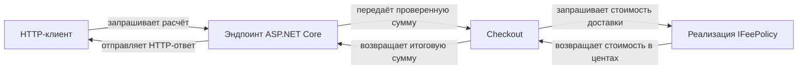

# Области применения и практики C#

[C#](README.md) · [English](../../en/csharp/practice.md)

Выберите стек для своего приложения. Используйте эти приёмы, если нужно отделить бизнес-правило от ввода-вывода, проверить интеграцию или разобраться с медленным запросом.

| Задача | Приём | Пример |
| --- | --- | --- |
| Выбрать стек и первое упражнение | Сопоставить платформу и библиотеки с задачей | [Области применения](#application-areas) |
| Заменить правило или внешнюю зависимость | Композиция, внедрение через конструктор, службы с областью жизни | [Паттерны и практики](#patterns) |
| Выбрать границу теста | Модульный, интеграционный или сквозной тест | [Выбор границы теста](#test-at-the-right-boundary) |
| Ограничить объём запроса | Проекция и ограничение результата EF Core | [Запрос нужных данных](#query-data) |

<a id="application-areas"></a>

## Области применения

Стек зависит от целевой платформы. Исполняемые примеры раздела используют .NET 10. Для настольного приложения, мобильного приложения или игры проверьте требования платформы или движка к инструментам и версии языка.

| Область | Инструменты и библиотеки | Навыки | Первая задача | Ограничение |
| --- | --- | --- | --- | --- |
| CLI и автоматизация | .NET SDK, `System.IO`, `System.Text.Json` | Аргументы, коды завершения, пути | Прочитайте JSON-файл и выведите сводку | Опишите базовый каталог для путей и результат при неверном вводе. |
| Веб-API и бэкенд | [ASP.NET Core](https://learn.microsoft.com/en-us/aspnet/core/fundamentals/minimal-apis?view=aspnetcore-10.0), Minimal APIs или контроллеры, `HttpClient` | Контракты HTTP, валидация, внедрение зависимостей | Добавьте эндпоинт расчёта доставки. Проверьте успешный ответ и ответ с ошибкой. | Среда выполнения и сервер должны поддерживать выбранную платформу. Настройте аутентификацию и авторизацию перед открытием приватных данных. |
| Реляционные данные | [EF Core 10](https://learn.microsoft.com/en-us/ef/core/what-is-new/ef-core-10.0/whatsnew), провайдер SQLite или PostgreSQL, [Dapper](https://github.com/DapperLib/Dapper) для явного SQL | SQL, транзакции, миграции, планы запросов | Сохраните заказ и запросите страницу заказов | Проверяйте перевод запросов и миграции на целевой СУБД в изолированной среде. Согласуйте версии провайдера и EF Core. |
| Рабочий стол Windows | [WPF](https://learn.microsoft.com/en-us/dotnet/desktop/wpf/overview/) или [WinForms](https://learn.microsoft.com/en-us/dotnet/desktop/winforms/overview/) | XAML и привязки в WPF, события и UI-поток в обоих | Сделайте редактор заказов с сообщениями об ошибках ввода | WPF и WinForms работают на Windows. |
| Кроссплатформенный рабочий стол | [Avalonia](https://docs.avaloniaui.net/docs/supported-platforms), XAML | Привязки, команды, упаковка | Запустите один редактор заказов на двух поддерживаемых ОС | Проверьте уровень поддержки и требования к упаковке каждой цели. |
| Игры | [Unity](https://docs.unity.com/en-us/engine/6000.0/manual/programming-environment/overview-of-dot-net-in-unity/csharp-compiler) или [.NET-редакция Godot](https://docs.godotengine.org/en/stable/tutorials/scripting/c_sharp/index.html) | Сцены, ввод, игровой цикл, профилирование кадра | Добавьте движение персонажа и обнаружение столкновения | Движок задаёт доступные версии C# и API .NET. Проверьте поддержку экспорта для цели. |
| Облако и фоновые задачи | [.NET Worker Service](https://learn.microsoft.com/en-us/dotnet/core/extensions/workers), Docker, [OpenTelemetry](https://learn.microsoft.com/en-us/dotnet/core/diagnostics/observability-with-otel) | Завершение работы, повторы, идемпотентность, метрики и трассировки | Запустите обработчик в контейнере и остановите его во время задачи | Учтите повторную доставку и остановку процесса. Для развёртывания нужен подходящий контейнерный хост. |
| Мобильные приложения | [.NET MAUI 10](https://learn.microsoft.com/en-us/dotnet/maui/supported-platforms?view=net-maui-10.0), инструменты Android или iOS | Жизненный цикл приложения, разрешения, интерфейс и локальные данные | Сделайте автономный список дел. Запустите его в эмуляторе или на устройстве. | Установите набор компонентов для целевой платформы. Для разработки под iOS с Windows нужен сетевой Mac для сборки. |
| Нативная поставка | [.NET Native AOT](https://learn.microsoft.com/en-us/dotnet/core/deploying/native-aot/) | Идентификаторы среды, удаление неиспользуемого кода, сборка для поставки | Опубликуйте небольшую CLI-программу. Запустите её на целевой ОС и архитектуре. | Проверьте требования к инструментам целевой платформы и предупреждения о рефлексии или динамическом коде. |

Используйте стандартные API для [файлов, JSON, HTTP и коллекций](syntax.md#standard-library). Если нужны дополнительные возможности, проверьте документацию пакета.

| Задача | Пакет или инструмент | Когда применять |
| --- | --- | --- |
| Прочитать существующий контракт JSON | [Newtonsoft.Json](https://www.nuget.org/packages/Newtonsoft.Json) | Код или контракт зависит от его API или поведения |
| Проверить локальное поведение | [xUnit](tooling-and-testing.md#tests), [NUnit](https://docs.nunit.org/) или [MSTest](https://learn.microsoft.com/en-us/dotnet/core/testing/unit-testing-mstest-intro) | Выберите фреймворк и платформу, которые поддерживает репозиторий |
| Запустить СУБД или брокер для теста | [Testcontainers for .NET](https://dotnet.testcontainers.org/) | Доступна совместимая среда контейнеров, а тесту нужен реальный сервис |
| Экспортировать структурированные логи | [Serilog](https://serilog.net/) | Проекту нужны его обработка и получатели логов |
| Измерить время работы или выделение памяти | [BenchmarkDotNet](https://benchmarkdotnet.org/articles/overview.html) | Профилировщик указал участок для проверки. Сравните варианты при одинаковой среде выполнения и входных данных. |

<a id="patterns"></a>

## Паттерны и практики

Используйте внедрение через конструктор, если класс зависит от поведения, которое может меняться. Во фрагменте для `Program.cs` передайте правило расчёта явно. Используйте [консольный проект `net10.0`](tooling-and-testing.md#project-templates). В рабочем приложении вызывающий код проверяет входные данные до расчёта.

```csharp
using System;

var checkout = new Checkout(new FlatFee(500));
Console.WriteLine(checkout.Total(2_000));

public interface IFeePolicy
{
    int FeeFor(int orderTotalInCents);
}

public sealed class FlatFee(int feeInCents) : IFeePolicy
{
    public int FeeFor(int orderTotalInCents) => feeInCents;
}

public sealed class Checkout(IFeePolicy feePolicy)
{
    public int Total(int orderTotalInCents) =>
        checked(orderTotalInCents + feePolicy.FeeFor(orderTotalInCents));
}
```

Программа выводит `2500`. Класс `Checkout` передаёт расчёт стоимости доставки выбранной стратегии. Тест может подставить другую стратегию. Если достаточно одного расчёта, начните с функции, как в [правиле доставки](../../../examples/csharp/shipping/Shipping/ShippingFee.cs).

| Задача | Паттерн и пример | Ограничение |
| --- | --- | --- |
| Выбрать способ расчёта доставки | Стратегия. Передайте реализацию `IFeePolicy` в `Checkout`. | Добавьте интерфейс, если способов расчёта несколько. |
| Связать два контракта | Адаптер. Эндпоинт ASP.NET Core преобразует HTTP-ввод в вызов расчёта. Результат расчёта становится HTTP-ответом. | Храните правила доставки в коде расчёта. |
| Добавить общее поведение к исходящему вызову | Декоратор. `DelegatingHandler` добавляет заголовок корреляции и передаёт запрос следующему обработчику. | Управляйте повторами на одном уровне. Проверьте, безопасно ли повторять запись. |

Схема показывает, как те же обязанности разделяет веб-адаптер. Эндпоинт проверяет входные данные и переводит результаты в HTTP-ответы.



| Решение | Практика | Возможный отказ |
| --- | --- | --- |
| Где проверять данные | Проверяйте внешний ввод на границе. Храните инварианты рядом с операцией, которой они нужны. | Неверный ввод получает успешный ответ |
| Где соединять службы | Соединяйте реализации при старте. Передавайте зависимости через конструктор. | Служба скрыто ищет зависимости в глобальном контейнере |
| Как долго живёт служба | Используйте transient для каждого получения, scoped для каждой области, singleton на время работы приложения. | Singleton удерживает scoped-службу или состояние без защиты от параллельного доступа |
| Как управлять исходящим HTTP | Используйте долгоживущий клиент с подходящим временем жизни соединений или `IHttpClientFactory` для управления обработчиками. | Новый обработчик для каждого запроса исчерпывает сокеты |
| Что писать в лог | Записывайте структурированные свойства через `ILogger`, например операцию и идентификатор корреляции. | В логи попадают учётные данные или приватное содержимое |
| Когда повторять операцию | Перед настройкой повторов определите временные отказы и идемпотентность операции. | Повтор записи дублирует побочный эффект |

В ASP.NET Core каждый запрос получает свою область внедрения зависимостей. Типичный `DbContext` EF Core живёт в одной области и выполняет одну операцию за раз. Если фоновому заданию нужны службы scoped, создайте отдельную область на задание.

<a id="test-at-the-right-boundary"></a>

## Выбор границы теста

| Вопрос | Уровень теста | Пример |
| --- | --- | --- |
| Правило возвращает нужную стоимость доставки? | Модульный | [Тесты стоимости доставки](tooling-and-testing.md#tests) |
| Эндпоинт превращает ввод и ошибки в правильный HTTP-ответ? | Интеграционный | `WebApplicationFactory<TEntryPoint>` из `Microsoft.AspNetCore.Mvc.Testing` с тестовым хостом ASP.NET Core |
| Запрос работает с нужной схемой и диалектом SQL? | Интеграционный с реальным сервисом | Примените миграции в изолированной БД и проверьте результат запроса |
| Пользователь может оформить заказ в развёрнутом приложении? | Сквозной | Пройдите сценарий в развёрнутом приложении с синтетическим заказом |

Модульный тест чистой функции проверяет точные значения на границе и типы исключений. Маршрутизацию, привязку входных данных и конфигурацию приложения проверяйте интеграционным тестом. Перевод в SQL, ограничения и транзакции проверяйте на целевой СУБД. Коллекции в памяти не воспроизводят эти свойства.

<a id="query-data"></a>

## Запрос нужных данных

Фрагмент для EF Core 10. Импортируйте `System.Linq` и `Microsoft.EntityFrameworkCore`. В примере `db.Orders` имеет тип `DbSet<Order>`, а у `Order` есть свойства `Id`, `TotalInCents` и `IsOpen`. Передайте токен отмены вызывающего кода.

```csharp
var page = await db.Orders
    .Where(order => order.IsOpen)
    .OrderBy(order => order.Id)
    .Select(order => new { order.Id, order.TotalInCents })
    .Take(20)
    .ToListAsync(cancellationToken);
```

Запрос возвращает до 20 открытых заказов с двумя полями в каждом. Провайдер переводит операции `IQueryable` до того, как `ToListAsync` создаст список. Фильтруйте и выбирайте поля до создания списка, если провайдер поддерживает перевод этих операций. Перед оптимизацией проверьте полученный SQL и число запросов. При ленивой загрузке обращение к связанным объектам в цикле может вызвать дополнительный запрос на каждую строку.

## Источники

- [Внедрение зависимостей и время жизни служб](https://learn.microsoft.com/en-us/dotnet/core/extensions/dependency-injection/service-lifetimes), [рекомендации по времени жизни HttpClient](https://learn.microsoft.com/en-us/dotnet/fundamentals/networking/http/httpclient-guidelines) и [`DelegatingHandler`](https://learn.microsoft.com/en-us/dotnet/api/system.net.http.delegatinghandler?view=net-10.0).
- [Изменения ASP.NET Core 10](https://learn.microsoft.com/en-us/aspnet/core/release-notes/aspnetcore-10.0?view=aspnetcore-10.0) и [интеграционные тесты ASP.NET Core](https://learn.microsoft.com/en-us/aspnet/core/test/integration-tests?view=aspnetcore-10.0).
- [Провайдеры EF Core](https://learn.microsoft.com/en-us/ef/core/providers/), [время жизни `DbContext`](https://learn.microsoft.com/en-us/ef/core/dbcontext-configuration/), [эффективные запросы](https://learn.microsoft.com/en-us/ef/core/performance/efficient-querying) и [стратегии тестирования БД](https://learn.microsoft.com/en-us/ef/core/testing/choosing-a-testing-strategy).
