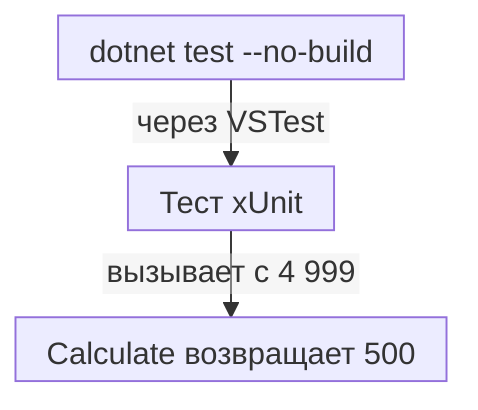

# Инструменты .NET, пакеты и тесты

[C#](README.md) · [English](../../en/csharp/tooling-and-testing.md)

Используйте .NET SDK 10. Примеры с пакетами и инструментами используют новые временные каталоги. Запускайте команды в Bash или Zsh с доступом к NuGet.org или зеркалу с нужными пакетами.

| Задача | Команда или запись в проекте | Пример |
| --- | --- | --- |
| Начать консольное приложение или веб-API | `dotnet new` и шаблон проекта | [Шаблоны проектов](#project-templates) |
| Добавить библиотеку и посмотреть зависимости | `dotnet package add`, `PackageReference`, `dotnet restore` | [Пакеты](#packages) |
| Дать команде одну версию инструмента | `dotnet tool` и манифест | [Инструменты .NET](#dotnet-tools) |
| Собрать и проверить правило | xUnit v3, `ProjectReference`, `dotnet test` | [Исполняемые тесты](#tests) |

<a id="project-templates"></a>

## Создать проект из шаблона

Проверьте доступные шаблоны командой `dotnet new list console` или `dotnet new list web`. Посмотрите параметры установленного шаблона через `dotnet new webapi --help`.

| Проект | Шаблон | Результат |
| --- | --- | --- |
| Консольная программа | `console` | Исполняемый проект с точкой входа |
| Повторно используемый код | `classlib` | Библиотека для ссылки из проекта или публикации как пакета |
| HTTP API | `webapi` | Начальный проект ASP.NET Core. Параметр `--use-controllers` создаёт проект с контроллерами. |
| Фоновый сервис | `worker` | Хост с примером `BackgroundService` |
| Тесты | `mstest`, `nunit`, `xunit` | Шаблоны SDK. Проверьте версии тестового фреймворка и платформы в созданном проекте. |

Файл `.csproj` задаёт SDK сборки, целевую платформу и зависимости. Решение объединяет проекты для сборки, IDE или тестов. Запись `ProjectReference` ссылается на проект, который собирается из исходников. Запись `PackageReference` ссылается на пакет NuGet с версией.

Веб-SDK `Microsoft.NET.Sdk.Web` автоматически подключает общую платформу ASP.NET Core `Microsoft.AspNetCore.App`. Если обычной библиотеке нужны её API, добавьте `<FrameworkReference Include="Microsoft.AspNetCore.App" />`. При публикации с зависимостью от платформы серверу нужна среда выполнения ASP.NET Core. Для API вне общей платформы добавьте совместимый пакет NuGet, например провайдер базы данных для EF Core.

<a id="packages"></a>

## Добавить и восстановить пакеты NuGet

Если виртуальное окружение Python активно, команда `python -m pip install "packaging==25.0"` устанавливает пакет в это окружение. Сам pip оставляет декларацию зависимостей проекта без изменений. В .NET команда `dotnet package add` обновляет декларацию зависимости и обычно запускает восстановление.

| Задача | Python с pip | .NET с NuGet |
| --- | --- | --- |
| Найти публичный пакет | PyPI | [NuGet.org](https://www.nuget.org/) |
| Записать прямую зависимость | Зависимости в `pyproject.toml` или файл требований, в зависимости от процесса | `PackageReference` в `.csproj`. При централизованном управлении версии хранятся в `Directory.Packages.props`. |
| Восстановить зависимости | `python -m pip install -r requirements.txt` для процесса с файлом требований | `dotnet restore` разрешает и загружает зависимости проекта, включая транзитивные |
| Задать источник | `--index-url` или конфигурация pip | `NuGet.Config` или параметры восстановления, например `--source` |
| Повторить разрешение зависимостей | Зафиксировать все зависимости в процессе с файлом требований | Сохранить `packages.lock.json` приложения в Git и использовать `dotnet restore --locked-mode` |

Создайте временный консольный проект. Добавьте конкретную версию Newtonsoft.Json. В .NET SDK 10 используйте `dotnet package add`. В более ранних SDK используйте `dotnet add package`.

```bash
demo_dir=$(mktemp -d) &&
  dotnet new console --name PackageDemo --framework net10.0 --output "$demo_dir" --no-restore &&
  dotnet package add Newtonsoft.Json --version 13.0.4 --project "$demo_dir/PackageDemo.csproj" &&
  dotnet package list --project "$demo_dir/PackageDemo.csproj" --include-transitive
```

В выводе указана запрошенная и разрешённая версия `13.0.4` для `Newtonsoft.Json`. Команда добавляет в `ItemGroup` проекта следующий фрагмент.

```xml
<PackageReference Include="Newtonsoft.Json" Version="13.0.4" />
```

Версия без скобок задаёт нижнюю границу включительно. Обычно NuGet выбирает самую низкую подходящую версию. Для точного ограничения укажите версию в квадратных скобках, например `Version="[13.0.4]"`. Ограничение прямой зависимости само по себе оставляет открытым выбор транзитивных версий. Создайте файл блокировки командой `dotnet restore --use-lock-file`. Используйте `--locked-mode` в CI, чтобы команда завершилась ошибкой при расхождении декларации и файла блокировки.

При восстановлении NuGet читает настройки источников и разрешает прямые и транзитивные зависимости. Разрешённый граф хранится в `obj/project.assets.json`. NuGet повторно использует файлы из общего кеша пакетов. Сборка и тесты обычно запускают восстановление автоматически. Используйте `--no-restore` после успешного восстановления с тем же проектом, целевой платформой и путём к артефактам.

Если для временного проекта нужен только NuGet.org, сохраните полную конфигурацию как `$demo_dir/NuGet.Config`. В общем репозитории можно хранить конфигурацию с источниками команды. Используйте сопоставление источников пакетов, если для каждого идентификатора нужно ограничить доступные источники.

```xml
<?xml version="1.0" encoding="utf-8"?>
<configuration>
  <packageSources>
    <clear />
    <add key="nuget.org" value="https://api.nuget.org/v3/index.json" />
  </packageSources>
</configuration>
```

```bash
dotnet restore "$demo_dir/PackageDemo.csproj" --configfile "$demo_dir/NuGet.Config" --use-lock-file &&
  dotnet restore "$demo_dir/PackageDemo.csproj" --configfile "$demo_dir/NuGet.Config" --locked-mode
```

Первая команда создаёт `packages.lock.json`. Вторая проверяет разрешение по файлу блокировки. При ошибке восстановления проверьте источники командой `dotnet nuget list source --configfile "$demo_dir/NuGet.Config"`. Если пакет найден, но несовместим, проверьте поддерживаемые платформы и значение `TargetFramework`.

<a id="dotnet-tools"></a>

## Установить инструмент .NET

Пакет инструмента предоставляет исполняемую команду. Используйте локальный манифест, если команда и CI должны запускать одну версию. Глобальная установка действует для текущего пользователя и подходит для личных команд. Добавьте каталог запуска глобальных инструментов в `PATH`.

Установите локальный инструмент во временный каталог. Пример проверяет версию CLI EF Core и обходится без базы данных.

```bash
tool_dir=$(mktemp -d) && (
  cd "$tool_dir" &&
  dotnet new tool-manifest &&
  dotnet tool install --local dotnet-ef --version 10.0.0 &&
  dotnet tool restore &&
  dotnet tool run dotnet-ef -- --version
)
```

Инструмент выводит `10.0.0`. В рабочем репозитории сохраните созданный `dotnet-tools.json`. После клонирования выполните `dotnet tool restore`. SDK также распознаёт манифест в `.config/dotnet-tools.json`. Для установки на уровне пользователя команда выглядит как `dotnet tool install --global dotnet-ef --version 10.0.0`. Согласуйте основную версию инструмента с пакетами EF Core проекта. Для команд миграции также нужны провайдер EF Core и пакет времени разработки в соответствующем проекте.

<a id="tests"></a>

## Собрать и запустить тесты стоимости доставки

Полный пример начисляет 500 центов за доставку при сумме заказа меньше 5 000 центов. При сумме от 5 000 центов доставка бесплатна. Отрицательная сумма недопустима. Пример принимает целое число центов и обходится без базы данных, сетевого сервиса и учётной записи.

| Файл | Роль |
| --- | --- |
| [`Shipping.csproj`](../../../examples/csharp/shipping/Shipping/Shipping.csproj) и [`ShippingFee.cs`](../../../examples/csharp/shipping/Shipping/ShippingFee.cs) | Библиотека с расчётом стоимости доставки для `net10.0` |
| [`Shipping.Tests.csproj`](../../../examples/csharp/shipping/Shipping.Tests/Shipping.Tests.csproj) и [`ShippingFeeTests.cs`](../../../examples/csharp/shipping/Shipping.Tests/ShippingFeeTests.cs) | Тестовый проект и тесты с синтетическими данными |

При сборке `ProjectReference` в `Shipping.Tests.csproj` подключает `Shipping.csproj`. Пакет xUnit v3 версии `3.2.2` предоставляет тестовые атрибуты и проверки. Пакет `Microsoft.NET.Test.Sdk` версии `18.0.1` обеспечивает интеграцию с VSTest. Пакет `xunit.runner.visualstudio` версии `3.1.5` служит адаптером xUnit. Пример использует VSTest, платформу тестирования .NET SDK 10 по умолчанию. Для Microsoft.Testing.Platform нужна совместимая конфигурация тестового проекта и другой набор параметров запуска.

Схема показывает один случай после сборки. VSTest находит тест через адаптер xUnit. Тест вызывает `ShippingFee.Calculate(4_999)` и проверяет, что метод вернул `500`.



Из корня репозитория восстановите зависимости. Затем соберите и запустите тесты. Для восстановления нужен доступ к NuGet или заполненный кеш пакетов. Используйте один временный каталог артефактов для всех трёх шагов.

```bash
test_project=examples/csharp/shipping/Shipping.Tests/Shipping.Tests.csproj
test_artifacts=$(mktemp -d) &&
  dotnet restore "$test_project" --artifacts-path "$test_artifacts" &&
  dotnet build "$test_project" --artifacts-path "$test_artifacts" --no-restore &&
  dotnet test "$test_project" --artifacts-path "$test_artifacts" --no-build
```

Ожидайте пять успешных случаев. Каждая строка `[InlineData]` запускает одну и ту же проверку `[Theory]` с разными данными. Атрибут `[Fact]` запускает проверку неверного ввода один раз.

Фрагмент метода из `ShippingFeeTests.cs`. Тестовый класс импортирует `Xunit` и вызывает `ShippingFee` из подключённой библиотеки.

```csharp
[Theory]
[InlineData(0, 500)]
[InlineData(4_999, 500)]
[InlineData(5_000, 0)]
[InlineData(7_500, 0)]
public void Calculate_ReturnsExpectedFee(int orderTotalInCents, int expectedFee)
{
    int actualFee = ShippingFee.Calculate(orderTotalInCents);

    Assert.Equal(expectedFee, actualFee);
}
```

| Ввод в центах | Проверка |
| --- | --- |
| `0` | Стоимость доставки равна `500` |
| `4999` | Стоимость равна `500` непосредственно перед порогом |
| `5000` | Стоимость равна `0` на пороге |
| `7500` | Стоимость равна `0` выше порога |
| `-1` | Исключение `ArgumentOutOfRangeException` для `orderTotalInCents` |

График показывает переход на пороге 5 000 центов. На пороге стоимость доставки падает с 500 центов до нуля.


Для повторного запуска только теста неверного ввода используйте переменные оболочки из предыдущего блока.

```bash
dotnet test "$test_project" --artifacts-path "$test_artifacts" --no-build \
  --filter 'FullyQualifiedName~Calculate_RejectsNegativeTotal'
```

Ожидайте один успешный случай.

Если VSTest не нашёл нужный тест, после сборки выведите список тестов без фильтра. Используйте те же переменные оболочки.

```bash
dotnet test "$test_project" --artifacts-path "$test_artifacts" --no-build --list-tests
```

Если нужного теста нет в списке, проверьте путь к проекту, тестовый SDK, адаптер и платформу тестирования. Если тест есть в списке, проверьте фильтр запуска. Если в `Calculate_ReturnsExpectedFee` метод вернул `500` для суммы `5_000`, проверьте условие порога в `ShippingFee.Calculate`. [Параметры VSTest](https://learn.microsoft.com/en-us/dotnet/core/tools/dotnet-test-vstest#options) · [Выбор границы теста](practice.md#test-at-the-right-boundary).

## Источники

- [Шаблоны SDK](https://learn.microsoft.com/en-us/dotnet/core/tools/dotnet-new-sdk-templates) и [ссылки на общую платформу ASP.NET Core](https://learn.microsoft.com/en-us/aspnet/core/fundamentals/target-aspnetcore?view=aspnetcore-10.0).
- [`dotnet package add`](https://learn.microsoft.com/en-us/dotnet/core/tools/dotnet-package-add), [`dotnet package list`](https://learn.microsoft.com/en-us/dotnet/core/tools/dotnet-package-list), [`PackageReference` и файлы блокировки](https://learn.microsoft.com/en-us/nuget/consume-packages/package-references-in-project-files), [диапазоны версий](https://learn.microsoft.com/en-us/nuget/concepts/package-versioning) и [`NuGet.Config`](https://learn.microsoft.com/en-us/nuget/reference/nuget-config-file).
- [`pip install`](https://pip.pypa.io/en/stable/cli/pip_install/), [`packaging` 25.0](https://pypi.org/project/packaging/25.0/) и [Newtonsoft.Json 13.0.4](https://www.nuget.org/packages/Newtonsoft.Json/13.0.4).
- [Локальные инструменты .NET](https://learn.microsoft.com/en-us/dotnet/core/tools/local-tools-how-to-use) и [CLI EF Core](https://learn.microsoft.com/en-us/ef/core/cli/dotnet).
- [Выпуск xUnit v3 3.2.2](https://xunit.net/releases/v3/3.2.2), [выпуск адаптера xUnit 3.1.5](https://xunit.net/releases/visualstudio/3.1.5), [Microsoft.NET.Test.Sdk 18.0.1](https://www.nuget.org/packages/Microsoft.NET.Test.Sdk/18.0.1) и [`dotnet test` с VSTest](https://learn.microsoft.com/en-us/dotnet/core/tools/dotnet-test-vstest).
