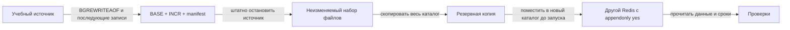

# Скопировать AOF Redis и проверить восстановление

[English](../../../../en/databases/non-relational/redis/aof-backup-and-restore.md)

Откройте страницу, чтобы восстановить данные Redis из полного набора файлов AOF.
AOF — журнал операций записи; Redis воспроизводит журнал при запуске.
TTL — оставшееся время жизни ключа.
Пример копирует файлы после штатной остановки учебного источника.
Источник будет недоступен во время копирования.

[Справочник Redis](README.md) · [Карточка AOF](operations.md#создать-и-восстановить-aof-копию) · [Пример RDB](backup-and-restore.md)

| Задача | Приём | Где |
| --- | --- | --- |
| Создать согласованную копию с остановкой источника | Скопировать весь appendonlydir | [Подготовка](#подготовить-запуск) · [Полная программа](#полный-пример) |
| Проверить состав журнала | Прочитать manifest, проверить BASE и INCR | [Состав файлов](#разобрать-состав-файлов) |
| Проверить значения и сроки | Сравнить данные, PEXPIRETIME и PTTL | [Результат](#проверить-результат) |

| Параметр | Значение |
| --- | --- |
| Уровень | Средний → продвинутый; административные команды выполняются только в учебных процессах |
| Предпосылки | Функции, словари, файлы, процессы, `with`, `try`/`finally` и `assert` в Python |
| Требования запуска | Redis Open Source 8.2.11, redis-cli 8.2.11, Python 3.14.7; Unix-сокеты на macOS или Linux |
| Зависимости | redis-server и redis-cli в PATH; Python использует только стандартную библиотеку |


## Разобрать состав файлов

Начиная с Redis 7.0 AOF может состоять из нескольких файлов.
Manifest — служебный список файлов и порядка их загрузки.
BASE содержит снимок исходных данных для переписанного журнала.
INCR содержит изменения после создания BASE; таких файлов может быть несколько.
Переписывание AOF создаёт более компактное представление текущих данных вместо полной истории команд.

Для этого примера возможен следующий состав каталога `appendonlydir`:

```text
appendonlydir/
├── appendonly.aof.manifest   # список частей журнала
├── appendonly.aof.2.base.rdb # BASE: начальное состояние в формате RDB
└── appendonly.aof.2.incr.aof # INCR: последующие команды записи
```

Номер `2` приведён как пример; программа читает имена из manifest.
Файл `.base.rdb` входит в AOF-набор, потому что включён `aof-use-rdb-preamble yes`.
Этот файл не заменяет весь журнал: для восстановления нужны также INCR и manifest.
Значение `appenddirname` задаёт имя каталога, а `appendfilename` — основу имён файлов.

Программа создаёт строку, hash и list, затем выполняет `BGREWRITEAOF` и ждёт завершения.
`BGREWRITEAOF` запускает фоновое переписывание; ответ команды ещё не означает готовность нового набора.
Проверки используют `INFO persistence`: rewrite завершён, не запланирован и имеет статус `ok`.
После переписывания программа меняет строку, дополняет list и создаёт два ключа с TTL.
Эти записи должны восстановиться из INCR, а исходные поля hash — из BASE.

Схема показывает этапы копирования и восстановления:



`SHUTDOWN NOSAVE` не создаёт отдельный RDB-снимок, но при штатной остановке Redis сбрасывает AOF на диск.
Программа требует успешного завершения источника перед копированием.
В примере `appendfsync always` выполняет синхронизацию AOF при записи; настройка выбрана для небольшого учебного набора.
Она не является универсальной рекомендацией для рабочего сервера.
Автоматическое переписывание отключено; единственное ручное переписывание завершается до остановки.


## Подготовить запуск

Установите Redis Open Source 8.2.11 по [официальным инструкциям](https://redis.io/docs/latest/operate/oss_and_stack/install/archive/install-redis/).
Добавьте `redis-server` и `redis-cli` этой версии в PATH.
Создайте отдельную учебную папку.
Сохраните файл [`aof_backup.py`](../../../../../examples/databases/non-relational/redis/aof_backup.py) в этой папке.
Выполните команды оболочки:

```bash
redis-server --version
redis-cli --version
python3 aof_backup.py
```

Дополнительные пакеты Python и другие файлы репозитория не нужны.
Программа сама создаёт процессы и не принимает адрес существующего Redis.
Unix-сокет — локальный файл для соединения; TCP отключён.
Все данные находятся в новом закрытом каталоге `/tmp/redis-aof-*`.

Запускайте программу без `-O`: она проверяет результаты через `assert`.
Программа отклоняет запуск с отключёнными проверками до создания каталога и процессов.


## Полный пример

Полный `aof_backup.py` проверяет исходный набор, обе копии и восстановленные данные.
SHA-256 — контрольная сумма содержимого; она позволяет сравнить байты файлов до запуска целевого Redis.
После запуска Redis может дописывать журнал, поэтому побайтовое сравнение выполняется заранее.

`inventory()` проверяет только контролируемый набор этого примера, а не произвольный manifest Redis.
Для этого набора ожидаются одна BASE в формате RDB, хотя бы одна непустая INCR и manifest.
Не переносите эти условия без изменения на произвольный AOF-каталог.
`INFO` возвращается как текст даже с `redis-cli --json`; помощник обрабатывает такой ответ отдельно.

[`redis/aof_backup.py`](../../../../../examples/databases/non-relational/redis/aof_backup.py)


## Проверить результат

Ожидается код завершения `0` и такие сообщения:

```text
OK: BASE + INCR восстановили строку, hash и порядок list
OK: абсолютный срок сохранён, оставшийся TTL уменьшился
OK: постоянные ключи без TTL, просроченный ключ отсутствует
OK: manifest и все его файлы скопированы без изменения байтов
```

Программа также выводит учебный каталог, имена частей и значения PTTL до и после восстановления.
Имена файлов и числа PTTL зависят от запуска.
`PEXPIRETIME` — абсолютный момент истечения в миллисекундах Unix-времени.
`PTTL` — оставшееся время в миллисекундах; `-1` означает отсутствие срока, `-2` — отсутствие ключа.

| Объект | Ожидаемый результат |
| --- | --- |
| Manifest и перечисленные части | Все файлы присутствуют; SHA-256 совпадает у источника и двух копий |
| `demo:title` | `after rewrite`, то есть изменение из INCR применилось |
| `demo:profile` | Поля `id=42` и `name=Alice` из BASE сохранились |
| `demo:queue` | `first`, `second`, `third`: сохранены исходный порядок и добавление из INCR |
| Три постоянных ключа | `PTTL == -1` |
| `demo:live` | Значение сохранено; PEXPIRETIME прежний, оставшийся PTTL положителен и уменьшился |
| `demo:expired` | Истёк во время простоя; отсутствует, `PTTL == -2` |
| БД 0 | Четыре ключа; AOF включён |

Время жизни продолжает уменьшаться во время остановки.
Восстановление AOF не выдаёт ключу исходные 120 секунд заново.
Блок `finally` останавливает только созданные процессы и при ошибке проверки.
Учебный каталог с источником, копией и журналами остаётся для просмотра.
После изучения удалите только каталог, который вывела программа.


## Ограничения

Сценарий рассчитан на копирование остановленного источника, одинаковые бинарные файлы Redis и стабильные часы одного компьютера.
Он не показывает копирование работающего экземпляра или переключение действующего RDB-сервера на AOF.
Для копирования без остановки нужен отдельный порядок управления переписыванием и границей копии.

Пример размещает файлы только в новом каталоге до запуска целевого Redis.
Не заменяйте AOF работающего экземпляра этим рецептом.
Пустой каталог при запуске с `appendonly yes` может создать новую пустую БД; это не подтверждает восстановление.
Поэтому программа проверяет наличие всего набора до запуска и состав данных после запуска.

`aof-load-truncated no` запрещает автоматическое принятие оборванного хвоста журнала.
Программа не ремонтирует файлы и не запускает `redis-check-aof --fix`.
Такой ремонт может удалить часть истории; сначала нужны сохранённая копия и оценка последствий.

Пример использует БД 0 и маленькие синтетические данные.
Он не проверяет конкурирующие записи, сбой питания, нехватку диска, модули, Cluster или разные версии Redis.
Большая задержка запуска или скачок часов может нарушить временные условия; проверки остановят сценарий.
Копия на том же компьютере не защищает от потери этого компьютера.
Для рабочего резервного копирования нужны отдельное хранение и регулярные проверки восстановления.


## Источники

- [Redis persistence: состав AOF и резервное копирование](https://redis.io/docs/latest/operate/oss_and_stack/management/persistence/).
- [BGREWRITEAOF](https://redis.io/docs/latest/commands/bgrewriteaof/), [SHUTDOWN](https://redis.io/docs/latest/commands/shutdown/), [INFO](https://redis.io/docs/latest/commands/info/).
- [EXPIRE: сроки и сохранение](https://redis.io/docs/latest/commands/expire/), [PEXPIRETIME](https://redis.io/docs/latest/commands/pexpiretime/).
- [Redis 8.2.11: формат manifest и загрузка AOF](https://github.com/redis/redis/blob/8.2.11/src/aof.c), [остановка сервера](https://github.com/redis/redis/blob/8.2.11/src/server.c).
- [Redis 8.2.11: release notes](https://github.com/redis/redis/releases/tag/8.2.11).

[Карточка AOF](operations.md#создать-и-восстановить-aof-копию) · [Пример RDB](backup-and-restore.md) · [Справочник Redis](README.md) · [Указатель задач](../../../tasks/README.md#redis)
