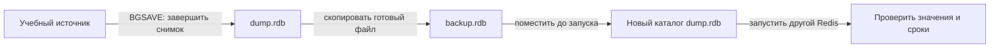

# Создать RDB-копию Redis и проверить восстановление

[English](../../../../en/databases/non-relational/redis/backup-and-restore.md)

Откройте страницу, чтобы сохранить данные Redis и проверить копию на отдельном экземпляре.
RDB — файл снимка данных на определённый момент.
TTL — оставшееся время жизни ключа; после истечения ключ становится недоступен.
Пример проверяет значения и сроки, а не только наличие файла.

[Справочник Redis](README.md) · [Короткая карточка](operations.md#создать-и-восстановить-rdb-копию) · [Отдельный пример AOF](aof-backup-and-restore.md)

| Задача | Приём | Где |
| --- | --- | --- |
| Создать копию и восстановить данные | Два отдельных Redis и один файл Python | [Подготовка](#подготовить-запуск) · [Полная программа](#полный-пример) |
| Проверить сроки жизни | Сравнить срок истечения и оставшийся TTL | [Ожидаемый результат](#проверить-результат) |
| Понять границы восстановления | Учесть момент снимка, AOF и часы | [Ограничения](#ограничения) |

| Параметр | Значение |
| --- | --- |
| Уровень | Средний; административные команды выполняются только в учебных процессах |
| Предпосылки | Функции, словари, `with`, `try`/`finally`, `assert`, процессы и файлы Python |
| Требования запуска | Redis Open Source 8.2.11, redis-cli 8.2.11, Python 3.14.7; macOS или Linux с Unix-сокетами |
| Зависимости | Два бинарных файла Redis в PATH; Python использует только стандартную библиотеку |


## Как устроен пример

Программа сама создаёт два процесса Redis с разными Unix-сокетами.
Unix-сокет — локальный файл для соединения с процессом без TCP-порта.
Каталог каждого запуска создаётся заново в `/tmp` и доступен только текущему пользователю.
Программа не принимает адрес существующего Redis.

Источник содержит строку, hash с полями профиля и list с двумя элементами.
Ещё два строковых ключа имеют TTL: 120 секунд и 5 секунд.
Пример выполняет следующие этапы:



`BGSAVE` начинает фоновое сохранение; ответ команды ещё не означает готовность файла.
Программа ждёт завершения по `INFO persistence` и проверяет статус `ok`.
В свежем каталоге нет старого `dump.rdb`, который можно случайно принять за новую копию.
После завершения программа копирует файл в `backup.rdb` и сравнивает SHA-256.
SHA-256 — контрольная сумма содержимого; равенство сумм подтверждает совпадение скопированных байтов.
Пригодность копии подтверждается последующим запуском Redis и проверкой данных.

После копирования программа изменяет строку и добавляет ключ в источнике.
Затем программа останавливает источник через `SHUTDOWN NOSAVE` и ждёт истечения короткого TTL.
Эта команда завершает только созданный учебный процесс, без сохранения поздних изменений.
Копия загружается в другой процесс из нового каталога с отключённым AOF.
AOF — журнал операций записи; при одновременном включении AOF и RDB Redis предпочитает AOF при запуске.


## Подготовить запуск

Установите Redis Open Source 8.2.11 по [официальным инструкциям](https://redis.io/docs/latest/operate/oss_and_stack/install/archive/install-redis/).
Добавьте `redis-server` и `redis-cli` этой версии в PATH.
Создайте отдельную учебную папку.
Сохраните файл [`rdb_backup.py`](../../../../../examples/databases/non-relational/redis/rdb_backup.py) в этой папке.
Выполните команды оболочки из учебной папки:

```bash
redis-server --version
redis-cli --version
python3 rdb_backup.py
```

Дополнительные пакеты Python не нужны.
Запускайте программу без `-O`: проверки `assert` обязательны.
Программа отклоняет запуск с отключёнными проверками до создания процессов.


## Полный пример

Полный файл `rdb_backup.py` создаёт данные, копирует RDB и выполняет проверки.
Он запускает `redis-cli` с `--json` для разбора ответов.
Команда `INFO` возвращается как текст даже при этом флаге; помощник обрабатывает её отдельно.
Флаг `-e` превращает ошибку команды Redis в ненулевой код завершения клиента.
Все Redis-команды передаются отдельными аргументами, без выполнения команд оболочкой.

[`redis/rdb_backup.py`](../../../../../examples/databases/non-relational/redis/rdb_backup.py)


## Проверить результат

Ожидается завершение с кодом `0` и такими строками:

```text
OK: string, hash, list и ключи без срока восстановлены
OK: срок истечения сохранён, оставшийся TTL уменьшился
OK: просроченный ключ и запись после снимка отсутствуют
```

Программа также выводит учебный каталог, два значения PTTL и контрольную сумму RDB.
Числа PTTL и контрольная сумма зависят от момента запуска.
`PTTL` возвращает оставшееся время в миллисекундах.
Значение `-1` означает ключ без срока; значение `-2` означает отсутствие ключа.
`PEXPIRETIME` возвращает абсолютный момент истечения в миллисекундах Unix-времени.

| Проверяемый объект | Ожидаемый результат |
| --- | --- |
| `demo:title` | `before snapshot`; изменение после снимка не возвращается |
| `demo:profile` | Поля `id=42` и `name=Alice` сохранены |
| `demo:queue` | Элементы `first`, `second` сохранили порядок |
| Три ключа без TTL | `PTTL == -1` |
| `demo:live` | Значение сохранено; PEXPIRETIME совпадает, оставшийся PTTL положителен и меньше прежнего |
| `demo:expired` | Ключ отсутствует; `PTTL == -2` |
| `demo:later` | Ключ, созданный после снимка, отсутствует |
| Размер восстановленной БД 0 | Четыре ключа |

Redis хранит момент истечения, поэтому TTL продолжает уменьшаться во время простоя.
Восстановление не выдаёт ключу исходные 120 секунд заново.

Блок `finally` останавливает созданные процессы и при ошибке проверки.
Учебный каталог с копией, исходным RDB и журналами остаётся для просмотра.
После изучения удалите только каталог, который вывела программа.


## Ограничения

Этот пример использует маленький набор данных и один компьютер со стабильными часами.
Большое расхождение часов между компьютерами меняет результат проверки сроков.
Если машина работает слишком медленно, короткий ключ может истечь до сохранения; соответствующая проверка остановит сценарий.

RDB относится к моменту снимка, а не к моменту восстановления.
Изменения после снимка в эту копию не входят.
Файл RDB может содержать несколько логических БД; пример создаёт данные только в БД 0.

Не подменяйте файл работающего экземпляра этим рецептом.
Пример размещает RDB только в новом каталоге до запуска целевого Redis.
Для восстановления нужны совместимые формат RDB, версия Redis и используемые модули.
Пример использует одинаковые бинарные файлы для обоих процессов.

Сценарий не проверяет конкурентные записи во время BGSAVE, повреждённые копии, AOF, Cluster или восстановление после сбоя питания.
Копия на том же компьютере демонстрирует механизм и не защищает от потери этого компьютера.
Для рабочей резервной копии нужны отдельное хранение и регулярные проверки восстановления.


## Источники

- [Redis: RDB, копирование готового файла и восстановление](https://redis.io/docs/latest/operate/oss_and_stack/management/persistence/).
- [BGSAVE](https://redis.io/docs/latest/commands/bgsave/), [INFO persistence](https://redis.io/docs/latest/commands/info/).
- [EXPIRE: сроки и сохранение](https://redis.io/docs/latest/commands/expire/), [PTTL](https://redis.io/docs/latest/commands/pttl/), [PEXPIRETIME](https://redis.io/docs/latest/commands/pexpiretime/).
- [Redis 8.2.11: сохранение и загрузка RDB](https://github.com/redis/redis/blob/8.2.11/src/rdb.c).
- [Redis 8.2.11: release notes](https://github.com/redis/redis/releases/tag/8.2.11).

[Карточка RDB](operations.md#создать-и-восстановить-rdb-копию) · [Справочник Redis](README.md) · [Указатель задач](../../../tasks/README.md#redis)
