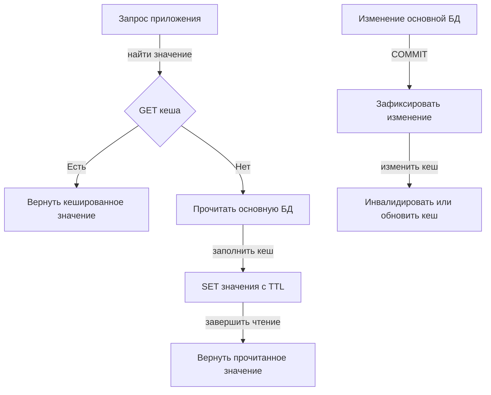

# Структуры, TTL и кеширование

[English](../../../../en/databases/non-relational/redis/data-and-caching.md)

Откройте страницу для выбора структуры и срока жизни данных в Redis 8.2.
Для кеша заранее определите источник истины и допустимую устарелость.


## Быстрый поиск

| Данные и задача | Приём | Пример / подробности |
| --- | --- | --- |
| Обновить значение, сохранив срок | SET XX KEEPTTL | [TTL](#обновить-значение-и-сохранить-срок) |
| Выбрать структуру под операции | String, hash, list, set, sorted set | [Структуры](#выбрать-структуру-по-данным) |
| Снизить чтения основной БД | Cache-aside и инвалидирование | [Кеширование](#кеширование-cache-aside) |
| Выполнить все операции в учебном Redis | Отдельный процесс и случайные ключи | [Подготовка](data-lab.md#подготовка) · [Полный код](data-lab.md#полный-пример-структуры-и-ttl) |

[К Redis](README.md)

| Параметр | Значение |
| --- | --- |
| Уровни | Базовый — структуры/TTL; средний — кеширование |
| Предпосылки | Выделенный Redis 8.2, Python 3.14 и redis-py 8.1.0 |


## Подготовка

Для полного запуска используйте [установку клиента и изолированный Redis](data-lab.md#подготовка).
Не направляйте примеры в рабочую БД.
Короткие фрагменты ниже продолжают полную программу: `client` — клиент с `decode_responses=True`, `cache` — её собственный ключ.

<a id="полный-пример-структуры-и-ttl"></a>


## Обновить значение и сохранить срок

**Когда:** нужно обновить существующий ключ с TTL и сохранить оставшийся срок.
Фрагмент Python использует учебный клиент и собственный ключ из [полной программы](data-lab.md#полный-пример-структуры-и-ttl).
Первая команда готовит значение со сроком 60 секунд:

```python
client.set(cache, '{"name":"Ada"}', ex=60)
updated = client.set(cache, '{"name":"Ada Lovelace"}', xx=True, keepttl=True)
if updated is None:
    print("Ключ отсутствует; обновление пропущено")
else:
    print("Значение обновлено")
```

**Результат:** если ключ существует с TTL в момент обновления, значение меняется, а исходный срок продолжает уменьшаться.
Если ключ исчез до обновления, `XX` запрещает создание ключа; redis-py возвращает `None`.

**Ограничение:** `XX` проверяет существование ключа, но не наличие TTL.
Если другой клиент снял TTL или заменил ключ бессрочным значением, `KEEPTTL` сохранит отсутствие срока.
Для такой конкуренции нужен отдельный атомарный протокол проверки срока и записи.

Если SET не задаёт новый срок и не использует KEEPTTL, команда снимает прежний TTL.
TTL не гарантирует наличие ключа до истечения: ключ могут удалить приложение или eviction.
Полная программа выполняет операции последовательно над собственными ключами изолированного Redis.


## Выбрать структуру по данным

**Когда:** известны операции над значением и требования к порядку или уникальности.
Выберите структуру по этим требованиям.

| Данные | Команды | Ограничение |
| --- | --- | --- |
| String / двоичное значение | SET/GET/MGET, INCR | INCR требует строковое целое; сериализацию объекта выбирает приложение |
| Hash | HSET/HGET/HGETALL | Отдельные поля; тип/валидацию полей определяет приложение |
| List | LPUSH/RPUSH/LPOP/LRANGE | Порядок; большие диапазоны дороги; после LPOP нет ACK или повтора |
| Set | SADD/SISMEMBER/SINTER | Уникальность, порядок не гарантирован |
| Sorted set | ZADD/ZRANGE/ZREVRANGE | Сортировка по score, при равенстве — правила структуры |
| Bitmap / HyperLogLog / geo | SETBIT / PFADD / GEOADD | Специализированные задачи; HyperLogLog даёт оценку количества, не точное множество |
| [Stream](transactions-and-messaging.md#полный-пример-stream-и-pubsub) | XADD/XREADGROUP/XACK | Журнал сообщений и учёт доставки; сохраняемость зависит от конфигурации |

Проверьте тип через TYPE.
Повторное использование имени для другой структуры даёт WRONGTYPE.

TTL/PTTL возвращают секунды/миллисекунды.
EXPIRE/PEXPIRE меняют срок.
PERSIST снимает срок.
INCR/HSET сохраняют существующий TTL.

Для обхода большого namespace используйте SCAN с MATCH/COUNT.
Учитывайте возможные повторы и изменения во время обхода.
COUNT задаёт подсказку, а не жёсткий размер порции.


## Кеширование cache-aside

**Средний уровень.** Источник истины находится в основной БД.
Redis хранит копию с ограниченным сроком.

Схема показывает вызовы приложения при чтении и изменении основной БД:



Схема показывает протокол без гарантии строгой согласованности.
Конкурентное чтение может заполнить кеш старым значением после инвалидирования.
Выберите допустимую устарелость, версионирование или другой протокол.
Добавляйте небольшой разброс TTL, чтобы уменьшить массовое одновременное истечение.
Ограничивайте параллельное заполнение горячего ключа.
Для отсутствующих объектов можно кешировать специальный отрицательный ответ на короткий срок.

Ошибка кеша не должна молча перегрузить основную БД.
Задайте лимиты, наблюдение и определённый fallback.
Отдельно задайте maxmemory и eviction policy.
Кешируемые и незаменимые данные часто стоит разделить по экземплярам.
Цель разделения — сохранить прикладное состояние при вытеснении кеша.
SET NX PX может быть частью блокировки.
Безопасное освобождение блокировки требует проверки токена.
Без анализа отказов SET NX PX не образует готовую распределённую блокировку.


## Источники

- [Структуры](https://redis.io/docs/latest/develop/data-types/), [SET](https://redis.io/docs/latest/commands/set/), [EXPIRE](https://redis.io/docs/latest/commands/expire/), [TTL](https://redis.io/docs/latest/commands/ttl/).
- [SCAN](https://redis.io/docs/latest/commands/scan/), [eviction](https://redis.io/docs/latest/develop/reference/eviction/), [cache-aside](https://redis.io/tutorials/howtos/solutions/microservices/caching/).
- [Redis 8.2.11: release notes](https://github.com/redis/redis/releases/tag/8.2.11).
