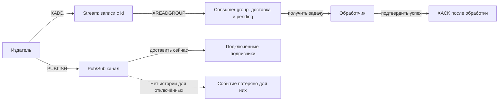

# Атомарные изменения и доставка сообщений

[English](../../../../en/databases/non-relational/redis/transactions-and-messaging.md)

Откройте страницу, если несколько изменений конкурируют или сообщения требуют определённой гарантии доставки.
Сначала выберите границу атомарности и допустимое поведение при повторе или отключении.


## Быстрый поиск

| Условие задачи | Приём | Пример / подробности |
| --- | --- | --- |
| Команды независимы; важны сетевые ожидания | Pipeline без транзакции | [Сравнение](#атомарность-транзакция-и-pipeline) |
| Группа изменений не допускает вмешательства | MULTI/EXEC | [Короткая карточка](#изменить-счётчик-и-срок-одной-группой) |
| Изменение зависит от прочитанного значения | WATCH и ограниченный повтор | [Конфликт](transactions-lab.md#полный-пример-конфликт-и-ошибка-команды) |
| Задачу подтверждают после обработки | Stream, pending и XACK | [Доставка](#подтвердить-обработанное-сообщение) |
| Нужны только временные уведомления | Pub/Sub без истории | [Полная проверка](transactions-lab.md#полный-пример-stream-и-pubsub) |

[К Redis](README.md)

| Параметр | Значение |
| --- | --- |
| Уровни | Средний — pipeline/MULTI/WATCH; продвинутый — stream/доставка |
| Предпосылки | Подготовка и REDIS_URL из [первого примера](data-lab.md#подготовка); standalone Redis 8.2 |


## Атомарность, транзакция и pipeline

| Механизм | Для чего | Чего не гарантирует |
| --- | --- | --- |
| Одна команда, например INCR | Атомарное изменение одного значения | Сохранность на диске при любой конфигурации |
| Pipeline | Отправка нескольких команд без отдельного ожидания каждого ответа | Отсутствие вмешательства других клиентов, если нет MULTI/EXEC |
| MULTI → команды → EXEC | Выполнение группы без команд другого клиента внутри группы | Откат успешных команд после runtime error одной команды |
| WATCH → чтение → MULTI/EXEC | Оптимистическая проверка отсутствия изменения наблюдаемого ключа | Успех без повторов; данные могут измениться и EXEC отменится |
| Lua / Redis Functions | Чтение, проверка и изменение на сервере в одной атомарной операции | Автоматический rollback уже сделанных записей при любой ошибке; бесконечный ресурс времени |

redis-py `pipeline()` по умолчанию использует транзакцию.
Для чистого pipeline явно задайте transaction=False.
WATCH привязывает соединение до завершения или reset.
Используйте контекстный менеджер.
DISCARD отменяет очередь до EXEC.
Ошибки постановки команд отличаются от ошибок исполнения.
При ошибке исполнения проверьте каждый результат.
Не предполагайте полный откат.

<a id="полный-пример-конфликт-и-ошибка-команды"></a>


## Изменить счётчик и срок одной группой

**Когда:** счётчик и его срок нужно изменить без команд другого клиента внутри группы.
Ниже — фрагмент [полной программы](transactions-lab.md#полный-пример-конфликт-и-ошибка-команды).
`client` — подготовленный redis-py-клиент; `counter` — собственный ключ со значением `1`.

```python
with client.pipeline(transaction=True) as pipe:
    pipe.incr(counter)
    pipe.expire(counter, 60)
    results = pipe.execute()
assert results == [2, True]
```

**Результат:** счётчик равен `2`, срок установлен на 60 секунд.
MULTI/EXEC не откатывает успешные команды после runtime error другой команды.
[Полная программа](transactions-lab.md#полный-пример-конфликт-и-ошибка-команды) отдельно проверяет это ограничение и конфликт WATCH.

После WatchError приложение обычно читает данные заново и ограниченно повторяет операцию.
Для нескольких ключей в Redis Cluster нужна совместимость hash slots.
Операции одной транзакции не образуют распределённую транзакцию по произвольным шардам.

<a id="полный-пример-stream-и-pubsub"></a>


## Подтвердить обработанное сообщение

**Когда:** задача должна оставаться в pending до успешной прикладной обработки.
Ниже — фрагмент [полной программы](transactions-lab.md#полный-пример-stream-и-pubsub).
`client` — подготовленный redis-py-клиент; `stream` — собственный stream с группой `workers` и одной новой записью.

```python
deliveries = client.xreadgroup("workers", "worker-1", {stream: ">"}, count=1, block=500)
message_id, fields = deliveries[0][1][0]
# Сначала надёжно завершите прикладную обработку fields.
client.xack(stream, "workers", message_id)
assert client.xpending(stream, "workers")["pending"] == 0
```

**Результат:** XACK снимает запись с pending группы после обработки.
Фрагмент предполагает непустую доставку; реальный обработчик должен проверить пустой результат.
ACK не удаляет тело сообщения и не делает внешний побочный эффект атомарным.
[Полная программа](transactions-lab.md#полный-пример-stream-и-pubsub) создаёт stream и проверяет отдельную Pub/Sub-доставку.

В примере нет внешнего побочного эффекта.
При повторной доставке обработчик должен быть идемпотентным.

Схема сравнивает путь сообщения через stream и временный канал Pub/Sub:



Stream сохраняет записи до удаления или обрезки.
Сохранность при сбое зависит от persistence.
Наблюдайте зависшие pending.
Переназначайте зависшие pending через XAUTOCLAIM или другой протокол.
Обрабатывайте повторы.
Согласуйте retention/MAXLEN с задержкой consumers.
Один ACK не восстановит удалённое тело сообщения.
Pub/Sub имеет at-most-once доставку.
Отключение или ошибка подписчика не создаёт очередь повторов.


## Источники

- [Транзакции / WATCH / ошибки](https://redis.io/docs/latest/develop/using-commands/transactions/), [pipelining](https://redis.io/docs/latest/develop/using-commands/pipelining/).
- [Streams](https://redis.io/docs/latest/develop/data-types/streams/), [XACK](https://redis.io/docs/latest/commands/xack/), [XAUTOCLAIM](https://redis.io/docs/latest/commands/xautoclaim/).
- [Pub/Sub и гарантии](https://redis.io/docs/latest/develop/pubsub/), [redis-py pipeline](https://redis.readthedocs.io/en/v8.1.0/advanced_features.html).
- [Redis 8.2.11: release notes](https://github.com/redis/redis/releases/tag/8.2.11).
