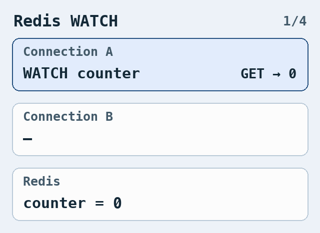
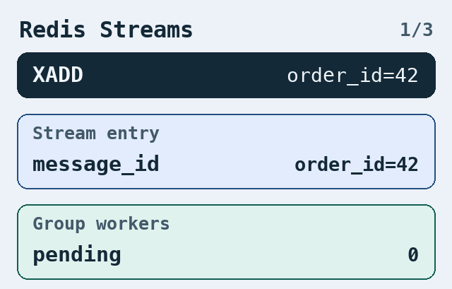

# Проверить транзакцию и доставку Redis

[English](../../../../en/databases/non-relational/redis/transactions-lab.md)

Откройте страницу для полного запуска конфликта WATCH, ошибки команды и доставки сообщений.
Используйте отдельный standalone Redis 8.2; все ключи получают случайный namespace.
[К карточкам транзакций и сообщений](transactions-and-messaging.md) · [К Redis](README.md).

| Задача | Приём | Пример |
| --- | --- | --- |
| Проверить конфликт и отсутствие runtime rollback | WATCH и MULTI/EXEC | [Полная программа](#полный-пример-конфликт-и-ошибка-команды) |
| Проверить pending, ACK и временное уведомление | Stream и Pub/Sub | [Полная программа](#полный-пример-stream-и-pubsub) |

| Параметр | Значение |
| --- | --- |
| Уровень | Средний — транзакции; продвинутый — доставка |
| Предпосылки | [Подготовленные redis-py 8.1.0 и REDIS_URL](data-lab.md#подготовка); Python 3.14 |

## Полный пример: конфликт и ошибка команды

Сохраните пример как `transactions.py`.
Выполните `python transactions.py` в подготовленном окружении.
Скрипт намеренно вызывает конфликт WATCH и ошибку INCR.
Скрипт проверяет оба результата и удаляет только свои ключи.

[`redis/transactions.py`](../../../../../examples/databases/non-relational/redis/transactions.py)

**Результат:** `OK: pipeline, WATCH conflict, MULTI/EXEC and no runtime rollback`.
Конфликт WATCH оставляет значение `1`.
Ошибка INCR не отменяет успешный SET того же EXEC.
Ключи удаляются в finally.

Показать конфликт WATCH по шагам

Соединение с `WATCH` читает `counter = 0`. Другое соединение из пула увеличивает счётчик до `1`. Первое соединение использует прежнее значение и ставит `SET counter 10` в очередь `MULTI`. При `EXEC` Redis возвращает null и пропускает запись. redis-py сообщает об ошибке `WatchError`. Значение остаётся равным `1`.

[Открыть GIF для повторного просмотра](../../../../assets/redis-watch-conflict.gif?raw=true)

## Полный пример: stream и Pub/Sub

**Продвинутый уровень.** Сохраните пример как `messaging.py`.
Выполните `python messaging.py`.
Пример создаёт stream с собственной группой.
Pub/Sub-подписка ограничена одной доставкой без бесконечного цикла.

[`redis/messaging.py`](../../../../../examples/databases/non-relational/redis/messaging.py)

**Результат:** `OK: stream delivery/pending/ACK and bounded Pub/Sub notification`.
После XACK pending равен нулю; это не удаляет запись stream.
Pub/Sub проверяет одно уведомление уже подключённого подписчика.
Программы не моделируют сбой обработчика или внешний побочный эффект.

Показать, что меняется после XACK

`XADD` сохраняет запись в потоке. Когда `XREADGROUP` передаёт запись обработчику `worker-1`, в группе `workers` появляется одна запись в списке pending. После обработки `XACK` убирает эту запись из списка pending группы. Запись остаётся в потоке, где её можно прочитать через `XRANGE`.

[Открыть GIF для повторного просмотра](../../../../assets/redis-streams-ack.gif?raw=true)

## Источники

- [Транзакции / WATCH / ошибки](https://redis.io/docs/latest/develop/using-commands/transactions/), [pipelining](https://redis.io/docs/latest/develop/using-commands/pipelining/).
- [Streams](https://redis.io/docs/latest/develop/data-types/streams/), [XACK](https://redis.io/docs/latest/commands/xack/), [XAUTOCLAIM](https://redis.io/docs/latest/commands/xautoclaim/).
- [Pub/Sub и гарантии](https://redis.io/docs/latest/develop/pubsub/), [redis-py pipeline](https://redis.readthedocs.io/en/v8.1.0/advanced_features.html).
- [Redis 8.2.11: release notes](https://github.com/redis/redis/releases/tag/8.2.11).
