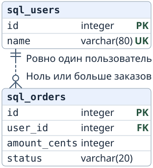

# Подготовить учебные таблицы SQL

[English](../../../en/databases/sql/query-lab.md)

Пример создаёт пользователей и заказы для карточек SQL.
[К карточкам запросов](queries.md) · [К SQL](README.md).

Нужна новая учебная БД PostgreSQL 18 или SQLite 3.53 со свободными именами `sql_users` и `sql_orders`.

## Полный пример

Сохраните SQL как `demo.sql`.
В PostgreSQL выберите отдельную учебную БД.
Запустите `psql -X --set=ON_ERROR_STOP=1 --dbname=имя_учебной_бд --file=demo.sql`.
В SQLite выберите новый файл sql-demo.db в отдельном учебном каталоге.
Запустите `sqlite3 -bail -cmd 'PRAGMA foreign_keys=ON' sql-demo.db < demo.sql`.
Эти команды выполняются в оболочке, а не в SQL.
MySQL/SQL Server требуют адаптации управления транзакцией из [таблицы диалектов](dialects-and-transactions.md).

Полный SQL-пример предназначен для PostgreSQL/SQLite.
Пример создаёт только учебные объекты без DROP:

[`sql/demo.sql`](../../../../examples/databases/sql/demo.sql)

Ожидаемые суммы: `alice | 14000`, `bob | 0`, `carol | 0`.
Значение preserved_amount равно `10000`.
Сумма хранится в целых условных центах, чтобы пример не зависел от округления REAL.
Идентификаторы задаются явно: генерация ключей различается между СУБД.
[Следующие карточки](queries.md) используют эти таблицы в той же БД.

Схема показывает ключи и связь учебных таблиц.

- Две черты у `sql_users` означают одного пользователя для каждого заказа. Это обеспечивают `NOT NULL` и внешний ключ `user_id`.
- Кружок и развилка у `sql_orders` означают, что у пользователя может быть любое число заказов, включая ноль.
- Пунктир показывает неидентифицирующую связь. У заказа собственный первичный ключ `sql_orders.id`. Обозначения `PK`, `FK` и `UK` указывают первичный ключ, внешний ключ и ограничение уникальности соответственно.

[Обозначения связей в ER-схемах](https://mermaid.js.org/syntax/entityRelationshipDiagram.html#relationship-syntax).

## Источники

- [PostgreSQL: JOIN/группы](https://www.postgresql.org/docs/18/queries-table-expressions.html), [CTE](https://www.postgresql.org/docs/18/queries-with.html), [окна](https://www.postgresql.org/docs/18/functions-window.html).
- [SQLite: SELECT](https://www.sqlite.org/lang_select.html), [WITH](https://www.sqlite.org/lang_with.html), [окна](https://www.sqlite.org/windowfunctions.html).
- [SQLite: scalar subquery](https://www.sqlite.org/lang_expr.html#subquery_expressions), [PostgreSQL: scalar subquery](https://www.postgresql.org/docs/18/sql-expressions.html#SQL-SYNTAX-SCALAR-SUBQUERIES).
- [MySQL 8.4: JOIN](https://dev.mysql.com/doc/refman/8.4/en/join.html), [SQL Server: CTE](https://learn.microsoft.com/en-us/sql/t-sql/queries/with-common-table-expression-transact-sql?view=sql-server-ver17).
- [PostgreSQL 18.6: release notes](https://www.postgresql.org/docs/18/release-18-6.html), [SQLite 3.53.4: release notes](https://www.sqlite.org/releaselog/3_53_4.html).
