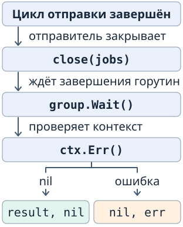

# Отмена, goroutines и общие данные

[English](../../en/go/concurrency-and-testing.md)

Откройте страницу, чтобы обработать список параллельно или защитить данные нескольких goroutines.
Примеры сохраняют порядок строк и ждут завершения всех запущенных workers перед возвратом.
[Справочник Go](README.md) · [Файлы модуля](language.md#полный-модуль)

| Задача | Приём | Пример |
| --- | --- | --- |
| Обработать список с ограничением параллелизма | Фиксированные workers и индексы результата | [Worker pool](#ограниченный-worker-pool) |
| Завершить работу по отмене | `context` в отправителе и workers | [Отмена](#отменить-обработку) |
| Изменять общий счётчик без потерянных обновлений | Один mutex для чтения и записи | [Счётчик](#общие-данные-и-mutex) |
| Проверить порядок, ошибки и гонки | Тесты и `-race` | [Проверка](#тесты-и-race-detector) |

**Уровень:** средний → продвинутый.
Предпосылки: функции, slices, error и владение памятью; Go 1.27.
Фрагменты используют стандартную библиотеку.
Сохраните [worker.go, counter.go и worker_test.go](examples/concurrency-and-testing.md) вместе с `go.mod` по [подготовке примера](examples/concurrency-and-testing.md#подготовка).


## Ограниченный worker pool

**Ситуация:** список `go, python, rust` нужно перевести в верхний регистр двумя workers.
Порядок ответа должен совпасть с входным порядком.
Передайте каждому заданию индекс; дождитесь workers до чтения результата.

**Пример — фрагмент внутри `main`; импорты: `context`, `fmt`, `example.com/cheatsheet`:**

```go
input := []string{"go", "python", "rust"}
result, err := cheatsheet.Uppercase(context.Background(), input, 2)
fmt.Println(result, err) // [GO PYTHON RUST] <nil>
```

**Результат:** две goroutines записывают результаты по индексам входного списка.
Если `python` обработан раньше `go`, значение `PYTHON` всё равно попадёт в `result[1]`.
Не изменяйте входной срез во время работы.
Для коротких строк расходы на goroutines могут превысить пользу параллелизма; пример не измеряет ускорение.

Схема показывает порядок завершения работы.
Отправитель закрывает `jobs`, когда отправил все задания или выбрал ветку `ctx.Done()`.
Каждый worker вызывает `Done()` при выходе. После `Wait()` функция проверяет ошибку контекста.
Если `ctx.Err()` вернул ошибку, функция возвращает `nil` и ошибку. Иначе функция возвращает результат.



[Полный пример с `worker.go`](examples/concurrency-and-testing.md#ограниченный-worker-pool)


## Отменить обработку

Вызывающий код отменяет задачу. Функция возвращает ошибку контекста.
Передайте `context` первым аргументом; предусмотрите выход из блокирующего `select` у отправителя и workers.

**Пример — самостоятельный фрагмент внутри `main`; импорты: `context`, `errors`, `fmt`, `example.com/cheatsheet`:**

```go
ctx, cancel := context.WithCancel(context.Background())
cancel()
result, err := cheatsheet.Uppercase(ctx, []string{"go"}, 2)
fmt.Println(result == nil, errors.Is(err, context.Canceled)) // true true
```

**Результат:** уже отменённый context отклоняет обработку до запуска workers.
При отмене во время работы workers проверяют `Done()` между заданиями.
Отмена не прерывает `strings.ToUpper` посередине операции.
Если готовы несколько веток `select`, отмена не имеет абсолютного приоритета.
Пример не гарантирует отсутствие заданий после `cancel`.
Для `WithTimeout` также вызывайте `cancel`, обычно через `defer`.
Не используйте context как контейнер произвольных параметров.

[Полная реализация](examples/concurrency-and-testing.md#ограниченный-worker-pool) · [Тест отказа](examples/concurrency-and-testing.md#тесты-и-race-detector)


## Общие данные и mutex

**Ситуация:** двадцать goroutines увеличивают один счётчик по сто раз.
Каждое увеличение должно сохраниться, а чтение не должно пересекаться с незащищённой записью.
Используйте один mutex для обоих методов.

**Пример — самостоятельный фрагмент внутри `main`; импорты: `fmt`, `sync`, `example.com/cheatsheet`:**

```go
var counter cheatsheet.Counter
var group sync.WaitGroup
for range 20 {
    group.Add(1)
    go func() {
        defer group.Done()
        for range 100 {
            counter.Add(1)
        }
    }()
}
group.Wait()
fmt.Println(counter.Value()) // 2000
```

**Результат:** счётчик равен `2000` после завершения всех goroutines.
Нулевое значение `Counter` пригодно к использованию.
Передавайте `Counter` указателем; не копируйте mutex после начала использования.
Канал переносит данные или сигналы; mutex защищает инвариант общей памяти.
Для независимого счётчика возможен atomic-тип; не смешивайте atomic и обычные обращения к тому же значению.

[Полный counter.go](examples/concurrency-and-testing.md#общие-данные-и-mutex)


## Тесты и race detector

После добавления [полного worker_test.go](examples/concurrency-and-testing.md#тесты-и-race-detector) запустите команды из каталога модуля:

```bash
go test -count=1 ./...
go vet ./...
go test -race -count=1 ./...
```

**Результат:** тесты проверяют порядок строк, пустой ввод, недопустимое число workers, отменённый context и точное число инкрементов.
Race detector требует поддерживаемой платформы и средств сборки.
`-race` обнаруживает гонки только на выполненных путях; логические гонки и deadlock требуют отдельных проверок.
Timeout теста ограничивает ожидание, но не доказывает отсутствие любых утечек goroutines.
`-count=1` отключает использование кешированного результата теста.

| Ситуация | Что сделать |
| --- | --- |
| Создан `WithCancel` / `WithTimeout` | Вызовите cancel, обычно через defer |
| Worker блокируется на send | Добавьте `ctx.Done()` либо другой гарантированный путь завершения |
| Нужно дождаться goroutines | Вызовите Add до запуска, Done в worker, Wait после запуска |
| Несколько workers возвращают ошибки | Определите политику отмены/сбора; этот пример возвращает только ошибку context |
| Канал равен nil | Send/receive блокируются; используйте это свойство только в осознанном select |


## Источники

[context](https://pkg.go.dev/context), [sync](https://pkg.go.dev/sync),
[memory model](https://go.dev/ref/mem), [race detector](https://go.dev/doc/articles/race_detector),
[testing](https://pkg.go.dev/testing), [Go 1.27 release notes](https://go.dev/doc/go1.27).
