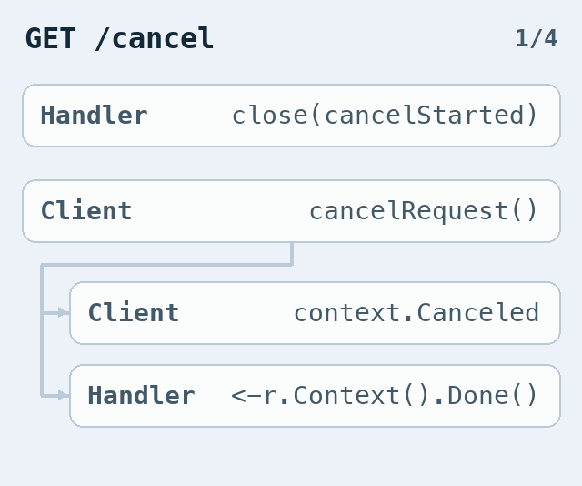

# Отмена и дедлайн HTTP-запроса в Go

[English](../../en/go/context.md)

Передайте `context.Context` в исходящий HTTP-запрос, чтобы ограничить время ожидания или отменить запрос по сигналу вызывающего кода.
Учебная программа проверяет успешный ответ, истечение дедлайна и явную отмену во время запроса.

| Задача | Приём | Пример |
| --- | --- | --- |
| Ограничить время от текущего момента | `context.WithTimeout` | [Задать дедлайн](#задать-дедлайн) |
| Задать точный момент окончания | `context.WithDeadline` | [Задать дедлайн](#задать-дедлайн) |
| Отменить операцию по сигналу | `context.WithCancel` и `cancel()` | [Отменить запрос](#отменить-запрос) |
| Определить причину отказа | `errors.Is` | [Проверить три исхода](#проверить-три-исхода) |

Пример использует стандартную библиотеку. Для запуска файла нужен Go 1.16 или новее из-за `io.ReadAll`.
Если вы ещё не работали с функциями и ошибками, начните со [справочника языка Go](language.md).

## Задать дедлайн

Создайте дочерний контекст от контекста вызывающего кода. Если родительского контекста ещё нет, начните с `context.Background()`.
Отмена родительского контекста отменяет дочерний. Более ранний дедлайн родителя также ограничивает дочерний контекст.
Для лимита в 200 мс используйте `WithTimeout`. Если время окончания уже задано значением `time.Time`, передайте его в `WithDeadline`.

Фрагмент находится внутри функции, которая возвращает `(string, error)`. Используйте `parent`, `client` и `get` из полного примера. Задайте адрес запроса в `url`. Нужны импорты `context` и `time`.

```go
ctx, cancel := context.WithTimeout(parent, 200*time.Millisecond)
defer cancel()
return get(ctx, client, url)
```

В `get` создайте запрос через `http.NewRequestWithContext(ctx, http.MethodGet, url, nil)`. Отправьте запрос через `client.Do(req)`.
Дедлайн действует до конца чтения тела ответа.
После успешного `Do` поставьте `defer resp.Body.Close()` перед проверкой статуса и чтением тела.
Вызовите `cancel` при выходе из функции, даже если запрос завершился успешно. Вызов освобождает ресурсы дочернего контекста, в том числе останавливает его таймер.

## Отменить запрос

Получите дочерний контекст и функцию отмены через `context.WithCancel(parent)`. Передайте контекст запросу.
В полном примере обработчик `/cancel` сообщает через канал, что получил запрос. Клиентский код дожидается сигнала и вызывает `cancelRequest()`.
Обработчик ждёт `<-r.Context().Done()` и возвращается после закрытия соединения клиентом.
Контекст передаёт сигнал отмены. Код, который выполняет собственную длительную работу, должен обработать сигнал сам.

В этом фрагменте `err` — ошибка вызова `get`. Нужны импорты `context` и `errors`.

```go
switch {
case errors.Is(err, context.DeadlineExceeded):
    // The deadline expired.
case errors.Is(err, context.Canceled):
    // The operation was canceled.
}
```

`errors.Is` распознаёт причину внутри обёрнутой ошибки. Остальные ошибки обработайте отдельно.

<details>
<summary>Показать отмену по шагам</summary>



После получения запроса обработчик `/cancel` закрывает канал `cancelStarted`. Клиентская goroutine получает сигнал и вызывает `cancelRequest()`. Клиент распознаёт `context.Canceled` через `errors.Is`. Обработчик завершает работу после закрытия канала `r.Context().Done()`. Порядок этих двух исходов может различаться.

[Открыть GIF для повторного просмотра](../../assets/go-request-cancellation.gif)

</details>

## Проверить три исхода

Откройте [полный файл `main.go`](../../../examples/go/context/main.go). Выполните команду из корня репозитория.

```bash
go run ./examples/go/context/main.go
```

`httptest.NewServer` открывает локальный порт на loopback-интерфейсе. Программа отправляет запросы только этому серверу и закрывает сервер при выходе.
У трёх запросов общий родительский дедлайн в 5 секунд. Обработчик `/timeout` ждёт сигнал отмены, который приходит после истечения дедлайна запроса.

Сравните вывод с ожидаемым результатом.

```text
success: ok
timeout: context deadline exceeded
cancel: context canceled
```

Программа проверяет тело успешного ответа и причины двух ошибок. Если проверка не пройдёт, программа завершится с ненулевым кодом.

[Отмена обработки в worker pool](concurrency-and-testing.md#отменить-обработку) · [Проверка HTTP-обработчика](http-json.md#тест-без-сетевого-сервера)

## Источники

- [Go 1.27.1 — пакет `context`](https://pkg.go.dev/context@go1.27.1).
- [`http.NewRequestWithContext`](https://pkg.go.dev/net/http@go1.27.1#NewRequestWithContext), [`http.Client.Do`](https://pkg.go.dev/net/http@go1.27.1#Client.Do) и [`http.Request.Context`](https://pkg.go.dev/net/http@go1.27.1#Request.Context).
- [`httptest.NewServer`](https://pkg.go.dev/net/http/httptest@go1.27.1#NewServer).
- [Go 1.16 — добавление `io.ReadAll`](https://go.dev/doc/go1.16).
