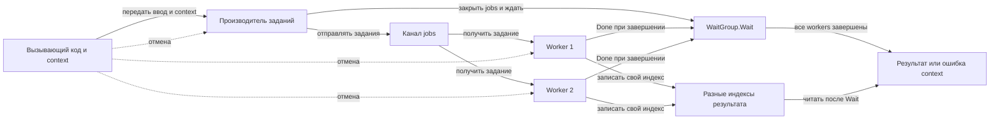

# Полный пример: workers и счётчик

[English](../../../en/go/examples/concurrency-and-testing.md)

Пример обрабатывает строки несколькими workers и защищает общий счётчик.
[Короткие карточки](../concurrency-and-testing.md) объясняют отдельные приёмы.

| Задача | Приём | Пример |
| --- | --- | --- |
| Обработать список с отменой | `Канал заданий + WaitGroup` | [Worker pool](#ограниченный-worker-pool) |
| Защитить общий счётчик | `Mutex для чтения и записи` | [Счётчик](#общие-данные-и-mutex) |
| Проверить результат и гонки | `Тесты + race detector` | [Проверка](#тесты-и-race-detector) |

[Справочник Go](../README.md) · [Файлы модуля](language.md#полный-модуль)


## Подготовка

Для запуска нужен Go 1.27.
Предпосылки: функции, slices, error и владение памятью.
Создайте отдельный учебный каталог.
Скопируйте [go.mod](language.md#go-mod) в новый каталог.
Сохраните `worker.go`, `counter.go` и `worker_test.go` по ссылкам ниже рядом с `go.mod`.
Пример использует только стандартную библиотеку, включая `context` и `sync`.


## Ограниченный worker pool

Задача — обработать список строк с ограниченным количеством workers и сохранить порядок результата.
Производитель закрывает канал.
Вызывающий код получает результат только после завершения всех workers.



Полный `worker.go`:

[`go/worker.go`](../../../../examples/go/worker.go)

Функция создаёт срез заранее.
Каждый индекс записывает один worker.
Чтение результата начинается после Wait.
Не изменяйте входной срез во время работы.
Workers проверяют отмену между заданиями.
Отмена не прерывает `strings.ToUpper` посередине операции.
Если одновременно готовы несколько веток select, отмена не имеет абсолютного приоритета.
Пример не гарантирует отсутствие заданий после cancel.


## Общие данные и mutex

Полный `counter.go`. Если несколько goroutines меняют один счётчик, отдельные переменные каналов сами по себе не защищают его значение.

[`go/counter.go`](../../../../examples/go/counter.go)

Нулевое значение Counter пригодно к использованию.
Передавайте Counter указателем.
Не копируйте mutex после начала использования.
Lock защищает чтение и запись одного инварианта.
Для независимого счётчика возможен atomic-тип.
Не смешивайте atomic и обычные обращения к тому же значению.


## Тесты и race detector

Полный `worker_test.go`:

[`go/worker_test.go`](../../../../examples/go/worker_test.go)

```bash
go test ./...
go vet ./...
go test -race ./...
```

Ожидаются исходный порядок строк и точное число инкрементов.
При workers=0 или уже отменённом context ожидается отказ.
Timeout теста ограничивает обработку.
Timeout не доказывает отсутствие любых утечек goroutines.
`-race` обнаруживает только гонки на реально выполненных путях.
Логические race conditions и deadlock требуют отдельных тестов или анализа.
Для повторяемой диагностики используйте `go test -count=1 ./...`.
Не делайте вывод только по кешированному прогону.

Функция возвращает только ошибку context; ошибки отдельных заданий здесь не моделируются.
[Таблица синхронизации и отмены](../concurrency-and-testing.md#тесты-и-race-detector) содержит правила для других сценариев.

Источники: [context](https://pkg.go.dev/context), [sync и модель синхронизации](https://pkg.go.dev/sync), [memory model](https://go.dev/ref/mem), [race detector](https://go.dev/doc/articles/race_detector), [testing](https://pkg.go.dev/testing).
