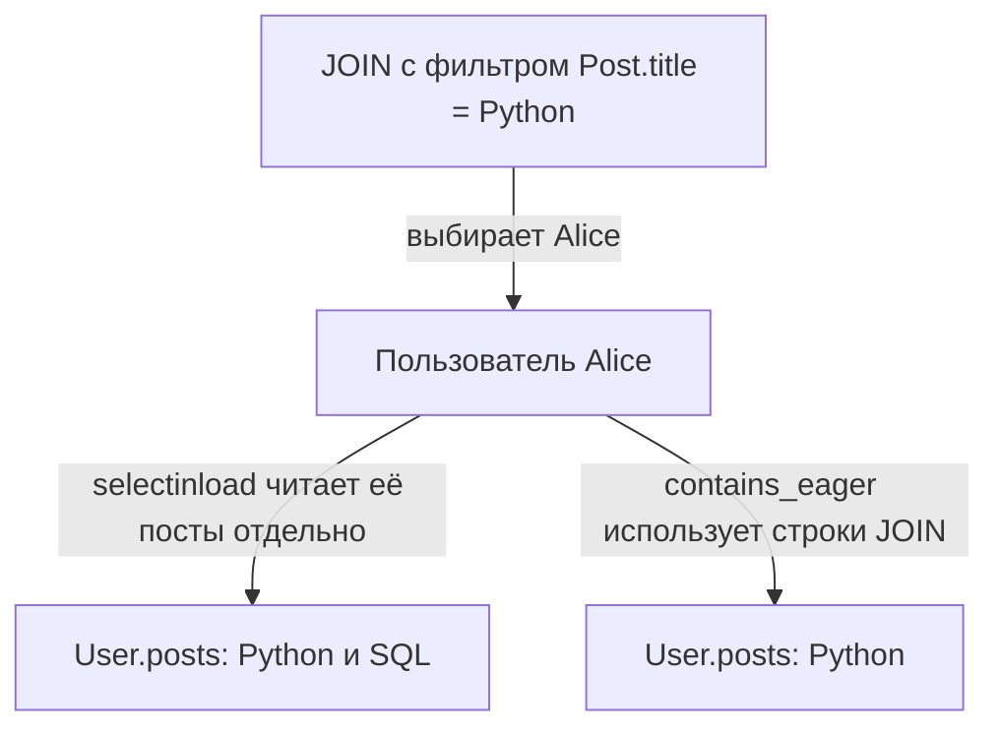

# Фильтровать и обновлять коллекции SQLAlchemy

[English](../../../../en/python/databases/sqlalchemy/filtered-relationships.md) · [Выбор загрузки](relationship-loading.md#выбрать-стратегию) · [Справочник SQLAlchemy](README.md)

Выберите, какие родители попадут в результат и что будет в каждой их коллекции. Если коллекция уже загружена, отдельно решите, нужно ли заменить её содержимое в Session.

| Задача | Приём | Карточка |
| --- | --- | --- |
| Найти пользователей с постом Python и прочитать все их посты | Явный JOIN и `selectinload` | [Полные коллекции](#отфильтровать-родителей-и-загрузить-полные-коллекции) |
| Оставить только посты, которые прошли фильтр JOIN | `contains_eager` | [Частичная коллекция](#загрузить-частичную-коллекцию-из-join) |
| Заменить ранее загруженную коллекцию результатом запроса | `populate_existing` | [Обновление в Session](#обновить-уже-загруженную-коллекцию) |

Используйте Python 3.14, синхронную ORM SQLAlchemy 2.1.8 и SQLite в памяти. Подготовьте модели, данные и `engine` по [инструкции к лабораторной](loading-lab.md#подготовить-примеры). Первые две карточки используют новые Session. Для третьей сначала загрузите полную коллекцию Alice в той же Session, как в [полном тесте](../../../../../examples/python/databases/sqlalchemy/test_relationship_loading.py).

На схеме исходный JOIN выбирает Alice по посту Python. Дальше способ загрузки определяет содержимое её коллекции.



## Отфильтровать родителей и загрузить полные коллекции

**Ситуация:** нужны пользователи с постом Python, но для каждого пользователя нужны все посты.
Фильтруйте родителей явным JOIN; коллекцию загрузите отдельно:

```python
from sqlalchemy import select
from sqlalchemy.orm import Session, selectinload
from demo_models import Post, User

with Session(engine) as session:
    users = session.scalars(
        select(User).join(User.posts).where(Post.title == "Python")
        .options(selectinload(User.posts)).order_by(User.id)
    ).unique().all()
```

**Результат.** Запрос возвращает Alice с постами `Python` и `SQL`.
`unique()` убирает возможные повторения родителей после явного JOIN.
Фильтр родителей не превращается автоматически в фильтр содержимого коллекции.
[Сравнение полной и частичной коллекции](loading-lab.md#сравнить-стратегии-и-проверить-ограничения)


## Загрузить частичную коллекцию из JOIN

**Ситуация:** в `User.posts` нужны только посты, выбранные вашим JOIN.
Для новой Session направьте строки JOIN в отношение:

```python
from sqlalchemy import select
from sqlalchemy.orm import Session, contains_eager
from demo_models import Post, User

with Session(engine) as session:
    users = session.scalars(
        select(User).join(User.posts).where(Post.title == "Python")
        .options(contains_eager(User.posts)).order_by(User.id)
    ).unique().all()
```

**Результат.** Запрос возвращает Alice с одним постом `Python`. Пост `SQL` остаётся в БД.
После истечения состояния последующая загрузка может снова вернуть полную коллекцию.
Если коллекция уже загружена, применяйте [следующую карточку](#обновить-уже-загруженную-коллекцию).
[Полная проверка](loading-lab.md#сравнить-стратегии-и-проверить-ограничения)


## Обновить уже загруженную коллекцию

**Ситуация:** Alice уже есть в Session с полной коллекцией posts.
Новый запрос сам по себе не обязан заменить содержимое загруженного отношения.
Фрагмент продолжает работу в этой Session без ожидающих изменений:

```python
from sqlalchemy import select
from sqlalchemy.orm import contains_eager
from demo_models import Post, User

stmt = (
    select(User).join(User.posts).where(Post.title == "Python")
    .options(contains_eager(User.posts))
    .execution_options(populate_existing=True)
)
alice = session.scalars(stmt).unique().one()
```

**Результат.** В загруженной коллекции Alice остаётся только пост `Python`.
Перед обновлением решите, как сохранить нужные локальные изменения.
`populate_existing` может заменить значения в памяти; особенно учитывайте отключённый autoflush.
`expire_all()` помечает состояние устаревшим, но не очищает identity map Session.
Последующее чтение может выполнить SQL.
Не передавайте одну Session одновременно нескольким потокам.
[Проверка identity map и повторной загрузки](loading-lab.md#сравнить-стратегии-и-проверить-ограничения)

## Источники

- [Select-in loading](https://docs.sqlalchemy.org/en/21/orm/queryguide/relationships.html#select-in-loading).
- [Загрузка частичной коллекции через contains_eager](https://docs.sqlalchemy.org/en/21/orm/queryguide/relationships.html#using-contains-eager-to-load-a-custom-filtered-collection-result).
- [Обновление загруженных объектов через populate_existing](https://docs.sqlalchemy.org/en/21/orm/queryguide/api.html#populate-existing).
