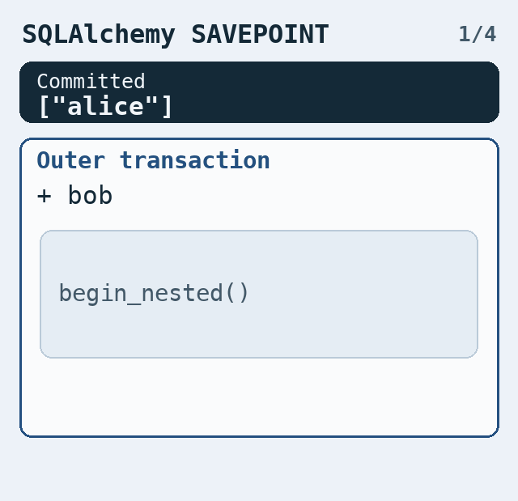

# Модели, CRUD и транзакции

[English](../../../../en/python/databases/sqlalchemy/models-and-transactions.md)

Откройте страницу, чтобы подготовить общие модели, выполнить CRUD или проверить откат транзакции.
Учебная SQLite создаётся в памяти и не использует существующую БД.

| Задача | Приём | Пример / подробности |
| --- | --- | --- |
| Подготовить модели отношений | `Mapped`, FK, constraints | [Полный demo_models.py](#единая-схема-для-рецептов) |
| Добавить, изменить и удалить | `Session`, `begin`, `flush` | [CRUD и тесты](#crud-транзакции-и-savepoint) |
| Сохранить внешнюю транзакцию после ошибки | `begin_nested` и savepoint | [Тест savepoint](#crud-транзакции-и-savepoint) |

[Справочник](README.md) · [Запросы](queries.md) · [Async и операции](async-and-operations.md)

**Уровень:** базовый → средний, savepoint и custom type — продвинутый.
Расширенные рецепты используют общую схему ниже.
Для первого знакомства с загрузкой достаточно [двух моделей в одном файле](n-plus-one.md).
Запускайте примеры на Python 3.14 с SQLite из стандартного модуля `sqlite3`.
Выполните `python -m pip install 'sqlalchemy[asyncio]==2.1.8' 'pytest==9.2.0'`.
Общая база наследует AsyncAttrs; импорт asyncio в SQLAlchemy 2.1 требует greenlet через extra `asyncio`.
[Пояснение установки](https://docs.sqlalchemy.org/en/21/faq/installation.html#i-m-getting-an-error-about-greenlet-not-being-installed-when-i-try-to-use-asyncio).
Примеры создают только учебную SQLite в памяти.

## Единая схема для рецептов

Полный `demo_models.py` показывает scalar/optional/defaults, Enum, JSON TypeDecorator, constraints и четыре типа отношений.

[`sqlalchemy/demo_models.py`](../../../../../examples/python/databases/sqlalchemy/demo_models.py)

Для даты рождения, больших целых и бинарных данных есть `Date`, `BigInteger` и `LargeBinary`.
Выбирайте тип и диалект по данным.
`DateTime(timezone=True)` не гарантирует одинаковое хранение timezone во всех СУБД.
SQLite-пример хранит серверное время без такой гарантии.
JSON TypeDecorator показывает способ расширения.
Если диалект поддерживает нужный JSON, встроенный `JSON` обычно проще.
`MutableDict` отслеживает верхний уровень словаря.
Вложенные dict/list требуют отдельной стратегии изменений.

## CRUD, транзакции и savepoint

Полный пример `demo_crud.py` создаёт `User` со всеми обязательными полями.

[`sqlalchemy/demo_crud.py`](../../../../../examples/python/databases/sqlalchemy/demo_crud.py)

Запустите `python demo_crud.py`.
Ожидаемый результат — `['alice', 'bob']`.
INSERT/UPDATE/DELETE меняют только временную базу примера.
База исчезнет после закрытия движка.
`RETURNING` зависит от СУБД и версии.
Здесь проверяется SQLite из окружения запуска.
Для существующей сессии учитывайте autobegin.
Чтение тоже может открыть транзакцию.
Перед новым `session.begin()` проверьте, не началась ли транзакция.

Полный `test_models.py` проверяет откат, savepoint, constraints, отношения и custom type:

[`sqlalchemy/test_models.py`](../../../../../examples/python/databases/sqlalchemy/test_models.py)

Запустите `python -m pytest -q test_models.py`.
Savepoint позволяет продолжить внешнюю транзакцию после ошибки дублирующего email.
Корректные изменения внешней транзакции должны сохраниться.
Пример обрабатывает исключение снаружи вложенного контекста.
Необработанное исключение вышло бы и из внешнего контекста.

Показать откат к savepoint по шагам

Запись Alice уже зафиксирована. Тест добавляет Bob во внешней транзакции. Вызов `begin_nested()` отправляет INSERT для Bob до создания savepoint. Дублирующий email вызывает `IntegrityError` внутри savepoint. Вложенный контекст откатывается к savepoint, а тест обрабатывает ошибку снаружи этого контекста. Затем внешняя транзакция добавляет Carol и фиксирует изменения. Итоговый запрос возвращает `["alice", "bob", "carol"]`.

[Открыть GIF для повторного просмотра](../../../../assets/sqlalchemy-savepoint.gif?raw=true)

В FastAPI зависимость с `yield` выдаёт сессию.
Полный [sync/async HTTP-рецепт](../../web/fastapi/database.md) находится в теме FastAPI.
Выбирайте транзакционную границу в одном месте.
Не распределяйте commit между несогласованными слоями.

Источники: [Declarative](https://docs.sqlalchemy.org/en/21/orm/declarative_tables.html), [отношения](https://docs.sqlalchemy.org/en/21/orm/basic_relationships.html), [транзакции/savepoint](https://docs.sqlalchemy.org/en/21/orm/session_transaction.html), [custom types](https://docs.sqlalchemy.org/en/21/core/custom_types.html), [MutableDict](https://docs.sqlalchemy.org/en/21/orm/extensions/mutable.html).
