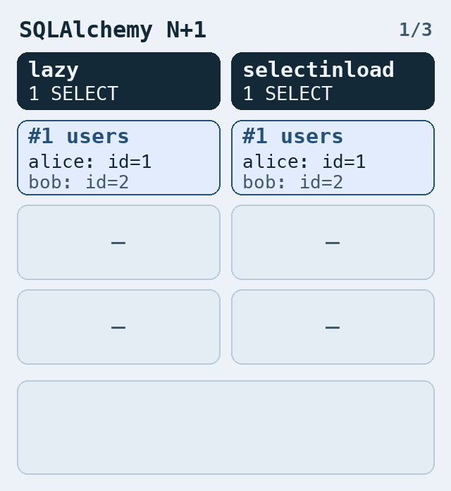
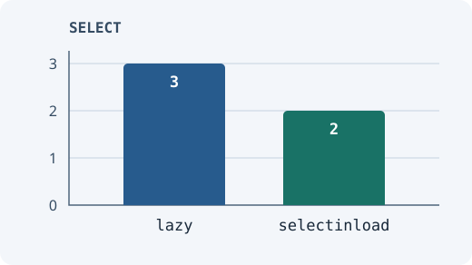

# Устранить лишние запросы при чтении коллекции

[English](../../../../en/python/databases/sqlalchemy/n-plus-one.md)

Откройте страницу, если цикл по пользователям выполняет отдельный SQL-запрос для постов каждого пользователя.
Пример сравнивает два способа чтения одинаковых данных.
Программа содержит две синхронные модели и запускается из одного файла.

| Нужно сделать | Приём | Где |
| --- | --- | --- |
| Понять причину лишних запросов | Сравнить lazy-загрузку и eager loading | [Почему возникает N+1](#почему-возникает-n1) · [Запросы по шагам](#n-plus-one-steps) |
| Повторить пример с нуля | Установить SQLAlchemy и сохранить файл | [Подготовка и запуск](#подготовка-и-запуск) · [Полная программа](#полная-программа) |
| Проверить другие стратегии и сложные случаи | Сравнить joinedload, raiseload и частичные коллекции | [Отдельная лабораторная](loading-lab.md) |

Уровень: средний; первое знакомство с загрузкой отношений ORM.
Предпосылки: функции и классы Python, аннотации типов, циклы, `with`, `try`/`finally`, `assert` и основы SQL SELECT.

Для запуска нужны Python 3.14, SQLAlchemy 2.1.9 и встроенный модуль `sqlite3`.

Пример использует SQLite в памяти и синтетические данные.
После завершения программы учебные данные исчезают.

## Почему возникает N+1

**Ситуация:** нужно показать список пользователей вместе с постами каждого пользователя.
Первый SELECT читает пользователей.
Затем чтение незагруженного `user.posts` выполняет ещё один SELECT для каждого пользователя.
Для N пользователей получается N+1 запросов: один общий и N дополнительных.
Если коллекция Bob ещё не загружена, запрос возвращает ноль строк. По этому результату ORM определяет, что коллекция пуста.

ORM связывает строки таблиц с объектами Python.
Здесь модель `User` описывает пользователя, а модель `Post` — его пост.
Отношение `User.posts` представляет коллекцию постов одного пользователя.
`relationship` описывает это отношение в Python; `ForeignKey` указывает столбец связи между таблицами.

**Изменение:** загрузите посты заранее через `selectinload(User.posts)`.
Lazy loading означает загрузку отношения при первом обращении к незагруженному атрибуту.
Eager loading означает загрузку отношения при выполнении исходного запроса, до последующего обращения к атрибуту.
`selectinload` — способ eager loading: отдельный SELECT читает посты сразу для группы пользователей через условие `IN`.

**Фрагмент функции `read_users` из [полной программы](#полная-программа):**

```python
stmt = select(User).options(selectinload(User.posts)).order_by(User.id)
```

`select(User)` описывает запрос; само описание ещё не выполняет SQL.
`Session` выполняет запрос и хранит состояние загруженных объектов.
В примере `session.scalars(stmt).all()` возвращает список объектов `User`.
Каждое сравнение использует новую `Session`, поэтому ранее загруженные посты не скрывают дополнительные SELECT.

**Результат:** для двух пользователей число SELECT уменьшается с трёх до двух при том же составе постов.
Для больших выборок `selectinload` выполняет запросы по пакетам ключей; два SELECT не являются общей гарантией.
Для составного ключа нужна поддержка tuple IN со стороны СУБД.
Для выбора другой стратегии откройте [таблицу решений](relationship-loading.md#выбрать-стратегию).

<a name="n-plus-one-steps"></a>

<details>
<summary>Показать запросы SELECT по шагам</summary>



Каждый прогон начинается с чтения Alice и Bob в новой Session. При lazy-загрузке второй SELECT находит два поста Alice. Третий SELECT читает посты Bob и возвращает ноль строк. При `selectinload` второй SELECT использует `user_id IN (1, 2)` и запрашивает посты обоих пользователей. SQLAlchemy заполняет те же коллекции для Alice и Bob. Чтение загруженных коллекций не добавляет SELECT.

Оба прогона возвращают `["Python", "SQL"]` для Alice и `[]` для Bob. Счётчики относятся к этим чтениям в учебном примере.

[Открыть GIF для повторного просмотра](../../../../assets/sqlalchemy-n-plus-one.gif)

</details>

## Подготовка и запуск

Создайте отдельную папку `sqlalchemy-n-plus-one-demo`.
Сохраните [файл `n_plus_one.py`](../../../../../examples/python/databases/sqlalchemy/n_plus_one.py) в этой папке.
Откройте терминал в папке `sqlalchemy-n-plus-one-demo`.
Используйте Python 3.14 для создания окружения.
Выполните команды оболочки на macOS или Linux:

```bash
python3.14 -m venv .venv
source .venv/bin/activate
python -m pip install 'sqlalchemy==2.1.9'
python n_plus_one.py
```

Программе достаточно SQLAlchemy и стандартной библиотеки Python.
`pytest`, `AsyncAttrs`, extra `asyncio` и `greenlet` этому примеру не нужны.
Установка требует доступа к индексу пакетов; сама программа работает без внешней сети.

## Полная программа

[Полный файл `n_plus_one.py`](../../../../../examples/python/databases/sqlalchemy/n_plus_one.py) определяет модели, создаёт таблицы, записывает данные и проверяет результаты.
`DeclarativeBase` задаёт общую основу моделей.
`Mapped` указывает тип ORM-атрибута, а `mapped_column` настраивает столбец таблицы.
`back_populates` связывает атрибуты `User.posts` и `Post.author` в обе стороны.
`Engine` управляет соединениями с БД; объект `engine` создаётся в `main`.
`with session.begin()` фиксирует учебные данные при успехе и откатывает транзакцию при исключении.

Функция счётчика получает SQL через событие `before_cursor_execute` перед выполнением команды драйвером.
Счётчик подключается только на время чтения и включает обращения к `user.posts`.
Создание таблиц и запись данных находятся вне измерения.
Блок `finally` снимает обработчик события даже при исключении.

## Результат и ограничения



*По горизонтали показана стратегия загрузки. По вертикали указано число запросов SELECT из этого примера. Каждый прогон читает одну коллекцию для двух пользователей в новой Session. Создание и заполнение таблиц не входят в подсчёт.*

Ожидаемый вывод:

```text
lazy: 3 SELECT; [('alice', ['Python', 'SQL']), ('bob', [])]
selectinload: 2 SELECT; [('alice', ['Python', 'SQL']), ('bob', [])]
```

В обоих случаях прочитаны все пользователи и все посты, включая пустую коллекцию Bob.
Проверки `assert` сравнивают состав данных и число запросов отдельно.
Запускайте пример без `python -O`, чтобы сохранить проверки `assert`.

Счётчик распознаёт команды, начинающиеся с SELECT; этого достаточно для запросов данного примера.
Для произвольного SQL с CTE или комментариями нужен другой способ учёта команд.
Числа относятся к одной коллекции, двум пользователям и новым `Session` на указанных версиях.
Они не измеряют время выполнения и не доказывают ускорение приложения.

Для своих данных отдельно измерьте объём результата, время и память.

Сравнение `joinedload`, отказ без `unique()`, `raiseload`, вложенные и частичные коллекции находятся в [полной лабораторной](loading-lab.md).
Лабораторная использует расширенную схему с отдельной подготовкой.
Async, другие СУБД, большие объёмы и конкурентный доступ этот пример не проверяет.

## Источники

- [SQLAlchemy 2.1: lazy loading и проблема N+1](https://docs.sqlalchemy.org/en/21/orm/queryguide/relationships.html#lazy-loading).
- [Select-in loading](https://docs.sqlalchemy.org/en/21/orm/queryguide/relationships.html#select-in-loading).
- [Основы ORM](https://docs.sqlalchemy.org/en/21/orm/quickstart.html), [Session](https://docs.sqlalchemy.org/en/21/orm/session_basics.html).
- [События выполнения SQL](https://docs.sqlalchemy.org/en/21/core/events.html#sqlalchemy.events.ConnectionEvents.before_cursor_execute).
- [Release notes 2.1.9](https://docs.sqlalchemy.org/en/21/changelog/changelog_21.html#change-2.1.9).

[Карточки загрузки](relationship-loading.md) · [Справочник SQLAlchemy](README.md) · [Указатель задач](../../../tasks/README.md#sql-и-доступ-из-python)
