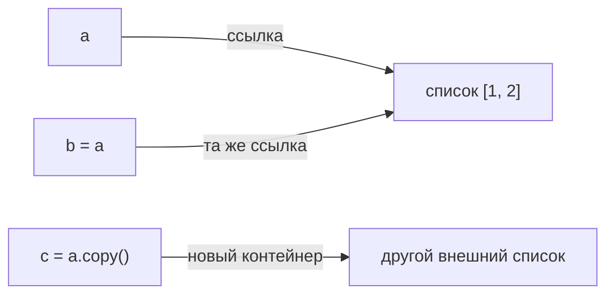

# Типы данных Python

[English](../../../../en/python/language/types/README.md)

Используйте справочник для выбора типа, операций и преобразований.
Справочник также описывает особенности изменяемых объектов.
Аннотации типов описывают контракт для инструментов.
Сами аннотации не проверяют входные данные во время выполнения.

[Каталог Python](../../README.md) · [Полные примеры](recipes.md)


## Быстрый поиск

| Задача | Выбор | Пример |
| --- | --- | --- |
| Целое / приближённое число | `int` / `float` | [Карточка](#числа-строки-и-логика) |
| Точная десятичная арифметика | `Decimal` из строк; округление задаётся явно | [Карточка](#числа-строки-и-логика) |
| Комплексное число | `complex`, например `3 + 4j` | [Карточка](#числа-строки-и-логика) |
| Изменяемая последовательность | `list` | [Карточка](#коллекции) |
| Фиксированная последовательность ссылок | `tuple` | [Карточка](#коллекции) |
| Последовательность целых без готового списка | `range` | [Карточка](#коллекции) |
| Текст / двоичные данные | `str` / `bytes`; изменяемые байты — `bytearray` | [Карточка](#коллекции) |
| Соответствие ключ → значение | `dict`; группировка — `defaultdict` | [Карточка](#коллекции) |
| Уникальные значения | `set`; неизменяемое множество — `frozenset` | [Карточка](#коллекции) |
| Отсутствие значения | `None`; проверка `is None` | [Карточка](#преобразования-и-проверка) |

| Параметр | Значение |
| --- | --- |
| Целевая документация | Python 3.14; примеры используют стандартную библиотеку |

<a id="базовый-уровень"></a>


## Числа, строки и логика

**Ситуация:** десятичную цену `"2.675"` нужно округлить до копеек по правилу HALF_UP.
**Изменение:** создайте `Decimal` из строки и задайте правило явно.
Самостоятельный фрагмент использует стандартную библиотеку:

```python
from decimal import Decimal, ROUND_HALF_UP

amount = Decimal("2.675").quantize(Decimal("0.01"), rounding=ROUND_HALF_UP)
assert amount == Decimal("2.68")
```

**Результат:** `2.68` без промежуточного `float`.
Выбор правила округления зависит от задачи.
[Полная программа с проверками](recipes.md#полная-программа).


| Выражение | Результат / смысл |
| --- | --- |
| `0b1010`, `0o12`, `0xA` | Целое `10` в разных системах счисления |
| `int("ff", 16)` | `255` |
| `3e5`, `1.5e-3` | `300000.0`, `0.0015` |
| `(3 + 4j).real`, `(3 + 4j).imag` | `3.0`, `4.0` |
| `Decimal("0.1")` | Десятичное значение без промежуточного float |
| `f"Привет, {name}"` | Форматирование; переменная `name` должна существовать |
| `" a b ".strip().split()` | `['a', 'b']`; методы возвращают новые строки |
| `bool(0)`, `bool("")`, `bool([])`, `bool(None)` | `False` |
| `bool("False")` | `True`: любая непустая строка истинна |

`float` имеет двоичную погрешность.
Для приближённых сравнений используйте `math.isclose`.
Деление `/` и целочисленное `//` различаются.
`int(-3.8)` усекает к нулю.
`-3.8 // 1` округляет вниз.
`bool` — подтип `int`, поэтому `isinstance(True, int)` истинно.
Если `bool` недопустим как число, учитывайте это свойство при проверке.


## Коллекции

**Ситуация:** в списке языков встречаются повторы, а нужен проверяемый набор уникальных значений.
**Изменение:** создайте множество; сортируйте результат только для устойчивого вывода.
Самостоятельный фрагмент:

```python
languages = ["python", "go", "python"]
unique = set(languages)
assert unique == {"python", "go"}
assert sorted(unique) == ["go", "python"]
```

**Результат:** каждое значение входит в множество один раз.
Множество не сохраняет исходный порядок и требует хешируемые элементы.
[Полная программа с операциями коллекций](recipes.md#полная-программа).

| Тип | Операции / особенности |
| --- | --- |
| `list` | `append`, `extend`, `pop`, срезы; элементы могут иметь разные типы |
| `tuple` | `(5,)` — один элемент; неизменяемость кортежа не замораживает вложенный список |
| `range` | `range(1, 6, 2)` даёт `1, 3, 5`; правая граница исключена |
| `str` | Unicode-текст; `lower`, `upper`, `replace`, `split`, `join` |
| `bytes`, `bytearray` | Элемент при индексировании — целое; текст требует `encode`/`decode` |
| `dict` | Сохраняет порядок вставки; `keys`, `values`, `items` возвращают представления |
| `set` | `a \| b`, `a & b`, `a - b`, `a ^ b`; порядок обхода не является контрактом |
| `frozenset` | Неизменяемое множество хешируемых элементов; может быть ключом словаря |

`{}` создаёт словарь.
Для пустого множества используйте `set()`.
Если элемент множества отсутствует, `remove` вызывает `KeyError`.
`discard` допускает отсутствие элемента.
`dict.get` не вызывает `KeyError`.
Отличайте значение по умолчанию от сохранённого `None`.

<a id="средний-уровень"></a>


## Преобразования и проверка

**Ситуация:** отсутствие лимита означает значение по умолчанию; `0` должен оставаться допустимым лимитом.
**Изменение:** проверяйте `None`, а не общую ложность значения.
Самостоятельный фрагмент:

```python
limit = 0
actual = 10 if limit is None else limit
assert actual == 0
```

**Результат:** нулевой лимит сохраняется.
Выражение `limit or 10` вернуло бы `10`.
Проверка не подтверждает, что лимит имеет допустимый тип.
[Полная проверка преобразований](recipes.md#полная-программа).


`list(iterable)`, `tuple(iterable)` и `set(iterable)` создают коллекции.
`dict` принимает пары ключ/значение.
`str([1, 2])` — представление Python, а не универсальная JSON-сериализация.
`int("abc")` вызывает `ValueError`.
Для ожидаемого неверного ввода обрабатывайте конкретное исключение.

`type(value) is T` проверяет точный тип.
`isinstance(value, T)` учитывает подтипы.
Проверка `is None` отличается от `if not value`.
Ноль и пустая коллекция могут быть допустимыми значениями.


## Словари специального назначения

- `defaultdict(list)` создаёт список при обращении через `mapping[key]`. Метод `.get()` фабрику не вызывает.
- `OrderedDict` полезен для перестановки `move_to_end` и извлечения по порядку. Обычный `dict` уже сохраняет порядок вставки.
- Порядок не влияет на равенство обычных словарей. Равенство двух `OrderedDict` учитывает порядок.
- Представления `dict.items()` отражают дальнейшие изменения. Для снимка используйте `list(mapping.items())`.

<a id="продвинутый-уровень"></a>


## Изменяемость, ссылки и хешируемость

**Ситуация:** внешний список скопирован, но вложенную строку данных нужно менять независимо.
**Изменение:** выберите глубокую копию для поддерживаемых вложенных объектов.
Самостоятельный фрагмент:

```python
from copy import deepcopy

original = [[1]]
shallow = original.copy()
deep = deepcopy(original)
original[0].append(2)
assert shallow == [[1, 2]]
assert deep == [[1]]
```

**Результат:** поверхностная копия разделяет вложенный список, глубокая — сохраняет прежнее содержимое.
`deepcopy` не является универсальным копированием ресурсов вроде соединений.
[Полная проверка ссылок и хешируемости](recipes.md#полная-программа).

Схема показывает ссылки переменных на объекты:




Присваивание не копирует объект.
Поверхностная копия создаёт новый внешний контейнер со ссылками на исходные вложенные объекты.
`deepcopy` рекурсивно копирует поддерживаемые объекты.
При этом `deepcopy` сохраняет отношения повторных ссылок внутри копии.

Неизменяемость и хешируемость — разные свойства.
Кортеж со списком неизменяем как контейнер, но не хешируется.
`list`, `dict` и `set` нельзя использовать как обычные ключи словаря.
Пользовательские классы имеют собственные правила `__eq__`/`__hash__`.

`sys.getsizeof` учитывает размер самого объекта, а не рекурсивный размер всех его элементов.
`sys.getrefcount` относится к ссылкам CPython и **не проверяет изменяемость**.
Результат зависит от временных ссылок и особенностей реализации.
[Рабочая проверка всех случаев](recipes.md).


## Частые ошибки

| Симптом | Причина / действие |
| --- | --- |
| Изменились сразу две переменные | Переменные ссылаются на один объект. Выберите нужную глубину копии |
| Списки внутри `[[0] * 2] * 3` меняются вместе | Повторяются ссылки. Используйте comprehension для независимых строк |
| `0.1 + 0.2 != 0.3` | Двоичная арифметика; `isclose` либо подходящая десятичная модель |
| `TypeError: unhashable type` | Ключ/элемент не хешируется. Выберите подходящее представление |
| `bool("false")` включил опцию | Разберите строку по явно допустимым значениям |


## Источники

- [Стандартные типы Python 3.14](https://docs.python.org/3.14/library/stdtypes.html).
- [collections](https://docs.python.org/3.14/library/collections.html), [Decimal](https://docs.python.org/3.14/library/decimal.html).
- [Копирование](https://docs.python.org/3.14/library/copy.html), [sys: размер и ссылки](https://docs.python.org/3.14/library/sys.html).
- [Модель данных и hash](https://docs.python.org/3.14/reference/datamodel.html#object.__hash__), [аннотации](https://docs.python.org/3.14/library/typing.html).
