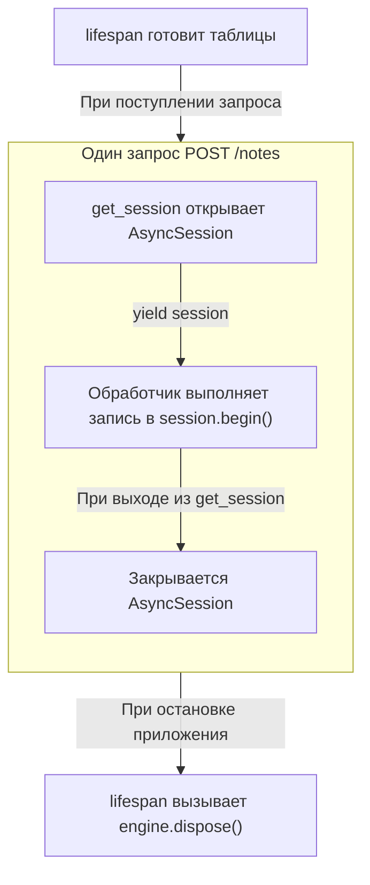

# Выдать сессию БД на запрос

[English](../../../../en/python/web/fastapi/database.md)

Откройте страницу, если HTTP-обработчик должен получить собственную сессию БД и завершить транзакцию.
Выберите sync- или async-пример по используемому драйверу.

| Задача | Приём | Пример / подробности |
| --- | --- | --- |
| Использовать блокирующий драйвер | `def`, сессия через `yield` | [Синхронный пример](#синхронный-sqlalchemy) |
| Использовать async-драйвер | `AsyncSession`, `async with`, lifespan | [Асинхронный пример](#async-sqlalchemy-и-lifespan) |
| Проверить сохранение и отказ | Изолированная SQLite на тест | [Полные проверки](testing.md#сессии-бд-и-lifespan) |

[Краткий справочник](README.md) · [Тестирование](testing.md) · [SQLAlchemy](../../databases/sqlalchemy/README.md)

| Параметр | Значение |
| --- | --- |
| Уровень | Средний: синхронная сессия; продвинутый: async и жизненный цикл |
| Предпосылки | SQL, транзакции, SQLAlchemy, `Depends`; для async — `async with` |

Используйте Python 3.14; установите пакеты выбранного варианта ниже.

Оба примера самостоятельны.
Не объединяйте `Base`, движки и фабрики сессий из разных примеров.
Примеры используют локальную SQLite с синтетическими данными.
Производственные подключения здесь не нужны.


## Синхронный SQLAlchemy

В отдельном окружении выполните `python -m pip install 'fastapi==0.162.0' 'uvicorn[standard]' 'sqlalchemy==2.1.8' 'pydantic[email]==2.14.3'`.
Сохраните полный пример в файле `db_app.py`:

[`db_app.py`](../../../../../examples/python/web/fastapi/db_app.py)

```bash
uvicorn db_app:app --reload
```

```bash
curl -i -X POST http://127.0.0.1:8000/users -H 'Content-Type: application/json' -d '{"username":"alice","email":"alice@example.com"}'
curl http://127.0.0.1:8000/users
```

Ожидается `201` с `id`.
Следующий запрос возвращает список пользователей.
Повтор того же email даёт `409`.
Рецепт создаёт или пополняет `fastapi-sync.db` в папке запуска.
Повторный запуск сохраняет данные.
Для чистого опыта используйте новую учебную папку.

`check_same_thread=False` снимает ограничение SQLite на поток использования соединения.
Этот параметр не делает `Session` безопасной для параллельного общего доступа.
У каждого запроса своя сессия.
Блокирующие операции находятся в `def`-обработчиках.
FastAPI выполняет эти обработчики в пуле потоков.
Синхронный `create_all` в lifespan допустим здесь для крошечной учебной базы.
В приложении применяйте миграции отдельным шагом.

Источники: [SQLAlchemy: Session и транзакции](https://docs.sqlalchemy.org/en/21/orm/session_basics.html), [FastAPI: зависимости с yield](https://fastapi.tiangolo.com/tutorial/dependencies/dependencies-with-yield/), [Pydantic: чтение атрибутов объектов](https://pydantic.dev/docs/validation/latest/concepts/models/#arbitrary-class-instances).


## Async SQLAlchemy и lifespan

Если вы впервые используете `async def` и `await`, начните с [основ asyncio](../../language/asyncio.md).

Для независимого async-примера выполните `python -m pip install 'fastapi==0.162.0' 'uvicorn[standard]' 'sqlalchemy[asyncio]==2.1.8' 'aiosqlite==0.22.1'`.
Сохраните полный независимый пример в файле `async_db_app.py`:

[`async_db_app.py`](../../../../../examples/python/web/fastapi/async_db_app.py)

Запустите `uvicorn async_db_app:app --reload`.
POST `/notes` с JSON `{"text":"Прочитать документацию"}` даёт `201`.
GET `/notes` возвращает список заметок.
Файл `fastapi-async.db` создаётся в папке запуска.

Схема показывает, как в примере связаны жизненный цикл приложения, сессия одного запроса и транзакция записи.



До `yield` lifespan открывает или готовит ресурс.
После `yield` lifespan закрывает ресурс.
Здесь lifespan заменяет прежние `@app.on_event("startup")` / `shutdown`.
При успешном выходе `session.begin()` фиксирует изменения.
При исключении `session.begin()` откатывает изменения.
Не разделяйте один `AsyncSession` между одновременно работающими задачами.
Драйвер и URL должны соответствовать async-движку.
`async def` вокруг обычного синхронного драйвера не делает драйвер неблокирующим.

Страница не реализует production-миграции, пул PostgreSQL, relationship lazy loading и восстановление БД.
Это самостоятельные задачи SQLAlchemy/Alembic.
Тот же принцип lifespan применим и к другим клиентам.

Источники: [FastAPI: lifespan](https://fastapi.tiangolo.com/advanced/events/), [SQLAlchemy: async API](https://docs.sqlalchemy.org/en/21/orm/extensions/asyncio.html), [AsyncSession и конкурентные задачи](https://docs.sqlalchemy.org/en/21/orm/extensions/asyncio.html#using-asyncsession-with-concurrent-tasks).
