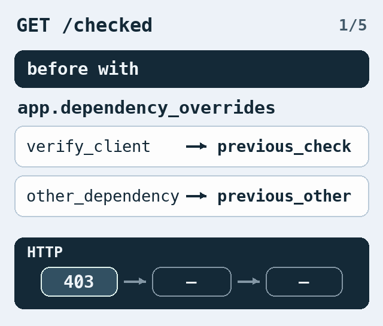

# Проверить подмену зависимости FastAPI

[English](../../../../en/python/web/fastapi/dependency-overrides.md)

Откройте страницу, чтобы проверить обработчик без вызова реальной зависимости.
Начните с самостоятельной программы в одном файле.
Для выбора приёма используйте [короткую карточку](testing.md#подмена-зависимости).

| Задача | Приём | Пример |
| --- | --- | --- |
| Впервые проверить исходную функцию и подмену | Создать небольшое приложение и два теста | [Один файл, установка и запуск](#минимальный-самостоятельный-пример) |
| Подробно проверить восстановление | Использовать приложение из рецепта и отдельные тесты | [Подготовка двух файлов](#подготовить-учебную-папку) · [Полный файл тестов](#полный-файл-тестов) |
| Проверить восстановление после ошибки теста или зависимости | Сравнить словарь и выполнить запрос после блока | [Тест восстановления](#полный-файл-тестов) · [Ожидаемый результат](#результат-и-границы) |

Уровень: средний; проверка очистки требует понимания контекстных менеджеров Python.
Предпосылки: функции, словари, импорты, `with`, `try`/`finally` и проверки `assert`.
<a id="среда-примеров"></a>

Для запуска нужен Python 3.14; команды установки приведены рядом с каждым примером.


## Минимальный самостоятельный пример

**Ситуация:** нужно проверить ответ обработчика, временно пропустив реальную проверку заголовка.
Зависимость здесь — функция `verify_client`, которая проверяет заголовок до вызова обработчика.
`Depends(verify_client)` объявляет связь между маршрутом и этой функцией.
Обычно FastAPI вызывает исходную функцию; при подмене FastAPI вызывает другую функцию вместо исходной.
`dependency_overrides` — словарь приложения: ключом служит исходный объект функции, значением — функция подмены.
`TestClient` выполняет запрос в приложение внутри процесса, без сетевого сервера.
`pytest` находит функции `test_*`; `assert` проверяет ожидаемый результат.
Блок `finally` выполняет очистку при выходе из `try`, включая выход из-за исключения.
`Header()` задаёт источник параметра `x_client`: заголовок `X-Client`.
`Annotated` связывает тип `str` с этой настройкой.

Создайте отдельную папку `fastapi-override-demo`.
Сохраните файл [`test_dependency_override.py`](../../../../../examples/python/web/fastapi/test_dependency_override.py) в этой папке.
Этот файл содержит приложение, учебные данные и тесты.

[`test_dependency_override.py`](../../../../../examples/python/web/fastapi/test_dependency_override.py)

Откройте терминал в папке `fastapi-override-demo`.
Используйте Python 3.14 для создания отдельного окружения.
Выполните команды оболочки на macOS или Linux:

```bash
python3 -m venv .venv
source .venv/bin/activate
python -m pip install 'fastapi==0.165.0' 'httpx2==2.16.2' 'pytest==9.2.0'
python -m pytest -q test_dependency_override.py
```

**Ожидаемый результат:** `2 passed`.
Первый тест проверяет исходные ответы: `422` без заголовка, `400` с неверным заголовком и `200` с учебным.
Второй тест проверяет вызов подмены и ответ `200` без заголовка.
После `finally` тот же тест проверяет прежний словарь и возврат исходных HTTP-ответов; порядок тестов не влияет на проверку.

**Ограничения:** учебный заголовок не является аутентификацией.
Подмена действует на всё приложение, пока запись остаётся в словаре.
Не изменяйте подмены одновременно для общего `app` внутри одного процесса.
Для конкурентных тестов создавайте отдельное приложение на тест.
Выход из `TestClient` сам подмены не очищает.
Подмена здесь возвращает `None`, потому что маршрут использует зависимость только как проверку.
Для результата, передаваемого в обработчик, верните подходящее значение.

Сами тесты работают без внешней сети; установка требует доступа к индексу пакетов.
Данные синтетические; секреты и внешние сервисы не используются.
Проверка заранее установленных подмен и ошибки внутри блока находится в [расширенном сценарии](#полный-файл-тестов).
Дополнительные ограничения подзависимостей и прямых вызовов находятся в [пояснениях к выбору функции](#выбрать-функцию-для-подмены).


## Выбрать функцию для подмены

| Нужно проверить | Действие | Что подтверждает тест |
| --- | --- | --- |
| Правило проверки заголовка | Оставьте `verify_client` | Ответы `422`, `400` и `200` для разных запросов |
| Ответ обработчика без проверки заголовка | Подмените `verify_client` | Обработчик возвращает ожидаемый JSON без заголовка |
| Обработчик получает данные из зависимости | Верните учебное значение из подмены | Обработчик использует значение нужного типа и состава |

Ключ `app.dependency_overrides` — тот же объект функции, который передан в `Depends`.
Используйте `verify_client`, а не строку `"verify_client"` или результат вызова `verify_client()`.
Если приложение находится в другом модуле, импортируйте функцию из этого модуля.

В примере маршрут объявляет `dependencies=[Depends(verify_client)]` и не получает результат проверки.
Поэтому `skip_client_check` может вернуть `None`.
Если обработчик получает пользователя или сессию БД через параметр `Depends`, возврат `None` обычно не подходит.
Подмена должна соответствовать операциям, которые обработчик выполняет над результатом.
Пример с заголовком показывает механизм; подключение и операции настоящей БД здесь не проверяются.

Подмена действует везде, где этот `app` разрешает исходную зависимость через FastAPI.
Подзависимости исходной функции также пропускаются.
Подзависимость — функция, которую исходная зависимость получает через собственный `Depends`.
Зависимости самой подмены FastAPI разрешает обычным способом.
Прямой вызов `verify_client(...)` в Python словарь подмен не использует.

`finally` восстанавливает состояние и при исключении внутри теста или запроса.
Пара `clear()` и `update(previous)` возвращает весь прежний словарь, включая посторонние подмены.
Одного `clear()` достаточно только тогда, когда прежний словарь был пустым.


## Подготовить учебную папку

Для расширенной проверки подготовьте приложение и тесты в двух файлах.
Создайте отдельную учебную папку.
Сохраните [полный исходный файл `header_dependency.py`](recipes.md#проверка-заголовка-перед-обработчиком) в эту папку.
Сохраните файл [`test_dependencies.py`](../../../../../examples/python/web/fastapi/test_dependencies.py) рядом с приложением.
Другие приложения из раздела FastAPI не нужны.
Данные синтетические; секреты и внешние сервисы не используются.

Выполните команды оболочки из учебной папки:

```bash
python3 -m venv .venv
source .venv/bin/activate
python -m pip install 'fastapi==0.165.0' 'httpx2==2.16.2' 'pytest==9.2.0'
python -m pytest -q test_dependencies.py
```

Установка требует доступа к индексу пакетов.
Сами тесты работают без внешней сети.
Starlette использует HTTPX2 для `TestClient`.


## Полный файл тестов

Полный файл `test_dependencies.py` использует только `header_dependency.py` из подготовки.
Фикстура — функция подготовки и очистки теста.
`autouse=True` применяет фикстуру ко всем тестам этого файла.
Фикстура временно убирает прежние подмены, чтобы первый тест проверял исходную функцию.

Помощник `overridden_client` ограничивает время действия подмены блоком `with`.
Декоратор `@contextmanager` превращает функцию с `yield` в контекстный менеджер.
Код до `yield` готовит клиент, а `finally` восстанавливает словарь при выходе из блока.

[`test_dependencies.py`](../../../../../examples/python/web/fastapi/test_dependencies.py)


## Результат и границы

Ожидаемый результат запуска: `8 passed`.
Два первых теста проверяют исходную функцию и вызов подмены.
Параметризация запускает тест восстановления шесть раз: с прежними записями и без них для трёх вариантов выхода.
Варианты: обычный выход, ошибка проверки теста и исключение из функции подмены.
`pytest.raises` проверяет ожидаемое исключение; отсутствие такого исключения проваливает тест.
По умолчанию `TestClient` пробрасывает необработанное исключение приложения в тест.
Проверка после `pytest.raises` подтверждает восстановление до завершения теста и очистки фикстуры.
Прежняя запись для `verify_client` возвращается вместе с посторонней записью.
Запрос после блока получает `403` от прежней подмены или исходный `422`, если прежних подмен не было.
Этот запрос проверяет действие восстановленной зависимости, а не только содержимое словаря.

<details>
<summary>Показать восстановление подмен по шагам</summary>



В начале примера есть две прежние подмены. До блока `with` запрос `GET /checked` возвращает `403`. Внутри блока с подменой `replacement` запрос возвращает `200`. Затем тест вызывает `AssertionError`. Блок `finally` очищает словарь и восстанавливает сохранённые записи. Следующий запрос снова возвращает `403`. В восстановленном словаре `other_dependency` соответствует `previous_other`.

[Открыть GIF для повторного просмотра](../../../../assets/fastapi-override-restoration.gif)

</details>

`None` подходит здесь: декоратор маршрута использует зависимость только как проверку.
Для зависимости, которая возвращает пользователя или сессию БД в обработчик, подберите подходящее возвращаемое значение.
[Пояснения к выбору функции](#выбрать-функцию-для-подмены) описывают ключ словаря, подзависимости и область действия подмены.

Сценарий не проверяет конкурентное изменение общего `app`, зависимости с `yield` или работу внешнего провайдера.
Проверки используют синхронный `TestClient`; async-клиент разобран [отдельно](testing.md#асинхронный-клиент).
Не запускайте эти тесты одновременно с другими тестами того же `app` внутри одного процесса.


## Источники

- [FastAPI: подмена зависимостей](https://fastapi.tiangolo.com/advanced/testing-dependencies/).
- [FastAPI: зависимости в декораторе](https://fastapi.tiangolo.com/tutorial/dependencies/dependencies-in-path-operation-decorators/).
- [FastAPI 0.165.0: разрешение зависимостей](https://github.com/fastapi/fastapi/blob/0.165.0/fastapi/dependencies/utils.py).
- [FastAPI: release notes 0.165.0](https://fastapi.tiangolo.com/release-notes/#01650-2026-11-18).
- [Starlette: TestClient](https://starlette.dev/testclient/).

[Карточка подмены](testing.md#подмена-зависимости) · [Справочник FastAPI](README.md) · [Указатель задач](../../../tasks/README.md#http-api-и-веб-приложения)
