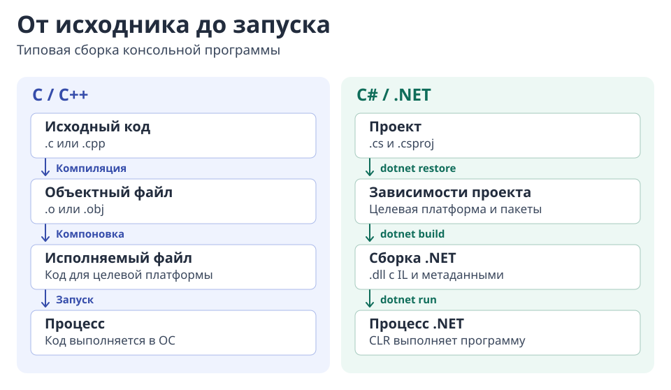

# Указатель задач и синонимов

[English](../../en/tasks/README.md)

Найдите действие, даже если не помните название инструмента или приёма.
Ссылки ведут к конкретной карточке, командам или примеру в основном материале.

| Что нужно сделать | Где искать в указателе |
| --- | --- |
| Начать с Python, прочитать файл или выбрать тип данных | [Первая программа на Python](../python/language/first-program.md) · [Файлы, типы и коллекции](#python-файлы-типы-и-коллекции) |
| Запустить корутину Python или ждать несколько операций одновременно | [Основы asyncio](#python-основы-asyncio) |
| Создать Python-проект, управлять зависимостями и сборкой | [Проект и окружение](#python-проект-и-окружение) |
| Проверить данные, написать тест, настроить логи | [Валидация, тесты и логи](#валидация-тесты-и-логи) |
| Отправить HTTP-запрос, написать API или защитить маршрут | [HTTP и веб-приложения](#http-api-и-веб-приложения) |
| Вспомнить Go, отменить задачи или защитить общие данные | [Go](#go-язык-и-конкурентность) |
| Найти синтаксис, собрать программу или выбрать библиотеку для C, C# или C++ | [C, C# и C++](#c-family-basics) |
| Выбрать данные, выполнить транзакцию, сделать резервную копию | [Базы данных и SQL](#базы-данных-и-sql) |
| Найти файл, процесс, сетевой порт или журнал службы | [Linux и оболочка](#linux-и-оболочка) |
| Поднять приложение с PostgreSQL или разобрать отказ теста в CI | [Docker Compose и CI](#docker-compose-и-ci) |
| Отменить изменение, обновить ветку, подготовить PR | [Git и GitHub](#git-и-github) |
| Выбрать границу, контракт, паттерн или протокол повтора | [Архитектура](#архитектура-и-проектирование) |
| Оценить, как растёт число операций с размером входа | [Алгоритмы](#алгоритмы-и-сложность) |
| Добавить шпаргалку или проверить её оформление | [Оформление материалов](#оформление-материалов) |

**Поиск по странице:** используйте `Ctrl+F` / `⌘F`.
Примеры запросов: `откат`, `undo`, `N+1`, `request_id`, `backup`, `retry`.
Второй столбец содержит поисковые слова и связанные имена API.
Эти слова помогают найти задачу.
Они не всегда взаимозаменяемы.
Версии и подготовка указаны в целевом материале.
Там же указаны последствия команд и ограничения примера.

[Каталог по технологиям](../README.md#каталог-материалов)

## Python: файлы, типы и коллекции

| Хочу сделать | Синонимы и имена API | Прямой переход |
| --- | --- | --- |
| Прочитать большой файл по одной строке | Python, построчно, большой текстовый файл, без загрузки целиком | [Построчное чтение в Python](../python/language/read-lines.md) |
| Выбрать число, строку или точную денежную арифметику | numeric, string, `int`, `float`, `Decimal` | [Python: числа, строки и логика](../python/language/types/README.md#числа-строки-и-логика) |
| Округлить денежную сумму и проверить операции типов | Decimal, quantize, ROUND_HALF_UP, rounding, округление | [Python: полный пример операций и копий](../python/language/types/recipes.md#проверить-операции-копии-и-границы-типов) |
| Выбрать список, словарь или множество | collection, array, map, unique, `list`, `dict`, `set` | [Python: коллекции](../python/language/types/README.md#коллекции) |
| Преобразовать значение и проверить его тип | cast, conversion, `isinstance`, `type`, `None` | [Python: преобразования и проверка](../python/language/types/README.md#преобразования-и-проверка) |
| Сгруппировать данные и управлять порядком словаря | grouping, defaultdict, OrderedDict, move_to_end, порядок | [Python: специальные словари](../python/language/types/README.md#словари-специального-назначения) |
| Разобраться с копией и общей ссылкой | copy, deepcopy, aliasing, mutable, hashable, изменяемость | [Python: ссылки и хешируемость](../python/language/types/README.md#изменяемость-ссылки-и-хешируемость) |

## Python: основы asyncio

| Хочу сделать | Синонимы и имена API | Прямой переход |
| --- | --- | --- |
| Запустить корутину и дождаться результата | asyncio, async def, await, asyncio.run, цикл событий | [Python: первая корутина](../python/language/asyncio.md#запустить-корутину) |
| Ждать несколько операций одновременно | TaskGroup, задача, конкурентность, асинхронный ввод-вывод | [Python: конкурентное ожидание](../python/language/asyncio.md#дождаться-операций-конкурентно) |

## Python: проект и окружение

| Хочу сделать | Синонимы и имена API | Прямой переход |
| --- | --- | --- |
| Разложить Python-пакет по файлам | layout, src layout, package, структура проекта | [Проектирование: структура пакета](../python/architecture/project-design/structure-and-decisions.md#структура-python-пакета) |
| Передать зависимости и собрать рабочий пакет | DI, bootstrap, composition root, адаптер, CLI | [Проектирование: полный пакет](../python/architecture/project-design/example.md) |
| Зафиксировать решение или проверить готовность изменения | ADR, checklist, release, архитектурное решение | [Запись ADR](../python/architecture/project-design/structure-and-decisions.md#записать-решение-adr) · [Проверки готовности](../python/architecture/project-design/delivery-and-evolution.md#проверки-готовности) |
| Создать проект и запустить команду в окружении | uv, init, venv, run, виртуальное окружение | [uv: учебный проект](../python/tooling/uv/projects.md#учебный-проект-без-сети) |
| Добавить, обновить или удалить зависимость | dependency, add, update, upgrade, remove, пакет | [uv: изменение зависимостей](../python/tooling/uv/projects.md#добавить-обновить-и-удалить) |
| Согласовать lock-файл и установленное окружение | sync, locked, frozen, воспроизводимость | [uv: lock и окружение](../python/tooling/uv/projects.md#lock-не-равен-окружению) |
| Отделить dev-зависимости или экспортировать requirements | dependency group, extras, pip, export | [uv: группы](../python/tooling/uv/projects.md#группы-и-платформы) · [Экспорт](../python/tooling/uv/projects.md#экспорт-и-интерфейс-pip) |
| Повторить установку в CI или контейнере | GitHub Actions, Docker, cache, сборка | [uv: CI](../python/tooling/uv/automation.md#github-actions) · [Docker](../python/tooling/uv/automation.md#docker) |

## Валидация, тесты и логи

| Хочу сделать | Синонимы и имена API | Прямой переход |
| --- | --- | --- |
| Проверить словарь/JSON, ограничить поля и вернуть JSON | Pydantic, validate, serialize, alias, `Field`, `model_dump` | [Pydantic: модели, валидация и JSON](../python/validation/pydantic/models.md#модели-валидация-и-json) |
| Прочитать атрибуты ORM-объекта | from_attributes, ORM mode, ConfigDict | [Pydantic: атрибуты и конфигурация](../python/validation/pydantic/models.md#атрибуты-конфигурация-и-типы) |
| Проверить список без модели-обёртки или задать свой тип | TypeAdapter, generic, Annotated, custom type | [Pydantic: типы и адаптер](../python/validation/pydantic/advanced.md#generic-typeadapter-и-собственный-тип) |
| Прочитать настройки из переменных окружения | settings, env, dotenv, BaseSettings | [Pydantic Settings: настройки](../python/validation/pydantic/advanced.md#настройки-приложения) |
| Перенести код Pydantic v1 на v2 | migration, parse_obj, dict, model_validate | [Pydantic: миграция](../python/validation/pydantic/advanced.md#миграция-и-производительность) |
| Выбрать тест по имени или метке, остановиться на ошибке | pytest, run test, `-k`, `-m`, `-x`, pdb | [pytest: выбор и отладка](../python/testing/pytest/configuration.md#выбор-тестов-и-отладка) |
| Подготовить данные, временный файл, проверить ошибку | fixture, tmp_path, capsys, raises, approx | [pytest: полный пример фикстур и assertions](../python/testing/pytest/fixtures.md#полный-учебный-пример) |
| Прогнать один тест на разных входах | parametrize, parameterized, варианты данных | [pytest: полный пример](../python/testing/pytest/fixtures.md#полный-учебный-пример) · [Сочетание параметров](../python/testing/pytest/fixtures.md#параметризовать-независимые-измерения) |
| Подменить внешний вызов без сети | mock, monkeypatch, patch, fake | [pytest: внешний контракт](../python/testing/pytest/mocking-and-async.md#проверить-внешний-контракт-без-сети) |
| Проверить async-функцию | asyncio, pytest-asyncio, event loop, async fixture | [pytest: полный async-тест](../python/testing/pytest/mocking-and-async.md#проверить-внешний-контракт-без-сети) · [Настройка event loop](../python/testing/pytest/mocking-and-async.md#async-фикстуры-и-event-loop) |
| Получить отчёт для CI | JUnit, coverage, xdist, плагины | [pytest: плагины и отчёты](../python/testing/pytest/configuration.md#плагины-и-отчёты) |
| Настроить JSON-логи и сохранить исключение | structlog, renderer, traceback, exc_info | [structlog: конфигурация и проверки](../python/logging/structlog/configuration.md#самостоятельная-конфигурация) |
| Добавить поля ко всем логам запроса или задачи | bind, contextvars, request_id, correlation id | [structlog: локальный и контекстный bind](../python/logging/structlog/context-and-web.md#локальный-и-контекстный-bind) |
| Объединить стандартный logging и structlog | stdlib, ProcessorFormatter, единый формат | [structlog: интеграция logging](../python/logging/structlog/configuration.md#интеграция-со-stdlib-logging) |

## HTTP API и веб-приложения

| Хочу сделать | Синонимы и имена API | Прямой переход |
| --- | --- | --- |
| Посмотреть статус и заголовки HTTP-ответа | `curl -i`, `curl -I`, GET, HEAD, код ответа, Content-Type | [Посмотреть HTTP-ответ](../tools/http-json.md#посмотреть-http-ответ) |
| Вывести поле из JSON-ответа | `jq -r`, curl, тело ответа, name | [Извлечь поле JSON](../tools/http-json.md#извлечь-поле-json) |
| Создать FastAPI-маршрут с path/query/body и валидацией | REST, endpoint, request, response, 422 | [Карточка](../python/web/fastapi/recipes.md#http-api-с-валидацией) · [Полное HTTP API](../python/web/fastapi/http-api.md#http-api-с-валидацией) |
| Передать зависимость в обработчик FastAPI | Depends, dependency injection, подзависимость | [FastAPI: как устроены зависимости](../python/web/fastapi/recipes.md#как-устроены-зависимости) |
| Принять форму или файл | upload, multipart, Form, UploadFile | [Карточка](../python/web/fastapi/recipes.md#формы-и-загрузка-файлов) · [Полный пример загрузки](../python/web/fastapi/uploads.md#формы-и-загрузка-файлов) |
| Настроить CORS или middleware | browser, cross-origin, заголовки, request middleware | [Карточка](../python/web/fastapi/recipes.md#middleware-и-cors) · [Полный пример middleware и CORS](../python/web/fastapi/middleware.md#middleware-и-cors) |
| Проверить пароль и защитить маршрут токеном | auth, authentication, JWT, bearer, OAuth2, 401 | [FastAPI: полный пример аутентификации](../python/web/fastapi/authentication.md#полный-пример) |
| Выдать сессию БД на запрос и закрыть ресурсы | SQLAlchemy, Session, AsyncSession, yield, lifespan | [FastAPI: sync-сессия](../python/web/fastapi/database.md#синхронный-sqlalchemy) · [Async и lifespan](../python/web/fastapi/database.md#async-sqlalchemy-и-lifespan) |
| Проверить ответ FastAPI и неверный ввод | TestClient, httpx2, integration test, 422 | [FastAPI: карточка TestClient](../python/web/fastapi/testing.md#синхронный-testclient) · [Полные проверки](../python/web/fastapi/testing-lab.md) |
| Проверить обработчик FastAPI без вызова реальной зависимости | Depends, dependency_overrides, override, подмена, заглушка, fake, без сети, без БД | [Карточка подмены](../python/web/fastapi/testing.md#подмена-зависимости) · [Самостоятельная программа](../python/web/fastapi/dependency-overrides.md#минимальный-самостоятельный-пример) |
| Вернуть исходные зависимости FastAPI после теста или ошибки | cleanup, finally, dependency_overrides, восстановление | [Самостоятельный пример](../python/web/fastapi/dependency-overrides.md#минимальный-самостоятельный-пример) · [Прежние подмены и исключения](../python/web/fastapi/dependency-overrides.md#полный-файл-тестов) |
| Запустить API в контейнере | deploy, Dockerfile, Uvicorn, production | [FastAPI: контейнер](../python/web/fastapi/deployment.md#контейнер-для-минимального-приложения) |
| Создать Flask-приложение и сгруппировать маршруты | app factory, create_app, Blueprint, jsonify | [Flask: полное приложение](../python/web/flask/application.md#полное-приложение) |
| Проверить Flask-ответ и отказ без сервера | test_client, request context, 400, 404 | [Flask: полный набор проверок](../python/web/flask/testing.md#полный-набор-проверок) |
| Закрывать Flask-соединение после запроса | g, teardown_appcontext, resource lifecycle | [Flask: жизненный цикл соединения](../python/web/flask/configuration-and-deployment.md#жизненный-цикл-соединения) |
| Выбрать способ запуска Flask | WSGI, development server, reverse proxy, deploy | [Flask: разработка и production](../python/web/flask/configuration-and-deployment.md#разработка-и-production) |
| Создать таблицу из модели и управлять записями через админку | Django, ORM, migrations, makemigrations, migrate, admin, тест | [Django: модель и админка](../python/web/django/README.md) |
| Прочитать ответ API в TypeScript и проверить структуру JSON | fetch, Response.ok, unknown, type guard, tsc, строгий режим | [TypeScript: клиент к FastAPI](../typescript/README.md) |
| Ограничить и проверить JSON-запрос в Go | HTTP handler, MaxBytesReader, json.Decoder, validation | [Go: handler с границами ввода](../go/http-json.md#handler-с-границами-ввода) |
| Проверить Go-handler без сетевого сервера | httptest, ResponseRecorder, HTTP test | [Go: тест HTTP/JSON](../go/http-json.md#тест-без-сетевого-сервера) |

## Go: язык и конкурентность

| Хочу сделать | Синонимы и имена API | Прямой переход |
| --- | --- | --- |
| Создать модуль, запустить, форматировать и проверить код | Golang, Голанг, go.mod, go run, gofmt, go test, go vet, race detector | [Go: команды учебного модуля](../go/README.md#команды-модуля) |
| Вспомнить slices, maps, pointers, structs и generics | синтаксис, срез, указатель, receiver, интерфейс | [Go: конструкции](../go/language.md#основные-конструкции) · [Полный модуль](../go/examples/language.md#полный-модуль) |
| Обернуть ошибку и проверить её причину | error wrapping, errors.Is, errors.As, %w | [Go: проверки валидного и невалидного ввода](../go/language.md#проверка-валидного-и-невалидного-ввода) |
| Ограничить параллельную работу и отменить задачи | goroutine, worker pool, channel, context, select, cancel | [Go: ограниченный worker pool](../go/concurrency-and-testing.md#ограниченный-worker-pool) |
| Задать тайм-аут HTTP-запроса или отменить его | context, WithTimeout, WithCancel, deadline, NewRequestWithContext | [Go: тайм-аут и отмена HTTP-запроса](../go/context.md#проверить-три-исхода) |
| Защитить общую память | mutex, sync.Mutex, race, data race, счётчик | [Go: общие данные](../go/concurrency-and-testing.md#общие-данные-и-mutex) |
| Проверить конкурентный код и гонки | concurrency test, go test -race, race detector | [Go: тесты и race detector](../go/concurrency-and-testing.md#тесты-и-race-detector) |

## C, C# и C++

| Хочу сделать | Синонимы и имена API | Прямой переход |
| --- | --- | --- |
| Собрать и запустить программу на C | C17, clang, main, printf, компоновка | [C: первый запуск](../c/README.md#первый-запуск) |
| Передать массив в функцию C | size_t, sizeof, pointer, указатель, границы | [C: массивы и память](../c/README.md#массивы-и-память) |
| Вспомнить синтаксис C и управление памятью | struct, enum, pointer, malloc, free, const | [C: синтаксис](../c/syntax.md) |
| Подключить библиотеку и проверить функцию на C | CMake, vcpkg, FetchContent, CTest, Unity | [C: зависимости](../c/tooling-and-testing.md#packages) · [Тесты](../c/tooling-and-testing.md#tests) |
| Выбрать инструменты для C и организовать код | embedded, драйвер, системное ПО, владение ресурсом | [C: паттерны](../c/practice.md#patterns) · [Области применения](../c/practice.md#application-areas) |
| Собрать и запустить проект на C# | C#, C Sharp, .NET SDK, csproj, dotnet build, dotnet run | [C#: первый запуск](../csharp/README.md#первый-запуск) |
| Добавить число в список или проверить аргумент C# | `List<T>`, Add, foreach, TryParse, код завершения | [C#: коллекции](../csharp/README.md#коллекции) · [Ошибки](../csharp/README.md#типичные-ошибки) |
| Найти значение в словаре C# и отличить сохранённый ноль от отсутствующего ключа | словарь, нет ключа, значение равно 0, `Dictionary`, `TryGetValue`, `out` | [Проверить ключ и прочитать значение](../csharp/syntax.md#try-get-value) |
| Прочитать файл с отменой в C# | отменить чтение, асинхронное чтение, CancellationToken | [Метод чтения файла](../csharp/syntax.md#async-io-and-cleanup) |
| Запустить первый HTTP-сервис на .NET и проверить ошибку запроса | C#, веб-сервис, эндпоинт, статус 400, ASP.NET Core, интеграционный тест | [Первый запрос](../csharp/first-http-service.md#run-service) · [HTTP-тест](../csharp/first-http-service.md#test-service) |
| Сохранить заказ и получить его после перезапуска .NET-сервиса | сохранить в файл БД, прочитать по номеру, данные после перезапуска, C#, EF Core, SQLite | [Заказы в SQLite](../csharp/persist-orders.md#create-order) · [Прочитать после перезапуска](../csharp/persist-orders.md#restart) |
| Вспомнить синтаксис C# | nullable, record, generics, LINQ, async, await | [C#: синтаксис](../csharp/syntax.md) |
| Установить NuGet-пакет или запустить тесты C# | NuGet, PackageReference, dotnet restore, dotnet test | [C#: пакеты](../csharp/tooling-and-testing.md#packages) · [Тесты](../csharp/tooling-and-testing.md#tests) |
| Выбрать фреймворк .NET и границы компонентов | ASP.NET Core, EF Core, DI, desktop, игры | [C#: паттерны](../csharp/practice.md#patterns) · [Области применения](../csharp/practice.md#application-areas) |
| Собрать и запустить программу на C++ | C++20, clang++, main, cout, компоновка | [C++: первый запуск](../cpp/README.md#первый-запуск) |
| Добавить элемент в вектор и проверить индекс | std::vector, push_back, size, at, out_of_range | [C++: коллекции](../cpp/README.md#коллекции) · [Ошибки](../cpp/README.md#типичные-ошибки) |
| Вспомнить синтаксис C++ и правила времени жизни | RAII, const, ссылка, move, template, lambda | [C++: синтаксис](../cpp/syntax.md) |
| Подключить C++-библиотеку и запустить тесты | CMake, vcpkg, Conan, CTest, GoogleTest | [C++: зависимости](../cpp/tooling-and-testing.md#packages) · [Тесты](../cpp/tooling-and-testing.md#tests) |
| Выбрать инструменты для C++ и организовать код | RAII, Qt, Unreal Engine, embedded, низкая задержка | [C++: паттерны](../cpp/practice.md#patterns) · [Области применения](../cpp/practice.md#application-areas) |

Сравнить путь программы от исходника до запуска

Схема показывает артефакты обычной консольной сборки. Стрелки подписаны командами или этапами, которые создают следующий артефакт либо запускают процесс.

В C и C++ компиляция создаёт объектный файл, а компоновка создаёт исполняемый файл.
В .NET команда `dotnet build` собирает проект и по умолчанию восстанавливает зависимости. Для запуска готовой сборки выполните `dotnet basics.dll` из каталога, где лежит DLL. Для запуска нужны совместимая среда .NET и остальные файлы приложения.
В [практикуме C#](../csharp/README.md#первый-запуск) команда `dotnet run --project … --no-build` использует результаты предыдущей сборки из того же каталога артефактов.

[Этапы Clang](https://releases.llvm.org/21.1.0/tools/clang/docs/CommandGuide/clang.html) · [Сборка .NET](https://learn.microsoft.com/en-us/dotnet/core/tools/dotnet-build) · [Запуск проекта или DLL](https://learn.microsoft.com/en-us/dotnet/core/tools/dotnet-run#description)

## Базы данных и SQL

### SQL и доступ из Python

| Хочу сделать | Синонимы и имена API | Прямой переход |
| --- | --- | --- |
| Выбрать строки и объединить таблицы | SELECT, WHERE, JOIN, EXISTS, фильтрация, соединение | [SQL: фильтрация и соединения](../databases/sql/queries.md#фильтрация-и-соединения) |
| Увидеть, какие строки остаются после JOIN | INNER JOIN, LEFT JOIN, NULL, пары, совпадение | [SQL: сравнение на одних таблицах](../databases/sql/queries.md#сравнить-inner-join-и-left-join) |
| Добавить, обновить или удалить строки | INSERT, UPDATE, DELETE, CRUD, DML | [SQL: изменение данных](../databases/sql/queries.md#изменение-данных) |
| Найти адреса почты, которые встречаются несколько раз | найти дубликаты, повторяющиеся значения, повторы, email | [Повторяющиеся адреса почты](../databases/sql/queries.md#duplicate-emails) |
| Сгруппировать данные и посчитать результат внутри группы | GROUP BY, HAVING, CTE, WITH, OVER, window, оконная функция | [SQL: агрегация, CTE и окна](../databases/sql/queries.md#агрегация-cte-и-окна) |
| Выбрать транзакцию и уровень изоляции | BEGIN, COMMIT, ROLLBACK, isolation, блокировки | [SQL: транзакции и изоляция](../databases/sql/dialects-and-transactions.md#транзакции-и-изоляция) |
| Учесть различия PostgreSQL и SQLite | dialect, placeholder, UPSERT, типы, диалект | [SQL: различия диалектов](../databases/sql/dialects-and-transactions.md#различия-диалектов) |
| Описать ORM-модели и отношения | SQLAlchemy, Mapped, relationship, ForeignKey, one-to-many | [SQLAlchemy: согласованная схема](../python/databases/sqlalchemy/models-and-transactions.md#единая-схема-для-рецептов) |
| Изменить данные через ORM и откатить часть операции | SQLAlchemy, Session, CRUD, transaction, savepoint | [SQLAlchemy: транзакции и savepoint](../python/databases/sqlalchemy/models-and-transactions.md#crud-транзакции-и-savepoint) |
| Написать SELECT/JOIN/CTE через Python | SQLAlchemy, select, func, aliased, ORM query | [SQLAlchemy: запросы](../python/databases/sqlalchemy/queries.md#select-join-подзапросы-и-cte) |
| Устранить лишние запросы к БД при чтении коллекций | SQLAlchemy, N+1, lazy loading, eager loading, счётчик SELECT | [Карточка N+1](../python/databases/sqlalchemy/relationship-loading.md#найти-n1) · [Пример с графиком числа SELECT](../python/databases/sqlalchemy/n-plus-one.md) |
| Выбрать загрузку коллекций и одиночных связей | selectinload, joinedload, unique, relationship, объём результата, LIMIT | [SQLAlchemy: таблица выбора](../python/databases/sqlalchemy/relationship-loading.md#выбрать-стратегию) |
| Запретить непредвиденную lazy-загрузку | raiseload, неожиданный SQL, InvalidRequestError | [SQLAlchemy: ошибка вместо SELECT](../python/databases/sqlalchemy/relationship-loading.md#обнаружить-незапланированную-lazy-загрузку) |
| Фильтровать родителей и получить все дочерние строки | JOIN, filter, полная коллекция, selectinload | [SQLAlchemy: родители и полные коллекции](../python/databases/sqlalchemy/filtered-relationships.md#отфильтровать-родителей-и-загрузить-полные-коллекции) |
| Заполнить отношение результатом своего JOIN | contains_eager, filtered collection, частичная коллекция | [SQLAlchemy: частичная коллекция](../python/databases/sqlalchemy/filtered-relationships.md#загрузить-частичную-коллекцию-из-join) |
| Заменить уже загруженное отношение | populate_existing, expire_all, identity map | [SQLAlchemy: обновить коллекцию](../python/databases/sqlalchemy/filtered-relationships.md#обновить-уже-загруженную-коллекцию) |
| Обработать большую ORM-выборку по частям | yield_per, partitions, streaming, память | [SQLAlchemy: пакетная обработка](../python/databases/sqlalchemy/streaming.md) |
| Использовать async-сессию ORM | AsyncSession, AsyncAttrs, awaitable_attrs, asyncio | [SQLAlchemy: асинхронная сессия](../python/databases/sqlalchemy/async-and-operations.md#асинхронная-сессия) |
| Изменить схему через миграцию | Alembic, revision, upgrade, downgrade, migration | [SQLAlchemy: отдельный проект Alembic](../python/databases/sqlalchemy/async-and-operations.md#alembic-отдельный-учебный-проект) |

### PostgreSQL

| Хочу сделать | Синонимы и имена API | Прямой переход |
| --- | --- | --- |
| Подключиться и вспомнить команды консоли | psql, connection, describe, список таблиц | [PostgreSQL: подключение и psql](../databases/relational/postgresql/operations.md#подключение-и-команды-psql) |
| Выдать доступ пользователю | role, GRANT, REVOKE, privileges, права | [PostgreSQL: роли и доступ](../databases/relational/postgresql/operations.md#роли-и-доступ) |
| Сделать UPSERT и проверить изменённые строки | ON CONFLICT, RETURNING, INSERT, UPDATE, DELETE | [PostgreSQL: изменение данных](../databases/relational/postgresql/queries.md#изменить-данные-и-проверить-результат) |
| Обойти дерево рекурсивным запросом | recursive CTE, WITH RECURSIVE, иерархия | [PostgreSQL: рекурсивный обход](../databases/relational/postgresql/queries.md#рекурсивный-обход) |
| Выбрать индекс и посмотреть план запроса | EXPLAIN, ANALYZE, B-tree, GIN, performance | [PostgreSQL: индексы и план](../databases/relational/postgresql/schema-and-indexes.md#индексы-и-план-запроса) |
| Искать в JSON или тексте | JSONB, full-text search, tsvector, полнотекстовый поиск | [PostgreSQL: JSONB и поиск](../databases/relational/postgresql/schema-and-indexes.md#jsonb-и-полнотекстовый-поиск) |
| Выбрать формат резервной копии PostgreSQL | backup, dump, custom, plain, directory, бэкап, бекап | [PostgreSQL: формат и версии](../databases/relational/postgresql/backup-and-restore.md#выбрать-формат-и-проверить-версии) |
| Создать логическую копию PostgreSQL | pg_dump, consistent snapshot, резервная копия | [PostgreSQL: создать custom](../databases/relational/postgresql/backup-and-restore.md#создать-логическую-копию) |
| Восстановить PostgreSQL в новую БД | restore, pg_restore, createdb, single-transaction | [Custom-архив](../databases/relational/postgresql/backup-and-restore.md#логическая-копия-и-восстановление-в-новую-бд) · [SQL-файл](../databases/relational/postgresql/backup-and-restore.md#восстановить-sql-файл) |
| Проверить восстановленную копию PostgreSQL | verify backup, данные, FK, CHECK, identity | [PostgreSQL: проверки](../databases/relational/postgresql/backup-and-restore.md#проверить-восстановленную-бд) · [Полный сценарий](../databases/relational/postgresql/backup-lab.md) |
| Найти блокировку, долгий запрос или разрастание таблиц | locks, pg_stat_activity, VACUUM, monitoring | [PostgreSQL: изоляция и блокировки](../databases/relational/postgresql/operations.md#транзакции-изоляция-и-блокировки) · [Обслуживание](../databases/relational/postgresql/operations.md#мониторинг-и-обслуживание) |

### SQLite

| Хочу сделать | Синонимы и имена API | Прямой переход |
| --- | --- | --- |
| Подключить SQLite из Python и безопасно передать параметры | sqlite3, parameterized query, in-memory, foreign keys | [SQLite: короткий запрос](../databases/relational/sqlite/python-and-queries.md#полный-пример-блог-в-памяти) · [Полный блог](../databases/relational/sqlite/query-lab.md) |
| Управлять commit/rollback в Python | sqlite3, autocommit, transaction, транзакция | [SQLite: полный сценарий](../databases/relational/sqlite/query-lab.md) · [Режимы транзакции](../databases/relational/sqlite/python-and-queries.md#транзакция-в-приложении) |
| Создать резервную копию SQLite | backup, Connection.backup, .backup, бэкап, бекап | [Python](../databases/relational/sqlite/backup-and-restore.md#создать-копию-через-python) · [CLI](../databases/relational/sqlite/backup-and-restore.md#создать-копию-через-cli) |
| Восстановить SQLite в новый файл | restore, .restore, .dump, SQL-копия | [Бинарная копия](../databases/relational/sqlite/backup-and-restore.md#восстановить-копию-в-новый-файл) · [SQL dump](../databases/relational/sqlite/backup-and-restore.md#создать-и-восстановить-sql-копию) |
| Проверить восстановленную копию SQLite | integrity_check, foreign_key_check, verify backup, триггер | [SQLite: проверки результата](../databases/relational/sqlite/backup-and-restore.md#проверить-восстановленную-бд) · [Полные сценарии](../databases/relational/sqlite/backup-lab.md) |
| Изменить схему SQLite с сохранением связей | migration, user_version, перестроение таблицы | [SQLite: выбор миграции](../databases/relational/sqlite/backup-and-migrations.md#полный-пример-перестроение-таблицы) · [Полный пример](../databases/relational/sqlite/migration-lab.md) |
| Разобраться с занятой БД и параллельным доступом | database is locked, busy_timeout, WAL, concurrent writes | [SQLite: конкуренция и WAL](../databases/relational/sqlite/backup-and-migrations.md#конкуренция-и-wal) |

### Redis

| Хочу сделать | Синонимы и имена API | Прямой переход |
| --- | --- | --- |
| Выбрать структуру и задать срок жизни ключа | string, hash, list, set, sorted set, TTL, expire | [Redis: структуры и TTL](../databases/non-relational/redis/data-and-caching.md#полный-пример-структуры-и-ttl) |
| Кешировать чтение и сбрасывать старое значение | cache-aside, invalidation, cache miss, кэш, кеш | [Redis: кеширование](../databases/non-relational/redis/data-and-caching.md#кеширование-cache-aside) |
| Различить pipeline, транзакцию и optimistic locking | MULTI, EXEC, WATCH, atomic, атомарность | [Redis: механизмы](../databases/non-relational/redis/transactions-and-messaging.md#атомарность-транзакция-и-pipeline) · [Конфликт и ошибка](../databases/non-relational/redis/transactions-lab.md#полный-пример-конфликт-и-ошибка-команды) |
| Выбрать Pub/Sub или Streams и подтвердить сообщение | queue, stream, consumer group, XACK, доставка | [Redis: выбор доставки](../databases/non-relational/redis/transactions-and-messaging.md#полный-пример-stream-и-pubsub) · [Полный пример](../databases/non-relational/redis/transactions-lab.md#полный-пример-stream-и-pubsub) |
| Проверить сохранность и восстановление Redis | persistence, RDB, AOF, backup, restore | [Redis: сохранность и восстановление](../databases/non-relational/redis/operations.md#сохранность-и-восстановление) |
| Создать RDB-копию Redis и восстановить в другом экземпляре | backup, restore, dump.rdb, BGSAVE, бэкап, бекап | [Карточка RDB](../databases/non-relational/redis/operations.md#создать-и-восстановить-rdb-копию) · [Полный пример](../databases/non-relational/redis/backup-and-restore.md#полный-пример) |
| Скопировать AOF Redis и восстановить данные | appendonlydir, appendonly.aof.manifest, BASE, INCR, журнал, backup, restore | [Карточка AOF](../databases/non-relational/redis/operations.md#создать-и-восстановить-aof-копию) · [Состав файлов и пример](../databases/non-relational/redis/aof-backup-and-restore.md#разобрать-состав-файлов) |
| Проверить значения и сроки ключей после восстановления Redis | TTL, PTTL, PEXPIRETIME, expire, истечение | [RDB](../databases/non-relational/redis/backup-and-restore.md#проверить-результат) · [AOF](../databases/non-relational/redis/aof-backup-and-restore.md#проверить-результат) |
| Найти расход памяти и медленные команды | memory, eviction, INFO, SLOWLOG, latency | [Redis: память и наблюдение](../databases/non-relational/redis/operations.md#память-и-наблюдение) |

## Linux и оболочка

| Хочу сделать | Синонимы и имена API | Прямой переход |
| --- | --- | --- |
| Скопировать, сравнить или обработать файлы | shell, Bash, cp, cmp, temporary directory | [Shell: безопасный учебный скрипт](../systems/linux/shell-and-files.md#безопасный-практический-пример) |
| Найти строку, перенаправить вывод или проверить код выхода | grep, pipe, stderr, stdout, exit code, поиск | [Shell: текст и потоки](../systems/linux/shell-and-files.md#текст-потоки-и-коды-выхода) |
| Найти файлы с пробелами и необычными именами | find, xargs, null delimiter, print0, имя файла | [Shell: поиск файлов](../systems/linux/shell-and-files.md#поиск-файлов-с-необычными-именами) |
| Проверить права и владельца файла | permission, owner, chmod, umask, id | [Linux: права](../systems/linux/permissions-and-processes.md#прочитать-права) |
| Найти процесс и корректно завершить свой дочерний процесс | ps, PID, kill, SIGTERM, wait, сигнал | [Процессы и сигналы](../systems/linux/permissions-and-processes.md#процессы-и-сигналы) · [Учебная проверка завершения](../systems/linux/permissions-and-processes.md#проверить-завершение-своего-дочернего-процесса) |
| Узнать IP и маршрут | network, ip route, интерфейс, адрес | [Linux: сеть](../systems/linux/network-and-services.md#сеть-сначала-чтение-состояния) |
| Найти процесс, который занял TCP-порт | порт занят, address already in use, EADDRINUSE, `ss -lntp`, PID, listener, socket | [Команда и вывод](../systems/linux/process-by-port.md#найти-tcp-listener) · [Права](../systems/linux/process-by-port.md#если-pid-не-показан) · [Namespace](../systems/linux/process-by-port.md#если-процесс-в-другом-namespace) |
| Проверить службу и её журналы | systemd, systemctl, journalctl, service, logs | [Linux: службы systemd](../systems/linux/network-and-services.md#службы-systemd) |
| Проверить свободное место и ресурсы | disk, df, du, free, память | [Linux: диск и ресурсы](../systems/linux/network-and-services.md#диск-и-ресурсы) |

## Docker Compose и CI

| Хочу сделать | Синонимы и имена API | Прямой переход |
| --- | --- | --- |
| Запустить приложение и учебную БД одной командой | Docker Compose, PostgreSQL, compose up, контейнер, healthcheck | [Compose: локальный запуск](../tools/compose-and-github-actions.md#запустить-приложение-локально) |
| Запустить готовый workflow вручную | GitHub Actions, `workflow_dispatch`, Run workflow | [Запустить workflow вручную](../tools/compose-and-github-actions.md#запустить-готовый-workflow-вручную) |
| Воспроизвести отказ теста в CI | GitHub Actions, PostgreSQL, задание integration, `fail_test` | [Запустить учебный workflow](../tools/compose-and-github-actions.md#запустить-тест-в-github-actions) |
| Найти упавшую проверку в журнале CI | GitHub Actions, logs, журнал, assert, тест, `gh run view`, `--log-failed` | [GitHub Actions: причина падения](../tools/compose-and-github-actions.md#найти-причину-падения-в-журнале) |
| Проверить статус и структуру ответа API одним тестом локально и в CI | API contract, FastAPI, PostgreSQL, TypeScript, Docker Compose, GitHub Actions | [Сквозная проверка контракта](../tools/api-contract-lab.md) |

## Git и GitHub

| Хочу сделать | Синонимы и имена API | Прямой переход |
| --- | --- | --- |
| Посмотреть изменения и подготовить локальный коммит | status, diff, staged, add, commit, log | [Git: карточка коммита](../tools/git/workflow.md#посмотреть-изменения-и-подготовить-коммит) |
| Создать ветку и проверить весь рабочий процесс | switch, branch, merge, учебный репозиторий | [Git: полный сценарий](../tools/git/workflow.md#проверяемый-рабочий-процесс) |
| Временно отложить незавершённую работу | stash, stash pop, WIP, shelve | [Git: отложить работу](../tools/git/workflow.md#временно-отложить-работу) |
| Убрать файл из следующего коммита и сохранить правки | убрать файл из индекса, снять подготовку, отменить git add, unstage, `git restore --staged` | [Снять подготовку файла](../tools/git/history.md#убрать-файл-из-индекса) |
| Отменить незакоммиченные изменения файла | discard, restore, working tree, удалить правки | [Git: выбрать источник restore](../tools/git/history.md#отменить-незакоммиченные-изменения) |
| Отменить локальный коммит с сохранением изменений | undo, откат, reset soft, reset mixed, HEAD~1 | [Git: вернуть правки в индекс или рабочее дерево](../tools/git/history.md#отменить-коммит-с-сохранением-изменений) |
| Отменить опубликованное изменение | revert, обратный коммит, общая история | [Git: отмена без переписывания](../tools/git/history.md#отменить-опубликованное-изменение) |
| Восстановить потерянный коммит | reflog, rescue, вернуть HEAD, потерянная ветка | [Git: создать rescue-ветку](../tools/git/history.md#восстановить-потерянный-коммит) |
| Исправить собственный последний коммит | amend, сообщение, забытый файл | [Git: исправить последний коммит](../tools/git/history.md#исправить-свой-последний-коммит) |
| Перенести свою ветку на новую базу и решить конфликт | rebase, conflict, continue, abort, перебазирование | [Git: перебазировать ветку](../tools/git/history.md#перебазировать-свою-ветку) |
| Получить изменения и выбрать merge или rebase | fetch, pull, fast-forward, remote, origin | [Git: выбрать интеграцию](../tools/git/remotes.md#получить-изменения-и-выбрать-интеграцию) |
| Обновить ветку с сохранением коммитов и решить конфликт | merge, conflict, continue, abort, слияние | [Git: конфликт merge](../tools/git/remotes.md#обновить-ветку-и-разрешить-конфликт) |
| Выбрать способ обновления удалённой ветки | push, rejected, non-fast-forward, безопасная отправка | [Git: обычный push или явный lease](../tools/git/remotes.md#выбрать-способ-обновления-удалённой-ветки) |
| Обновить удалённую ветку после согласованного переписывания | force-with-lease, push, expected OID, SHA | [Git: проверить ожидаемый SHA](../tools/git/remotes.md#переписать-свою-ветку-с-проверкой) |
| Проверить результат перед удалением ветки | delete branch, cleanup, merged, squash, gone | [Git: проверить main и удалить нужную ссылку](../tools/git/remotes.md#удалить-ветку-после-проверки-результата) |
| Подготовить понятное описание PR | pull request, summary, testing, risks, ревью | [GitHub: подготовить предложение](../tools/github-pull-requests/review.md#подготовить-понятное-предложение) |
| Создать Draft PR или посмотреть предложение через CLI | gh pr create, gh pr view, gh pr list, черновик | [GitHub: CLI для PR](../tools/github-pull-requests/review.md#создать-и-посмотреть-через-cli) |
| Проверить CI и готовность к слиянию | checks, required checks, approval, review, merge gate | [GitHub: перед слиянием](../tools/github-pull-requests/review.md#перед-слиянием) |
| Выбрать Merge, Squash или Rebase для PR | merge method, история, линейная история | [GitHub: способы слияния](../tools/github-pull-requests/merging.md#выбрать-способ-слияния) |
| Разобраться с лишними коммитами в PR | wrong base, commit range, stacked PR, merge base | [GitHub: неправильный список коммитов](../tools/github-pull-requests/merging.md#разобраться-с-неправильным-списком-коммитов) |

## Архитектура и проектирование

| Хочу сделать | Синонимы и имена API | Прямой переход |
| --- | --- | --- |
| Найти полезную границу модуля | cohesion, coupling, связность, связанность, SOLID, SRP | [Принципы: границы](../architecture/principles.md#связность-и-связанность) · [S: причины изменений](../architecture/solid.md#s--причины-изменений) |
| Сохранить допустимое состояние при успехе и отказе | invariant, contract, инкапсуляция, precondition, postcondition | [Полный пример: резерв остатка](../architecture/contracts.md#резерв-остатка) |
| Решить, когда выделять общий код | DRY, KISS, YAGNI, дублирование, абстракция | [Принципы: DRY / KISS / YAGNI](../architecture/principles.md#dry-kiss-и-yagni) |
| Добавить вариант поведения без новых ветвей у клиента | SOLID, OCP, Open/Closed, расширение, strategy | [O: точка расширения](../architecture/solid.md#o--обоснованная-точка-расширения) |
| Проверить замену реализации и сузить интерфейс клиента | SOLID, LSP, ISP, substitution, Protocol, duck typing | [L: контракт](../architecture/solid.md#l--поведенческая-подстановка) · [I: роль потребителя](../architecture/solid.md#i--интерфейс-под-потребителя) |
| Отделить правило от SDK/БД и передать зависимость | SOLID, DIP, DI, dependency inversion, injection | [D: схема зависимостей и сборка](../architecture/solid.md#d--направление-зависимости-di--способ-передачи) |
| Подменить алгоритм расчёта | Strategy, callable, interchangeable algorithm, тариф | [Strategy: роли и вызов](../architecture/patterns/design-patterns.md#strategy-подменить-алгоритм) |
| Перевести внешний API, единицы и формат | Adapter, adaptee, адаптер, legacy SDK | [Adapter: роли и вызов](../architecture/patterns/design-patterns.md#adapter-перевести-внешний-контракт) |
| Добавить поведение вокруг вызова | Decorator, wrapper, обёртка, аудит | [Decorator: роли и вызов](../architecture/patterns/design-patterns.md#decorator-добавить-поведение-вокруг-вызова) |
| Собрать реализацию по конфигурации | Factory, фабрика, composition | [Карточка Factory](../architecture/patterns/design-patterns.md#factory-собрать-нужную-реализацию) |
| Подписать локальных слушателей на событие | Observer, callback, subscribe, unsubscribe | [Полный Observer](../architecture/patterns/code-examples.md#observer-подписка-отписка-и-ошибка-слушателя) |
| Передать действие как данные и определить повтор | Command, handler, request_id, dedup, replay | [Полный Command](../architecture/patterns/code-examples.md#command-запрос-обработчик-и-локальный-повтор) |
| Сравнить слои, фичи и порты на деревьях пакетов | Layered, feature-oriented, Vertical Slice, Ports & Adapters, hexagonal | [Архитектурные подходы: организация кода](../architecture/patterns/architecture-patterns.md#организация-кода) |
| Выбрать монолит или отдельные сервисы | modular monolith, microservices, deployment, релиз | [Границы развёртывания](../architecture/patterns/architecture-patterns.md#границы-развёртывания) |
| Сохранить заказ и намерение публикации одной транзакцией | Transactional Outbox, relay, at-least-once, duplicate | [Полный Outbox и окно дубликата](../architecture/patterns/outbox-example.md#полный-пример-outbox-и-дубликат-публикации) |
| Компенсировать шаги распределённого процесса | Saga, orchestration, choreography, compensation | [Saga: шаги и компенсация](../architecture/patterns/distributed-systems.md#saga-согласовать-локальные-шаги) |
| Разделить модели изменения и чтения | CQRS, command/query, read model, projection, Event Sourcing | [CQRS: границы разделения](../architecture/patterns/distributed-systems.md#cqrs-разделить-модели-записи-и-чтения) |
| Ограниченно повторить временный отказ | Retry, backoff, jitter, deadline, idempotency, идемпотентность | [Retry: решение о повторе](../architecture/patterns/distributed-systems.md#retry-повторить-временный-отказ) |
| Изменить опубликованный контракт поэтапно | parallel change, expand/migrate/contract, backward compatibility | [Принципы: этапы изменения контракта](../architecture/principles.md#менять-контракт-постепенно) |

## Алгоритмы и сложность

| Хочу сделать | Синонимы и имена API | Прямой переход |
| --- | --- | --- |
| Сравнить один проход и перебор пар | Big O, сложность, размер входа, линейный рост, квадратичный рост, O(n), O(n²) | [Big O: число операций](../algorithms/README.md#big-o) |

## Оформление материалов

[Запустите статические проверки репозитория и проверьте внешний PR](../../../scripts/README.md).

| Хочу сделать | Синонимы и имена API | Прямой переход |
| --- | --- | --- |
| Создать краткую карточку со ссылкой на полный пример | template, cheat sheet, шпаргалка, до/после | [Шаблон справочника](../../../templates/cheat-sheet.md#карточка) |
| Подготовить самостоятельную учебную программу | example, tutorial, зависимости, запуск, полный пример | [Шаблон полного примера](../../../templates/standalone-example.md) |
| Описать порядок миграции, восстановления или другой операции | procedure, runbook, инструкция, последовательность | [Шаблон процедуры](../../../templates/procedure.md) |
| Выбрать один файл или каталог подробных страниц | structure, navigation, README, организация материала | [Выбор формата](../../../templates/README.md#выбор-формата) · [Подробная страница](../../../templates/README.md#подробная-страница) |
| Сравнить текущую подачу и более строгий технический язык | STE, ASD-STE100, Simplified Technical English, стиль, 80%, 75% | [Три версии одной страницы](../../../templates/ste-comparison/README.md#сравнить-три-варианта-подачи-документации) |

[Вернуться к началу](#указатель-задач-и-синонимов) · [Каталог материалов](../README.md)
