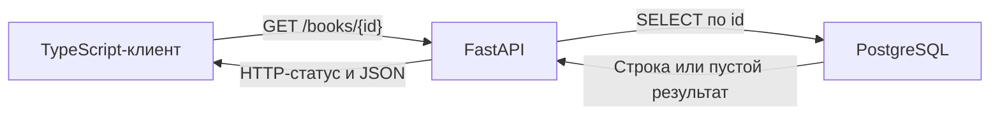

# Проверить контракт FastAPI из TypeScript локально и в GitHub Actions

[English](../../en/tools/api-contract-lab.md) · [Инструменты](README.md)

Проверьте, что TypeScript-клиент получает ожидаемый ответ FastAPI по HTTP. FastAPI читает книгу из PostgreSQL. Docker Compose запускает все три компонента локально и в GitHub Actions.

| Задача | Приём | Где начать |
| --- | --- | --- |
| Проверить ответы API на своём компьютере | `docker compose run --build --rm client` | [Локальный запуск](#выполнить-проверку-локально) |
| Повторить проверку в CI | Ручной запуск workflow | [GitHub Actions](#повторить-проверку-в-github-actions) |
| Понять, почему локальная проверка не прошла | Вывод клиента и журналы сервисов | [Разбор отказа](#разобрать-отказ-проверки) |

Контракт определяет, какой HTTP-статус и какие поля JSON клиент ожидает от сервера. Запрос `GET /books/1` возвращает `200` и `{"id":1,"title":"The Hobbit"}`. Запрос `GET /books/999` возвращает `404` и `{"detail":"Book not found"}`.



## Подготовить окружение

Для локального запуска нужны работающий Docker Engine и команда `docker compose run` с параметром `--build`. Для сборки нужны Docker Hub, PyPI и реестр npm. Устанавливать Python и Node.js на свой компьютер не нужно.

Пример использует Python 3.14, FastAPI 0.162.0, Psycopg 3.3.9, Uvicorn 0.54.0, PostgreSQL 18.6, Node.js 26.8.2 и TypeScript 6.0.3. База содержит одну учебную книгу. Compose использует учебный пароль `lab-only-password` и не открывает порты сервисов на компьютере.

[Первый запуск Compose](compose-and-github-actions.md) · [Первый HTTP-запрос из TypeScript](../typescript/README.md) · [Маршруты FastAPI](../python/web/fastapi/http-api.md)

## Посмотреть полный пример

| Файл | Что делает |
| --- | --- |
| [`compose.yaml`](../../../examples/tools/api-contract-lab/compose.yaml) | Создаёт общую сеть и ждёт готовности зависимостей |
| [`init.sql`](../../../examples/tools/api-contract-lab/init.sql) | Создаёт таблицу `books` и добавляет книгу с `id = 1` в пустую БД |
| [`app.py`](../../../examples/tools/api-contract-lab/app.py) | Передаёт `id` параметром SQL-запроса и формирует HTTP-ответ |
| [`client.mts`](../../../examples/tools/api-contract-lab/client.mts) | Отправляет два запроса и проверяет статус и JSON |
| [`Dockerfile`](../../../examples/tools/api-contract-lab/Dockerfile) и [`requirements.txt`](../../../examples/tools/api-contract-lab/requirements.txt) | Собирают образы API и клиента с нужными зависимостями |
| [`workflow-example.yml`](../../../examples/tools/api-contract-lab/workflow-example.yml) | Запускает ту же проверку по кнопке в GitHub Actions |

Клиент обращается к `http://app:8000`. FastAPI подключается к базе по имени `postgres`. Compose разрешает эти имена внутри общей сети. В контейнере `localhost` указывает на сам контейнер.

При сборке образа клиента `tsc` проверяет типы и создаёт файл `client.mjs`. При запуске клиент получает JSON по сети. Тип `Book` сам по себе не проверяет этот JSON. Поэтому клиент читает ответ как `unknown` и проверяет, что `id` — целое число, а `title` — строка.

## Выполнить проверку локально

Из корня репозитория перейдите в каталог примера и запустите клиент.

```bash
cd examples/tools/api-contract-lab
docker compose run --build --rm client
```

Compose собирает образы и запускает PostgreSQL и FastAPI. Когда API начинает принимать подключения, Compose запускает клиент. Параметр `--rm` удаляет контейнер клиента после завершения. PostgreSQL и FastAPI продолжают работать.

При успехе клиент завершится с кодом `0` и выведет две строки.

```text
OK GET /books/1 -> 200 The Hobbit
OK GET /books/999 -> 404 Book not found
```

### Разобрать отказ проверки

Клиент завершится с ненулевым кодом при неверном статусе, отсутствии обязательного поля или неверном значении поля. Дополнительные поля допустимы. Строка `GET /books/999: expected HTTP 404, got 200` означает, что сервер вернул успешный ответ для отсутствующей книги.

Если клиент не запустился или не смог получить ответ, проверьте состояние сервисов и журналы.

```bash
docker compose ps -a
docker compose logs --tail 50 app postgres
```

Для очистки выполните команду из каталога примера. Она удаляет контейнеры, сеть и том `books-data` проекта вместе с данными. При следующем запуске PostgreSQL снова выполнит `init.sql`.

```bash
docker compose down --volumes
```

## Повторить проверку в GitHub Actions

Используйте отдельный учебный репозиторий с включёнными Actions и правом записи. Если его локальная копия лежит рядом с `Python_cheat_sheet`, выполните команды из корня **учебного репозитория**.

```bash
cp -R ../Python_cheat_sheet/examples/tools/api-contract-lab .
mkdir -p .github/workflows
cp api-contract-lab/workflow-example.yml .github/workflows/api-contract.yml
git status --short
```

Сохраните файлы в коммите и отправьте коммит в ветку по умолчанию учебного репозитория. GitHub ищет файл ручного запуска в этой ветке. [Работа с удалённым репозиторием](git/remotes.md).

1. Откройте **Actions → API contract lab → Run workflow**.
2. Выберите ветку по умолчанию и нажмите **Run workflow**.
3. Откройте новый запуск и шаг **Check the API contract** в задании **contract**. Найдите обе строки `OK GET`.

GitHub выполняет ту же команду Compose в каталоге `api-contract-lab` на Ubuntu 24.04. При сбое шаг **Show service logs** показывает журналы API и PostgreSQL. Последний шаг удаляет контейнеры, сеть и учебный том после успеха или отказа. Для получения файлов достаточно разрешения `contents: read`. Образец закрепляет `actions/checkout` по полному SHA коммита. Секреты репозитория не нужны.

## Источники

- Docker. [Запуск одноразового контейнера](https://docs.docker.com/reference/cli/docker/compose/run/) и [порядок запуска сервисов](https://docs.docker.com/compose/how-tos/startup-order/).
- PostgreSQL и Psycopg. [Инициализация официального образа](https://hub.docker.com/_/postgres) и [параметры SQL-запроса](https://www.psycopg.org/psycopg3/docs/basic/params.html).
- FastAPI. [HTTP-ошибки](https://fastapi.tiangolo.com/tutorial/handling-errors/) и [модель ответа](https://fastapi.tiangolo.com/tutorial/response-model/).
- TypeScript и Node.js. [Уточнение типов](https://www.typescriptlang.org/docs/handbook/2/narrowing.html) и [`fetch` в Node.js 26.8.2](https://nodejs.org/download/release/v26.8.2/docs/api/globals.html#fetch).
- GitHub. [Ручной запуск workflow](https://docs.github.com/en/actions/how-tos/manage-workflow-runs/manually-run-a-workflow) и [`actions/checkout` v7.0.1](https://github.com/actions/checkout/releases/tag/v7.0.1).
