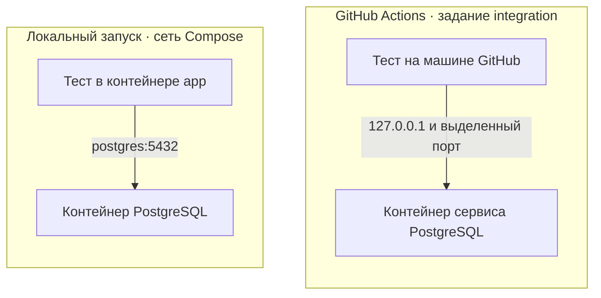

# Запустить Python-приложение с PostgreSQL в Docker Compose и проверить в GitHub Actions

[English](../../en/tools/compose-and-github-actions.md)

Запустите учебное Python-приложение с PostgreSQL на своём компьютере. Затем выполните интеграционный тест на GitHub и разберите его намеренный отказ.

| Задача | Приём | Где выполнить |
| --- | --- | --- |
| Проверить ответ приложения | `docker compose up` и запрос к `/health` | [Терминал на вашем компьютере](#запустить-приложение-локально) |
| Проверить запрос к PostgreSQL | `python -m unittest -v` | [Контейнер приложения](#проверить-тест-локально) |
| Запустить готовый workflow вручную | `workflow_dispatch` и **Run workflow** | [Ручной запуск](#запустить-готовый-workflow-вручную) |
| Воспроизвести отказ теста в CI | `Run workflow` с параметром `fail_test` | [Запуск на GitHub](#запустить-тест-в-github-actions) |
| Найти причину отказа в готовом запуске | Открыть упавший шаг или выполнить `gh run view --log-failed` | [Журнал GitHub Actions](#найти-причину-падения-в-журнале) |

## Подготовка

Для локального запуска нужны работающий Docker Engine, команда `docker compose` с параметром `up --wait` и `curl`. Команды рассчитаны на Bash или Zsh. Для загрузки отсутствующих образов нужен доступ к Docker Hub. При сборке образа приложения Python 3.14 входит в базовый образ, а Psycopg 3.3.9 загружается из PyPI. Оба сценария используют PostgreSQL 18.6.

Для запуска на GitHub нужен отдельный учебный репозиторий с включёнными Actions и правом записи. Пример использует только учебные учётные данные `lab` и `lab-only-password`. Используйте пример в учебной среде с пустой базой данных. HTTP-сервер `http.server` предназначен для учебного запуска.

## Файлы примера

Полный пример находится в каталоге `examples/tools/compose-and-github-actions/`.

| Файл | Назначение |
| --- | --- |
| [`app.py`](../../../examples/tools/compose-and-github-actions/app.py) | Отвечает на `GET /health` и выполняет `SELECT current_database()` |
| [`test_app.py`](../../../examples/tools/compose-and-github-actions/test_app.py) | Проверяет результат запроса к PostgreSQL |
| [`requirements.txt`](../../../examples/tools/compose-and-github-actions/requirements.txt) | Задаёт версию Psycopg с бинарным пакетом |
| [`Dockerfile`](../../../examples/tools/compose-and-github-actions/Dockerfile) | Собирает образ приложения с тестом |
| [`compose.yaml`](../../../examples/tools/compose-and-github-actions/compose.yaml) | Запускает приложение и PostgreSQL локально |
| [`workflow-example.yml`](../../../examples/tools/compose-and-github-actions/workflow-example.yml) | Задаёт ручной запуск теста на GitHub |

## Запустить приложение локально

Из корня репозитория шпаргалки перейдите в каталог примера. Выполняйте остальные команды Compose из этого каталога.

```bash
cd examples/tools/compose-and-github-actions
docker version
docker compose config -q
docker compose up --build -d --wait
docker compose ps
curl --fail --silent --show-error http://127.0.0.1:18080/health
```

`docker version` показывает секцию `Server`, если Docker Engine доступен. `config -q` проверяет конфигурацию. `up --build` собирает образ приложения. `-d` оставляет контейнеры работать в фоне. `--wait` ждёт успешных проверок готовности.

В выводе `docker compose ps` оба сервиса имеют статус `healthy`. Запрос возвращает HTTP 200 и JSON.

```json
{"status": "ok", "database": "compose_lab"}
```

Compose создаёт общую сеть. Приложение подключается к PostgreSQL по имени сервиса `postgres` и порту `5432` внутри сети. На компьютере доступен только порт приложения `127.0.0.1:18080`. Сочетание `depends_on` и `service_healthy` задаёт порядок запуска. Запрос `/health` проверяет реальное подключение и возвращает имя базы из SQL-ответа.

Если запуск завершается ошибкой или запрос возвращает HTTP 503, проверьте состояние сервисов и их журналы.

```bash
docker compose ps -a
docker compose logs --tail 30 app postgres
```

Строка `PostgreSQL is unavailable` в журнале `app` означает, что приложение не смогло подключиться к базе или потеряло соединение. Проверьте журнал `postgres`. После устранения причины снова выполните `docker compose up -d --wait`. Если занят порт `18080`, измените номер слева от `:8000` в `compose.yaml` и используйте новый порт в `curl`.

## Проверить тест локально

При запущенных контейнерах выполните тест из терминала в каталоге примера. `docker compose exec` запускает Python внутри контейнера `app` с настроенным подключением к базе.

```bash
docker compose exec app python -m unittest -v
```

Тест вызывает функцию `database_status()` из приложения. Функция выполняет запрос к PostgreSQL. Тест проверяет статус `ok` и фактическое имя базы `compose_lab`. Ожидаемый результат — один тест и `OK`.

Для учебного отказа задайте переменную только для процесса теста. Тест подставит заведомо неверное ожидаемое имя базы.

```bash
docker compose exec -e LAB_FORCE_FAILURE=1 app python -m unittest -v
```

Ожидаемый результат — `FAILED (failures=1)` и код завершения `1`. Повторите первую команду для возврата к `OK`.

## Запустить готовый workflow вручную

В файле workflow в ветке по умолчанию укажите `workflow_dispatch` в разделе `on`. Для запуска нужно право записи в репозиторий.

На вкладке **Actions** выберите workflow. Нажмите **Run workflow**. Выберите ветку. Укажите значения параметров, если workflow их принимает. Нажмите **Run workflow** ещё раз. В списке появится новый запуск. [Документация GitHub](https://docs.github.com/en/actions/how-tos/manage-workflow-runs/manually-run-a-workflow).

## Запустить тест в GitHub Actions

Создайте пустой учебный репозиторий рядом с локальной копией `devrefsnap`. В терминале из корня **учебного репозитория** скопируйте файлы примера. Переместите образец workflow в каталог, в котором GitHub ищет конфигурацию.
Если каталог локальной копии называется иначе, замените путь `../devrefsnap` в команде.

```bash
cp -R ../devrefsnap/examples/tools/compose-and-github-actions/. .
mkdir -p .github/workflows
mv workflow-example.yml .github/workflows/postgres-test.yml
git status --short
```

Сохраните файлы в коммите. Отправьте коммит в ветку по умолчанию **учебного репозитория**. Файл должен находиться по пути `.github/workflows/postgres-test.yml` в этой ветке. [Работа с удалённым репозиторием](git/remotes.md).

Workflow — файл с описанием запуска. `workflow_dispatch` включает ручной запуск с параметром `fail_test`. Задание `integration` выполняется на машине GitHub с Ubuntu 24.04. GitHub запускает PostgreSQL как контейнер сервиса и выделяет свободный порт на машине задания. Шаг `Run database test` подключается через `127.0.0.1` и использует этот порт. Задание запускает тест напрямую на машине GitHub. Локально тест выполнялся в контейнере `app`.

Схема сравнивает, где выполняется тест и по какому адресу тест подключается к PostgreSQL.



Разрешение `contents: read` позволяет получить файлы репозитория. Обе операции `uses` закреплены полными SHA коммитов официальных actions. Настройка секретов репозитория для этого примера не нужна.

1. Откройте **Actions → PostgreSQL integration test → Run workflow** на GitHub.
2. Выберите ветку по умолчанию. Оставьте **Make the test fail on purpose** выключенным. Нажмите **Run workflow**.
3. Откройте новый запуск, задание **integration** и шаг **Run database test**. Найдите `OK` в журнале успешного запуска.
4. Запустите workflow ещё раз. Включите **Make the test fail on purpose**. Откройте тот же шаг в журнале нового запуска.

Если кнопки **Run workflow** нет, проверьте путь файла в ветке по умолчанию, настройки Actions и право записи.

## Найти причину падения в журнале

На вкладке **Actions** выберите workflow. Откройте запуск с ошибкой. Выберите задание, которое завершилось с ошибкой. Откройте первый упавший шаг. Прочитайте сообщение об ошибке.

Войдите в GitHub CLI под учётной записью с доступом к запуску. Выполните команду в локальной копии репозитория. Вместо `RUN_ID` укажите число после `/actions/runs/` в URL запуска.

```bash
gh run view RUN_ID --log-failed
```

[Справочник GitHub CLI](https://cli.github.com/manual/gh_run_view).

В учебном workflow **PostgreSQL integration test** откройте задание **integration**. Выберите шаг **Run database test**.

При учебном отказе найдите имя теста `test_reports_current_database` и строку `self.assertEqual` из `test_app.py`. Сравните фактическое имя базы с ожидаемым. Фрагмент сообщения выглядит так.

```text
AssertionError: 'compose_lab' != 'intentional_failure'
```

`compose_lab` пришло из PostgreSQL. `intentional_failure` подставил тест по параметру запуска. Если сбой произошёл до проверки `self.assertEqual`, откройте журнал первого упавшего шага. Например, `OperationalError` на этапе теста указывает на проблему подключения к PostgreSQL.

Для восстановления создайте новый запуск с выключенным параметром. Команда **Re-run jobs** повторяет запуск с исходным параметром.

## Очистить учебное окружение

Из каталога локального примера выполните `docker compose down`, чтобы остановить и удалить контейнеры и сеть проекта. Именованный том PostgreSQL сохранится.

Для полного сброса учебной базы выполните команду ниже. Она удаляет том `lab-data` этого проекта вместе со всеми данными в нём. Используйте команду только для учебных данных.

```bash
docker compose down --volumes
```

GitHub удаляет контейнер PostgreSQL после завершения задания. Журнал можно открыть в истории запусков.

## Источники

- Docker. [Первый проект Compose](https://docs.docker.com/compose/gettingstarted/) и [порядок запуска сервисов](https://docs.docker.com/compose/how-tos/startup-order/).
- PostgreSQL. [Официальный Docker-образ и путь тома в PostgreSQL 18](https://hub.docker.com/_/postgres) и [`current_database()`](https://www.postgresql.org/docs/18/functions-info.html#FUNCTIONS-INFO-SESSION).
- Python. [`http.server`](https://docs.python.org/3.14/library/http.server.html) и [установка Psycopg](https://www.psycopg.org/psycopg3/docs/basic/install.html).
- GitHub. [Сервис PostgreSQL](https://docs.github.com/en/actions/tutorials/use-containerized-services/create-postgresql-service-containers), [ручной запуск](https://docs.github.com/en/actions/how-tos/manage-workflow-runs/manually-run-a-workflow) и [журналы запуска](https://docs.github.com/en/actions/how-tos/monitor-workflows/use-workflow-run-logs).
- Версии actions. [`actions/checkout` v7.0.1](https://github.com/actions/checkout/releases/tag/v7.0.1) и [`actions/setup-python` v7.0.0](https://github.com/actions/setup-python/releases/tag/v7.0.0).

Если в вашем проекте уже есть `uv.lock`, используйте [рецепты uv для CI и Docker](../python/tooling/uv/automation.md).
Чтобы проверить HTTP-контракт из TypeScript одной командой локально и в CI, откройте [сквозной пример](api-contract-lab.md).
