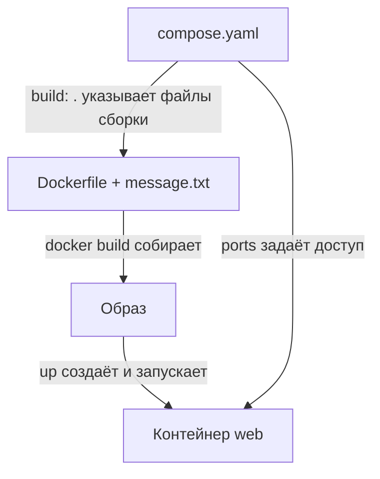

# Dockerfile и Docker Compose

[English](../../../en/tools/docker/README.md)

Соберите небольшой HTTP-сервер и получите файл из контейнера. Для первого запуска нужен только Docker с Compose и curl 7.71 или новее. Python входит в образ.

| Что вы хотите сделать | Приём | Куда перейти |
| --- | --- | --- |
| Впервые запустить готовый проект | `up --build -d` → HTTP-запрос → `down` | [Первый запуск](#первый-запуск) |
| Написать Dockerfile для своего приложения | Выбрать базовый образ, скопировать файлы, задать команду | [Написать Dockerfile](dockerfile.md) |
| Использовать Dockerfile в Compose | Связать сервис с каталогом сборки и опубликовать порт | [Составить compose.yaml](compose-file.md) |
| Найти команду для работающего проекта | Посмотреть журнал, выполнить команду, применить изменение | [Команды Compose](commands.md) |
| Подключить приложение к PostgreSQL | Найти БД по имени сервиса, дождаться готовности, сохранить данные | [Добавить базу данных](compose-file.md#подключить-базу-данных) |

**Образ** содержит файлы и команду запуска. **Контейнер** — экземпляр образа со своим состоянием. В Compose **сервис** описывает, какие контейнеры нужны приложению. **Проект** объединяет сервисы и их ресурсы под общим именем.

Схема показывает, как два файла участвуют в запуске одного сервиса.



## Первый запуск

Запустите Docker Desktop или Docker Engine с плагином Compose. Выполняйте команды в Bash или Zsh из корня репозитория. Для первой загрузки образа нужен доступ к Docker Hub. По умолчанию пример занимает локальный порт `18081`. Сервер Python предназначен для учебного запуска. [Установка Compose](https://docs.docker.com/compose/install/) · [Модуль http.server](https://docs.python.org/3.14/library/http.server.html).

```bash
cd examples/tools/docker-basics
docker version
docker compose version
docker compose config -q
docker compose up --build -d
docker compose ps
curl --retry 5 --retry-all-errors -fsS http://127.0.0.1:18081/message.txt
```

У `docker version` должна появиться секция `Server`. Команда `config -q` при успехе завершится без вывода. Команда `up` соберёт образ по [Dockerfile](../../../../examples/tools/docker-basics/Dockerfile) и запустит сервис `web` из [compose.yaml](../../../../examples/tools/docker-basics/compose.yaml). Флаг `-d` вернёт управление терминалу.

В выводе `ps` найдите сервис `web` и привязку `127.0.0.1:18081->8000/tcp`. Если сервер ещё запускается, curl может показать ошибку соединения и повторить запрос. При успехе вы увидите содержимое [message.txt](../../../../examples/tools/docker-basics/message.txt).

```text
Hello from Docker!
```

Посмотрите запись о запросе. Затем удалите учебный контейнер и сеть проекта. Собранный образ останется на компьютере.

```bash
docker compose logs --tail 5 web
docker compose down
```

Если порт занят или ответ отличается, откройте [диагностику по симптому](commands.md#найти-причину-сбоя). После первого запуска попробуйте [изменить файл и применить изменение](commands.md#применить-изменение).

[Приложение с PostgreSQL и тест в GitHub Actions](../compose-and-github-actions.md) · [Инструменты разработки](../README.md)
