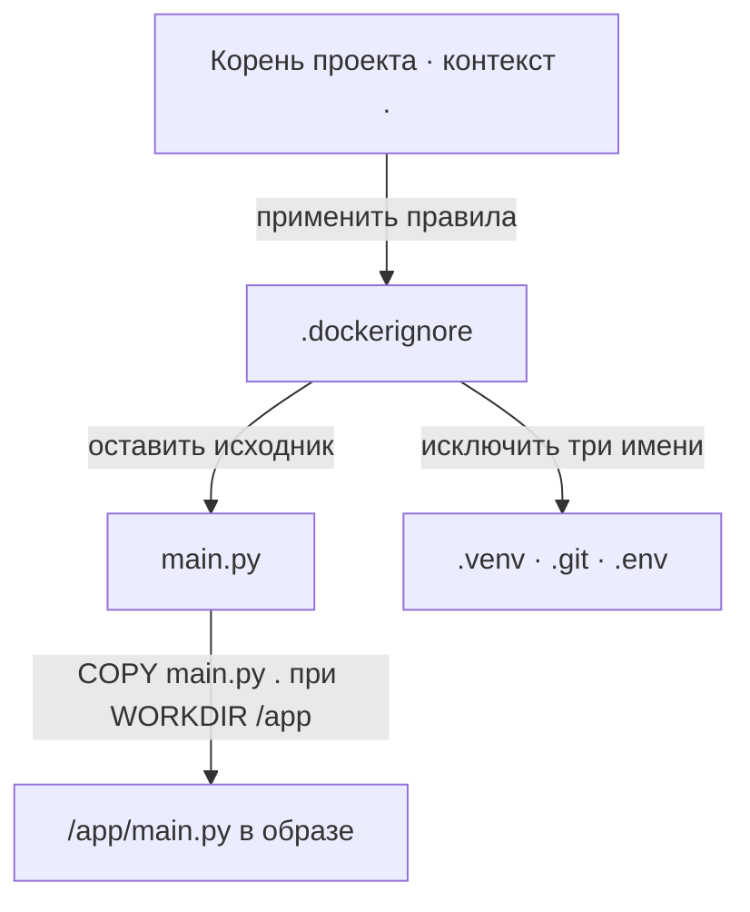
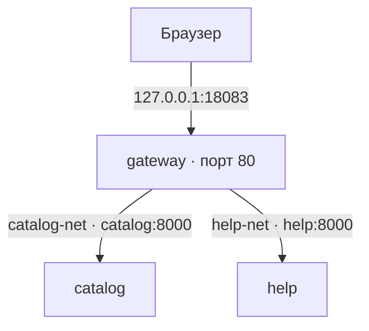

# Методичка по Dockerfile и Compose

[English](../../../en/tools/docker/guide.md)

Представьте сайт с двумя разделами. Читатель открывает каталог или справку по одному адресу. За этим адресом работают три сервиса. Шлюз `gateway` принимает запросы, а `catalog` и `help` отдают нужный текст. [Готовые файлы сайта](lab.md).

## Что задаёт каждый файл

**Dockerfile задаёт содержимое образа.** Инструкция `FROM` берёт готовую среду Python. Инструкция `COPY` добавляет тексты страниц. Инструкция `CMD` задаёт команду сервера. Результат сборки — **образ**, из которого Docker может создать контейнеры.

**compose.yaml задаёт условия запуска.** Раздел `services` описывает роли приложения. Сервисы `catalog` и `help` используют один Dockerfile. Каждый запускает сервер в своём каталоге и получает собственный том. Сервис `gateway` использует готовый образ Nginx. Все три сервиса входят в один проект Compose.

## Откуда COPY берёт файл

В команде `docker build -f dockers/Dockerfile .` последняя точка выбирает исходные файлы для сборки. Если вы запускаете команду из корня проекта, Docker ищет там `.dockerignore`. Затем `COPY main.py .` берёт разрешённый файл из этого корня. Точка справа указывает на рабочий каталог внутри образа. При `WORKDIR /app` получится `/app/main.py`.

Стрелки показывают, как один исходный файл попадает в образ.

Что изменится, если передать `dockers/` последним аргументом? Контекстом станет подкаталог. Корневой `main.py` окажется за его пределами, и сборка завершится ошибкой. [Дерево проекта и полные файлы](build-context.md)

## Как запрос находит нужный сервис

Стрелки показывают адрес назначения на каждом участке пути.

Для запроса `/catalog/message.txt` путь выглядит так.

1. Браузер обращается к порту `18083` на компьютере. Запись `ports` направляет запрос на порт `80` шлюза.
2. Nginx выбирает маршрут `/catalog/`. Он находит сервис по имени `catalog` в общей сети `catalog-net` и запрашивает у него `/message.txt` на порту `8000`.
3. Сервер читает `/site/catalog/message.txt`. Ответ возвращается через шлюз в браузер.

Для `/help/message.txt` шлюз использует сеть `help-net` и имя `help`. Оба внутренних сервиса могут слушать порт `8000`: у каждого свой сетевой адрес. Шлюз подключён к обеим сетям. У каталога и справки общей сети нет. Внутри контейнера адрес `127.0.0.1` ведёт в этот же контейнер. [Сети Compose](https://docs.docker.com/compose/how-tos/networking/).

## Что остаётся после пересоздания

**Том** хранит файлы отдельно от контейнера. Запись `catalog-pages:/site/catalog` означает, что сервер видит содержимое тома `catalog-pages` по пути `/site/catalog`. При первом подключении пустого тома Docker копирует туда файлы, уже лежащие по этому пути в образе. Поэтому сразу доступен исходный текст каталога.

Когда том уже содержит файлы, следующий контейнер увидит именно их. Поэтому пересборка образа сама по себе не обновит страницу в существующем томе. Тот же принцип сохраняет журнал запросов при пересоздании шлюза. [Как Docker заполняет пустой том](https://docs.docker.com/engine/storage/volumes/#mounting-a-volume-over-existing-data).

Файл настроек `gateway.conf` подключён иначе. Запись `./gateway.conf:/etc/nginx/conf.d/default.conf:ro` показывает шлюзу конкретный файл с компьютера и разрешает только чтение. Такой способ называют **bind mount**. В [практикуме](lab.md) можно проследить запрос и проверить сохранность данных.

[Все материалы по Docker](README.md)
