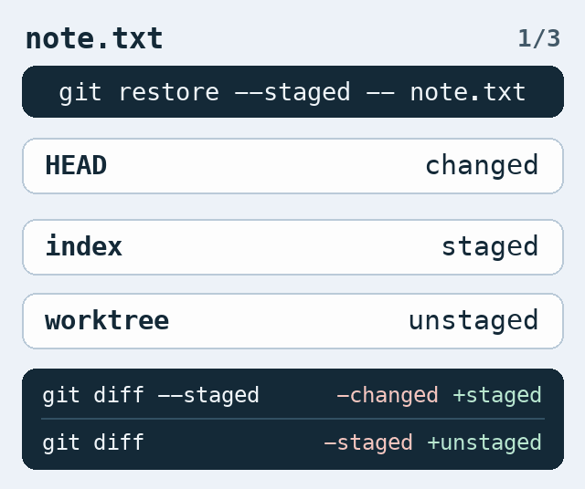

# Отмена изменений, восстановление и rebase

[English](../../../en/tools/git/history.md)

Выберите операцию по месту изменения и требованию к сохранности текста.
Карточки ниже разделяют отмену подготовки, удаление правок и изменение истории.
[К справочнику Git](README.md).


## Выбрать операцию

| Ситуация | Команда | Пример и последствия |
| --- | --- | --- |
| Файл подготовлен по ошибке | `restore --staged` | [Сохранить текст](#убрать-файл-из-индекса) |
| Правка файла больше не нужна | `restore` | [Выбрать источник; правки теряются](#отменить-незакоммиченные-изменения) |
| Последний коммит локальный | `reset --soft` / `--mixed` | [Сохранить изменения](#отменить-коммит-с-сохранением-изменений) |
| Изменение опубликовано | `revert` | [Добавить обратный коммит](#отменить-опубликованное-изменение) |
| Коммит исчез из ветки | `reflog` → `branch rescue` | [Восстановить ссылку](#восстановить-потерянный-коммит) |
| Нужно дополнить свой коммит | `commit --amend` | [Создать новый идентификатор](#исправить-свой-последний-коммит) |
| Нужно перенести свою ветку на новую базу | `rebase` | [Разрешить конфликт или отменить](#перебазировать-свою-ветку) |

Уровни: средний — отмена; продвинутый — восстановление и rebase.
Предпосылки: понимание [HEAD, индекса и рабочего дерева](README.md#различать-head-индекс-и-рабочее-дерево).
Полные сценарии требуют Bash и Git 2.32+ для изоляции конфигурации.


## Убрать файл из индекса

**Ситуация:** `app.py` попал в индекс, но правки должны остаться на диске.
Если HEAD уже существует, снимите подготовку файла:

```bash
git restore --staged -- app.py
git diff --staged -- app.py
git diff -- app.py
```

**Результат:** индекс получает версию файла из HEAD.
Подготовленный diff для файла пуст.
Рабочее дерево не меняется.
Новый добавленный файл становится неотслеживаемым и показывается через `git status --short`.

<details>
<summary>Показать по шагам</summary>



До команды файл `note.txt` содержит `changed` в HEAD, `staged` в индексе и `unstaged` в рабочем дереве. Команда копирует `changed` из HEAD в индекс. После команды вывод `git diff --staged` пуст. Команда `git diff` показывает замену `changed` на `unstaged`.

[Открыть GIF для повторного просмотра](../../../assets/git-restore-staged.gif?raw=true)

</details>

**Ограничения:** команда не прекращает отслеживание файла, который уже есть в HEAD.
До первого коммита HEAD отсутствует; для нового добавленного файла используйте `git rm --cached -- app.py`.

Если нужно прекратить отслеживание ранее закоммиченного файла, выберите другую операцию:

```bash
git rm --cached -- local.env
```

**Последствия:** файл остаётся на диске, а индекс подготавливает его удаление из репозитория.
Добавьте путь в `.gitignore`, если файл должен оставаться локальным.
Проверьте staged diff перед коммитом удаления.
После получения этого коммита другие копии могут удалить файл из рабочего дерева.
Прежние версии остаются в истории; команда не удаляет опубликованный секрет из истории.
Если `rm --cached` отказывает из-за разных версий файла, сначала сохраните нужные версии.

[Учебная проверка restore](#проверить-режимы-reset-и-revert)


## Отменить незакоммиченные изменения

**Ситуация:** правки отслеживаемого `app.py` больше не нужны.
Сначала посмотрите `git diff -- app.py` и `git diff --staged -- app.py`.
Сохраните нужный текст отдельной копией или через [stash](workflow.md#временно-отложить-работу).

Команды в таблице — альтернативы.
Каждая команда удаляет правки выбранного назначения.

| Что отбросить | Отдельный фрагмент команды | Результат и потеря |
| --- | --- | --- |
| Только правки после последнего `add` | `git restore -- app.py` | Файл получает версию индекса. Staged-правки сохраняются |
| Только рабочую копию заменить версией HEAD | `git restore --source=HEAD --worktree -- app.py` | Индекс сохраняется; рабочий текст заменяется версией коммита |
| И staged, и unstaged для файла | `git restore --source=HEAD --staged --worktree -- app.py` | Индекс и файл получают версию HEAD. Обе незакоммиченные версии теряются |

**Пример — фрагмент для удаления только unstaged-правки:**

```bash
git restore -- app.py
git diff -- app.py
git diff --staged -- app.py
```

**Результат:** первый diff пуст; второй показывает сохранённые staged-правки, если они были.
`restore` не удаляет произвольные неотслеживаемые файлы.
Если выбранного отслеживаемого пути нет в источнике, Git удаляет этот путь для соответствия источнику.
Reflog не хранит каждый незакоммиченный текст.

[Учебная проверка потери правки](#проверить-режимы-reset-и-revert)


## Отменить коммит с сохранением изменений

**Ситуация:** последний коммит ещё не опубликован и имеет родителя.
Текущая локальная ветка выбрана верно, рабочее дерево и индекс чистые.
Если коммит уже используют другие участники, [выберите revert](#отменить-опубликованное-изменение) или согласованный процесс.

| После отмены нужно | Команда — выберите одну | Индекс | Рабочее дерево |
| --- | --- | --- | --- |
| Сразу пересобрать коммит | `git reset --soft HEAD~1` | Сохраняет подготовленный снимок | Сохраняет файлы |
| Заново выбрать изменения | `git reset --mixed HEAD~1` | Получает версию родителя | Сохраняет файлы |

**Пример — фрагмент для сохранения подготовленных изменений:**

```bash
git status --short
git log -2 --oneline
git branch backup-before-reset
git reset --soft HEAD~1
git diff --staged
git status --short
```

**Результат:** текущая ветка и HEAD переходят к первому родителю.
Изменения отменённого коммита остаются staged.
Ветка `backup-before-reset` сохраняет прежний коммит; выберите свободное имя.
При исходных незакоммиченных правках результат смешается с этими правками.
Для merge-коммита `HEAD~1` обозначает первого родителя, а не произвольную «предыдущую работу».

**Не подменяйте команду на `reset --hard`.**
`--hard` заменяет индекс и отслеживаемые файлы целевым снимком.
Команда также может удалить неотслеживаемые пути, мешающие записи отслеживаемых файлов.
Объект прежнего коммита не удаляется немедленно, но восстановление незакоммиченного текста не гарантируется.

[Сравнение soft/mixed/hard в учебном репозитории](#проверить-режимы-reset-и-revert)


## Отменить опубликованное изменение

**Ситуация:** коммит уже попал в общую историю.
Сохраните незакоммиченную работу перед операцией.
Найдите нужный обычный коммит через `git log --oneline`.

**Пример — шаблон фрагмента:** замените `COMMIT` проверенным идентификатором.

```text
git show COMMIT
git revert COMMIT
git show --stat HEAD
```

**Результат:** Git добавляет новый коммит с обратным изменением.
Исходный коммит остаётся в истории.
Затем выполните проверки проекта и отправьте обратный коммит по обычному процессу PR/push.

**Ограничения:** поздние изменения могут вызвать конфликт.
При конфликте исправьте файл, выполните `git add -- file`, затем `git revert --continue`.
Для отмены незавершённой операции выполните `git revert --abort`.
Откат merge требует выбора основного родителя через `-m` и влияет на последующие слияния.
Этот короткий рецепт предназначен для обычного коммита с одним родителем.
Revert не удаляет исходный секрет из истории.

[Полный учебный revert](#проверить-режимы-reset-и-revert)


## Восстановить потерянный коммит

**Ситуация:** после reset, rebase или удаления ветки нужного коммита больше не видно в обычном log.
Посмотрите локальные движения HEAD:

```bash
git reflog --date=iso
```

**Пример — шаблон фрагмента:** замените `COMMIT` идентификатором найденного коммита.
Выберите свободное имя для rescue-ветки.

```text
git show COMMIT
git branch rescue COMMIT
git log -1 --oneline rescue
git show rescue:app.py
```

**Результат:** новая локальная ветка удерживает найденный коммит.
Текущая ветка, индекс и файлы не меняются.
Замените `app.py` путём существующего файла этого коммита.
После сохранения текущей работы можно переключиться на `rescue` и изучить файлы.

**Ограничения:** reflog относится к этой локальной копии и имеет срок хранения.
Нужный объект мог быть очищен.
Reflog не является долговечной резервной копией и не гарантирует восстановление незакоммиченного текста.

[Учебное восстановление через reflog](#проверить-режимы-reset-и-revert)


## Исправить свой последний коммит

**Ситуация:** последний коммит ещё не опубликован; нужно добавить правку.
Используйте фрагмент после просмотра всего staged diff:

```bash
git add -- app.py
git diff --staged
git commit --amend --no-edit
```

**Результат:** amend создаёт новый коммит с другим идентификатором.
Чтобы изменить сообщение, уберите `--no-edit`.
Весь подготовленный индекс войдёт в новый снимок.
После amend опубликованной ветки понадобится [согласованное переписывание remote](remotes.md#переписать-свою-ветку-с-проверкой).


## Перебазировать свою ветку

**Ситуация:** свою ветку нужно перенести на новую базу.
Пример предполагает текущую `feature/profile`, чистые файлы и индекс, remote `origin` и ветку `main` на сервере.
Для опубликованной совместной ветки сначала согласуйте переписывание.

```bash
git fetch origin
git branch backup-before-rebase
git rebase origin/main
```

**Результат без конфликта:** Git переприменяет коммиты поверх `origin/main`.
Пересозданные коммиты получают новые идентификаторы.
Выберите свободное имя для backup-ветки.

При конфликте изучите `git status` и `git diff`.
Исправьте файл, сохранив нужные изменения обеих сторон.
Фрагмент продолжения предполагает конфликт в `app.py`:

```bash
git add -- app.py
git diff --cached
git rebase --continue
```

Если следующий коммит тоже конфликтует, повторите разрешение.
Для отмены незавершённого rebase выполните `git rebase --abort`.
При указанных чистых исходных условиях ветка вернётся к состоянию перед rebase.
Правки разрешения конфликтов будут отброшены.
`--skip` пропускает текущий коммит и может потерять его изменение.
Не используйте `--skip` как обычное разрешение конфликта.

Интерактивный `git rebase -i HEAD~3` позволяет менять порядок, редактировать и объединять коммиты через `squash`/`fixup`.
Сначала проверьте, что все три коммита принадлежат вашей неопубликованной работе.
После успешного rebase сравните изменения и запустите проверки проекта.
Линейная история не доказывает эквивалентность поведения.

[Учебные continue/abort](#проверить-конфликты-merge-и-rebase) · [Выбор merge вместо rebase](remotes.md#обновить-ветку-и-разрешить-конфликт)


## Проверить режимы reset и revert

Полный учебный Bash-скрипт использует только синтетический временный репозиторий.
Сохраните файл [`history.sh`](../../../../examples/tools/git/history.sh).
Запустите `bash history.sh`.
При выходе скрипт удаляет только созданный каталог.
Глобальная конфигурация, пользовательские ветки и remote не затрагиваются.

[`git/history.sh`](../../../../examples/tools/git/history.sh)

**Результат:** проверки различий HEAD/индекса/файла проходят.
Скрипт восстанавливает ссылку на коммит через reflog.
Revert добавляет третий коммит.
Скрипт выводит `history OK`.
В реальном проекте сначала сохраните нужную работу коммитом или внешней копией.
Затем создайте backup-ветку перед опасной операцией.


## Проверить конфликты merge и rebase

Полный сценарий создаёт две ветки, которые меняют одну строку по-разному.
Скрипт проверяет конфликт, отмену и успешное продолжение обеих операций.
Зависимости: Bash и Git 2.32+.
Сохраните файл [`conflicts.sh`](../../../../examples/tools/git/conflicts.sh).
Запустите `bash conflicts.sh`.
Удаление и сбросы ограничены созданным временным репозиторием.

[`git/conflicts.sh`](../../../../examples/tools/git/conflicts.sh)

**Результат:** merge сохраняет двух родителей.
Rebase создаёт новый коммит поверх main.
Обе ветки содержат выбранный текст `main and feature`.
Скрипт выводит `conflicts OK`.
Синтетическое разрешение одной строки не заменяет проверки проекта.


## Источники

- [Git v2.55.0: reset](https://raw.githubusercontent.com/git/git/v2.55.0/Documentation/git-reset.adoc), [restore](https://git-scm.com/docs/git-restore/2.55.0), [rm](https://raw.githubusercontent.com/git/git/v2.55.0/Documentation/git-rm.adoc).
- [Revert и откат merge](https://raw.githubusercontent.com/git/git/v2.55.0/Documentation/git-revert.adoc), [reflog](https://raw.githubusercontent.com/git/git/v2.55.0/Documentation/git-reflog.adoc), [rebase](https://raw.githubusercontent.com/git/git/v2.55.0/Documentation/git-rebase.adoc).
- [Release notes 2.55.0](https://raw.githubusercontent.com/git/git/v2.55.0/Documentation/RelNotes/2.55.0.adoc).
