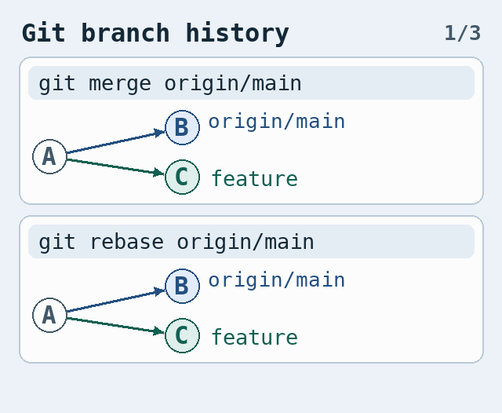

# Обновление и удаление веток

[English](../../../en/tools/git/remotes.md)

Откройте страницу, чтобы получить изменения, выбрать способ push или проверить ветку перед удалением.
[К справочнику Git](README.md).

| Ситуация | Приём | Пример |
| --- | --- | --- |
| Нужно узнать состояние сервера | Fetch и сравнение | [Выбрать интеграцию](#получить-изменения-и-выбрать-интеграцию) |
| Ветка разошлась с основной | Merge или согласованный rebase | [Разрешить конфликт](#обновить-ветку-и-разрешить-конфликт) |
| Нужно отправить ветку | Обычный push или явный lease | [Выбрать способ push](#выбрать-способ-обновления-удалённой-ветки) |
| Коммиты опубликованной ветки переписаны | Проверить ожидаемый SHA | [Карточка lease](#переписать-свою-ветку-с-проверкой) |
| Работа завершена | Проверить интеграцию и сохранность | [Карточка удаления](#удалить-ветку-после-проверки-результата) |

Уровни: средний — fetch, merge, push; продвинутый — lease и проверка после squash.
Предпосылки: понимание [видов веток](README.md#различать-локальную-и-удалённую-ветки), сохранённая работа и чистый индекс.


## Получить изменения и выбрать интеграцию

**Ситуация:** нужно обновиться и сначала понять расхождение.
Пример предполагает текущую `feature/profile`, настроенный `origin` и серверную `main`.
Перед интеграцией сохраните работу и проверьте чистоту через `git status --short`.

```bash
git branch --show-current
git fetch origin
git log --oneline --left-right HEAD...origin/main
```

**Результат:** fetch получает изменения, но не сливает их в текущую ветку.
В выводе log `<` обозначает коммиты только текущей ветки.
`>` обозначает коммиты только `origin/main`.
Вывод не показывает общие коммиты.

Выберите одну операцию после просмотра истории:

| Состояние / требование | Команда | Результат / ограничение |
| --- | --- | --- |
| Текущая ветка только отстаёт | `git merge --ff-only origin/main` | Передвигает ветку без merge-коммита; при расхождении отказывает |
| `origin/main` уже предок текущей ветки | Дополнительная интеграция не нужна | Ветка уже содержит известную основную историю |
| Есть коммиты с обеих сторон; существующие коммиты нужно сохранить | `git merge origin/main` | При расхождении создаёт merge-коммит; возможен конфликт |
| Свою ветку разрешено переписать | `git rebase origin/main` | Пересоздаёт коммиты; возможен конфликт |

<details>
<summary>Показать, как merge и rebase меняют историю</summary>

Стрелки идут от родителя к потомку. У веток общий коммит `A`. Ссылка `origin/main` указывает на коммит `B`, а рабочая ветка — на коммит `C`.



Merge добавляет коммит `M` с родителями `C` и `B`. После rebase рабочая ветка указывает на коммит `C′` с родителем `B` и новым SHA. В учебном сценарии одинаковое разрешение конфликтов даёт один и тот же текст `note.txt`.

[Открыть GIF для повторного просмотра](../../../assets/git-merge-rebase.gif) · [Запустить сценарий конфликтов](history.md#проверить-конфликты-merge-и-rebase)

</details>

Если нужно обновить текущую ветку из её настроенного upstream, используйте `git pull --ff-only`.
Проверьте upstream через `git branch -vv`.
`pull` сам выполняет fetch; при расхождении `--ff-only` отказывает.
Upstream feature-ветки часто указывает на `origin/feature/profile`, а не на `origin/main`.
Не запускайте pull в неизвестной ветке.

**Настройка — справочные шаблоны:** замените `URL` адресом проекта.

```text
git remote add origin URL
git remote -v
```

Для fork добавьте remote `upstream` с URL исходного проекта.
Выполните `git fetch upstream`.
Если локальная `main` только отстаёт, на `main` выполните `git merge --ff-only upstream/main`.
При собственных коммитах выберите согласованный merge/rebase.
Remote `origin` остаётся вашим fork.
Прямой push в основную ветку может быть запрещён правилами проекта.


## Обновить ветку и разрешить конфликт

**Ситуация:** текущая `feature/profile` и `origin/main` разошлись.
Нужно сохранить существующие коммиты feature-ветки.
После fetch и проверки чистоты рабочего дерева выберите merge:

```bash
git merge origin/main
```

**Результат без конфликта:** Git создаёт merge-коммит при расхождении.
При конфликте Git останавливается до завершения merge.
Изучите `git status` и `git diff`.
Исправьте конфликтующие файлы с учётом нужных изменений обеих сторон.
Продолжение ниже предполагает конфликт в `app.py`:

```bash
git add -- app.py
git diff --cached
git diff --check --cached
git merge --continue
```

**Результат после разрешения:** merge-коммит связывает обе истории.
Запустите проверки проекта.
Проверьте `git status` и `git log --oneline --graph -5`.

Если нужно отказаться от незавершённого merge, выполните `git merge --abort`.
При чистом исходном состоянии команда возвращает состояние до merge.
Правки разрешения конфликтов будут отброшены.
Если merge начали с незакоммиченными правками, abort может не восстановить эти правки полностью.
Для rebase используйте [отдельные continue/abort](history.md#перебазировать-свою-ветку).
Не запускайте `rebase --continue` для конфликта merge.

[Полный сценарий конфликтов merge/rebase](history.md#проверить-конфликты-merge-и-rebase)


## Выбрать способ обновления удалённой ветки

**Ситуация:** нужно передать готовые локальные коммиты на сервер.
Сначала проверьте текущую ветку, remote и diff.
Имена ниже относятся к вашей целевой feature-ветке.

| Состояние | Выбор | Последствия / ограничение |
| --- | --- | --- |
| Новая ветка или обычное продвижение | Обычный `git push` с явной целью | Сервер обычно принимает fast-forward; правила сервера могут отказать |
| Обычный push отклонён | Fetch → изучение → merge/rebase по правилам проекта | Повтор push без разбора не устраняет причину |
| Согласованное переписывание своей опубликованной ветки | `--force-with-lease=ref:expected` | Проверяет точное ожидаемое состояние; не проверяет корректность содержимого |
| Общая история должна сохраниться | Revert/merge → обычный push | Не заменяет существующие коммиты |

**Пример — фрагмент обычного push из текущей `feature/profile`:**

```bash
git branch --show-current
git remote -v
git push -u origin HEAD:refs/heads/feature/profile
```

**Результат:** серверная `feature/profile` получает текущий HEAD, если push принят.
`-u` задаёт upstream текущей локальной ветки.
Явная цель уменьшает зависимость от `push.default`.
Обычный push без аргументов зависит от конфигурации.
При отказе из-за защиты ветки используйте процесс PR, принятый проектом.
`--force` может затереть чужое продвижение и не служит исправлением обычного отказа.

[Карточка явного lease](#переписать-свою-ветку-с-проверкой)


## Переписать свою ветку с проверкой

**Ситуация:** переписывание опубликованной `feature/profile` согласовано.
Рабочее дерево и индекс чистые; текущая ветка — `feature/profile`.
Сначала сохраните ожидаемый серверный SHA в этой же оболочке:

```bash
git fetch origin
expected=$(git rev-parse --verify refs/remotes/origin/feature/profile)
git log --oneline HEAD..origin/feature/profile
```

- [ ] Изучите коммиты, которые есть только на сервере.
- [ ] Сохраните нужные серверные изменения в новом варианте ветки.
- [ ] Убедитесь, что согласование относится именно к этой удалённой ветке.

Затем выполните нужный [amend или rebase](history.md#перебазировать-свою-ветку).
При конфликте завершите операцию либо отмените её.
После успешного изменения истории сравните результат и выполните проверки проекта.
Только затем выполните фрагмент отправки:

```bash
: "${expected:?Сначала сохраните ожидаемый SHA в этой оболочке}"
git push --force-with-lease="refs/heads/feature/profile:$expected" origin HEAD:refs/heads/feature/profile
```

**Результат:** push принят, только если серверная ссылка всё ещё указывает на `$expected` и правила сервера разрешают операцию.
При несовпадении Git отклоняет отправку.
Не обновляйте `$expected` автоматически после отказа.
Сначала выясните, какие новые коммиты появились.

**Ограничения:** lease проверяет состояние ссылки, а не сохранность чужих изменений в вашем новом снимке.
Вариант `--force-with-lease` без явного SHA опирается на локальную remote-tracking ссылку.
Фоновый fetch может изменить эту ссылку и ослабить такую проверку.
Явный `$expected` сохраняет выбранное ожидание даже после нового fetch.
Lease не заменяет согласование, review и проверки проекта.

[Полный сценарий принятого и отклонённого lease](#проверить-rebase-lease-и-удаление-веток)


## Удалить ветку после проверки результата

**Ситуация:** работа `feature/profile` завершена; нужно проверить сохранность результата до удаления.
Сначала сохраните незакоммиченную работу.
Фрагмент предполагает локальную `main`, remote `origin` и существующую `feature/profile`:

```bash
git fetch origin
git switch main
git merge --ff-only origin/main
git log --oneline main..feature/profile
git diff main feature/profile
git merge-base --is-ancestor feature/profile main
```

**Результат проверки:** `log` показывает коммиты feature, недостижимые из main.
`diff` сравнивает конечные снимки: туда могут попасть и другие изменения main.
Код `0` у `merge-base --is-ancestor` подтверждает включение истории feature в локальную main.
Код `1` означает отсутствие такого включения; проверьте результат squash/rebase отдельно.
Другой ненулевой код означает ошибку проверки.
Если обновление main отказало, сначала разберите расхождение.

- [ ] Проверьте актуальность целевой main после fetch.
- [ ] Проверьте завершённый PR, если проект использует PR.
- [ ] Проверьте наличие нужного поведения в main.
- [ ] Проверьте успешные проверки проекта.
- [ ] Сохраните нужные локальные коммиты, которых нет в результате интеграции.
- [ ] Проверьте отсутствие незавершённой работы других участников в удалённой ветке.

Перед удалением серверной ветки проверьте именно опубликованный результат.
Локальная main может опережать `origin/main`, даже если `merge --ff-only` завершился успешно.
Для обычного merge выполните отдельную проверку:

```bash
git log --oneline origin/main..main
git merge-base --is-ancestor feature/profile origin/main
```

Первый вывод показывает локальные коммиты main, которых нет в известной серверной main.
Код `0` второй команды подтверждает включение feature в `origin/main` после fetch.
После squash/rebase проверьте опубликованный PR и нужное поведение в серверной целевой ветке отдельно.
Если результат есть только локально, сначала опубликуйте результат по процессу проекта.
До этого сохраните удалённую feature-ветку.

После проверки выберите нужную область удаления.
Это отдельные операции, а не обязательная последовательность:

| Область | Команда | Последствие |
| --- | --- | --- |
| Локальная ветка | `git branch -d feature/profile` | Удаляет локальную ссылку; текущая ветка должна быть другой |
| Ветка на сервере | `git push origin --delete feature/profile` | Только после проверки опубликованного результата; удаляет общую ссылку |
| Устаревшие локальные ссылки remote | `git fetch --prune origin` | Удаляет устаревшие remote-tracking ссылки; не удаляет локальные ветки |

`branch -d` проверяет включение в настроенный upstream, а при его отсутствии — в HEAD.
Успешное `-d` само по себе не доказывает включение в main.
После squash исходные коммиты могут отсутствовать в истории main при сохранённом результате.
Если `-d` отказал, сначала проверьте PR, содержимое и сохранность работы.
Для сохранения исходных коммитов можно создать `git branch archive/profile feature/profile` со свободным именем.
Только после этих проверок принимайте отдельное решение о `git branch -D feature/profile`.
`-D` отключает проверку включения истории; архивная ветка остаётся локальной копией, пока вы её храните.
Не удаляйте все ветки с `gone` через конвейер `branch -D`.

[Учебная проверка обычного merge и удаления](#проверить-rebase-lease-и-удаление-веток)


## Проверить rebase, lease и удаление веток

Полный пример создаёт локальный bare remote и две учебные копии с синтетическими данными.
Пример проверяет rebase, принятый lease и два отказа устаревшего lease, включая отказ после fetch.
Пример удаляет отдельную ветку после проверки включения в main.
Зависимости: Bash и Git 2.32+.
Сохраните файл [`remotes.sh`](../../../../examples/tools/git/remotes.sh).
Запустите `bash remotes.sh`.
При выходе скрипт удаляет только созданный временный каталог.
Глобальная конфигурация и пользовательские remote не затрагиваются.

[`git/remotes.sh`](../../../../examples/tools/git/remotes.sh)

**Результат:** `remote lease and cleanup OK`.
Проверка `stale info` подтверждает ожидаемый отказ; серверный коммит Bob остаётся на месте.
Скрипт фиксирует английский язык диагностик через `LC_ALL=C` для этой проверки.
До удаления `cleanup-demo` её результат включён в локальную и опубликованную main.
Prune убирает устаревшую ссылку второй копии.
Сценарий использует локальный bare remote.
Для GitHub дополнительно учитывайте права и защиту веток.


## Источники

- [Git v2.55.0: fetch](https://raw.githubusercontent.com/git/git/v2.55.0/Documentation/git-fetch.adoc), [pull](https://raw.githubusercontent.com/git/git/v2.55.0/Documentation/git-pull.adoc), [merge](https://raw.githubusercontent.com/git/git/v2.55.0/Documentation/git-merge.adoc).
- [Push и явный lease](https://git-scm.com/docs/git-push/2.55.0), [branch и удаление](https://raw.githubusercontent.com/git/git/v2.55.0/Documentation/git-branch.adoc).
- [Release notes 2.55.0](https://raw.githubusercontent.com/git/git/v2.55.0/Documentation/RelNotes/2.55.0.adoc).
