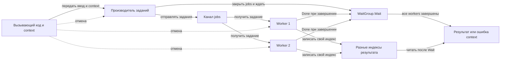

# Отмена, goroutines и общие данные

[Справочник Go](README.md) · [Файлы модуля](language.md#полный-модуль)

**Уровень:** средний → продвинутый. Предпосылки: функции, slices, error и владение памятью. Сверено 2026-11-06 с Go 1.27 и API context/sync. Выполнено 2026-11-06 на go1.27.1 darwin/arm64: порядок результата, пустой ввод, неверное число workers, уже отменённый context и конкурентный счётчик проверены; `go vet` и `go test -race -count=1 ./...` успешны. Эти файлы дополняют тот же модуль, используют только стандартную библиотеку.

- [Ограниченный worker pool](#ограниченный-worker-pool)
- [Общие данные и mutex](#общие-данные-и-mutex)
- [Тесты и race detector](#тесты-и-race-detector)

## Ограниченный worker pool

Задача — обработать список строк с ограниченным количеством workers, сохранив порядок результата. Производитель владеет закрытием канала, вызывающий код получает результат только после завершения всех workers.



Полный `worker.go`:

<!-- example: go/worker.go -->
```go
package cheatsheet

import (
	"context"
	"errors"
	"strings"
	"sync"
)

var ErrWorkers = errors.New("workers must be positive")

func Uppercase(ctx context.Context, input []string, workers int) ([]string, error) {
	if workers < 1 {
		return nil, ErrWorkers
	}
	if err := ctx.Err(); err != nil {
		return nil, err
	}
	if workers > len(input) {
		workers = len(input)
	}
	type job struct {
		index int
		value string
	}
	jobs := make(chan job)
	result := make([]string, len(input))
	var group sync.WaitGroup
	group.Add(workers)
	for range workers {
		go func() {
			defer group.Done()
			for {
				select {
				case <-ctx.Done():
					return
				case task, ok := <-jobs:
					if !ok {
						return
					}
					result[task.index] = strings.ToUpper(task.value)
				}
			}
		}()
	}
sendLoop:
	for index, value := range input {
		select {
		case <-ctx.Done():
			break sendLoop
		case jobs <- job{index: index, value: value}:
		}
	}
	close(jobs)
	group.Wait()
	if err := ctx.Err(); err != nil {
		return nil, err
	}
	return result, nil
}
```

Срез создаётся заранее, каждый индекс записывается одним worker, чтение начинается после Wait. Входной срез во время работы изменять нельзя. Отмена не прерывает `strings.ToUpper` посередине операции: она проверяется между заданиями. При одновременной готовности нескольких веток select отмена не имеет абсолютного приоритета; обещания «ни одного задания после cancel» здесь нет.

## Общие данные и mutex

Полный `counter.go`. Если несколько goroutines меняют один счётчик, отдельные переменные каналов сами по себе не защищают его значение.

<!-- example: go/counter.go -->
```go
package cheatsheet

import "sync"

type Counter struct {
	mu    sync.Mutex
	value int
}

func (c *Counter) Add(delta int) {
	c.mu.Lock()
	defer c.mu.Unlock()
	c.value += delta
}

func (c *Counter) Value() int {
	c.mu.Lock()
	defer c.mu.Unlock()
	return c.value
}
```

Zero value Counter пригоден к использованию. Передавай его указателем; mutex нельзя копировать после начала использования. Lock защищает чтение и запись одного инварианта. Для независимого счётчика возможен atomic-тип, но смешивать atomic и обычные обращения к тому же значению нельзя.

## Тесты и race detector

Полный `worker_test.go`:

<!-- example: go/worker_test.go -->
```go
package cheatsheet

import (
	"context"
	"errors"
	"reflect"
	"sync"
	"testing"
	"time"
)

func TestUppercasePreservesOrder(t *testing.T) {
	ctx, cancel := context.WithTimeout(context.Background(), time.Second)
	defer cancel()
	got, err := Uppercase(ctx, []string{"go", "python", "rust"}, 2)
	if err != nil || !reflect.DeepEqual(got, []string{"GO", "PYTHON", "RUST"}) {
		t.Fatalf("Uppercase = %v, %v", got, err)
	}
	empty, err := Uppercase(ctx, nil, 2)
	if err != nil || len(empty) != 0 {
		t.Fatalf("empty input = %v, %v", empty, err)
	}
}

func TestUppercaseRejectsInvalidWorkersAndCancellation(t *testing.T) {
	if _, err := Uppercase(context.Background(), []string{"go"}, 0); !errors.Is(err, ErrWorkers) {
		t.Fatalf("workers error = %v", err)
	}
	ctx, cancel := context.WithCancel(context.Background())
	cancel()
	if _, err := Uppercase(ctx, []string{"go"}, 2); !errors.Is(err, context.Canceled) {
		t.Fatalf("cancellation error = %v", err)
	}
}

func TestCounterConcurrentUpdates(t *testing.T) {
	var counter Counter
	var group sync.WaitGroup
	for range 20 {
		group.Add(1)
		go func() {
			defer group.Done()
			for range 100 {
				counter.Add(1)
			}
		}()
	}
	group.Wait()
	if got := counter.Value(); got != 2000 {
		t.Fatalf("counter = %d, want 2000", got)
	}
}
```

```bash
go test ./...
go vet ./...
go test -race ./...
```

Ожидаются исходный порядок строк, отказ при workers=0/уже отменённом context и точное число инкрементов. Timeout теста ограничивает обработку, но не доказывает отсутствие любых утечек goroutines. `-race` обнаруживает только гонки на реально выполненных путях; логические race conditions и deadlock требуют отдельных тестов/анализа. Для повторяемой диагностики используй `go test -count=1 ./...`, а не делай вывод по cached-прогону.

| Ситуация | Что сделать |
| --- | --- |
| Создан `WithCancel` / `WithTimeout` | Вызови cancel, обычно через defer |
| Worker может блокироваться на send | Дай ветку `ctx.Done()` либо другой гарантированный путь завершения |
| Нужно дождаться goroutines | Add до запуска, Done в worker, Wait после запуска |
| Сразу несколько ошибок worker | Нужна отдельная политика отмены/сбора ошибок; этот пример обрабатывает только ошибку context |
| Канал nil | Send/receive блокируются; это допустимый инструмент только при осознанном select |

Источники: [context](https://pkg.go.dev/context), [sync и модель синхронизации](https://pkg.go.dev/sync), [memory model](https://go.dev/ref/mem), [race detector](https://go.dev/doc/articles/race_detector), [testing](https://pkg.go.dev/testing).
