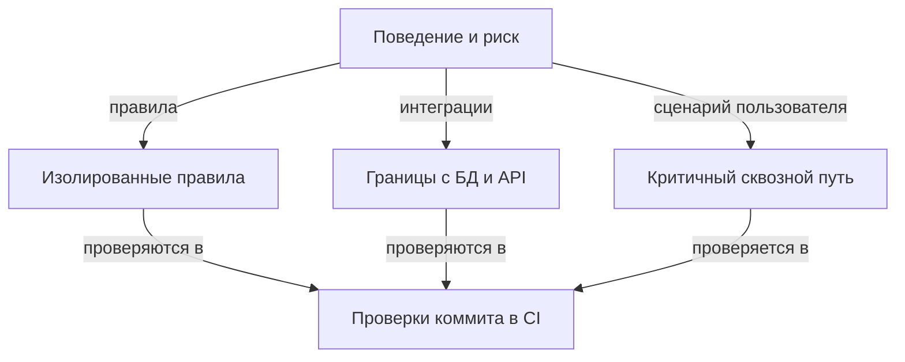
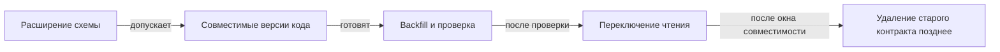

# Проверять, выпускать и изменять проект

Используйте страницу перед изменением контракта или выпуском приложения.
Выберите проверку по риску конкретного сценария.

| Ситуация | Приём | Пример / форма |
| --- | --- | --- |
| Непонятно, что покрыть тестами | Разделите правило, адаптер и сквозной путь | [Тестовая стратегия](#тестовая-стратегия) |
| Изменение готовят к включению или релизу | Соберите доказательства по чек-листу | [Проверки готовности](#проверки-готовности) |
| Старый и новый клиенты работают одновременно | Расширьте контракт, переведите клиентов, удалите старый путь | [Переименование поля](#пример-переименовать-поле-без-одномоментного-разрыва-клиентов) |
| Требуется оценить результат изменения | Задайте операцию, профиль нагрузки и окно измерения | [Метрики](#наблюдение-и-метрики) |

[К руководству](README.md) · [Рабочий пакет и тесты](example.md)

**Уровень:** средний → продвинутый.
Таблицы и чек-листы — рабочие формы для команды.
Эти формы не исполняются как конфигурация.
Сценарий изменения БД ниже иллюстрирует порядок действий.

## Навигация

- [Тестовая стратегия](#тестовая-стратегия)
- [Проверки готовности](#проверки-готовности)
- [Изменения схемы, данных и архитектуры](#изменения-схемы-данных-и-архитектуры)
- [Наблюдение и метрики](#наблюдение-и-метрики)
- [Антипаттерны и диагностика](#антипаттерны-и-диагностика)

## Тестовая стратегия

**Средний уровень.**
Выбирайте проверки по рискам и границам.
Универсальный процент не заменяет этот выбор.

| Проверка | Что доказывает | Пример |
| --- | --- | --- |
| Изолированная | Правило или сценарий без инфраструктуры | Неизвестный товар вызывает `ProductNotFound` |
| Интеграционная | Согласованность с настоящим адаптером/драйвером | SQLite хранит и читает ту же модель |
| Контрактная | Совместимость производителей и потребителей | Поля/коды ошибок API соответствуют договорённости |
| Сквозная | Критичный путь через собранное приложение | CLI или HTTP даёт ожидаемый результат на учебных данных |
| Нагрузочная | Поведение при заданном профиле нагрузки | Заданные объёмы, параллельность, задержка и ресурсы |

Схема показывает группы проверок по рискам.

Диаграмма показывает группы проверок, а не фиксированные доли 70/20/10.
Coverage помогает найти непроверенный код, но не доказывает качество assertions или корректность требований.
Если async-функция возвращает coroutine, дождитесь coroutine в тесте.
Обычный Mock не заменяет AsyncMock для await-контракта.

## Проверки готовности

**Базовый / средний уровень.**
Отмечайте каждый пункт после появления указанного доказательства.
Адаптируйте список под приложение.
Сам список не утверждает готовность вашего проекта.

### Первый рабочий сценарий

- [ ] Выполните команды установки из README в чистом окружении.
- [ ] Выполните команды запуска из README в чистом окружении.
- [ ] Задайте версию Python.
- [ ] Задайте зависимости.
- [ ] Проверьте, что lock-файл соответствует принятому инструменту.
- [ ] Воспроизведите пример ввода с ожидаемым результатом.
- [ ] Проверьте тестом понятный результат для ошибочного ввода.
- [ ] Проверьте тестом понятный результат при отсутствии данных.
- [ ] Проверьте валидацию настроек при старте.
- [ ] Перечислите обязательные параметры в безопасном образце окружения.

### Изменение перед включением в основную ветку

- [ ] Проверьте форматирование кода.
- [ ] Выполните выбранные проверки качества.
- [ ] Проверьте изменённое поведение тестами.
- [ ] Проверьте существенные ошибки тестами.
- [ ] Проверьте, что тесты оценивают поведение, а не только факт вызова mock.
- [ ] Проверьте закрытие всех внешних ресурсов на успешном пути.
- [ ] Проверьте закрытие всех внешних ресурсов при исключении.
- [ ] Документируйте новое поведение.
- [ ] Запишите существенное решение в ADR или эквивалентной форме.
- [ ] Для изменений данных/контракта составьте план совместимости.
- [ ] Для изменений данных/контракта проверьте старый код.
- [ ] Для изменений данных/контракта проверьте новый код.

### Релиз, если приложение развёртывается

- [ ] Проверьте, что для релиза собран тот же артефакт, который проверяли.
- [ ] Перечислите параметры окружения.
- [ ] Проверьте миграции на копии подходящей структуры и объёма данных.
- [ ] Определите условия остановки релиза.
- [ ] Определите способ отката кода.
- [ ] Определите способ отката данных.
- [ ] Восстановите нужные резервные копии в проверочном окружении.
- [ ] Проверьте доступность логов.
- [ ] Проверьте доступность метрик.
- [ ] Назначьте ответственного за реакцию.
- [ ] Проверьте, что readiness отражает способность обслуживать запросы.
- [ ] После релиза проверьте основной сценарий дымовым тестом.
- [ ] После релиза проверьте нужную совместимость дымовым тестом.

Эти пункты — реальные действия команды.
Пункты можно перенести в issue, PR-шаблон или релизный регламент.
Добавьте к отмеченному пункту ссылку на результат проверки.
Отметка не заменяет проверку.

## Изменения схемы, данных и архитектуры

**Продвинутый уровень.**
Сначала уточните, что именно меняется:

| Вид изменения | Типичный артефакт | Проверка и откат |
| --- | --- | --- |
| Схема БД | Версионируемый migration script, например Alembic revision | Проверьте upgrade на копии. Проверьте совместимость приложений. Оцените downgrade по сохранности данных |
| Данные | Идемпотентный backfill с учётом прогресса | Проверьте инварианты, повтор и остановку. Для отката предусмотрите обратное преобразование или восстановление |
| Развёртывание | Порядок выпуска и переключения трафика | Проверьте дымовые тесты/метрики. Для отката верните предыдущий совместимый артефакт |
| Архитектурная граница | ADR и план поэтапного переноса сценария | Сравните поведение. Проверьте маршрутизацию старого/нового пути. Предусмотрите возврат старого пути |

Переход «MVP → Kubernetes → микросервисы через N месяцев» не является обязательной последовательностью.
Инструмент и размер изменения определяются наблюдаемой потребностью.

### Пример: переименовать поле без одномоментного разрыва клиентов

Контекст: есть поле `name`.
Новый контракт использует `display_name`.
Развёртывание проходит поэтапно.
Старый и новый код некоторое время работают одновременно.
Это **пример плана**.
Это не готовая миграция вашей БД.

| Шаг | Действие | Условие перехода | Возможность возврата |
| --- | --- | --- | --- |
| Подготовить | Проверьте копию. Проверьте восстановление. Определите всех писателей поля. Определите длительность блокировок | Репетиция успешна. Владелец выпуска определён | Изменений ещё нет |
| Расширить | Добавьте новое nullable-поле отдельной миграцией | Старый код работает с расширенной схемой | Оставьте дополнительное поле. Верните старый код |
| Совместить запись | Новый код пишет оба поля согласованно. Старое поле пока сохраняется | Все необходимые писатели обновлены. Расхождения наблюдаются | Верните старый код с сохранением старого поля |
| Заполнить | Пакетами заполните только ещё не перенесённые значения | Проверены количество, соответствие и конкурентные изменения | Остановите или повторите backfill. Исходное поле сохранено |
| Переключить чтение | После проверки инвариантов читайте новое поле | Проверки на реальном профиле проходят | Верните старый путь чтения в пределах совместимости |
| Сузить контракт | Удалите старое поле отдельным поздним релизом | Старых читателей/писателей больше нет. Период возврата завершён | После удаления прежний код может не работать. Нужен отдельный план восстановления |

При конкурентной записи backfill должен учитывать изменившиеся значения.
Backfill не должен перезаписывать новые данные.
Внешние писатели, триггеры, размеры таблиц, реплики и контракты клиентов могут потребовать другого плана.
Rollback кода и rollback данных — разные операции.
Команда `downgrade` не восстанавливает уже потерянные значения.

Схема показывает порядок изменения контракта.

Пример выполнения настоящей локальной Alembic-миграции находится в
[материале SQLAlchemy](../../databases/sqlalchemy/async-and-operations.md).

## Наблюдение и метрики

**Средний / продвинутый уровень.**
Сначала сформулируйте пользовательское ожидание.
Определите способ измерить выполнение ожидания.

| Область | Что определяют | Что нельзя вывести из одного числа |
| --- | --- | --- |
| Задержка | Операция, percentile, окно, входной объём | Среднее время не описывает медленный хвост |
| Пропускная способность | Запросы/задачи в секунду при заданной параллельности и ресурсах | RPS без профиля запросов не сравним |
| Надёжность | Что считается успешным запросом, период и доля ошибок | HTTP 200 может содержать неправильные данные |
| Восстановление | Допустимые потери данных и время возврата сервиса | Наличие файла backup не доказывает восстановимость |
| Поставка | Время прохождения изменения, частота релизов, неуспешные выпуски | Универсальная «норма» для любой команды отсутствует |

Для логов определите событие, уровень, время, correlation/request id и минимальный полезный контекст.
Не включайте пароли и токены в события.
[structlog](../../logging/structlog/README.md) показывает настройку процессоров.
[FastAPI](../../web/fastapi/recipes.md) показывает HTTP-ошибки.
Доменная модель не обязана знать HTTP-код.

## Антипаттерны и диагностика

| Наблюдение | Проверяемый вопрос / действие |
| --- | --- |
| Модуль меняется по несвязанным причинам | Разделите разные правила и инфраструктурные обязанности |
| Циклические импорты | Проверьте направление зависимостей. Определите владельца контракта |
| Одно изменение затрагивает много сервисов | Проверьте границы, совместимость API и общие данные |
| N+1, блокирующий I/O, нет пагинации | Измерьте запросы/ожидания. Выберите стратегию загрузки и лимиты |
| Очень длинная функция | Оцените смешение обязанностей. Число строк — сигнал, а не доказательство ошибки |
| Повторяющийся код | Проверьте, повторяется ли одно знание или случайно похожи разные правила |

Источники: [Fowler: Parallel Change](https://martinfowler.com/bliki/ParallelChange.html),
[Alembic tutorial](https://alembic.sqlalchemy.org/en/latest/tutorial.html),
[Google SRE: monitoring](https://sre.google/sre-book/monitoring-distributed-systems/),
[Fowler: Practical Test Pyramid](https://martinfowler.com/articles/practical-test-pyramid.html).
