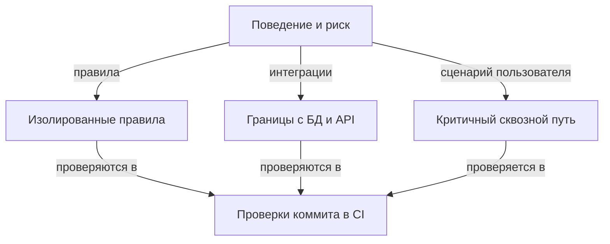
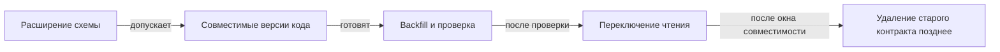

# Проверять, выпускать и изменять проект

[К руководству](README.md) · [Рабочий пакет и тесты](example.md)

**Уровень:** средний → продвинутый. Сверено с источниками 2026-11-06.
Таблицы и чек-листы — рабочие формы для команды; они не исполняются как конфигурация.
Сценарий изменения БД ниже иллюстративен и не выполнялся на рабочем сервере.

## Навигация

- [Тестовая стратегия](#тестовая-стратегия)
- [Проверки готовности](#проверки-готовности)
- [Изменения схемы, данных и архитектуры](#изменения-схемы-данных-и-архитектуры)
- [Наблюдение и метрики](#наблюдение-и-метрики)
- [Антипаттерны и диагностика](#антипаттерны-и-диагностика)

## Тестовая стратегия

**Средний уровень.** Выбирайте проверки по рискам и границам, а не по универсальному проценту.

| Проверка | Что доказывает | Пример |
| --- | --- | --- |
| Изолированная | Правило или сценарий без инфраструктуры | Неизвестный товар вызывает `ProductNotFound` |
| Интеграционная | Согласованность с настоящим адаптером/драйвером | SQLite хранит и читает ту же модель |
| Контрактная | Совместимость производителей и потребителей | Поля/коды ошибок API соответствуют договорённости |
| Сквозная | Критичный путь через собранное приложение | CLI или HTTP даёт ожидаемый результат на учебных данных |
| Нагрузочная | Поведение при заданном профиле нагрузки | Заданные объёмы, параллельность, задержка и ресурсы |

Диаграмма показывает группы проверок, а не фиксированные доли 70/20/10.
Coverage помогает найти непроверенный код, но не доказывает качество assertions или корректность требований.
Если async-функция возвращает coroutine, тест должен её дождаться; обычный Mock не заменяет AsyncMock для await-контракта.

## Проверки готовности

**Базовый / средний уровень.** Каждый пункт отмечают после появления указанного доказательства.
Список адаптируют под приложение; изначально это не утверждение о готовности вашего проекта.

### Первый рабочий сценарий

- [ ] README содержит команды установки и запуска, выполненные в чистом окружении.
- [ ] Версия Python и зависимости заданы; lock-файл соответствует принятому инструменту.
- [ ] Пример ввода и ожидаемый результат воспроизводятся.
- [ ] Ошибочный ввод и отсутствие данных дают понятный результат, проверенный тестом.
- [ ] Настройки проверяются при старте; обязательные параметры перечислены в безопасном образце окружения.

### Изменение перед включением в основную ветку

- [ ] Код форматируется и проходит выбранные проверки качества.
- [ ] Тесты проверяют изменённое поведение и существенные ошибки, а не только факт вызова mock.
- [ ] Все внешние ресурсы закрываются на успешном пути и при исключении.
- [ ] Новое поведение документировано; существенное решение имеет ADR или эквивалентную запись.
- [ ] Изменения данных/контракта имеют план совместимости и проверку старого/нового кода.

### Релиз, если приложение развёртывается

- [ ] Собран тот же артефакт, который проверяли; параметры окружения перечислены.
- [ ] Миграции проверены на копии подходящей структуры и объёма данных.
- [ ] Определены условия остановки релиза и способ отката кода/данных.
- [ ] Нужные резервные копии восстанавливаются в проверочном окружении.
- [ ] Доступны логи, метрики и ответственный за реакцию; readiness отражает способность обслуживать запросы.
- [ ] Дымовой тест после релиза проверяет основной сценарий и нужную совместимость.

Эти пункты — реальные действия команды. Их можно перенести в issue, PR-шаблон или релизный регламент;
отмеченный пункт должен ссылаться на результат проверки, а не заменять её.

## Изменения схемы, данных и архитектуры

**Продвинутый уровень.** Сначала уточните, что именно меняется:

| Вид изменения | Типичный артефакт | Проверка и откат |
| --- | --- | --- |
| Схема БД | Версионируемый migration script, например Alembic revision | Upgrade на копии, совместимость приложений; downgrade оценивают по сохранности данных |
| Данные | Идемпотентный backfill с учётом прогресса | Проверка инвариантов, повтор, остановка; обратное преобразование или восстановление |
| Развёртывание | Порядок выпуска и переключения трафика | Дымовые тесты/метрики; возврат предыдущего совместимого артефакта |
| Архитектурная граница | ADR и план поэтапного переноса сценария | Сравнение поведения, маршрутизация старого/нового пути, возможность вернуть старый путь |

Переход «MVP → Kubernetes → микросервисы через N месяцев» не является обязательной последовательностью.
Инструмент и размер изменения определяются наблюдаемой потребностью.

### Пример: переименовать поле без одномоментного разрыва клиентов

Контекст: есть поле `name`; новый контракт использует `display_name`. Развёртывание поэтапное,
старый и новый код некоторое время работают одновременно. Это **пример плана**, а не готовая миграция вашей БД.

| Шаг | Действие | Условие перехода | Возможность возврата |
| --- | --- | --- | --- |
| Подготовить | Проверить копию и восстановление; определить всех писателей поля и длительность блокировок | Репетиция успешна, владелец выпуска определён | Изменений ещё нет |
| Расширить | Добавить новое nullable-поле отдельной миграцией | Старый код работает с расширенной схемой | Оставить дополнительное поле, вернуть старый код |
| Совместить запись | Новый код пишет оба поля согласованно; старое поле пока сохраняется | Все необходимые писатели обновлены, расхождения наблюдаются | Вернуть старый код, сохранив старое поле |
| Заполнить | Пакетами заполнить только ещё не перенесённые значения | Проверены количество, соответствие и конкурентные изменения | Остановить/повторить backfill; исходное поле сохранено |
| Переключить чтение | Читать новое поле после проверки инвариантов | Проверки на реальном профиле проходят | Вернуть старый путь чтения в пределах совместимости |
| Сузить контракт | Удалить старое поле отдельным поздним релизом | Старых читателей/писателей больше нет, период возврата завершён | После удаления прежний код может не работать; нужен отдельный план восстановления |

При конкурентной записи backfill должен учитывать изменившиеся значения и не перезаписывать новые данные.
Внешние писатели, триггеры, размеры таблиц, реплики и контракты клиентов могут потребовать другого плана.
Rollback кода и rollback данных — разные операции; команда `downgrade` не восстанавливает уже потерянные значения.

Пример выполнения настоящей локальной Alembic-миграции находится в
[материале SQLAlchemy](../../databases/sqlalchemy/async-and-operations.md).

## Наблюдение и метрики

**Средний / продвинутый уровень.** Сначала сформулируйте пользовательское ожидание и способ измерить его.

| Область | Что определяют | Что нельзя вывести из одного числа |
| --- | --- | --- |
| Задержка | Операция, percentile, окно, входной объём | Среднее время не описывает медленный хвост |
| Пропускная способность | Запросы/задачи в секунду при заданной параллельности и ресурсах | RPS без профиля запросов не сравним |
| Надёжность | Что считается успешным запросом, период и доля ошибок | HTTP 200 может содержать неправильные данные |
| Восстановление | Допустимые потери данных и время возврата сервиса | Наличие файла backup не доказывает восстановимость |
| Поставка | Время прохождения изменения, частота релизов, неуспешные выпуски | Универсальная «норма» для любой команды отсутствует |

Для логов определяют событие, уровень, время, correlation/request id и минимальный полезный контекст.
Пароли и токены не включают в события. [structlog](../../logging/structlog/README.md) показывает настройку
процессоров; [FastAPI](../../web/fastapi/recipes.md) — HTTP-ошибки. Доменная модель не обязана знать HTTP-код.

## Антипаттерны и диагностика

| Наблюдение | Проверяемый вопрос / действие |
| --- | --- |
| Модуль меняется по несвязанным причинам | Разделить разные правила и инфраструктурные обязанности |
| Циклические импорты | Проверить направление зависимостей и владельца контракта |
| Одно изменение затрагивает много сервисов | Проверить границы, совместимость API и общие данные |
| N+1, блокирующий I/O, нет пагинации | Измерить запросы/ожидания; выбрать стратегию загрузки и лимиты |
| Очень длинная функция | Оценить смешение обязанностей; число строк — сигнал, а не доказательство ошибки |
| Повторяющийся код | Проверить, повторяется ли одно знание или случайно похожи разные правила |

Источники: [Fowler: Parallel Change](https://martinfowler.com/bliki/ParallelChange.html),
[Alembic tutorial](https://alembic.sqlalchemy.org/en/latest/tutorial.html),
[Google SRE: monitoring](https://sre.google/sre-book/monitoring-distributed-systems/),
[Fowler: Practical Test Pyramid](https://martinfowler.com/articles/practical-test-pyramid.html).
