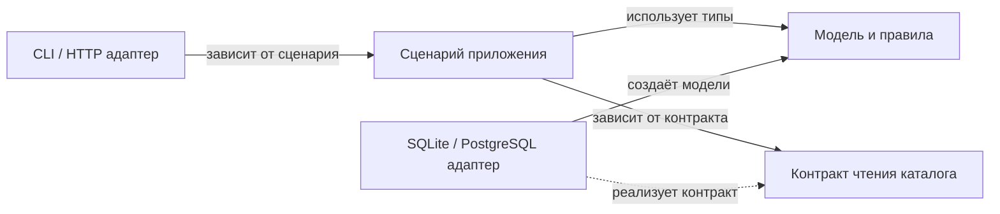

# Выбрать границы, структуру и зависимости

Открывайте страницу, когда изменение затрагивает несколько модулей или тест требует внешнюю инфраструктуру.
Выберите границу по наблюдаемой проблеме.

| Ситуация | Приём | Пример |
| --- | --- | --- |
| Части приложения требуют разных релизов | Сравните общий и независимый выпуск | [Границы развёртывания](#развёртывание-и-организация-кода) |
| Импорты зависят от рабочей папки | Оформите устанавливаемый пакет | [Структура Python-пакета](#структура-python-пакета) |
| Тест расчёта требует БД | Передайте готовый адаптер | [Внедрение зависимостей](#внедрение-зависимостей) |
| Причины выбора теряются | Запишите контекст, варианты и последствия | [Заполненный ADR](#записать-решение-adr) |

[К руководству](README.md) · [Рабочий пакет](example.md)

**Уровень:** базовый → продвинутый.
Это критерии проектирования и примеры документов, а не алгоритм автоматического выбора архитектуры.

## Навигация

- [Развёртывание и организация кода](#развёртывание-и-организация-кода)
- [Структура Python-пакета](#структура-python-пакета)
- [Выбор стека и конвенций](#выбор-стека-и-конвенций)
- [Внедрение зависимостей](#внедрение-зависимостей)
- [Записать решение: ADR](#записать-решение-adr)

## Развёртывание и организация кода

**Базовый / средний уровень.**
Решения о развёртывании и организации кода связаны.
Для каждого решения нужны свои критерии.

| Вариант развёртывания | Когда рассматривать | Цена и проверка |
| --- | --- | --- |
| Одно приложение | Достаточен общий релиз, согласованные данные и совместное масштабирование | Проверьте понятность модулей. Проверьте время релиза |
| Модульный монолит | Нужны явные предметные границы при общем развёртывании | Контролируйте импорты. Контролируйте доступ к данным между модулями |
| Несколько сервисов | Доказана необходимость независимых релизов, владения или масштабирования | Сеть, частичные отказы, совместимость контрактов и наблюдение становятся частью решения |

Модульный монолит может работать в одном процессе и контейнере.
Несколько контейнеров с копиями одного приложения не превращают приложение в микросервисы.
Если состояние и внешние зависимости позволяют, монолит можно масштабировать несколькими экземплярами.

| Организация кода | Полезная граница | Что проверить |
| --- | --- | --- |
| Слои | Представление → сценарии → доступ к данным | Бизнес-правила не расползаются между HTTP и SQL |
| По фичам / предметным модулям | `catalog`, `orders`, `users` | Изменение одной фичи не требует правок во всех общих папках |
| Ports & Adapters | Приложение отделено от способов ввода и хранения | Основной сценарий тестируется без HTTP-сервера и внешней БД |

Эти подходы можно сочетать.
Например, модуль `catalog` внутри монолита может иметь свои порты и адаптеры.
DDD не является обязательным условием группировки по фичам.

## Структура Python-пакета

**Средний уровень.**
Для устанавливаемого приложения используйте import package и явную точку входа.
Дерево показывает возможную структуру файлов.
Дерево не является кодом для исполнения:

```text
project/
├── pyproject.toml
├── README.md
├── src/
│   └── project_app/
│       ├── __init__.py
│       ├── __main__.py       # сборка и запуск
│       ├── catalog/          # предметный модуль
│       │   ├── domain.py
│       │   ├── application.py
│       │   └── adapters.py
│       └── config.py
└── tests/
    ├── unit/
    └── integration/
```

Для небольшого приложения модуль может быть одним файлом.
Отдельные папки не нужны заранее.
`src` помогает тестировать установленный пакет.
`src` отделяет импортируемый код от файлов корня.
Это свойство упаковки, а не архитектурный стиль.
При понятной модели импортов flat layout тоже допустим.

На диаграмме сплошные стрелки показывают зависимости кода.
Пунктир показывает соответствие контракту.
Это не порядок SQL-вызовов:



Контракт выражает потребность приложения.
Структурный Protocol допускает реализацию без импорта и наследования от Catalog.
Достаточно соответствующего интерфейса и поведения.
Точка сборки связывает конкретные объекты.
Во время выполнения вызовы всё равно могут идти из приложения в БД через адаптер.

## Выбор стека и конвенций

**Средний уровень.**
Для каждой технологии укажите причину выбора.
Укажите способ проверки технологии.

| Вопрос | Что записать |
| --- | --- |
| Python | Поддерживаемая ветка, версия для разработки/CI, доступность нужных библиотек |
| HTTP | [FastAPI](../../web/fastapi/README.md) для ASGI/типизированного API или [Flask](../../web/flask/README.md) для WSGI-сценария. Выбирайте по требованиям и опыту |
| Данные | Ограничения и транзакции; [SQLite](../../../databases/relational/sqlite/README.md) или [PostgreSQL](../../../databases/relational/postgresql/README.md) по модели работы |
| Доступ к БД | [SQLAlchemy](../../databases/sqlalchemy/README.md), области жизни сессий, инструмент миграций |
| Кэш / очередь | Подтверждённая задача [Redis](../../../databases/non-relational/redis/README.md). Кэш не является обязательным слоем любого приложения |
| Качество | Форматтер, линтер, проверка типов при необходимости, [pytest](../../testing/pytest/README.md), одинаковые команды локально и в CI |
| Наблюдение | Формат логов, идентификатор запроса, нужные метрики, health/readiness. Очередь задач не заменяет health check |

`pyproject.toml` хранит конфигурацию инструментов.
Зафиксируйте версии воспроизводимого окружения выбранным lock-механизмом.
[uv](../../tooling/uv/README.md) — один из вариантов.
Hooks pre-commit полезны для ранней проверки.
CI проверяет коммит независимо от локальных hooks.
Для pin hook используйте реальный проверенный тег.

Называйте модули/функции в `snake_case`.
Называйте классы в `PascalCase`.
Называйте константы в `UPPER_SNAKE_CASE`.
Один `_` обозначает непубличную деталь по соглашению, а не защищённый доступ как в некоторых других языках.
`__name` включает name mangling и не является универсальным способом безопасности данных.

## Внедрение зависимостей

**Средний / продвинутый уровень.**
DI передаёт готовые зависимости.
DIP определяет направление зависимости к контракту.

| Способ | Когда удобен | Что остаётся вашей ответственностью |
| --- | --- | --- |
| Аргументы функций / конструктор | Небольшой или понятный граф объектов | Сборка, закрытие ресурсов, области жизни |
| `Depends` FastAPI | Ресурсы и параметры HTTP-запроса | Отделение HTTP-контекста от бизнес-логики, `yield`/lifespan |
| DI-контейнер | Много вариантов сборки и сложные области жизни | Явность графа, настройка providers, корректное завершение ресурсов |

Размер проекта не обязывает использовать контейнер.
[Рабочий пример](example.md) использует ручной DI.
Пример проверяет один сценарий с двумя адаптерами.
Не разделяйте SQLAlchemy Session произвольно между запросами/задачами.

## Записать решение: ADR

**Продвинутый уровень.**
ADR — короткая запись существенного решения.
Храните ADR рядом с кодом, например в `docs/decisions/`.
Формат команды может отличаться.
Сохраняйте контекст, варианты и последствия.

Ниже — заполненный пример документа для учебного каталога:

| Поле | Содержание |
| --- | --- |
| Решение | Начать с одного Python-пакета и порта чтения каталога |
| Статус | Принято для учебного примера |
| Контекст | Нужны CLI-поиск и тесты без внешнего сервера. Независимые релизы модулей не требуются |
| Рассмотрено | Прямой SQL в CLI; сценарий с портом; отдельный HTTP-сервис |
| Выбрано | Сценарий получает `Catalog`. CLI собирает объекты. SQLite-адаптер проверяется отдельно |
| Последствия | Несколько небольших объектов. Хранение заменяется без изменения сценария. Распределённые задачи не решаются |
| Когда пересмотреть | Появилась подтверждённая потребность во внешнем API или многопользовательской записи |

ADR не обещает, что выбор вечен.
Свяжите новое решение с предыдущим.
Объясните, что изменилось.

Источники: [PyPA: src layout](https://packaging.python.org/en/latest/discussions/src-layout-vs-flat-layout/),
[Cockburn: Hexagonal Architecture](https://alistair.cockburn.us/hexagonal-architecture/),
[Fowler: Monolith First](https://martinfowler.com/bliki/MonolithFirst.html),
[Dependency Injector](https://python-dependency-injector.ets-labs.org/),
[Nygard: Documenting Architecture Decisions](https://cognitect.com/blog/2011/11/15/documenting-architecture-decisions).
