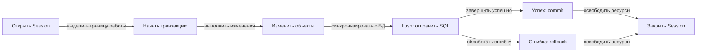

# SQLAlchemy: API 2.x

SQLAlchemy объединяет SQL-конструктор Core и ORM с сессиями, отношениями и транзакциями.
Справочник использует стиль `select()`.
Примеры используют SQLAlchemy 2.1.
Примеры сохраняют основные конструкции, введённые в 2.0.

[Каталог Python](../../README.md) · [FastAPI и сессия на запрос](../../web/fastapi/database.md)

## Быстрый поиск

| Задача | API | Где |
| --- | --- | --- |
| Модель, типы, defaults, constraints | `DeclarativeBase`, `Mapped`, `mapped_column` | [Модели](models-and-transactions.md#единая-схема-для-рецептов) |
| CRUD и откат | `Session`, `session.begin()`, `rollback()` | [Транзакции](models-and-transactions.md#crud-транзакции-и-savepoint) |
| 1:N, N:1, 1:1, N:M | `relationship`, `ForeignKey`, `Table` | [Полная схема](models-and-transactions.md#единая-схема-для-рецептов) |
| WHERE/JOIN/CTE/CASE/UNION/EXISTS | `select`, `func`, `aliased` | [Запросы](queries.md) |
| Устранить слишком много запросов при чтении коллекций | N+1, lazy, `selectinload` | [Карточка N+1](relationship-loading.md#найти-n1) · [Самостоятельная программа](n-plus-one.md#подготовка-и-запуск) |
| Загрузить коллекцию для списка | `selectinload` или `joinedload` | [Select-in](relationship-loading.md#загрузить-коллекции-через-selectinload) · [Joined и unique](relationship-loading.md#загрузить-коллекцию-через-joinedload) |
| Запретить неожиданный lazy SELECT | `raiseload` | [Карточка и ограничения](relationship-loading.md#обнаружить-незапланированную-lazy-загрузку) |
| Загрузить часть отношения своим JOIN | `contains_eager`, `populate_existing` | [Частичная коллекция](relationship-loading.md#загрузить-частичную-коллекцию-из-join) |
| Обработать большую выборку | `yield_per`, `partitions` | [Пакеты и ограничения](streaming.md) |
| Async-сессия и атрибуты | `AsyncSession`, `AsyncAttrs`, `awaitable_attrs` | [Async](async-and-operations.md#асинхронная-сессия) |
| UPSERT / FOR UPDATE / частичный индекс | Диалект PostgreSQL | [Компиляция PostgreSQL](queries.md#postgresql-компиляция-без-подключения) |
| События, SQL-логи и время запроса | `event`, `logging`, `perf_counter` | [Наблюдение](async-and-operations.md#события-и-диагностика) |
| Изменить схему | Alembic | [Миграции](async-and-operations.md#alembic-отдельный-учебный-проект) |

| Параметр | Значение |
| --- | --- |
| API / диалект | SQLAlchemy 2.1; исполняемые примеры SQLite, PostgreSQL отдельно помечен |
| Предпосылки | Python, SQL, транзакции; async-рецепт требует `async with` |
| Самостоятельный N+1 | [Синхронный пример с двумя моделями](n-plus-one.md): отдельная установка и проверки; общая схема ему не нужна |

## Навигация

- [Быстрый поиск](#быстрый-поиск)
- [Базовый уровень](#базовый-уровень)
- [Средний уровень](#средний-уровень)
- [Продвинутый уровень](#продвинутый-уровень)
- [Частые ошибки](#частые-ошибки)
- [Источники](#источники)

## Базовый уровень

Для первого знакомства с N+1 используйте [отдельную подготовку одного файла](n-plus-one.md#подготовка-и-запуск).
Установка ниже относится к общей схеме и остальным рецептам раздела.
Установите пакеты в отдельное окружение: `python -m pip install 'sqlalchemy[asyncio]==2.1.8' pytest`.
Extra `asyncio` нужен общей модели с AsyncAttrs, даже для её синхронных рецептов.
Для async добавьте `aiosqlite` и `pytest-asyncio`.

| Компонент | Назначение |
| --- | --- |
| `Engine` / `Connection` | Доступ к драйверу/пулу; конкретное соединение |
| `MetaData` / `Table` / `Column` | Описание схемы Core; `Column` нужен и в 2.x |
| `DeclarativeBase`, `Mapped[T]` | ORM-отображение и аннотации; `Mapped` не обязателен для всех допустимых стилей |
| `Session` | Identity map и единица работы; не общий потокобезопасный контейнер |
| `select()` | Описание запроса; SQL выполняется через сессию/соединение |
| `Result` / `ScalarResult` | Строки / значения первого выбранного столбца |

`with Session(engine)` закрывает сессию, но сам не делает commit.
При успехе `with session.begin()` фиксирует транзакцию.
При исключении контекст откатывает транзакцию.
`flush()` отправляет изменения в БД внутри транзакции.
Метод также выдаёт сгенерированные id.
Вызов `flush()` не выполняет commit.
[Полный исполняемый пример](models-and-transactions.md).

| Чтение | Результат |
| --- | --- |
| `session.get(User, id)` | Объект либо `None`, с учётом identity map |
| `session.scalars(select(User)).all()` | Список ORM-объектов |
| `session.execute(select(User.name, User.email))` | Строки из двух выбранных значений |
| `result.scalar_one()` / `scalar_one_or_none()` | Контроль числа результатов; больше одной строки — ошибка |

## Средний уровень

- `Mapped[str | None]` выводит nullable. Явный `nullable=` имеет приоритет. `Numeric` обычно возвращает `Decimal`. Аннотируйте соответствующее поле как Decimal.
- `default` применяется на стороне Python/SQLAlchemy. `server_default` входит в DDL БД. `onupdate` не создаёт серверный trigger.
- Обеспечивайте уникальность и внешние ключи через constraints. Для 1:1 скалярного `relationship` недостаточно. Нужен уникальный FK или PK.
- `Enum(MyEnum)` по умолчанию хранит **имена** членов. Для строковых значений задайте `values_callable`. Для целочисленного хранения нужна соответствующая отдельная модель столбца/конвертации.
- ORM `cascade="all, delete-orphan"` и FK `ON DELETE` — разные механизмы. [Схема и тесты](models-and-transactions.md) включают внешний ключ SQLite явно.

## Продвинутый уровень

[Запросы](queries.md) описывают SQL-выражения и отдельную компиляцию PostgreSQL.
[Карточки загрузки](relationship-loading.md) помогают выбрать состав отношений.
[Большие выборки](streaming.md) описывают пакетную обработку отдельно.
`selectinload` обычно удобен для коллекций.
Количество запросов зависит от размера пакета и диалекта.
`joinedload` коллекции требует `Result.unique()`.

[Async и эксплуатация](async-and-operations.md) описывают сессию на задачу, события и миграции.
Выбирайте размер пула, `max_overflow`, `pool_recycle` и `pool_pre_ping` по драйверу и лимитам БД.
Числа из примеров не являются универсальными настройками.

Компиляционный cache SQLAlchemy не кэширует строки результата.
Наличие cache не означает server-side prepared statement.
Для новых примеров не нужен устаревший `sqlalchemy.ext.baked`.
Переиспользуйте параметризованные выражения.
Измеряйте запросы.

## Частые ошибки

| Симптом | Исправление |
| --- | --- |
| Сессия «rolled back» после flush | Вызовите `rollback()` перед повторным использованием либо завершите контекст транзакции |
| `DetachedInstanceError` | Заранее загрузите нужные поля/отношения или преобразуйте объект в DTO до закрытия сессии |
| Надежда на `expire_on_commit=False` как полное лечение | Он предотвращает expiry при commit, но не загружает отсутствующие отношения |
| Отношение не заполнено после обычного JOIN | JOIN фильтрует строки; для eager loading нужны loader options / `contains_eager` |
| `metadata` как ORM-атрибут | Имя зарезервировано Declarative. Используйте другое Python-имя с SQL-именем столбца |
| Один AsyncSession в `gather()` | Выделите сессию на конкурентную задачу |

`Session.query()` — legacy API.
`Query.get()` заменён на `Session.get()`.
Не объявляйте все конструкции с `Column` запрещёнными.
Не возвращайте library-level autocommit.
Задавайте явные транзакционные границы задачи.

## Источники

- [SQLAlchemy 2.1](https://docs.sqlalchemy.org/en/21/), [отображения](https://docs.sqlalchemy.org/en/21/orm/declarative_tables.html), [Session](https://docs.sqlalchemy.org/en/21/orm/session_basics.html).
- [Загрузка отношений](https://docs.sqlalchemy.org/en/21/orm/queryguide/relationships.html), [async](https://docs.sqlalchemy.org/en/21/orm/extensions/asyncio.html), [миграция 2.0](https://docs.sqlalchemy.org/en/20/changelog/migration_20.html).
