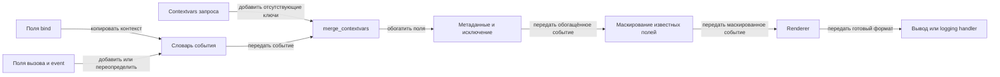

# structlog

structlog собирает событие как словарь.
Поля контекста и вызова проходят цепочку процессоров и renderer.
Используйте справочник для настройки логирования и контекста запросов.
Подробные страницы содержат воспроизводимые конфигурации.

[Каталог Python](../../README.md) · [FastAPI](../../web/fastapi/README.md)

## Быстрый поиск

| Задача | API | Рецепт |
| --- | --- | --- |
| JSON / console / key-value | `JSONRenderer`, `ConsoleRenderer`, `KeyValueRenderer` | [Конфигурация](configuration.md#самостоятельная-конфигурация) |
| Добавить/убрать поля логгера | `bind`, `unbind`, `try_unbind` | [Контекст](context-and-web.md#локальный-и-контекстный-bind) |
| Поля для всех логов запроса | `merge_contextvars`, `bound_contextvars` | [Contextvars](context-and-web.md) |
| Сохранить traceback | `exception` либо `exc_info=True` | [Конфигурация и тесты](configuration.md) |
| Обработать stdlib и structlog одинаково | `ProcessorFormatter` | [Stdlib](configuration.md#интеграция-со-stdlib-logging) |
| Контекст async/FastAPI/Django | Изоляция задач и middleware | [Контекст и веб](context-and-web.md) |
| Фильтровать/маскировать/профилировать | Процессоры, проверка уровня | [Порядок и стоимость](configuration.md#порядок-и-стоимость) |

| Параметр | Значение |
| --- | --- |
| API | structlog 26.1 |
| Предпосылки | Python, словари, logging; для contextvars — конкурентные задачи |

<a id="навигация"></a>

<a id="базовый-уровень"></a>

## Связать события с одним пользователем

**Ситуация:** несколько событий относятся к пользователю `123`, но исходный logger должен остаться общим.
**Изменение:** получите новый logger через `bind`.
Фрагмент использует [полный `demo_logging.py`](configuration.md#самостоятельная-конфигурация):

```python
from demo_logging import configure_logging

parent = configure_logging()
child = parent.bind(user_id=123)
child.info("user_logged_in")
parent.info("service_ready")
```

**Результат:** первое JSON-событие содержит `user_id=123`, второе не содержит `user_id`.
`bind` возвращает новый logger; исходный контекст не меняется.
[Полная настройка и проверки вывода](configuration.md#самостоятельная-конфигурация).


Установите пакеты в отдельное окружение: `python -m pip install 'structlog==26.1.0' pytest`.
После `import structlog` минимальная конструкция — `structlog.get_logger().info("user_logged_in", user_id=123)`.
Это фрагмент для знакомства.
Полная настройка находится [отдельно](configuration.md).

| Приём | Поведение |
| --- | --- |
| `log.info("event_name", key=value)` | Структурированное событие; `event` уже занят сообщением |
| `child = log.bind(user_id=1)` | Новый логгер с полем; исходный не меняется |
| `child = child.unbind("user_id")` | Новый логгер без ключа; отсутствующий ключ вызывает KeyError |
| `try_unbind("key")` | Удаляет ключ, если он существует |
| `debug/info/warning/error/critical` | Уровни, фильтрация зависит от конфигурации |
| `exception("failed")` внутри except | Добавляет traceback при подходящем processor/renderer |

<a id="средний-уровень"></a>

## Добавить поле всем событиям одной работы

**Ситуация:** вложенные функции берут собственный logger и должны видеть `request_id`.
**Изменение:** используйте `bound_contextvars` вместе с настроенным `merge_contextvars`.
Фрагмент использует [полный `demo_logging.py`](configuration.md#самостоятельная-конфигурация):

```python
import structlog
from structlog.contextvars import bound_contextvars
from demo_logging import configure_logging

log = configure_logging()
with bound_contextvars(request_id="training-request"):
    structlog.get_logger().info("inside")
log.info("outside")
```

**Результат:** только событие `inside` содержит временно добавленный идентификатор.
Контекстный менеджер восстанавливает прежние значения; граница нового запроса требует очистки прежнего контекста.
[Полные проверки конкурентных задач и middleware](context-and-web.md).


Сначала объедините поля из `contextvars` с событием.
Затем добавьте уровень, время и метаданные.
Обработайте исключение.
Замаскируйте поля.
Поставьте renderer последним.
Для stdlib используйте согласованный `ProcessorFormatter`.
Не смешивайте разные финальные renderer.

Схема показывает преобразование одного события процессорами:



Повторный ключ вызова имеет приоритет над полем bound logger.
`merge_contextvars` добавляет отсутствующие ключи.
Передавайте стабильное имя события и отдельные поля.
Так поля можно искать без разбора строки.

<a id="продвинутый-уровень"></a>

## Не вычислять дорогие данные выключенного DEBUG

**Ситуация:** формирование диагностического списка дорого, а logger настроен на INFO.
**Изменение:** проверьте уровень до вычисления аргумента.
Фрагмент для filtering logger из [полной конфигурации](configuration.md#самостоятельная-конфигурация):

```python
import logging
from demo_logging import configure_logging

log = configure_logging(level=logging.INFO)
if log.is_enabled_for(logging.DEBUG):
    log.debug("snapshot", values=list(range(100_000)))
```

**Результат:** список не создаётся и событие не выводится.
У stdlib BoundLogger используется другое имя метода: `isEnabledFor`.
[Порядок процессоров и ограничения](configuration.md#порядок-и-стоимость).


[Contextvars и middleware](context-and-web.md) обеспечивают границу запроса и очистку.
Эти средства не переносят автоматически все изменения между sync, async и потоками.
В асинхронном приложении обычный `.info()` остаётся синхронной работой.
`await log.ainfo()` доступен у показанного filtering logger.
Этот вызов переносит работу в пул потоков.

`cache_logger_on_first_use=True` полезен при стабильной конфигурации.
Уже созданные логгеры не перенастраиваются автоматически.
Фиксированный filtering logger от `make_filtering_bound_logger` рассчитан на неизменяемый минимум уровня.
При динамических уровнях stdlib выберите его BoundLogger и `filter_by_level`.
Не обещайте ускорение без замера реального пути обработки процессорами.

## Частые ошибки

| Ошибка | Исправление |
| --- | --- |
| `with logger.bind(...)` | Используйте новый logger либо `with bound_contextvars(...)` |
| `JSONRenderer(serializer=str)` | serializer должен кодировать весь event dict в JSON. Оставьте default или JSON-совместимый encoder |
| `structlog.dev.lazy(...)` | Такого публичного API в structlog 26.1 нет. Проверьте уровень до дорогого вычисления |
| `StackInfoRenderer` считают только ERROR+ | Он реагирует на `stack_info=True`, не на уровень сам по себе |
| `get_logger("name")` считают stdlib logger | Возвращается structlog proxy; stdlib-интеграцию определяет LoggerFactory |
| Повторяют configure/handlers в middleware | Настройте один раз при старте. Иначе возможны дубли и несовместимые цепочки |
| Пишут только `str(exception)` | Для traceback используйте `exception`/`exc_info` |

## Источники

- [Bound loggers](https://www.structlog.org/en/stable/bound-loggers.html), [processors](https://www.structlog.org/en/stable/processors.html), [API](https://www.structlog.org/en/stable/api.html).
- [Contextvars](https://www.structlog.org/en/stable/contextvars.html), [stdlib logging](https://www.structlog.org/en/stable/standard-library.html), [performance](https://www.structlog.org/en/stable/performance.html).
