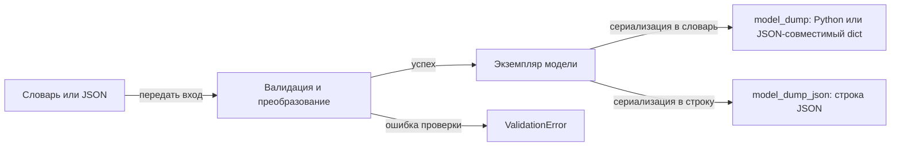

# Pydantic v2

Pydantic проверяет и преобразует данные по аннотациям Python.
Pydantic также сериализует модели и строит JSON Schema.
Используйте страницу как справочник API и рецептов.
Настройки окружения вынесены в пакет `pydantic-settings`.

[Каталог Python](../../README.md) · [FastAPI](../../web/fastapi/README.md)

## Быстрый поиск

| Задача | API | Рецепт |
| --- | --- | --- |
| Проверить словарь/JSON | `model_validate`, `model_validate_json` | [Модели и валидаторы](models.md) |
| Ограничить поле, задать alias | `Field`, `ConfigDict` | [Модели](models.md#модели-валидация-и-json) |
| Проверить несколько полей | `model_validator(mode="after")` | [Товар со скидкой](models.md#модели-валидация-и-json) |
| Сериализовать и вычислить поле | `model_dump`, `model_dump_json`, `computed_field` | [Модели](models.md) |
| Прочитать ORM-атрибуты | `from_attributes=True` | [ORM и конфигурация](models.md#атрибуты-конфигурация-и-типы) |
| Список без обёртки BaseModel | `TypeAdapter(list[Model])` | [Расширенные задачи](advanced.md#generic-typeadapter-и-собственный-тип) |
| Свой тип, generic, динамическая модель | `Annotated`, `Generic`, `create_model` | [Расширенные задачи](advanced.md) |
| Загрузить настройки / query FastAPI | `BaseSettings`, `Query()` | [Интеграции](advanced.md#настройки-приложения) |
| Перенести код v1, измерить скорость | Migration guide, `timeit` | [Миграция и производительность](advanced.md#миграция-и-производительность) |

| Параметр | Значение |
| --- | --- |
| API | Pydantic v2; новые параметры alias показаны для ветки 2.11+ |
| Предпосылки | Типы Python, классы, JSON; синтаксис примеров Python 3.10+ |

<a id="навигация"></a>

<a id="базовый-уровень"></a>

## Преобразовать вход и отвергнуть неверное значение

**Ситуация:** счётчик приходит строкой `"42"`; отрицательное значение недопустимо.
**Изменение:** опишите поле и числовую границу в модели.
Самостоятельный фрагмент требует Pydantic v2:

```python
from pydantic import BaseModel, Field, ValidationError


class Count(BaseModel):
    value: int = Field(ge=0)


assert Count.model_validate({"value": "42"}).value == 42
try:
    Count(value=-1)
except ValidationError as error:
    assert error.errors()[0]["type"] == "greater_than_equal"
```

**Результат:** модель преобразует допустимую строку в `int` и отвергает отрицательное значение.
Для запрета преобразования задайте strict mode.
[Полные модели, тесты и запуск](models.md#модели-валидация-и-json).


Установите пакет в отдельное виртуальное окружение: `python -m pip install 'pydantic[email]==2.14.3'`.

| Объявление / операция | Что означает |
| --- | --- |
| `name: str` | Обязательное поле |
| `name: str \| None` | Обязательное поле, допускает `None` |
| `name: str \| None = None` | Можно не передавать |
| `Field(default_factory=list)` | Новый список для экземпляра; Pydantic также копирует нехешируемые defaults |
| `Field(gt=0, le=100)` | Числовые границы; для float при необходимости `allow_inf_nan=False` |
| `model.model_dump()` | Python-значения, например datetime и Decimal |
| `model.model_dump(mode="json")` | Словарь с JSON-совместимыми значениями |
| `model.model_dump_json()` | Строка JSON; параметра `mode` нет |

По умолчанию Pydantic преобразует часть типов.
Например, строка `"42"` может стать `int`.
Для строгой границы используйте `strict=True`.
Проверьте нужные типы.
При невалидном вводе возникает `ValidationError`.
Метод `errors()` описывает место, тип и причину ошибки.
[Полный пример и тесты](models.md).

Схема показывает проверку входных данных и способы сериализации модели:



<a id="средний-уровень"></a>

## Проверить согласованность нескольких полей

**Ситуация:** у товара цена `10.00`, а скидочная цена должна быть меньше обычной.
**Изменение:** проверяйте обе цены в `model_validator(mode="after")`.
Фрагмент класса `Product` из [полной модели](models.md#модели-валидация-и-json):

```python
@model_validator(mode="after")
def valid_discount(self) -> "Product":
    if self.discount_price is not None and self.discount_price >= self.price:
        raise ValueError("Скидочная цена должна быть меньше обычной")
    return self
```

**Результат:** цена `10.00` со скидкой `10.00` вызывает `ValidationError`, а скидка `0` остаётся допустимой.
Импортируйте `model_validator` из Pydantic.
Поля и `Decimal` определены в полном классе; этот метод отдельно не запускается.
[Тест нулевой скидки и неверных цен](models.md#модели-валидация-и-json).


- `field_validator` проверяет или преобразует поле. `model_validator` проверяет согласованность модели. В режиме `before` вход может быть любым объектом. Не предполагайте, что вход всегда имеет тип dict. Не меняйте чужой словарь на месте.
- `alias`, `validation_alias` и `serialization_alias` решают разные задачи. В новых примерах явно заданы `validate_by_name`/`validate_by_alias`. Параметр `by_alias=True` управляет именами при выводе.
- `extra="forbid"` отвергает неизвестные ключи. Значение `ignore` игнорирует неизвестные ключи. Значение `allow` сохраняет неизвестные ключи. Выбирайте границу данных для конкретной модели.
- `validate_assignment=True` проверяет присваивание полю. Вложенные изменения списков сами по себе не перехватываются. `frozen=True` запрещает присваивание полям. Вложенные объекты при этом могут оставаться изменяемыми.
- `SecretStr` маскирует представление. `Field(exclude=True)` исключает поле из сериализации. Эти средства не отменяют обязательность поля. Эти средства не заменяют отдельную публичную модель.

<a id="продвинутый-уровень"></a>

## Проверить список без модели-обёртки

**Ситуация:** внешний ввод содержит список счётчиков `['1', '2']`, отдельный объект с полем `items` не нужен.
**Изменение:** создайте `TypeAdapter` для всего списка и переиспользуйте адаптер.
Самостоятельный фрагмент требует Pydantic v2:

```python
from pydantic import TypeAdapter

counts = TypeAdapter(list[int])
assert counts.validate_python(["1", "2"]) == [1, 2]
assert counts.dump_json([1, 2]) == b"[1,2]"
```

**Результат:** список проверяется без `BaseModel`; неверный элемент вызывает `ValidationError`.
Адаптер проверяет заданный тип, но не вводит дополнительные бизнес-ограничения.
[Полный пример с UserView, generic и отказом](advanced.md#generic-typeadapter-и-собственный-тип).


[Расширенные рецепты](advanced.md) показывают generic, повторное использование `TypeAdapter`, динамические модели и собственную Core Schema.
Пока отдельному типу не нужен низкоуровневый хук, предпочитайте `Annotated` с ограничениями.

`model_construct()` обходит проверку.
Используйте `model_construct()` только для уже доверенных данных.
Измеряйте ускорение.
Для простых моделей обычная валидация может быть сопоставима по скорости.
Материал не обещает универсального ускорения от `frozen`, `__slots__` или «до 50x».

## Частые ошибки

| Симптом | Причина / действие |
| --- | --- |
| Не передано исключаемое поле | `exclude=True` не задаёт default. Передайте значение либо измените модель |
| Не появился `@property` в JSON | Для включения вычисляемого поля нужен `@computed_field` |
| Ошибка о поле без аннотации | Объявите alias типа на уровне модуля. Для статического атрибута используйте `ClassVar` |
| ORM-объект не принимается | Включите `from_attributes`. Загружайте ORM-отношения отдельно |
| `protected_namespaces` приняли за скрытие секрета | Это защита имён от конфликтов API, не механизм приватности |
| YAML не принимается как JSON | Разберите YAML отдельным парсером. Передайте результат в `model_validate` |

## Источники

- [Модели](https://docs.pydantic.dev/latest/concepts/models/), [поля](https://docs.pydantic.dev/latest/concepts/fields/), [сериализация](https://docs.pydantic.dev/latest/concepts/serialization/).
- [ConfigDict](https://docs.pydantic.dev/latest/api/config/), [миграция](https://docs.pydantic.dev/latest/migration/), [производительность](https://docs.pydantic.dev/latest/concepts/performance/).
