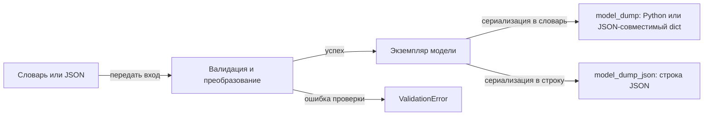

# Pydantic v2

Pydantic проверяет и преобразует данные по аннотациям Python.
Pydantic также сериализует модели и строит JSON Schema.
Используйте страницу как справочник API и рецептов.
Настройки окружения вынесены в пакет `pydantic-settings`.

[Каталог Python](../../README.md) · [FastAPI](../../web/fastapi/README.md)

| Параметр | Значение |
| --- | --- |
| API | Pydantic v2; новые параметры alias показаны для ветки 2.11+ |
| Предпосылки | Типы Python, классы, JSON; синтаксис примеров Python 3.10+ |
| Сверено с документацией | 2026-11-06, Pydantic v2, pydantic-settings и pydantic-extra-types |
| Выполнено | 2026-11-06: 10 Python-блоков скомпилированы, 20 тестов прошли, включая timezone-aware ввод и UTC-сериализацию. Python 3.14.7, Pydantic 2.14.3, pytest 9.2.0; settings 2.16.2 и FastAPI 0.162.0 проверены в интеграциях |

## Навигация

- [Быстрый поиск](#быстрый-поиск)
- [Базовый уровень](#базовый-уровень)
- [Средний уровень](#средний-уровень)
- [Продвинутый уровень](#продвинутый-уровень)
- [Частые ошибки](#частые-ошибки)
- [Источники](#источники)

## Быстрый поиск

| Задача | API | Рецепт |
| --- | --- | --- |
| Проверить словарь/JSON | `model_validate`, `model_validate_json` | [Модели и валидаторы](models.md) |
| Ограничить поле, задать alias | `Field`, `ConfigDict` | [Модели](models.md#модели-валидация-и-json) |
| Проверить несколько полей | `model_validator(mode="after")` | [Товар со скидкой](models.md#модели-валидация-и-json) |
| Сериализовать и вычислить поле | `model_dump`, `model_dump_json`, `computed_field` | [Модели](models.md) |
| Прочитать ORM-атрибуты | `from_attributes=True` | [ORM и конфигурация](models.md#атрибуты-конфигурация-и-типы) |
| Список без обёртки BaseModel | `TypeAdapter(list[Model])` | [Расширенные задачи](advanced.md#generic-typeadapter-и-собственный-тип) |
| Свой тип, generic, динамическая модель | `Annotated`, `Generic`, `create_model` | [Расширенные задачи](advanced.md) |
| Загрузить настройки / query FastAPI | `BaseSettings`, `Query()` | [Интеграции](advanced.md#настройки-приложения) |
| Перенести код v1, измерить скорость | Migration guide, `timeit` | [Миграция и производительность](advanced.md#миграция-и-производительность) |

## Базовый уровень

Установите пакет в отдельное виртуальное окружение: `python -m pip install 'pydantic[email]==2.14.3'`.

| Объявление / операция | Что означает |
| --- | --- |
| `name: str` | Обязательное поле |
| `name: str \| None` | Обязательное поле, допускает `None` |
| `name: str \| None = None` | Можно не передавать |
| `Field(default_factory=list)` | Новый список для экземпляра; Pydantic также копирует нехешируемые defaults |
| `Field(gt=0, le=100)` | Числовые границы; для float при необходимости `allow_inf_nan=False` |
| `model.model_dump()` | Python-значения, например datetime и Decimal |
| `model.model_dump(mode="json")` | Словарь с JSON-совместимыми значениями |
| `model.model_dump_json()` | Строка JSON; параметра `mode` нет |

По умолчанию Pydantic преобразует часть типов.
Например, строка `"42"` может стать `int`.
Для строгой границы используйте `strict=True`.
Проверьте нужные типы.
При невалидном вводе возникает `ValidationError`.
Метод `errors()` описывает место, тип и причину ошибки.
[Полный пример и тесты](models.md).

## Средний уровень

- `field_validator` проверяет или преобразует поле. `model_validator` проверяет согласованность модели. В режиме `before` вход может быть любым объектом. Не предполагайте, что вход всегда имеет тип dict. Не меняйте чужой словарь на месте.
- `alias`, `validation_alias` и `serialization_alias` решают разные задачи. В новых примерах явно заданы `validate_by_name`/`validate_by_alias`. Параметр `by_alias=True` управляет именами при выводе.
- `extra="forbid"` отвергает неизвестные ключи. Значение `ignore` игнорирует неизвестные ключи. Значение `allow` сохраняет неизвестные ключи. Выбирайте границу данных для конкретной модели.
- `validate_assignment=True` проверяет присваивание полю. Вложенные изменения списков сами по себе не перехватываются. `frozen=True` запрещает присваивание полям. Вложенные объекты при этом могут оставаться изменяемыми.
- `SecretStr` маскирует представление. `Field(exclude=True)` исключает поле из сериализации. Эти средства не отменяют обязательность поля. Эти средства не заменяют отдельную публичную модель.

## Продвинутый уровень

[Расширенные рецепты](advanced.md) показывают generic, повторное использование `TypeAdapter`, динамические модели и собственную Core Schema.
Пока отдельному типу не нужен низкоуровневый хук, предпочитайте `Annotated` с ограничениями.

`model_construct()` обходит проверку.
Используйте `model_construct()` только для уже доверенных данных.
Измеряйте ускорение.
Для простых моделей обычная валидация может быть сопоставима по скорости.
Материал не обещает универсального ускорения от `frozen`, `__slots__` или «до 50x».

## Частые ошибки

| Симптом | Причина / действие |
| --- | --- |
| Не передано исключаемое поле | `exclude=True` не задаёт default. Передайте значение либо измените модель |
| Не появился `@property` в JSON | Для включения вычисляемого поля нужен `@computed_field` |
| Ошибка о поле без аннотации | Объявите alias типа на уровне модуля. Для статического атрибута используйте `ClassVar` |
| ORM-объект не принимается | Включите `from_attributes`. Загружайте ORM-отношения отдельно |
| `protected_namespaces` приняли за скрытие секрета | Это защита имён от конфликтов API, не механизм приватности |
| YAML не принимается как JSON | Разберите YAML отдельным парсером. Передайте результат в `model_validate` |

## Источники

- [Модели](https://docs.pydantic.dev/latest/concepts/models/), [поля](https://docs.pydantic.dev/latest/concepts/fields/), [сериализация](https://docs.pydantic.dev/latest/concepts/serialization/).
- [ConfigDict](https://docs.pydantic.dev/latest/api/config/), [миграция](https://docs.pydantic.dev/latest/migration/), [производительность](https://docs.pydantic.dev/latest/concepts/performance/).
