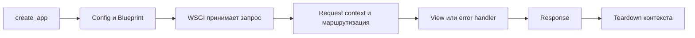

# Flask

Синхронное веб-приложение Python с WSGI-интерфейсом. Flask даёт маршрутизацию,
request/response, шаблоны и контексты; ORM, схема API, аутентификация и миграции выбираются отдельно.

| Параметр | Значение |
| --- | --- |
| Ветка API | Flask 3.1.x |
| Предпосылки | Python, HTTP, изолированное окружение; pytest для проверки |
| Сверено с документацией | 2026-11-06, официальная документация Flask 3.1.x |
| Выполнено | 2026-11-06, Python 3.14.7, Flask 3.1.3, Werkzeug 3.1.9, pytest 9.2.0; test client и SQLite lifecycle в temp-каталоге |

## Навигация

- [Быстрый поиск](#быстрый-поиск)
- [Базовый уровень](#базовый-уровень)
- [Средний уровень](#средний-уровень)
- [Продвинутый уровень](#продвинутый-уровень)
- [Частые ошибки](#частые-ошибки)
- [Источники](#источники)
- [Factory, Blueprint, запрос и ответ](application.md)
- [Тесты HTTP-поведения](testing.md)
- [Конфигурация, БД и развёртывание](configuration-and-deployment.md)

## Быстрый поиск

| Задача | API / команда | Где разобрано |
| --- | --- | --- |
| Создать независимый app | `create_app(test_config=None)` | [Приложение](application.md) |
| Сгруппировать маршруты | `Blueprint`, `register_blueprint` | [Приложение](application.md) |
| Query / JSON / path | `request.args`, `request.get_json()`, `<int:item_id>` | [Приложение](application.md) |
| Вернуть JSON | `jsonify(...)`, tuple `(response, status)` | [Приложение](application.md) |
| Ошибка клиента | `abort(400)` и HTTPException handler | [Приложение](application.md) |
| Проверить без сервера | `app.test_client()` | [Тестирование](testing.md) |
| Ресурс на контекст | `g`, `teardown_appcontext` | [База данных](configuration-and-deployment.md#жизненный-цикл-соединения) |
| Локальная разработка | `flask --app flask_app:create_app run --debug` | [Запуск](application.md#запуск-и-проверка) |
| Production | WSGI server и reverse proxy | [Развёртывание](configuration-and-deployment.md#разработка-и-production) |

## Базовый уровень

### Запустить API и проверить ответ

В отдельном окружении установи `python -m pip install Flask pytest`;
для точного воспроизведения использованы версии из паспорта выше.
Сохрани [flask_app.py](application.md) и [test_flask_app.py](testing.md) в одном каталоге,
запусти `python -m pytest -q test_flask_app.py`. HTTP-клиент тестов не открывает сетевой порт.

Route связывает URL и HTTP-метод с view-функцией. `GET /api/items/1` возвращает JSON;
`POST /api/greet` принимает JSON-объект и отвергает неправильные данные.
Query args приходят строками; собственная валидация остаётся ответственностью приложения.

## Средний уровень

### Разделять создание приложения и обработку запроса

Factory создаёт app и применяет конфигурацию перед регистрацией компонентов.
Blueprint описывает группу маршрутов; он не является отдельным сервером или отдельным app.
`request`, `session`, `g`, `current_app` — контекстные объекты; не сохраняй их в глобальных переменных
и не используй вне подходящего контекста без явного проектирования границы.

[Тесты](testing.md) создают новый app для каждого теста и проверяют HTTP-код, JSON, заголовки,
ошибку входных данных и экранирование шаблона.

## Продвинутый уровень

### Управлять конфигурацией, транзакциями и эксплуатацией

Конфигурацию расширений загружают до `init_app`; соединение БД открывают лениво и закрывают
после контекста. Teardown не должен автоматически коммитить любую транзакцию.
[Пример SQLite](configuration-and-deployment.md#жизненный-цикл-соединения) отделяет явный commit
от освобождения ресурса; для ORM смотри [SQLAlchemy](../../databases/sqlalchemy/README.md).

Встроенный сервер и debugger используются локально. [Production](configuration-and-deployment.md#разработка-и-production)
требует отдельного WSGI-сервера, настройки доверия к proxy, секретов и логирования.
`async def` view во Flask не меняет WSGI-модель на ASGI и не делает фоновые задачи долговечными.

## Частые ошибки

| Симптом | Причина / исправление |
| --- | --- |
| Working outside application/request context | Обращение к proxy вне его контекста; для CLI/тестовой setup использовать `app.app_context()` по назначению |
| 415 вместо JSON | Неподходящий Content-Type; клиенту использовать `json=...` |
| Непонятный 404/405 | Проверить Blueprint prefix, URL и HTTP-метод |
| Сессия не работает | Нужен SECRET_KEY; signed cookie не шифрует содержимое |
| Тест использует Django client | Создать `app.test_client()` именно для Flask app |
| Ошибка БД после запроса | Не переносить соединение/сессию между контекстами и worker-процессами |

## Источники

- [Factory](https://flask.palletsprojects.com/en/stable/patterns/appfactories/), [Blueprint](https://flask.palletsprojects.com/en/stable/blueprints/).
- [Quickstart](https://flask.palletsprojects.com/en/stable/quickstart/), [errors](https://flask.palletsprojects.com/en/stable/errorhandling/), [testing](https://flask.palletsprojects.com/en/stable/testing/).
- [Configuration](https://flask.palletsprojects.com/en/stable/config/), [database lifecycle](https://flask.palletsprojects.com/en/stable/tutorial/database/).
- [Deploying](https://flask.palletsprojects.com/en/stable/deploying/), [async](https://flask.palletsprojects.com/en/stable/async-await/).

[Каталог Python](../../README.md) · [Тестирование pytest](../../testing/pytest/README.md)
