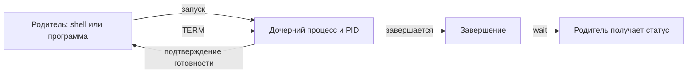

# Права, пользователи и процессы

Уровень: средний. Предпосылки: UID/GID, Bash и Python 3 для полного примера, собственные файлы и процессы.
[К справочнику Linux](README.md).

## Прочитать права

`id` показывает пользователя и группы, `ls -ld path` — метаданные самого каталога/файла.
Обычные mode bits делятся на владельца, группу и остальных (`u`, `g`, `o`).

| Бит | Обычный файл | Каталог |
| --- | --- | --- |
| `r` = 4 | Читать содержимое | Читать список имён |
| `w` = 2 | Менять содержимое | Менять записи каталога, обычно вместе с `x` |
| `x` = 1 | Исполнять при подходящем формате/interpreter | Проходить/искать имена внутри |

`chmod 640 file` даёт владельцу rw, группе r, остальным ничего; `chmod 750 dir` даёт владельцу rwx,
группе rx. Удаление файла в основном определяется правами родительского каталога, а не его собственным `w`.
Учитывай sticky bit, ACL, SELinux/AppArmor, capabilities и mount flags: таблица mode bits не описывает всё.
`umask` убирает разрешения из запрошенного режима новых файлов/каталогов, но не меняет существующие.

Отдельные справочные фрагменты для своих файлов:

```bash
id
umask
ls -ld project project/config.ini
chmod u=rw,go= project/config.ini
chmod u=rwx,go= project
```

Последние две команды меняют доступ; сначала проверь путь и требования других пользователей/процессов.
`chown USER:GROUP path` требует соответствующих привилегий и меняет владельца; рекурсивный chown
с неизвестным корнем способен нарушить систему. Здесь chown/sudo и административные изменения не выполнялись.
Не исправляй ошибку доступа через универсальное `chmod -R 777`.

## Процессы и сигналы

Процесс имеет PID, родительский PPID, пользователя и состояние. `ps` даёт снимок, `top` — интерактивное наблюдение.
В Linux procps фрагменты `ps -ef` и `ps -p PID -o pid,ppid,stat,args` показывают нужный контекст;
PID в справочнике — заглушка, перед сигналом нужно найти настоящий процесс и проверить владельца.

`kill -TERM PID` просит процесс завершиться; обработчик может выполнить очистку.
`kill -KILL PID` нельзя перехватить — ресурсная/прикладная очистка не гарантируется.
Не используй KILL первым шагом. `Ctrl-C` обычно отправляет SIGINT foreground process group;
`Ctrl-Z` останавливает job, `jobs`, `bg`, `fg` управляют jobs текущей интерактивной shell.
`nohup` не является полноценным service manager и не обеспечивает restart/health check.



## Проверить завершение своего дочернего процесса

Полный пример для Bash и Python 3 на GNU/Linux/macOS; Python нужен для явного
подтверждения готовности и управления только своим непосредственным дочерним процессом.
Запуск: `bash process.sh`. Никаких поисков PID по имени, административных команд и временных файлов.

`kill -0` проверяет существование/доступ к PID, но не завершение exec и не готовность программы.
Родитель ждёт сообщение `ready` через pipe. Дочерний Python отправляет его **после** установки
стандартного действия SIGTERM; TERM после этого завершит процесс и до входа в `signal.pause()`.
Пять секунд — предел ожидания события/завершения, а не задержка для «успокоения» гонки.

<!-- example: linux/process.sh -->
```bash
#!/usr/bin/env bash
set -euo pipefail
python3 - <<'PY_CHILD'
import selectors
import signal
import subprocess
import sys

child_code = """
import signal
signal.signal(signal.SIGTERM, signal.SIG_DFL)
print("ready", flush=True)
signal.pause()
"""
child = subprocess.Popen(
    [sys.executable, "-c", child_code], stdout=subprocess.PIPE, text=True
)
try:
    with selectors.DefaultSelector() as selector:
        selector.register(child.stdout, selectors.EVENT_READ)
        if not selector.select(timeout=5):
            raise TimeoutError("child did not report readiness")
    if child.stdout.readline() != "ready\n":
        raise RuntimeError("child exited before readiness")
    child.terminate()
    status = child.wait(timeout=5)
    if status != -signal.SIGTERM:
        raise AssertionError(f"expected SIGTERM, got {status}")
finally:
    if child.poll() is None:
        child.kill()
        child.wait(timeout=5)
    child.stdout.close()
print("process OK")
PY_CHILD
```

Ожидается `process OK`. Здесь проверяется код `-15` у Python Popen: отрицательное значение
обозначает завершение сигналом. Bash `wait` для процесса, завершённого SIGTERM, обычно сообщает
`128 + 15 = 143`; это другой интерфейс статуса, его не нужно сравнивать с Popen.returncode.

В обычном пути отправляется TERM. Только при ошибке до завершения `finally` принудительно
останавливает **собственный** ещё работающий child и вызывает wait; посторонние процессы не затрагиваются.
Этот ребёнок не имеет прикладных данных или файлов, требующих сохранения при таком аварийном завершении.
Родитель не повторяет запуск/сигнал до случайного успеха.

Проверка 2026-11-06: macOS, Bash 3.2.57, CPython 3.14.7; 100 последовательных запусков и
100 запусков с четырьмя параллельными проверками, все с готовностью перед TERM и получением `-15`.
Отдельно проверены отказ готовности и очистка после исключения перед штатным TERM.
Чтение таблицы процессов через ps ограничено средой macOS-проверки;
Linux procps формат вывода и service lifecycle не проверялись запуском.

## Источники

[GNU chmod/umask](https://www.gnu.org/software/coreutils/manual/coreutils.html),
[Bash signals/jobs/wait](https://www.gnu.org/software/bash/manual/bash.html),
[Linux ps](https://man7.org/linux/man-pages/man1/ps.1.html),
[Linux signal overview](https://man7.org/linux/man-pages/man7/signal.7.html),
[Python Popen и returncode](https://docs.python.org/3.14/library/subprocess.html#subprocess.Popen.returncode),
[signal.pause](https://docs.python.org/3.14/library/signal.html#signal.pause),
[ожидание pipe через selectors](https://docs.python.org/3.14/library/selectors.html).
Сверка: 2026-11-06. Административные команды и изменения системной конфигурации не выполнялись.
