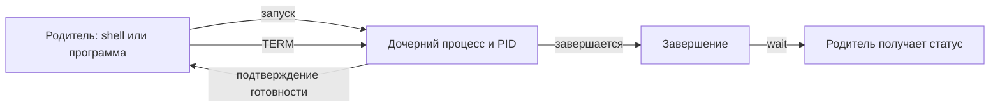

# Права, пользователи и процессы

Откройте страницу, чтобы ограничить доступ к своим файлам или завершить собственный дочерний процесс.
При отказе доступа сначала определите пользователя, путь и существующие ограничения.

| Задача | Приём | Пример |
| --- | --- | --- |
| Разрешить чтение конфигурации только владельцу | `id`, проверка пути, `chmod` | [Права](#прочитать-права) |
| Выбрать способ завершения процесса | Проверить PID и смысл сигнала | [Сигналы](#процессы-и-сигналы) |
| Дождаться завершения своего процесса | Подтверждение готовности, TERM, `wait` | [Полный пример](#проверить-завершение-своего-дочернего-процесса) |

Уровень: средний. Предпосылки: UID/GID, Bash и Python 3 для полного примера, собственные файлы и процессы.
[К справочнику Linux](README.md).

## Прочитать права

**Ситуация:** `project/config.ini` должен читать только владелец; каталог не должен пропускать других пользователей.
Проверьте владельца и путь перед изменением mode bits.

`id` показывает пользователя и группы.
`ls -ld path` показывает метаданные самого каталога или файла.
Обычные mode bits делятся на владельца, группу и остальных (`u`, `g`, `o`).

| Бит | Обычный файл | Каталог |
| --- | --- | --- |
| `r` = 4 | Читать содержимое | Читать список имён |
| `w` = 2 | Менять содержимое | Менять записи каталога, обычно вместе с `x` |
| `x` = 1 | Исполнять при подходящем формате/interpreter | Проходить/искать имена внутри |

`chmod 640 file` даёт владельцу rw, группе r, остальным ничего.
`chmod 750 dir` даёт владельцу rwx, группе rx.
Удаление файла в основном определяют права родительского каталога.
Собственное право `w` файла не определяет возможность удаления.
Учитывайте sticky bit, ACL, SELinux/AppArmor, capabilities и mount flags.
Таблица mode bits не описывает все ограничения доступа.
`umask` убирает разрешения из запрошенного режима новых файлов и каталогов.
`umask` не меняет существующие файлы и каталоги.

Отдельные справочные фрагменты для своих файлов:

```bash
id
umask
ls -ld project project/config.ini
chmod u=rw,go= project/config.ini
chmod u=rwx,go= project
```

**Результат:** файл получает режим `600`, каталог — `700`.
Другие пользователи и процессы без дополнительных привилегий теряют доступ через эти mode bits.
Последние две команды меняют доступ.
Сначала проверьте путь.
Уточните требования других пользователей и процессов.
`chown USER:GROUP path` требует соответствующих привилегий и меняет владельца.
Рекурсивный chown с неизвестным корнем может нарушить систему.
Не исправляйте ошибку доступа через универсальное `chmod -R 777`.

## Процессы и сигналы

**Ситуация:** ваш дочерний процесс готов к работе, но задачу нужно завершить.
Сначала запросите завершение через TERM; затем получите статус через ожидание дочернего процесса.

Процесс имеет PID, родительский PPID, пользователя и состояние.
`ps` даёт снимок процессов.
`top` позволяет наблюдать процессы интерактивно.
В Linux procps фрагменты `ps -ef` и `ps -p PID -o pid,ppid,stat,args` показывают нужный контекст.
PID в справочнике — заглушка.
Перед отправкой сигнала найдите настоящий процесс.
Проверьте владельца процесса.

`kill -TERM PID` просит процесс завершиться.
Обработчик сигнала может выполнить очистку.
Сигнал `kill -KILL PID` нельзя перехватить.
После KILL ресурсная и прикладная очистка не гарантируются.
Не используйте KILL первым шагом.
`Ctrl-C` обычно отправляет SIGINT группе процессов переднего плана.
`Ctrl-Z` останавливает задание.
`jobs`, `bg`, `fg` управляют заданиями текущей интерактивной shell.
`nohup` не является полноценным менеджером служб.
`nohup` не обеспечивает перезапуск и проверку состояния.

Схема показывает взаимодействие родителя и его дочернего процесса при завершении:



**Короткий пример — фрагмент Python из полного сценария; `child` — собственный `subprocess.Popen` после сообщения `ready`:**

```python
child.terminate()
status = child.wait(timeout=5)
```

**Результат:** при стандартном действии SIGTERM `status` равен `-15`.
Если процесс не завершился за пять секунд, `wait` поднимает `TimeoutExpired`; это не означает успешную остановку.
[Полный пример](#проверить-завершение-своего-дочернего-процесса) содержит ожидание готовности и очистку при ошибке.

## Проверить завершение своего дочернего процесса

Полный пример предназначен для Bash и Python 3 на GNU/Linux/macOS.
Python обеспечивает явное подтверждение готовности и управление только собственным непосредственным дочерним процессом.
Запустите `bash process.sh`.
Пример не ищет PID по имени, не выполняет административные команды и не создаёт временные файлы.

`kill -0` проверяет существование PID и доступ к PID.
`kill -0` не проверяет завершение exec или готовность программы.
Родитель ждёт сообщение `ready` через pipe.
Дочерний Python отправляет сообщение **после** установки стандартного действия SIGTERM.
После этой установки TERM завершит процесс даже до входа в `signal.pause()`.
Пять секунд ограничивают ожидание события или завершения.

<!-- example: linux/process.sh -->
```bash
#!/usr/bin/env bash
set -euo pipefail
python3 - <<'PY_CHILD'
import selectors
import signal
import subprocess
import sys

child_code = """
import signal
signal.signal(signal.SIGTERM, signal.SIG_DFL)
print("ready", flush=True)
signal.pause()
"""
child = subprocess.Popen(
    [sys.executable, "-c", child_code], stdout=subprocess.PIPE, text=True
)
try:
    with selectors.DefaultSelector() as selector:
        selector.register(child.stdout, selectors.EVENT_READ)
        if not selector.select(timeout=5):
            raise TimeoutError("child did not report readiness")
    if child.stdout.readline() != "ready\n":
        raise RuntimeError("child exited before readiness")
    child.terminate()
    status = child.wait(timeout=5)
    if status != -signal.SIGTERM:
        raise AssertionError(f"expected SIGTERM, got {status}")
finally:
    if child.poll() is None:
        child.kill()
        child.wait(timeout=5)
    child.stdout.close()
print("process OK")
PY_CHILD
```

Ожидается `process OK`.
Пример проверяет код `-15` у Python Popen.
Отрицательное значение обозначает завершение сигналом.
Для процесса, завершённого SIGTERM, Bash `wait` обычно сообщает `128 + 15 = 143`.
Bash использует другой интерфейс статуса.
Не сравнивайте этот статус с Popen.returncode.

В обычном пути родитель отправляет TERM.
Если до завершения возникла ошибка, `finally` принудительно останавливает **собственный** ещё работающий дочерний процесс.
Затем `finally` вызывает wait.
Посторонние процессы не затрагиваются.
У дочернего процесса нет прикладных данных или файлов, которые требуют сохранения при аварийном завершении.


## Источники

[GNU chmod/umask](https://www.gnu.org/software/coreutils/manual/coreutils.html),
[Bash signals/jobs/wait](https://www.gnu.org/software/bash/manual/bash.html),
[Linux ps](https://man7.org/linux/man-pages/man1/ps.1.html),
[Linux signal overview](https://man7.org/linux/man-pages/man7/signal.7.html),
[Python Popen и returncode](https://docs.python.org/3.14/library/subprocess.html#subprocess.Popen.returncode),
[signal.pause](https://docs.python.org/3.14/library/signal.html#signal.pause),
[ожидание pipe через selectors](https://docs.python.org/3.14/library/selectors.html).
