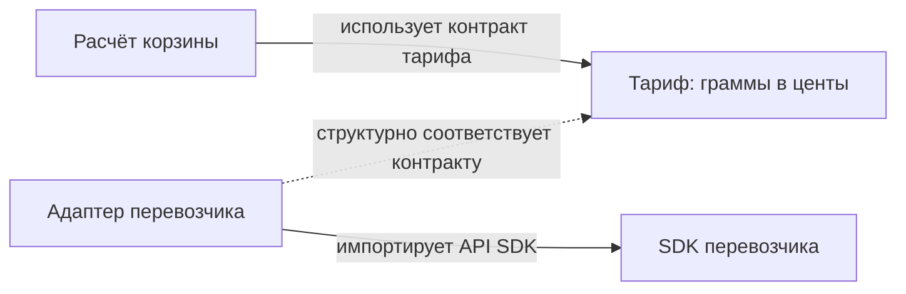

# Принципы проектирования

Принципы помогают выбрать границу и оценить изменение: какое знание объединить,
что скрыть и какое поведение сохранить. Начните с симптома, затем проверьте решение на примере.

## Быстрый поиск

| Наблюдение | Что сделать | Карточка / пример |
| --- | --- | --- |
| Несвязанные задачи меняются в одном модуле | Разделить причины изменений | [Cohesion / coupling](#связность-и-связанность) |
| Можно получить недопустимый остаток | Защитить операции контрактом | [Инвариант](#контракт-и-инвариант), [полный Stock](../../architecture/contracts.md#резерв-остатка) |
| Тест расчёта требует HTTP / БД | Скрыть внешний протокол за нужным правилу API | [Граница зависимости](#инкапсуляция-и-зависимости), [DIP](../../architecture/solid.md#продвинутый-уровень) |
| Правило скопировано / каркас растёт без потребителя | Выделить общее знание / убрать ненужную вариативность | [DRY / KISS / YAGNI](#dry-kiss-и-yagni) |
| Спор о названиях архитектур | Записать сценарий, цену и проверку | [Таблица решения](#делать-компромисс-проверяемым) |
| Нельзя сразу перевести всех клиентов | Добавить совместимый путь и постепенно убрать старый | [Parallel change](#менять-контракт-постепенно) |

[К архитектуре](../../architecture/README.md) · [Базовый](#базовый-уровень) · [Средний](#средний-уровень) · [Продвинутый](#продвинутый-уровень) · [Ошибки](#частые-ошибки) · [Источники](#источники)

**Предпосылки:** функции, модули, состояния и тесты. Концепции сверены с первичными источниками
2026-11-06; версии и выполненные сценарии Python — в [паспорте примеров](../../architecture/contracts.md).
Принципы не задают число классов, слоёв или сервисов; решение оценивают по требованиям и последствиям.

## Базовый уровень

### Связность и связанность

| Понятие | Быстро вспомнить | Пример решения |
| --- | --- | --- |
| **Cohesion — внутренняя связность** | Одна согласованная задача, связанные причины изменений | Расчёт тарифа и его ограничения рядом |
| **Coupling — связанность частей** | Знание чужих данных, порядка вызовов, ошибок и времени ответа | Перевод ответа SDK скрыт внутри адаптера |

**Проблема:** новый JSON-формат перевозчика заставляет менять правило выбора тарифа.
**Изменение:** отдельно переводить внешний ответ, отдельно выбирать тариф.

Схема **зависимостей кода**, вариант после разделения; стрелки подписывают используемый API:



**Проверка:** поменять JSON/SDK внутри адаптера; результаты расчёта и его зависимости сохраняются.
Для небольшого модуля достаточно функций рядом. Число файлов само по себе не снижает связанность:
общая изменяемая структура может связать их сильнее явного вызова.

### Контракт и инвариант

| Что фиксировать | Контракт `Stock.reserve(quantity)` |
| --- | --- |
| Вход | Целое положительное количество; `bool` отвергается |
| Успех | Остаток уменьшен на количество |
| Ошибки | `ValueError` для неверного входа; `OutOfStock` для нехватки |
| Побочный эффект при отказе | Остаток не изменился |
| Инвариант состояния | Остаток всегда целый и неотрицательный |

Фрагмент вызова из [полного `invariants.py`](../../architecture/contracts.md#резерв-остатка), после определения `Stock`:

```python
stock = Stock(3)
stock.reserve(2)
assert stock.available == 1
```

**Результат:** остаток `1`; попытка зарезервировать ещё `2` даст `OutOfStock` и сохранит `1`.
Пример однопоточный. Для конкурентного резерва в БД нужны отдельные транзакционные гарантии.

## Средний уровень

### Инкапсуляция и зависимости

| Скрыть | Оставить потребителю | Как проверить границу |
| --- | --- | --- |
| Формат SDK / HTTP-ответа | Значение в согласованных единицах и понятные ошибки | Один контрактный тест для адаптеров |
| Изменяемые внутренние данные | Операцию, копию или неизменяемое представление | Через публичный API нельзя обойти инвариант |
| Способ хранения цен | `price(sku)` с оговорённой свежестью | Расчёт работает с локальным источником без ORM |

Функция-параметр, модуль или небольшой `Protocol` могут быть достаточной границей.
[DIP и DI](../../architecture/solid.md#продвинутый-уровень) показывают направление зависимости и способ передачи;
[Ports & Adapters](../../architecture/patterns/architecture-patterns.md#организация-кода) — возможное размещение ролей.

### DRY, KISS и YAGNI

| Принцип | Сигнал → действие | Необходимая оговорка |
| --- | --- | --- |
| **DRY** | Одно бизнес-правило скопировано → одно авторитетное определение | Похожие строки могут выражать независимые правила |
| **KISS** | Скрытые режимы мешают понять результат → явное простое решение под контракт | Меньше строк не всегда проще |
| **YAGNI** | Вариант не нужен ни одному текущему потребителю → отложить | Тесты и границы текущей задачи остаются необходимыми |

**До:** два отчёта случайно имеют одинаковые столбцы; общий helper получает всё больше флагов.
**После:** независимые форматы остаются рядом с отчётами; общее правило выделяется, когда оно действительно общее.
**Проверка:** изменение одного формата не меняет другой; при общей норме проверены оба потребителя.

## Продвинутый уровень

### Делать компромисс проверяемым

Шаблон **записи решения**, не конфигурация и не готовый план внедрения:

| Поле | Пример конкретной записи |
| --- | --- |
| Проблема | Новый перевозчик меняет расчёт корзины и HTTP-ошибки в одном модуле |
| Ограничение | Тест цены работает без сети; существующие результаты сохраняются |
| Пробное изменение | Перевод ответа — в адаптере; выбор тарифа — отдельная функция |
| Проверка | Контрактные тесты двух адаптеров; расчёт не импортирует HTTP-модуль |
| Цена | Нужно сопровождать контракт ошибок и место сборки объектов |
| Пересмотр | Адаптеры всё равно требуют деталей SDK внутри правила |

- [ ] Названо конкретное изменение и приоритетное свойство.
- [ ] Проверяются успешный результат, отказ и побочные эффекты.
- [ ] Указано, что станет дороже и когда решение пересмотреть.

Изоляция данных, доступность, задержка и согласованность могут конфликтовать.
Ни число слоёв, ни процент покрытия сами по себе не доказывают полезную границу.

### Менять контракт постепенно

Для опубликованного интерфейса с независимо обновляемыми клиентами:


Это **порядок этапов изменения**, а не вызовы или зависимости исходников.
Период совместимости имеет стоимость: заранее определите способ учёта старых обращений.
Для внутренней локальной функции одновременное изменение всех вызовов может быть проще.
[Источник и подробности parallel change](https://martinfowler.com/bliki/ParallelChange.html).

## Частые ошибки

| Ошибка | Более полезная проверка |
| --- | --- |
| «DRY требует убрать любое совпадение» | Это одно знание или временно похожий текст? |
| «Абстракция нужна на будущее» | Есть ли текущее изменение и потребитель? |
| «Инкапсуляция — private-поля» | Сохраняют ли публичные операции инварианты? |
| «Микросервисы исправят связанность» | Можно ли менять/выпускать части независимо? |
| «Тест примера доказал архитектуру» | Какие именно входы, состояния и отказы он проверил? |

## Источники

- [Robert C. Martin: SRP](https://blog.cleancoder.com/uncle-bob/2014/05/08/SingleReponsibilityPrinciple.html) — причины изменений.
- [Alistair Cockburn: Ports & Adapters](https://alistair.cockburn.us/hexagonal-architecture/) — изоляция приложения.
- [Martin Fowler: Yagni](https://martinfowler.com/bliki/Yagni.html), [Danilo Sato: Parallel Change](https://martinfowler.com/bliki/ParallelChange.html).
