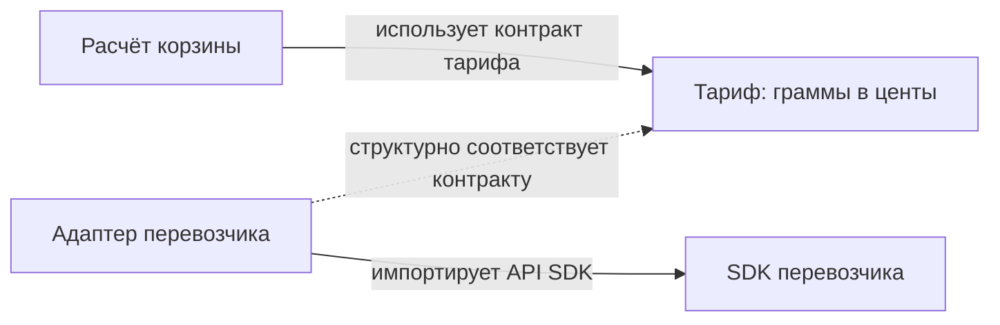

# Принципы проектирования

Принципы помогают выбрать границу модуля и понять последствия изменения.
Решите, какое знание объединить, что скрыть и какое поведение сохранить.
Начните с наблюдаемой проблемы и проверьте решение на примере.

## Быстрый поиск

| Наблюдение | Что сделать | Карточка / пример |
| --- | --- | --- |
| Несвязанные задачи меняются в одном модуле | Разделите причины изменений | [Cohesion / coupling](#связность-и-связанность) |
| Можно получить недопустимый остаток | Защитите операции контрактом | [Инвариант](#контракт-и-инвариант), [полный Stock](../../architecture/contracts.md#резерв-остатка) |
| Тест расчёта требует HTTP / БД | Скройте внешний протокол за API, который нужен правилу | [Граница зависимости](#инкапсуляция-и-зависимости), [DIP](../../architecture/solid.md#продвинутый-уровень) |
| Правило скопировано / каркас растёт без потребителя | Выделите общее знание, уберите ненужную вариативность | [DRY / KISS / YAGNI](#dry-kiss-и-yagni) |
| Спор о названиях архитектур | Запишите сценарий, цену и проверку | [Таблица решения](#делать-компромисс-проверяемым) |
| Нельзя сразу перевести всех клиентов | Добавьте совместимый путь и постепенно удалите старый | [Parallel change](#менять-контракт-постепенно) |

[К архитектуре](../../architecture/README.md) · [Базовый](#базовый-уровень) · [Средний](#средний-уровень) · [Продвинутый](#продвинутый-уровень) · [Ошибки](#частые-ошибки) · [Источники](#источники)

**Предпосылки:** функции, модули, состояния и тесты.
Концепции сверены с первичными источниками 2026-11-06; версии Python и выполненные сценарии — в [паспорте примеров](../../architecture/contracts.md).
Принципы не задают число классов, слоёв или сервисов: оценивайте решение по требованиям и последствиям.

## Базовый уровень

### Связность и связанность

| Понятие | Быстро вспомнить | Пример решения |
| --- | --- | --- |
| **Cohesion — внутренняя связность** | Одна согласованная задача и связанные причины изменений | Держите расчёт тарифа рядом с его ограничениями |
| **Coupling — связанность частей** | Знание чужих данных, порядка вызовов, ошибок и времени ответа | Скройте перевод ответа SDK внутри адаптера |

**Проблема:** новый JSON-формат перевозчика требует менять правило выбора тарифа.
**Изменение:** отделите перевод внешнего ответа от выбора тарифа.

Схема показывает **зависимости кода** после разделения; подписи стрелок указывают используемый API.



**Проверка:** измените JSON/SDK внутри адаптера и проверьте, что результаты расчёта и его зависимости сохранились.
В небольшом модуле функции можно оставить рядом.
Само увеличение числа файлов не снижает связанность: общая изменяемая структура может связать части сильнее, чем явный вызов.

### Контракт и инвариант

| Что фиксировать | Контракт `Stock.reserve(quantity)` |
| --- | --- |
| Вход | Целое положительное количество; `bool` недопустим |
| Успех | Остаток уменьшается на указанное количество |
| Ошибки | `ValueError` для неверного входа, `OutOfStock` для нехватки |
| Побочный эффект при отказе | Остаток не меняется |
| Инвариант состояния | Остаток всегда целый и неотрицательный |

Фрагмент вызова из [полного `invariants.py`](../../architecture/contracts.md#резерв-остатка); добавьте его после определения `Stock`.

```python
stock = Stock(3)
stock.reserve(2)
assert stock.available == 1
```

**Результат:** остаток равен `1`.
Попытка зарезервировать ещё `2` вызовет `OutOfStock`, а остаток останется равным `1`.
Пример выполняется в одном потоке; для конкурентного резерва в БД нужны отдельные транзакционные гарантии.

## Средний уровень

### Инкапсуляция и зависимости

| Скрыть | Оставить потребителю | Как проверить границу |
| --- | --- | --- |
| Формат SDK / HTTP-ответа | Значение в согласованных единицах и понятные ошибки | Один контрактный тест для адаптеров |
| Изменяемые внутренние данные | Операцию, копию или неизменяемое представление | Проверка, что публичный API сохраняет инвариант |
| Способ хранения цен | `price(sku)` с оговорённой свежестью | Расчёт с локальным источником без ORM |

Функция-параметр, модуль или небольшой `Protocol` могут задать достаточную границу.
[DIP и DI](../../architecture/solid.md#продвинутый-уровень) показывают направление зависимости и способ передачи,
а [Ports & Adapters](../../architecture/patterns/architecture-patterns.md#организация-кода) — возможное размещение ролей.

### DRY, KISS и YAGNI

| Принцип | Сигнал → действие | Необходимая оговорка |
| --- | --- | --- |
| **DRY** | Если одно бизнес-правило скопировано, оставьте одно авторитетное определение | Похожие строки могут выражать независимые правила |
| **KISS** | Если скрытые режимы мешают понять результат, выберите явное простое решение под контракт | Меньше строк не всегда означает более простой код |
| **YAGNI** | Отложите вариант, который пока не нужен потребителям | Сохраните тесты и границы текущей задачи |

**До:** два отчёта случайно имеют одинаковые столбцы, а общий helper получает всё больше флагов.
**После:** оставьте независимые форматы рядом с отчётами; выделите правило, когда оно действительно общее.
**Проверка:** изменение одного формата не затрагивает другой; если норма общая, проверьте обоих потребителей.

## Продвинутый уровень

### Делать компромисс проверяемым

Таблица содержит образец **записи решения**, а не конфигурацию или готовый план внедрения.

| Поле | Пример конкретной записи |
| --- | --- |
| Проблема | Новый перевозчик требует менять расчёт корзины и HTTP-ошибки в одном модуле |
| Ограничение | Тест цены работает без сети; существующие результаты сохраняются |
| Пробное изменение | Перевод ответа — в адаптере, выбор тарифа — в отдельной функции |
| Проверка | Контрактные тесты двух адаптеров проходят; расчёт не импортирует HTTP-модуль |
| Цена | Нужно сопровождать контракт ошибок и место сборки объектов |
| Пересмотр | Адаптеры всё равно требуют деталей SDK внутри правила |

- [ ] Укажите конкретное изменение и приоритетное свойство.
- [ ] Проверьте успешный результат, отказ и побочные эффекты.
- [ ] Укажите, что станет дороже и когда пересмотреть решение.

Изоляция данных, доступность, задержка и согласованность могут конфликтовать.
Ни число слоёв, ни процент покрытия сами по себе не доказывают полезную границу.

### Менять контракт постепенно

Для опубликованного интерфейса с независимо обновляемыми клиентами рассмотрите поэтапное изменение.


Схема показывает **порядок этапов изменения**, а не вызовы или зависимости исходников.
Период совместимости имеет стоимость, поэтому заранее определите способ учёта старых обращений.
Для внутренней локальной функции одновременное изменение всех вызовов может быть проще.
[Источник и подробности parallel change](https://martinfowler.com/bliki/ParallelChange.html).

## Частые ошибки

| Ошибка | Более полезная проверка |
| --- | --- |
| «DRY требует убрать любое совпадение» | Это одно знание или только похожий текст? |
| «Абстракция нужна на будущее» | Есть ли текущее изменение и потребитель? |
| «Инкапсуляция — private-поля» | Сохраняют ли публичные операции инварианты? |
| «Микросервисы исправят связанность» | Можно ли менять и выпускать части независимо? |
| «Тест примера доказал архитектуру» | Какие входы, состояния и отказы проверил тест? |

## Источники

- [Robert C. Martin: SRP](https://blog.cleancoder.com/uncle-bob/2014/05/08/SingleReponsibilityPrinciple.html) — причины изменений.
- [Alistair Cockburn: Ports & Adapters](https://alistair.cockburn.us/hexagonal-architecture/) — изоляция приложения.
- [Martin Fowler: Yagni](https://martinfowler.com/bliki/Yagni.html), [Danilo Sato: Parallel Change](https://martinfowler.com/bliki/ParallelChange.html).
