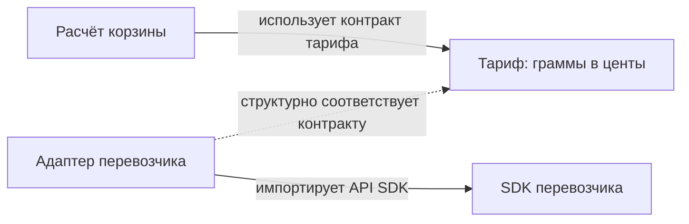

# Принципы проектирования

Используйте принципы, чтобы выбрать границу модуля и оценить изменение.
Определите, какое знание объединить, что скрыть и какое поведение сохранить.
Сначала найдите наблюдаемую проблему. Затем проверьте решение на примере.

## Быстрый поиск

| Наблюдение | Что сделать | Карточка / пример |
| --- | --- | --- |
| Несвязанные задачи меняются в одном модуле | Разделите причины изменений | [Cohesion / coupling](#связность-и-связанность) |
| Можно получить недопустимый остаток | Защитите операции контрактом | [Инвариант](#контракт-и-инвариант), [полный Stock](../../architecture/contracts.md#резерв-остатка) |
| Тест расчёта требует HTTP / БД | Скройте внешний протокол за API, который нужен правилу | [Граница зависимости](#инкапсуляция-и-зависимости), [DIP](../../architecture/solid.md#продвинутый-уровень) |
| Правило скопировано / каркас растёт без потребителя | Выделите общее знание. Уберите ненужную вариативность | [DRY / KISS / YAGNI](#dry-kiss-и-yagni) |
| Спор о названиях архитектур | Запишите сценарий, цену и проверку | [Таблица решения](#делать-компромисс-проверяемым) |
| Нельзя сразу перевести всех клиентов | Добавьте совместимый путь. Затем постепенно удалите старый путь | [Parallel change](#менять-контракт-постепенно) |

[К архитектуре](../../architecture/README.md) · [Базовый](#базовый-уровень) · [Средний](#средний-уровень) · [Продвинутый](#продвинутый-уровень) · [Ошибки](#частые-ошибки) · [Источники](#источники)

**Предпосылки:** функции, модули, состояния и тесты.
Концепции сверены с первичными источниками 2026-11-06.
Версии Python и выполненные сценарии указаны в [паспорте примеров](../../architecture/contracts.md).
Принципы не задают число классов, слоёв или сервисов.
Оценивайте решение по требованиям и последствиям.

## Базовый уровень

### Связность и связанность

| Понятие | Быстро вспомнить | Пример решения |
| --- | --- | --- |
| **Cohesion — внутренняя связность** | Модуль решает одну согласованную задачу. Код меняется по связанным причинам | Держите расчёт тарифа рядом с его ограничениями |
| **Coupling — связанность частей** | Одна часть знает чужие данные, порядок вызовов, ошибки или время ответа | Скройте перевод ответа SDK внутри адаптера |

**Проблема:** новый JSON-формат перевозчика требует изменить правило выбора тарифа.
**Изменение:** отделите перевод внешнего ответа от выбора тарифа.

Схема показывает **зависимости кода** после разделения.
Подписи стрелок указывают используемый API.



**Проверка:** измените JSON/SDK внутри адаптера.
Проверьте, что результаты расчёта сохранились.
Проверьте, что зависимости расчёта сохранились.

В небольшом модуле функции можно оставить рядом.
Само увеличение числа файлов не снижает связанность.
Общая изменяемая структура может связать части сильнее, чем явный вызов.

### Контракт и инвариант

| Что фиксировать | Контракт `Stock.reserve(quantity)` |
| --- | --- |
| Вход | Целое положительное количество. `bool` недопустим |
| Успех | Операция уменьшает остаток на указанное количество |
| Ошибки | `ValueError` для неверного входа. `OutOfStock` для нехватки |
| Побочный эффект при отказе | Операция сохраняет остаток |
| Инвариант состояния | Остаток всегда целый и неотрицательный |

Это фрагмент вызова из [полного `invariants.py`](../../architecture/contracts.md#резерв-остатка).
Используйте фрагмент после определения `Stock`.

```python
stock = Stock(3)
stock.reserve(2)
assert stock.available == 1
```

**Результат:** остаток равен `1`.
Если зарезервировать ещё `2`, операция вызовет `OutOfStock`.
Остаток останется равным `1`.

Пример выполняется в одном потоке.
Для конкурентного резерва в БД нужны отдельные транзакционные гарантии.

## Средний уровень

### Инкапсуляция и зависимости

| Скрыть | Оставить потребителю | Как проверить границу |
| --- | --- | --- |
| Формат SDK / HTTP-ответа | Значение в согласованных единицах и понятные ошибки | Примените один контрактный тест к адаптерам |
| Изменяемые внутренние данные | Операцию, копию или неизменяемое представление | Проверьте, что публичный API сохраняет инвариант |
| Способ хранения цен | `price(sku)` с оговорённой свежестью | Выполните расчёт с локальным источником без ORM |

Функция-параметр, модуль или небольшой `Protocol` могут задать достаточную границу.
[DIP и DI](../../architecture/solid.md#продвинутый-уровень) показывают направление зависимости и способ передачи.
[Ports & Adapters](../../architecture/patterns/architecture-patterns.md#организация-кода) показывает возможное размещение ролей.

### DRY, KISS и YAGNI

| Принцип | Сигнал → действие | Необходимая оговорка |
| --- | --- | --- |
| **DRY** | Если одно бизнес-правило скопировано, оставьте одно авторитетное определение | Похожие строки могут выражать независимые правила |
| **KISS** | Если скрытые режимы мешают понять результат, выберите явное простое решение под контракт | Уменьшение числа строк не всегда упрощает код |
| **YAGNI** | Если вариант не нужен текущим потребителям, отложите вариант | Сохраните тесты и границы, необходимые для текущей задачи |

**До:** два отчёта случайно имеют одинаковые столбцы.
Общий helper получает всё больше флагов.
**После:** оставьте независимые форматы рядом с отчётами.
Если правило действительно общее, выделите правило.
**Проверка:** измените один формат.
Проверьте, что второй формат сохранился.
Если норма общая, проверьте обоих потребителей.

## Продвинутый уровень

### Делать компромисс проверяемым

Таблица содержит образец **записи решения**.
Таблица не задаёт конфигурацию или готовый план внедрения.

| Поле | Пример конкретной записи |
| --- | --- |
| Проблема | Новый перевозчик требует изменить расчёт корзины и HTTP-ошибки в одном модуле |
| Ограничение | Тест цены работает без сети. Существующие результаты сохраняются |
| Пробное изменение | Перевод ответа находится в адаптере. Выбор тарифа находится в отдельной функции |
| Проверка | Контрактные тесты двух адаптеров проходят. Расчёт не импортирует HTTP-модуль |
| Цена | Нужно сопровождать контракт ошибок и место сборки объектов |
| Пересмотр | Адаптеры всё равно требуют деталей SDK внутри правила |

- [ ] Укажите конкретное изменение.
- [ ] Укажите приоритетное свойство.
- [ ] Проверьте успешный результат.
- [ ] Проверьте отказ и побочные эффекты.
- [ ] Укажите, что станет дороже.
- [ ] Укажите, когда пересмотреть решение.

Изоляция данных, доступность, задержка и согласованность могут конфликтовать.
Число слоёв само по себе не доказывает полезную границу.
Процент покрытия сам по себе не доказывает полезную границу.

### Менять контракт постепенно

Рассмотрите поэтапное изменение для опубликованного интерфейса с независимо обновляемыми клиентами.


Схема показывает **порядок этапов изменения**.
Схема не показывает вызовы или зависимости исходников.
Период совместимости имеет стоимость.
Заранее определите способ учёта старых обращений.
Для внутренней локальной функции одновременное изменение всех вызовов может быть проще.
[Источник и подробности parallel change](https://martinfowler.com/bliki/ParallelChange.html).

## Частые ошибки

| Ошибка | Более полезная проверка |
| --- | --- |
| «DRY требует убрать любое совпадение» | Определите, выражает ли код одно знание или только похожий текст |
| «Абстракция нужна на будущее» | Укажите текущее изменение и потребителя |
| «Инкапсуляция — private-поля» | Проверьте, сохраняют ли публичные операции инварианты |
| «Микросервисы исправят связанность» | Проверьте, можно ли менять и выпускать части независимо |
| «Тест примера доказал архитектуру» | Укажите входы, состояния и отказы, которые проверил тест |

## Источники

- [Robert C. Martin: SRP](https://blog.cleancoder.com/uncle-bob/2014/05/08/SingleReponsibilityPrinciple.html) — причины изменений.
- [Alistair Cockburn: Ports & Adapters](https://alistair.cockburn.us/hexagonal-architecture/) — изоляция приложения.
- [Martin Fowler: Yagni](https://martinfowler.com/bliki/Yagni.html), [Danilo Sato: Parallel Change](https://martinfowler.com/bliki/ParallelChange.html).
